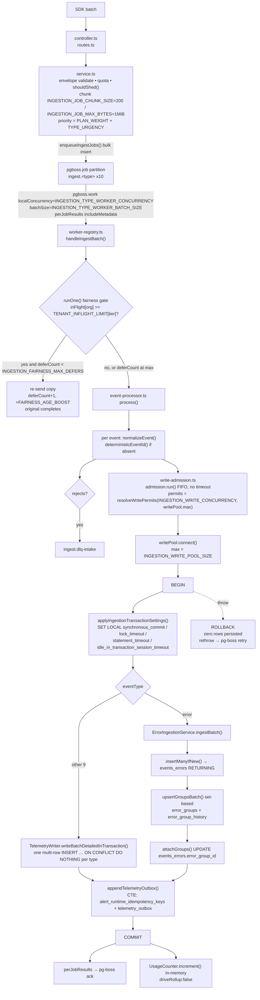
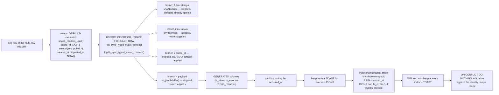
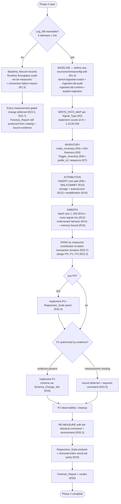
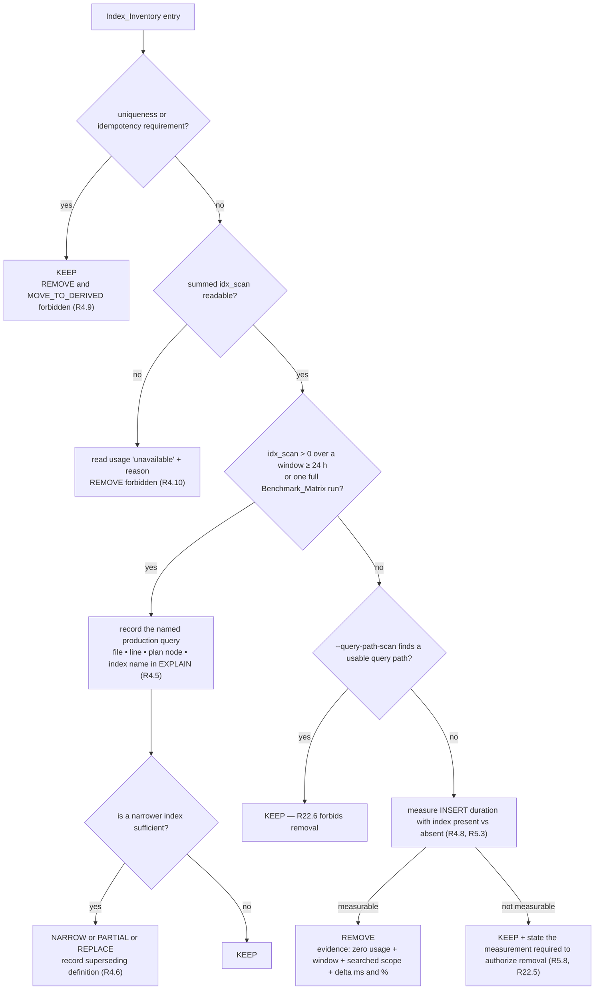
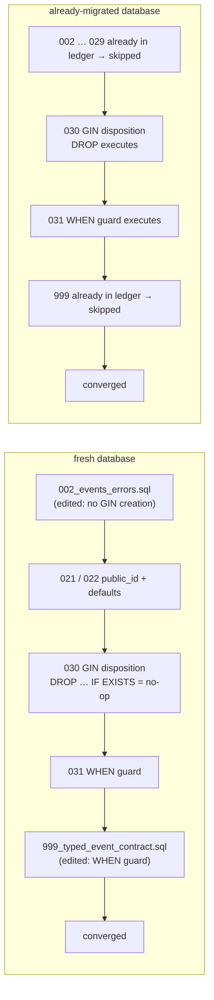

# Design Document


## Overview

Phase 2 is a **measurement-gated** change program, not a redesign. The deliverable is two things at
once: a forensic record (`docs/ingestion-write-path-optimization.md`) that explains where PostgreSQL
write time actually goes, and a bounded set of changes whose value is proved by a before/after
measurement taken with the same command in the same environment.

The design is shaped by one hard rule from Requirement 17.4 and Requirement 22.1: **no database
object is touched before its evidence exists, and no number is reported that a command did not
produce.** Where a measurement cannot be executed, the report states the exact sentence
`Runtime throughput could not be measured.` and the corresponding change is deferred
(Requirement 22.5, Requirement 22.7).

### What the investigation of the current code already establishes

These are code-reading findings, not measurements. Every one of them is a hypothesis that the
forensics phase must confirm or falsify against a live database; several already contradict the
assumptions in `planning/ginindexing.md`, which is exactly why Requirement 9.4 and Requirement 4.11
demand that solved problems be recorded as falsified rather than re-implemented.

| # | Finding (from source) | Where | Consequence for this design |
|---|---|---|---|
| F1 | The per-batch SQL statement count is already **independent of N** on every non-error signal: `BEGIN`, one `SET LOCAL` batch, one multi-row `INSERT` per event type, one optional outbox CTE, `COMMIT`. | `event-processor.ts` `process()`, `telemetry-writer.ts` `writeBatchDetailedUsing()` | Requirement 2.4 closed form is a constant. Requirement 21.3 is a regression guard, not a remediation. |
| F2 | `ErrorGroupRepository.upsertGroupsBatch` is already set-based: a lock probe, a bulk `INSERT … ON CONFLICT`, an optional raced re-probe, one `UPDATE … FROM (VALUES …)`, a final `SELECT`, and history/outbox inserts. Statement count is bounded at ≈14 regardless of N. | `error-group.repository.ts` L96–L420 | The `Q(N) = 3N + 6` hypothesis is expected to be **falsified** for the normal path (Requirement 9.4). Measurement decides, not this document. |
| F3 | The **only** surviving O(N) database path in error ingestion is the `BULK_ERROR_GROUP_MERGED_GROUP_FALLBACK_REQUIRED` catch block, which resolves groups one event at a time at ≈`3N` statements. It is already instrumented with a counter and a warning log. | `error-ingestion.service.ts` L180–L215 | Requirement 9.2 classification must be measured **with and without a merged group in the batch**, because the two paths have different growth characteristics. |
| F4 | Every branch of `logdb_sync_typed_event_contract` is already **skipped** on the writer path — the writer supplies `occurred_at`, `metadata` with `environment`, and `payload`; `created_at`/`ingested_at` carry `DEFAULT NOW()`; and `public_id` is filled by its column `DEFAULT` **before** the `BEFORE` trigger runs. | `999_typed_event_contract.sql`, `021_public_ids.sql`, `telemetry-writer.ts` | The residual cost is the **plpgsql invocation itself**, once per row per table, including on the `attachGroups` `UPDATE`. The narrowing design is a trigger `WHEN` guard (§6.4), not a branch deletion. |
| F5 | The `public_id` trigger branch is **load-bearing** for exactly two shapes: `public_id` supplied as `NULL` and supplied as `''`. A column `DEFAULT` does not fire for an explicit `NULL`, and the column is `NOT NULL`, so removing the branch converts those inserts into constraint violations. | `021_public_ids.sql` vs `999_typed_event_contract.sql` | Requirement 7.5 / 7.6 / 6.5 forbid removing it. The design keeps it and proves all three shapes by property test. |
| F6 | Ten GIN indexes remain on the ingest path: six on `events_errors` (`context`, `tags`, `extra`, `metadata`, `payload`, `ai_response`) and four on `events_metrics` (`attributes`, `metadata`, `payload`, `ai_response`). `events_requests`, `events_spans` and `events_logs` were already stripped by `025`/`029`. `events_traces`, `events_messages`, `events_profiles`, `events_replays` and `events_cron_checkins` carry **no** GIN index. | `002_events_errors.sql` L244–L262, `004_events_metrics.sql` L128–L136 | These ten are the entire scope of Requirement 5. `events_errors.payload` receives the full normalized SDK event, so it is the largest tokenization cost on the path. |
| F7 | Error ingestion writes each `events_errors` row **twice**: once by `insertManyIfNew`, then again by `attachGroups`, which `UPDATE`s `error_group_id`. The `UPDATE` re-fires the row trigger and produces a second heap tuple version plus index maintenance. | `error.repository.ts` L182–L205, `error-ingestion.service.ts` L217–L222 | A named P1 write-amplification candidate under Requirement 16.6, gated on the Requirement 8.2 attribution. |
| F8 | `INGESTION_GENERAL_CONCURRENCY`, `INGESTION_GENERAL_BATCH_SIZE`, `INGESTION_SPECIALIZED_CONCURRENCY` and `INGESTION_SPECIALIZED_BATCH_SIZE` are declared in `src/config/env.ts` but **consumed nowhere**. The live worker tier is governed by `INGESTION_TYPE_WORKER_CONCURRENCY` (default 2) and `INGESTION_TYPE_WORKER_BATCH_SIZE` (default 4), and batch size is set at the gateway by `INGESTION_JOB_CHUNK_SIZE` (default 200). | `worker-registry.ts` `start()`, `service.ts` | Requirements 11.4 and 13.5 name inert knobs. §7.4 and §7.6 define the honest mapping and the wiring decision. |
| F9 | `scripts/audit-ingestion-db-schema.ts` reads table/index/constraint/trigger/partition **definitions** but no usage or bloat statistics: no `idx_scan`, no index size, no dead/live tuples, no autovacuum timestamps, no TOAST size, no `stats_reset`. Its `defaultTables` list also omits `error_group_history` and does not name the `events_errors_idempotency` guard index's owning set. | `audit-ingestion-db-schema.ts` L94–L440 | Requirements 4.2, 4.3, 12.1, 12.2 cannot be satisfied without the extension in §1.3. |
| F10 | `pg_stat_statements` is referenced nowhere in the repository. `scripts/explain-ingestion-writes.ts` already captures `EXPLAIN (ANALYZE, BUFFERS, WAL, FORMAT JSON)` per writer statement inside a savepoint. `EventProcessor` already counts client round trips per batch via `instrumentClientQueries`. | `explain-ingestion-writes.ts`, `event-processor.ts` L96–L140 | The statement-count design (§2) uses the in-process counter as the authoritative source and `pg_stat_statements` as cross-validation, with an explicit absence path. |
| F11 | `999_typed_event_contract.sql` sorts **last** inside `03_observability_v2` and re-creates both the trigger function and the trigger. A new `030_*.sql` would be overwritten by it on a fresh database. | `src/shared/logdb/migrations.ts` `findLogDbMigrationFiles()` (sorts by relative path) | `999_typed_event_contract.sql` is the `Base_Schema_File` for the trigger and **must** be edited in lockstep with the new migration (§8.3). |
| F12 | The one existing `.down.sql` in the tree (`07_outbox/002_…down.sql`) does **not** delete its `logdb_migrations` ledger row. | `07_outbox/002_telemetry_outbox_idempotency.down.sql` | Requirement 18.5 introduces a new convention; §8.4 specifies it explicitly rather than copying the existing file. |

### Design principles

1. **Extend, never fork, the harnesses.** Six measurement scripts already exist and are wired into
   `package.json`. Every measurement in Requirements 1–17 is produced by extending one of them. No
   new harness is introduced except the index-cost measurement (§4.3), which needs DDL privileges
   and therefore must be separately gated.
2. **The absence of a measurement is a first-class result.** Every collector emits either a value
   with `{command, environment, timestampUtc, repetitions}` or the string
   `Runtime throughput could not be measured.` plus a reason. `scripts/validate-ingestion-evidence-bundle.ts`
   is extended to fail the bundle when a third state appears (Requirement 17.4, Requirement 17.7).
3. **Remediation is conditional on its own evidence.** Every change in §6 and §7 is written as
   `IF measurement M shows X THEN change C`, mirroring the conditional acceptance criteria. The
   task list will carry the measurement task as a prerequisite of the change task.
4. **Phase 1 protections are invariants, not context.** The ten `Phase_1_Protections` items get a
   `PRESERVED | MODIFIED | REMOVED` status each (Requirement 20.5) and three of them
   (write-admission FIFO, release-on-throw, permit derivation) get property tests (§9).
5. **No new runtime surface.** PostgreSQL and pg-boss only; no process entry added to
   `ecosystem.config.cjs`; `synchronous_commit` stays `on` (Requirement 10.3, Requirement 21.2).

---

## Architecture

### The measured write path



Per-row database work on the innermost `INSERT` (the layer Requirement 2.3 and Requirement 8.2
target):



### Forensics-then-remediation control flow



### Component map — what is extended versus created

| Component | Path | Change | Serves |
|---|---|---|---|
| Baseline / batch-size / workload harness | `scripts/bench-ingestion-worker.ts` | extend: time-boxed windows, repetitions, WAL LSN delta, per-signal offered-rate mix, sustained mode, statement counter | R1, R3, R10, R11, R13, R14, R15, R16, R17 |
| Matrix driver | `scripts/run-ingestion-benchmark-matrix.ts` | extend: `phase2` preset, workload-class labels, repetition aggregation | R11.1, R17.1 |
| Catalog audit | `scripts/audit-ingestion-db-schema.ts` | extend: index size + `idx_scan` + `stats_reset`, dead/live tuples, autovacuum timestamps, TOAST size, per-table `reloptions`, per-partition rollup, `error_group_history` added to `defaultTables`, `--query-path-scan` | R4, R5.1, R6.1, R12 |
| Runtime diagnostics | `scripts/diagnose-ingestion-db-runtime.ts` | extend: 1 Hz sampling loop with `--duration-seconds`, pool/checkout/admission/queue-depth series, `pg_stat_statements` section with absence recording | R3.1, R8.3, R9.1 |
| Plan capture | `scripts/explain-ingestion-writes.ts` | extend: per-statement WAL extraction into a flat table, environment allowlist assertion | R8.3–R8.6 |
| Evidence gate | `scripts/validate-ingestion-evidence-bundle.ts` | extend: provenance completeness, `Unmeasured_Declaration` exact-string check, GIN/trigger disposition coverage | R17.4, R17.6, R20.9 |
| Index cost measurement | `scripts/measure-ingestion-index-cost.ts` | **new** — the only DDL-executing harness, environment-allowlisted | R4.8, R5.3, R22.1 |
| Write path | `src/modules/ingestion/**`, `src/modules/errors/**` | conditional, evidence-gated | R9, R16 |
| Schema | `database/migrations/logdb/**` | new numbered migrations + `.down.sql` + `Base_Schema_File` edits | R18 |
| Report | `docs/ingestion-write-path-optimization.md` | **new** | R20 |


---

## Components and Interfaces

### 1. Forensics methodology and instrumentation

#### 1.1 Provenance envelope — the shape every measurement carries

Every collector emits values wrapped in one envelope so Requirements 1.2, 8.1, 11.2, 17.6 and 20.9
are satisfied structurally rather than by discipline.

```ts
// scripts/lib/ingestion-evidence.ts (new shared module under scripts/)
export const UNMEASURED = 'Runtime throughput could not be measured.' as const;

export interface Provenance {
  command: string;            // exact argv, e.g. "npm run bench:ingestion:matrix -- --preset phase2 …"
  environment: string;        // resolved DB/environment label; must match the staging/bench allowlist
  timestampUtc: string;       // ISO 8601 UTC
  gitCommit: string;          // `git rev-parse HEAD` of the measured tree
  repetitions: number;        // runs the reported value summarizes
}

export type Measured<T> =
  | { status: 'measured'; value: T; runs: T[]; median: T; min: T; max: T; provenance: Provenance }
  | { status: 'unmeasured'; declaration: typeof UNMEASURED; reason: string; provenance: Provenance };
```

Rules enforced by the collectors and re-checked by the evidence gate:

- `status: 'measured'` requires `runs.length === provenance.repetitions` and a non-empty `command`.
- `status: 'unmeasured'` requires `declaration === UNMEASURED` **byte for byte** and a non-empty
  `reason`. Any other shape fails the bundle.
- `environment` is asserted against `INGESTION_BENCH_ENV_ALLOWLIST` (a new comma-separated env var
  resolved in `src/config/env.ts`, default `staging,bench,benchmark,local`). A run against a
  non-allowlisted environment aborts with a non-zero exit before touching the database. This is how
  Requirements 5.4, 8.5 and 8.6 stay true without relying on the operator remembering.

#### 1.2 Baseline_Record production (Requirement 1)

The baseline is a **pre-modification snapshot**, so it is captured on a clean tree and its
`gitCommit` is recorded. The ordering constraint of Requirement 1.4 is enforced mechanically: the
baseline runner records `git status --porcelain` alongside `git rev-parse HEAD`, and the evidence
gate fails the bundle if the porcelain output is non-empty for any path under
`src/modules/ingestion/`, `src/modules/errors/`, `database/migrations/logdb/` or `src/config/env.ts`.

Sequence:

1. **Reachability probe** — 3 connection attempts, each with a 10 s `connectionTimeoutMillis`. On
   exhaustion, every metric of every Signal_Type becomes `unmeasured` with the driver error as the
   reason (Requirement 1.5), and the whole program proceeds in catalog-and-source-only mode.
2. `npm run ingestion:db:audit` — catalog state, extended per §1.3.
3. `npm run explain:ingestion` — per-statement plans with `BUFFERS` and `WAL`.
4. `npm run bench:ingestion:matrix -- --preset phase2 --mode processor --commit` — throughput and
   stage latency. Runs `--repetitions 3`, `--warmup-seconds 30`, `--duration-seconds 60` per cell
   (Requirement 1.7, Requirement 11.1).
5. `npm run ingestion:db:runtime -- --duration-seconds 300 --sample-interval-ms 1000` — executed
   **concurrently** with step 4's sustained cell, since Requirement 3.1 requires 1 Hz samples while
   the sustained workload is running.
6. Aggregation: median across repetitions, plus min and max (Requirement 1.7).

Per-Signal_Type failure isolation (Requirement 1.8): a non-zero harness exit, or zero ingested
events across all repetitions for a Signal_Type, marks **only that Signal_Type's** metrics
`unmeasured` with the failing command and its reported reason. Other signals keep their values.

`pg_stat_statements` absence (Requirement 1.6) is detected by
`SELECT to_regclass('pg_stat_statements') IS NOT NULL` and recorded as a first-class field
`statementCostSource: 'pg_stat_statements' | 'explain_analyze'`; when absent, the
`EXPLAIN (ANALYZE, BUFFERS, VERBOSE)` output from step 3 becomes the statement-cost source.

#### 1.3 Catalog audit extension (Requirements 4, 5.1, 6.1, 12)

`audit-ingestion-db-schema.ts` gains five read-only queries and one non-database scan. All are
additive: the existing `AuditOutput` fields keep their shape so
`scripts/summarize-ingestion-db-runtime.ts` and the evidence gate continue to parse older bundles.

```ts
interface AuditOutputV2 extends AuditOutput {
  statsResetAt: string | null;        // pg_stat_database.stats_reset for the Log_DB
  indexUsage: IndexUsageRow[];        // R4.2, R4.3
  tableStorage: TableStorageRow[];    // R12.1, R12.2
  toastRelations: ToastRow[];         // R12.2
  autovacuumSettings: ReloptionRow[]; // R12.4, R12.7
  partitionIndexRollup: PartitionIndexRow[]; // R4.1 attached-partition-index counts
  queryPathScan?: QueryPathScanResult;       // R4.8, R5.2 — only with --query-path-scan
}
```

`indexUsage` — parent index plus every attached partition index, summed:

```sql
WITH target AS (
  SELECT c.oid, c.relname FROM pg_class c JOIN pg_namespace n ON n.oid = c.relnamespace
  WHERE n.nspname = 'public' AND c.relname = ANY($1::text[]) AND c.relkind IN ('r','p')
),
idx AS (
  SELECT i.indexrelid, i.indrelid, ix.relname AS index_name, t.relname AS table_name,
         am.amname AS access_method, i.indisunique,
         pg_get_indexdef(i.indexrelid) AS index_def,
         pg_get_expr(i.indpred, i.indrelid) AS partial_predicate
    FROM pg_index i
    JOIN pg_class ix ON ix.oid = i.indexrelid
    JOIN pg_am am ON am.oid = ix.relam
    JOIN target t ON t.oid = i.indrelid
),
attached AS (  -- partition indexes hanging off each parent index
  SELECT ip.indexrelid AS parent_index, ci.oid AS child_index
    FROM idx ip JOIN pg_inherits h ON h.inhparent = ip.indexrelid
    JOIN pg_class ci ON ci.oid = h.inhrelid
)
SELECT idx.table_name, idx.index_name, idx.access_method, idx.index_def,
       COALESCE(idx.partial_predicate, 'NONE') AS partial_predicate, idx.indisunique AS is_unique,
       (pg_relation_size(idx.indexrelid)
         + COALESCE((SELECT SUM(pg_relation_size(a.child_index))
                       FROM attached a WHERE a.parent_index = idx.indexrelid), 0))::text AS bytes,
       (SELECT COUNT(*) FROM attached a WHERE a.parent_index = idx.indexrelid)::int
         AS attached_partition_indexes,
       (COALESCE(s.idx_scan, 0)
         + COALESCE((SELECT SUM(cs.idx_scan) FROM attached a
                       JOIN pg_stat_all_indexes cs ON cs.indexrelid = a.child_index
                      WHERE a.parent_index = idx.indexrelid), 0))::bigint AS idx_scan,
       s.last_idx_scan
  FROM idx LEFT JOIN pg_stat_all_indexes s ON s.indexrelid = idx.indexrelid
 ORDER BY idx.table_name, idx.index_name;
```

Two behaviours matter for Requirement 4.10 and Requirement 5.9:

- On a partitioned table the **parent** index is never scanned directly; only its partition indexes
  accumulate `idx_scan`. Summing across attached partition indexes is therefore mandatory, and
  reading the parent alone would produce a false zero — which under Requirement 22.6 would authorize
  a removal that no evidence supports. Any index whose summed `idx_scan` cannot be read (relation
  missing from `pg_stat_all_indexes`, or `track_counts = off`) is recorded as
  `readUsage: 'unavailable'` with the reason, and Requirement 4.10 forbids `REMOVE`.
- `last_idx_scan` is available from PostgreSQL 16. When the column is absent the field is recorded
  `null` with `readUsageWindowSource: 'stats_reset_only'`; the window is then bounded by
  `statsResetAt` alone (Requirement 4.3).

`tableStorage` covers parents and every partition (Requirement 12.1):

```sql
SELECT c.relname AS relation, COALESCE(pc.relname, c.relname) AS parent_relation,
       pg_table_size(c.oid)::text AS table_bytes,
       pg_indexes_size(c.oid)::text AS index_bytes,
       s.n_live_tup, s.n_dead_tup,
       CASE WHEN s.n_live_tup > 0
            THEN ROUND((s.n_dead_tup::numeric / s.n_live_tup) * 100, 2) ELSE NULL END AS dead_pct,
       s.last_autovacuum, s.last_autoanalyze, s.last_vacuum, s.last_analyze
  FROM pg_class c
  JOIN pg_namespace n ON n.oid = c.relnamespace
  LEFT JOIN pg_stat_all_tables s ON s.relid = c.oid
  LEFT JOIN pg_inherits h ON h.inhrelid = c.oid
  LEFT JOIN pg_class pc ON pc.oid = h.inhparent
 WHERE n.nspname = 'public' AND c.relkind IN ('r','p')
   AND (c.relname = ANY($1::text[]) OR pc.relname = ANY($1::text[]));
```

`toastRelations` uses `pg_total_relation_size(c.reltoastrelid)` and records an explicit
`hasToast: false` for any Canonical_Event_Table with a JSONB column but no TOAST relation
(Requirement 12.2). `autovacuumSettings` reads `c.reloptions` filtered to the `autovacuum_*` keys so
Requirement 12.7's before/after comparison has a definition to compare.

`defaultTables` is corrected to the full `Ingestion_Table_Set`: the ten Canonical_Event_Tables plus
`error_groups`, `error_group_history`, `analytics_error_groups`, `telemetry_outbox`,
`alert_runtime_idempotency_keys`, and `ingestion_dead_letter_jobs`. `events_errors_idempotency` in
the glossary denotes the unique guard index `idx_events_errors_event_unique` created by
`018_events_errors_idempotency.sql` on `events_errors`, not a separate relation; the Index_Inventory
records it under `events_errors` with that origin noted, so the glossary term resolves to a real
object rather than a missing table.

#### 1.4 Write_Path_Map derivation (Requirement 2)

The map is **derived from code with file/line citations**, then confirmed by an executed statement
count. Both halves are required: Requirement 2.6 wants the source location for each stage and
Requirement 2.7 wants the observed count at N ∈ {1, 10, 50, 200} to reproduce the closed form.

Per-event versus per-batch classification rule (Requirement 2.2): an operation is **per-batch** when
its call site lies outside any loop over `scoped` / `errors` / `items`, and **per-event** when a
single iteration of such a loop issues it. Classification is recorded as
`{operation, sqlVerb, classification, file, lineStart, lineEnd, loopVariable | null}`. The loop
variable is recorded because it is the discriminator a reviewer can re-check independently.

Closed forms the map asserts, to be confirmed or corrected by measurement:

| Signal_Type | Closed form (server statements per batch of N) | Terms |
|---|---|---|
| request, span, trace, log, metric, message, replay, profile, cron_checkin | `Q(N) = 6 + 1 + [outbox]` | `BEGIN` (1) + `SET LOCAL` ×4 (1 round trip) + `COMMIT` (1) + one typed multi-row `INSERT` (1) + outbox CTE when any row inserted and any event is a fast-path signal (0 or 1) |
| error | `Q(N) = 6 + 1 + G + 1 + [outbox]`, `G ∈ [2, 6]` | as above, plus `insertManyIfNew` (1), `upsertGroupsBatch` (`G`: lock probe, optional new-group `INSERT`, optional raced re-probe, optional `UPDATE`, final `SELECT`, optional `error_group_history` `INSERT`, optional regression history + regression outbox), `attachGroups` (1) |
| error, merged-group fallback | `Q(N) = 6 + 1 + 3N + c + 1 + [outbox]` | the `handleGroup` per-event loop in the catch block |
| mixed batch (`T` distinct types present) | `Q(N) = 6 + T + [outbox]` | one typed `INSERT` per distinct type |

`isFastPathSignal()` gates the outbox statement, so the `[outbox]` term is a **property of the batch
contents**, not of N. The map records that explicitly, since a naive reader would otherwise treat a
missing outbox statement as a regression.

Requirement 2.5 remediation candidates are emitted mechanically: any classification of `per-event`
for a `SELECT`/`INSERT`/`UPDATE`/`DELETE`/advisory-lock operation is written into the map with its
file, line range, observed per-event count, and the achievable per-batch count. On the current code
the expected output is a single entry: the merged-group fallback loop
(`error-ingestion.service.ts` L196–L214).

Requirement 2.8: `SDK_EVENT_TYPES` contains all ten types and `TelemetryWriter.writeTyped()` has a
`case` for all ten, so no Signal_Type is expected to be unimplemented. The map still runs the check
programmatically — for each of the ten types it asserts a queue in `INGEST_QUEUES`, a `writeTyped`
case, and a target table — and records any type failing the check as unimplemented with the missing
stages listed.

### 2. Statement-count instrumentation (Requirements 2.7, 9.1, 9.7, 21.3)

Two independent counters. The in-process counter is authoritative for the acceptance criteria as
written; `pg_stat_statements` is the cross-check and the cost attributor.

#### 2.1 In-process counter (authoritative, zero privileges)

`EventProcessor.instrumentClientQueries` already wraps `client.query` and counts invocations, but it
counts **client round trips**. `applyIngestionTransactionSettings` joins up to four `SET LOCAL`
statements with `'; '` into one round trip, so round trips undercount server statements.

A new shared helper records both:

```ts
// scripts/lib/statement-counter.ts (new)
export interface StatementRecord {
  sqlFirst120: string;      // normalized prefix, for grouping and reporting
  statementCount: number;   // top-level ';' split, string/dollar-quote/comment aware
  startedAtMs: number;
  durationMs: number;
  rowCount: number | null;
  caller: string | null;    // captured stack frame inside src/, e.g. error-group.repository.ts:150
}

export interface StatementTally {
  roundTrips: number;
  serverStatements: number;
  records: StatementRecord[];
}

export function countStatements(client: PoolClient): {
  tally: () => StatementTally;
  reset: () => void;
  restore: () => void;
};
```

`splitTopLevelStatements()` handles single quotes, `$tag$` dollar quoting, `--` and `/* */` comments
so a semicolon inside a JSON literal or a plpgsql body is never miscounted. It is a pure function
and is unit tested with adversarial inputs (a JSON payload containing `;`, a dollar-quoted body, a
nested comment).

Measurement procedure for Requirement 9.1 — eight cells, N ∈ {1, 10, 50, 200} × fingerprint
distribution ∈ {distinct-per-event, single-repeated}:

1. Seed a project and, for the "existing group" variant, pre-create the `error_groups` rows so both
   the create path and the update path are exercised and reported separately.
2. `BEGIN`, `applyIngestionTransactionSettings`, `reset()`.
3. Call `ErrorIngestionService.ingestBatch(client, batch)` — this is the enclosing call that
   contains `upsertGroupsBatch`.
4. `tally()`, then subtract nothing: `BEGIN` and `COMMIT` are issued outside the measured window, so
   the exclusion Requirement 9.1 demands is structural rather than arithmetic.
5. `ROLLBACK` unless `--commit`, so repeated measurement does not accumulate rows or bloat.

Classification (Requirement 9.2): `growing` when `count(200) − count(1) > 2` for the same
fingerprint distribution, `bounded` otherwise. Both fingerprint distributions are classified
independently and both are reported.

#### 2.2 `pg_stat_statements` delta (cross-check and cost attribution)

Used for Requirement 8.3 (statements above 1 % of measured database time) and to cross-validate
§2.1. Capture protocol:

```sql
-- capability probe
SELECT to_regclass('pg_stat_statements') IS NOT NULL AS available;
-- scoped reset (PG13+); requires pg_read_all_stats + EXECUTE, or superuser
SELECT pg_stat_statements_reset(
  (SELECT oid FROM pg_roles WHERE rolname = current_user),
  (SELECT oid FROM pg_database WHERE datname = current_database()));
-- … run the measured invocation on a different connection …
SELECT queryid, LEFT(query, 400) AS query, calls, total_exec_time, mean_exec_time,
       rows, wal_bytes, shared_blks_hit, shared_blks_read
  FROM pg_stat_statements
 WHERE dbid = (SELECT oid FROM pg_database WHERE datname = current_database())
   AND userid = (SELECT oid FROM pg_roles WHERE rolname = current_user)
 ORDER BY total_exec_time DESC;
```

The reset is scoped by `(userid, dbid)` so the measurement is valid on a shared benchmark cluster.
`wal_bytes` supplies the per-statement WAL that Requirement 8.1 and Requirement 16.1 need. Two
degradations, both recorded rather than worked around:

- extension absent → `statementCostSource: 'explain_analyze'`, and the `EXPLAIN (ANALYZE, BUFFERS,
  WAL, VERBOSE)` output from `explain:ingestion` is substituted (Requirement 1.6);
- reset not permitted → fall back to a **delta** of `calls` and `total_exec_time` across the
  invocation, recorded with `resetScope: 'delta_without_reset'` and the caveat that concurrent
  activity on the same role/database inflates it.

If **neither** `pg_stat_statements` nor the in-process counter can run (for example the harness
cannot reach the database at all), each affected batch size records the `Unmeasured_Declaration`
with the reason (Requirement 9.8). Note that the in-process counter has no database dependency
beyond the connection itself, so this state is expected only under total unreachability.

### 3. Connection pool and admission verification (Requirement 3)

`diagnose-ingestion-db-runtime.ts` gains a sampling mode. It samples at ≥1 Hz for
`--duration-seconds 300` while the sustained high-volume workload runs, and emits one series per
Signal_Type:

| Field | Source |
|---|---|
| `writePoolMax` | `pool.options.max` from the ingestion write pool, mirrored on the worker metrics endpoint |
| `active`, `idle`, `waiting` | `pool.totalCount − pool.idleCount`, `pool.idleCount`, `pool.waitingCount` |
| `checkoutWaitMs` p50/p95/p99 | `dbConnectionWaitMs` stage histogram (already recorded per batch by `EventProcessor`) |
| `transactionMs` p50/p95/p99 | `transactionMs` stage histogram |
| `workerConcurrency` | `INGESTION_TYPE_WORKER_CONCURRENCY × INGESTION_TYPE_WORKER_BATCH_SIZE` per queue, already exported via `setWorkerCapacity` |
| `writePermits`, `admissionInFlight`, `admissionQueued` | `WriteAdmissionController.stats()`, already exported via `setWriteAdmission` |
| `queueDepth` | `ingestQueueDepth()` cached snapshot, per queue |
| DB-side backends | `SELECT COUNT(*) FROM pg_stat_activity WHERE application_name LIKE 'pulse_ingestion_writes_%'` |

The `application_name` on the write pool (`pulse_ingestion_writes_${NODE_ENV}`) is what makes
Requirement 3.4's assertion measurable at the database rather than inferred from the client.

Verdict rules, applied per Signal_Type and stated as such (Requirement 3.2, 3.7, 3.8):

- `checkoutWait.p95 < 5 ms` **and** `transactionMs.p95 ≥ baseline transactionMs.p95` → starvation
  **absent**; cite both series.
- `checkoutWait.p95 ≥ 5 ms` → starvation **present**; rank the remediation P1.
- absent for all ten → the report directs remaining investigation to PostgreSQL execution and write
  cost, which is the expected outcome given Phase 1 and finding F1.

Preserved behaviours (Requirement 3.3, 3.4, 3.5) are asserted by the Regression_Suite, not by
inspection: FIFO waiter ordering, permits derived from the live pool max, release-on-throw, the
concurrent-write-connection ceiling, and the boot-time timeout ordering guard in
`src/config/env.ts` (`assertIngestionTimeoutsAreOrdered`). Requirement 3.5 is already implemented as
a module-load-time throw, which happens before any queue is provisioned, so "terminate before
claiming any job" holds by construction; the test asserts the throw and its message.

Concurrency-raise gate (Requirement 3.6, 3.9): raising `INGESTION_WRITE_POOL_SIZE`,
`INGESTION_WRITE_CONCURRENCY`, `INGESTION_TYPE_WORKER_CONCURRENCY` or `INGESTION_TYPE_WORKER_BATCH_SIZE`
requires, at both the old and new value, DB CPU %, DB resident MB and backend count under the
sustained class, with backends ≤ 80 % of `SHOW max_connections` and CPU ≤ 80 %. Because
`INGESTION_GENERAL_CONCURRENCY` and `INGESTION_SPECIALIZED_CONCURRENCY` are inert (finding F8), the
design maps those criteria onto the knobs that actually govern concurrency and records the mapping
in the report; raising the inert knobs alone cannot trigger the gate because it cannot change
behaviour.


### 4. Index and GIN/JSONB disposition procedure (Requirements 4, 5, 22.1, 22.6)

#### 4.1 Disposition state machine



Requirement 4.7 redundancy detection is a pure computation over the inventory: for every pair of
indexes on the same table, flag the pair when index A's column list is an ordered leading prefix of
B's, both share an access method, and both carry the same partial predicate (or neither has one).
The prefix test uses the parsed `indkey` column ordering, not the `indexdef` string, so
`(a, b DESC)` versus `(a, b)` is compared on columns and both members of the flagged pair carry their
own disposition.

Requirement 4.11 prior-phase dispositions: the eighteen index names dropped by `025`, `028` and `029`
are enumerated verbatim from those migration files, each recorded with its originating file name, a
`REMOVE` disposition marked `priorPhase: true`, and the catalog confirmation that the name is absent
from `indexUsage`. `scripts/validate-ingestion-evidence-bundle.ts` already carries this list as
`forbiddenRequestHotPathIndexes`; the inventory generator reads that list rather than duplicating it,
so the two cannot drift.

#### 4.2 GIN forensics (Requirement 5)

Scope is the ten GIN indexes of finding F6. The inventory reads the GIN set from the catalog rather
than from a hard-coded list, then **asserts** that the ten expected names are present and records any
additional GIN index found. That ordering matters: a hard-coded list that silently misses a
newly-added GIN index would understate the write cost.

For each GIN index, the `--query-path-scan` mode records the JSONB predicate search
(Requirement 5.2). The scan is executed in-process over every file under `src/` matching
`**/*.ts`, excluding `**/*.test.ts` only for the "production query" classification (test-only matches
are recorded separately and do **not** justify `KEEP`, because a test is not a production read path).
Pattern set per indexed column `C`:

| Pattern | Catches |
|---|---|
| `C\s*@>` | containment |
| `@>\s*[^)]*\bC\b` | reversed containment |
| `C\s*<@` | contained-by |
| `C\s*\?\??[&|]?` | key / any-key / all-keys existence |
| `C\s*#>>?` | path extraction used in a filter |
| `C\s*->>?\s*'` | key extraction (recorded, but only counts as a GIN-usable path when combined with an equality/`LIKE` on the same line or a `jsonb_path_*` call) |
| `jsonb_path_exists\s*\(\s*C` / `jsonb_path_query\w*\s*\(\s*C` | SQL/JSON path |
| `\bC\b` co-occurring with `WHERE` or `HAVING` on the same statement | catch-all, recorded as `weak` for manual adjudication |
| the index name itself | explicit hints, `pg_hint_plan`, or documentation references |

Output per index: `{indexName, column, patterns[], globs[], filesInspected: number,
matches: [{file, lineStart, lineEnd, snippet, strength: 'strong'|'weak'|'test-only'}]}`, or an
explicit `matches: []` recording that the search returned no predicate. Requirement 5.6's evidence is
then the pair `(matches === [], deltaPct from §4.3)`.

Requirement 5.7 narrowing: where a JSONB read requirement exists for ≤5 distinct keys of an indexed
column, the report enumerates those keys and specifies one of

- an expression index — `CREATE INDEX … ON events_errors ((metadata->>'release'))`;
- a partial index — the whole-document GIN with a predicate that excludes the hot bulk;
- a derived-table alternative — the key promoted into an analytics rollup owned by the analytics
  engine, which already reads `events_*` read-only and writes its own tables.

Requirement 5.9 discrepancy rule: `idx_scan > 0` with an empty `matches` array is a **contradiction
between two sources of evidence**, not a licence to remove. The report records the discrepancy and
assigns `KEEP`. Likely causes to be recorded as candidate explanations: a psql/ad-hoc session, an
out-of-repo consumer, or a planner choice on a `jsonb` equality that the pattern set did not model.

#### 4.3 Index-present versus index-absent INSERT harness (new script)

`scripts/measure-ingestion-index-cost.ts` is the only harness that executes DDL, so it is gated
harder than the rest.

Guards, all of which must pass before any DDL:

1. `--allow-ddl` flag present.
2. Resolved environment label ∈ `INGESTION_BENCH_ENV_ALLOWLIST`.
3. `SELECT current_database()` matches `--expect-database`, supplied explicitly by the operator.
4. `pg_is_in_recovery()` is false.
5. The measured tables' `n_live_tup` is below `--max-live-tuples` (default 5,000,000), so the script
   cannot be pointed at a production-sized table by accident.

Per-index procedure:

```
capture def   := pg_get_indexdef(index)                   -- exact text, for restoration
capture size  := summed parent + attached partition bytes
for rep in 1..R (R = 5 for triggers/R6.4, R = 3 for indexes/R5.3):
    seed 200 rows of a single Signal_Type through TelemetryWriter, one transaction, COMMIT
    record insertMs
DROP INDEX IF EXISTS <name>                                -- non-concurrent: partitioned parent
for rep in 1..R: repeat the identical 200-row batch, record insertMs
execute <def>                                              -- restore verbatim
assert pg_get_indexdef(index) == def                       -- else fail loudly, non-zero exit
DELETE FROM <table> WHERE payload->>'benchRunId' = <runId> -- leave no rows behind
```

Output per index: `presentMedianMs`, `presentP95Ms`, `absentMedianMs`, `absentP95Ms`,
`deltaMs`, `deltaPct`, `sizeBytes`, `repetitions`, plus the provenance envelope. Requirement 5.3
asks for the percentage difference between the two medians; it is computed as
`(presentMedian − absentMedian) / absentMedian × 100` and the formula is printed with the value so
Requirement 17.5 (constituent measurements plus the arithmetic) is satisfied.

Restoration failure is treated as a **hard stop**: the script exits non-zero, emits the captured
definition to stdout for manual replay, and records the index as `restorationFailed` so the evidence
gate refuses the bundle. Losing an index silently is a worse outcome than a failed measurement.

If any guard fails, or the `DROP` is rejected, the affected measurement records the
`Unmeasured_Declaration` and the reason, the GIN index is assigned `KEEP`, and the report states the
command that would authorize removal (Requirement 5.8, Requirement 22.5).

#### 4.4 Expected dispositions (hypotheses, not conclusions)

Recorded here so the forensics phase has something falsifiable to test, and so the report can show
which hypotheses survived.

| Index set | Hypothesis | Falsified if |
|---|---|---|
| `events_errors` GIN on `payload`, `ai_response`, `metadata` | `REMOVE` — no JSONB predicate in `src/`, and `payload` carries the whole normalized event, so tokenization dominates | any strong match, or `idx_scan > 0`, or `deltaPct` below the reporting threshold |
| `events_errors` GIN on `context`, `tags`, `extra` | `NARROW` or `PARTIAL` — error triage plausibly filters on a small key set | the scan finds no predicate at all → `REMOVE` becomes the candidate; or >5 keys → `KEEP` |
| `events_metrics` GIN on `attributes` | `NARROW` — metric attribute filtering is the plausible read path | no predicate found → `REMOVE` candidate |
| `events_metrics` GIN on `metadata`, `payload`, `ai_response` | `REMOVE` — same reasoning as `events_errors` | as above |
| `idx_events_*_pubid` (10 indexes, `(organization_id, project_id, public_id)`) | `KEEP` — the Public_ID_Contract lookup path | zero usage **and** no query path, in which case `NARROW` to `(public_id)` is evaluated before `REMOVE` |
| `idx_events_errors_event_unique` | `KEEP`, locked by Requirement 4.9 — it is the `ON CONFLICT` arbiter for error idempotency | never |

### 5. Trigger and public-ID design (Requirements 6, 7)

#### 5.1 Current behaviour, per branch, as read from `999_typed_event_contract.sql`

`trg_sync_typed_event_contract` is `BEFORE INSERT OR UPDATE … FOR EACH ROW` on all ten Canonical_
Event_Tables (attached to partitions by inheritance), executing `logdb_sync_typed_event_contract()`.
Column `DEFAULT`s are evaluated **before** a `BEFORE` trigger fires, which is what makes three of the
four branches dead on the writer path.

| Branch | Statement | Writer path | Load-bearing for | Verdict |
|---|---|---|---|---|
| 1 timestamps | `occurred_at := COALESCE(occurred_at, NOW())`, `created_at := COALESCE(created_at, ingested_at, NOW())`, `ingested_at := COALESCE(ingested_at, created_at)` | skipped — writer supplies `occurred_at`; `created_at`/`ingested_at` carry `DEFAULT NOW()` | direct SQL that omits all three on a table lacking a default; and the `ingested_at ← created_at` coupling, which no default expresses | **duplicative for the writer, retained for direct SQL** (R6.7 + R6.8 split) |
| 2 metadata environment | `metadata` rebuilt or `jsonb_set` when `metadata->>'environment' IS DISTINCT FROM environment` | skipped — `metadataFor()` sets `metadata.environment = environment` before the insert | every non-writer insert; a cross-column equality that **no** column default or generated column can express | **load-bearing (R6.6, R6.8)** |
| 3 public_id | assign `'<PFX>-' || lpad(nextval(seq_pubid_*), 9, '0')` when `public_id IS NULL OR = ''` | skipped — the column `DEFAULT` already produced a value | `public_id` supplied explicitly as `NULL` (default does not fire) and as `''` (default does not fire, and `NOT NULL` does not reject `''`) | **load-bearing (R6.5, R7.2, R7.6)** |
| 4 payload fallback | `payload := to_jsonb(NEW) − 'payload' − 'attributes' − 'metadata' − 'ai_response'` | skipped — `payloadFor()` supplies the normalized event | direct SQL and older callers | **retained; most expensive branch when taken** |

Second-order finding: because the trigger is `BEFORE INSERT **OR UPDATE**`, `attachGroups`
(`UPDATE events_errors SET error_group_id = …`) re-invokes the function for every error row, running
all four branch tests a second time per error event. That is a per-row plpgsql call on a statement
whose only purpose is to set one `uuid` column.

#### 5.2 Public_ID_Contract — mechanism per insert shape (Requirement 7.1, 7.2)

| Shape | Mechanism that assigns | Stored value satisfies contract? |
|---|---|---|
| column omitted from the `INSERT` column list (the writer's actual behaviour — `public_id` appears in no `buildInsert` column list) | column `DEFAULT` | yes |
| `public_id` supplied as `NULL` | trigger branch 3 (`DEFAULT` does not fire for an explicit `NULL`) | yes, **only while branch 3 exists** |
| `public_id` supplied as `''` | trigger branch 3 (`DEFAULT` does not fire; `NOT NULL` does not reject `''`) | yes, **only while branch 3 exists** |

Requirement 7.3's pattern is `^[A-Z]{3}-[0-9]{9,19}$`. Both mechanisms produce
`lpad(nextval(...)::text, 9, '0')`, which yields exactly 9 digits until the sequence exceeds
999,999,999 and grows naturally beyond that — inside the `{9,19}` bound for the full `bigint` range.
Prefixes: `REQ`, `ERR`, `TRC`, `SPN`, `LOG`, `MTR`, `MSG`, `RPL`, `PRF`, `CRN`, plus `ISS` for
`error_groups` and `analytics_error_groups` via `logdb_sync_error_groups_contract()`.

Uniqueness (Requirement 7.3) and no-reuse (Requirement 7.4) both rest on one per-table sequence.
Sequences are non-transactional, so a rolled-back batch consumes numbers permanently — gaps are
**permitted** and reuse is **impossible**. `idx_events_*_pubid` is a non-unique index, so uniqueness
is currently a property of the generator rather than an enforced constraint. Two consequences:

- Requirement 7.3's uniqueness clause is satisfied by the sequence, and the property test asserts it
  over generated inserts rather than relying on a constraint.
- Requirement 7.7 (the database rejects a contract-violating `public_id` and leaves the batch rolled
  back) is **not** currently enforced: an explicit `public_id = 'garbage'` is stored as-is, because
  branch 3 only fires on `NULL`/`''` and no `CHECK` constraint exists. This is a genuine gap between
  the requirement and the implementation. §6.3 specifies the P0 change that closes it.

Requirement 7.5 is a prohibition the design honours unconditionally: sequence-backed generation is
retained; no application-side or random identifier is introduced.

#### 5.3 Trigger cost measurement (Requirement 6.4)

Executed by `measure-ingestion-index-cost.ts` in `--target trigger` mode, reusing the same guards
and the same restore-and-verify discipline:

- tables: `events_errors` and `events_spans`; 200 rows of identical shape; R = 5 consecutive runs per
  condition;
- condition A: `trg_sync_typed_event_contract` enabled (as deployed);
- condition B: trigger absent — implemented as `ALTER TABLE … DISABLE TRIGGER trg_sync_typed_event_contract`
  when the role permits, else `DROP TRIGGER` with the definition captured from `pg_get_triggerdef`
  and restored verbatim afterwards. `DISABLE` is preferred because restoration is a single `ENABLE`
  and cannot lose the definition.
- Condition B must supply `public_id`, `metadata.environment`, `payload`, `occurred_at`, `created_at`
  and `ingested_at` explicitly, otherwise the comparison measures a contract violation rather than
  trigger overhead. The harness asserts, on a sample row from condition B, that `public_id` matches
  the contract pattern and `metadata->>'environment' = environment`; a failed assertion aborts the
  measurement and records it unmeasured.
- outputs: median ms, p95 ms, and derived per-row overhead in microseconds,
  `(medianA − medianB) / 200 × 1000`, with the formula printed alongside.

If the trigger can be neither disabled nor dropped, the trigger-absent duration records the
`Unmeasured_Declaration` with the reason (Requirement 6.9), and the narrowing of §6.4 is deferred.

Requirement 7.8 rides the same harness: a 200-row batch on `events_errors` and `events_spans`, once
with `public_id` supplied by the writer and once omitted, recording INSERT duration and the observed
sequence advance from `SELECT last_value FROM seq_pubid_*` before and after. The expected result is
`+200` when omitted (the `DEFAULT` fires per row) and `0` when supplied — which quantifies exactly
what the `DEFAULT` costs and confirms there is no double consumption.

#### 5.4 Trigger branch inventory per table (Requirement 6.3)

For one writer-inserted row on each of the ten Canonical_Event_Tables the Trigger_Inventory records,
per branch, the assigned columns and `taken | skipped`. The evaluation is derived from the writer's
column list for that table cross-referenced with the branch predicate, and **confirmed** by a
`RETURNING`-based probe: insert one row through `TelemetryWriter`, return `public_id`,
`metadata->>'environment'`, `occurred_at`, `created_at`, `ingested_at` and
`jsonb_typeof(payload)`, and compare against the values the writer submitted. A column whose returned
value differs from the submitted value proves the branch was taken. This turns Requirement 6.3 from
a code-reading claim into an executed observation.

`ai_response` deserves a note: it is one of the keys subtracted in branch 4 and it is also a GIN-
indexed column on `events_errors` and `events_metrics`, so branch 4 and §4.2 interact. The inventory
records that relationship so a reader does not evaluate them independently.


### 6. Conditional remediation designs

Each subsection states its trigger condition, the change, and the evidence that must exist first.
Nothing here is unconditional except §6.3, which closes a contract gap rather than an optimization.

#### 6.1 Error-group statement growth (Requirement 9.3) — conditional

**Condition:** §2.1 classifies the recorded statement count as `growing` for either fingerprint
distribution.

**Expected outcome:** `bounded`, and the `Q(N) = 3N + 6` hypothesis recorded as falsified with the
eight counts cited (Requirement 9.4). Finding F2 is the reason.

**If `growing` on the normal path** — the only shape that could produce it is a per-event statement
that code reading missed. The remediation is set-based conversion of the offending statement, keeping
the existing shape: one `VALUES`-driven statement per logical operation, ordered by
`(project_id, fingerprint)`. Acceptance is re-measurement: count(10), count(50), count(200) each
within 2 of count(1) for both fingerprint distributions.

**If `growing` only in the merged-group fallback** (the expected case if any growth appears at all) —
this is finding F3 and it is a genuine `3N` path. Design for merge-chain resolution inside the
set-based statement:

```sql
-- resolve merge chains set-wise, then lock the terminal groups in canonical order
WITH RECURSIVE input(project_id, fingerprint) AS (VALUES /* … */),
matched AS (
  SELECT g.id, g.project_id, g.fingerprint, g.merged_into
    FROM error_groups g JOIN input i USING (project_id, fingerprint)
),
chain AS (
  SELECT id AS origin_id, id AS current_id, merged_into, 1 AS depth FROM matched
  UNION ALL
  SELECT c.origin_id, g.id, g.merged_into, c.depth + 1
    FROM chain c JOIN error_groups g ON g.id = c.merged_into
   WHERE c.merged_into IS NOT NULL AND c.depth < 16      -- cycle / runaway guard
),
terminal AS (
  SELECT DISTINCT ON (origin_id) origin_id, current_id AS target_id
    FROM chain WHERE merged_into IS NULL ORDER BY origin_id, depth DESC
)
SELECT g.* FROM error_groups g JOIN terminal t ON t.target_id = g.id
 ORDER BY g.project_id, g.fingerprint
   FOR UPDATE OF g;
```

The `ORDER BY g.project_id, g.fingerprint` before `FOR UPDATE` is mandatory and is the same global
lock order the current code establishes (Requirement 9.6). PostgreSQL places `LockRows` above `Sort`,
so rows are locked in sorted output order and the fleet-wide ordering that prevents deadlock 40P01 is
preserved. The `depth < 16` bound converts a corrupt merge cycle into a bounded miss rather than an
infinite recursion; a row whose chain exceeds the bound retains the existing per-event fallback and
increments the existing `recordErrorGroupMergeFallback` counter, so the escape hatch stays observable.

**Invariants preserved either way (Requirement 9.5):** one `error_groups` row per distinct
fingerprint; `occurrence_count` equal to the number of ingested events carrying that fingerprint;
`first_seen_at` the earliest and `last_seen_at` the latest ingested event timestamp for that
fingerprint; all three unchanged on re-delivery of an already-processed batch. The existing
`occurrence_count = g.occurrence_count + v.occurrence_delta`, `LEAST(first_seen_at, …)` and
`GREATEST(last_seen_at, …)` already implement accumulation; re-delivery idempotency comes from
`insertManyIfNew` returning zero rows, which removes the event from `insertedErrors` before grouping
runs at all. That coupling — grouping is driven by the **confirmed-inserted** set, not the submitted
set — is the load-bearing property and is covered by Property 3 and Property 4.

Requirement 9.9 (resolved group regression) is already implemented: `regressionCandidate` selects the
earliest qualifying event after `resolved_at` subject to `isReleaseEligible`, flips status to `OPEN`,
increments `regression_count`, writes an `error_group_history` row and a `telemetry_outbox` row keyed
`error_group_regressed:<groupId>:<eventId>` behind an `alert_runtime_idempotency_keys` reservation.
Fingerprint grouping is retained because the group row is updated in place. The design does not change
this path; it adds the regression test.

#### 6.2 Trigger narrowing (Requirement 6.7, 6.8) — conditional

**Condition:** §5.3 measures a per-row trigger overhead that the bottleneck ranking places at or above
the P1 threshold, **and** the trigger-absent measurement was executable.

**Change — a `WHEN` guard, not a branch deletion.** All four branches are already skipped on the hot
path; what remains is the plpgsql invocation. Moving the branch predicates into the trigger's `WHEN`
clause makes PostgreSQL evaluate them in C and skip the function call entirely when no branch would
fire:

```sql
CREATE TRIGGER trg_sync_typed_event_contract
BEFORE INSERT OR UPDATE ON events_errors
FOR EACH ROW
WHEN (
     NEW.public_id IS NULL OR NEW.public_id = ''
  OR NEW.occurred_at IS NULL OR NEW.created_at IS NULL OR NEW.ingested_at IS NULL
  OR NEW.metadata IS NULL
  OR jsonb_typeof(NEW.metadata) <> 'object'
  OR NEW.metadata->>'environment' IS DISTINCT FROM NEW.environment
  OR NEW.payload IS NULL OR NEW.payload = '{}'::jsonb
)
EXECUTE FUNCTION logdb_sync_typed_event_contract();
```

Why this is safe rather than merely cheaper:

- The guard is the **disjunction of the four branch predicates**, so the function runs in exactly the
  set of cases where it previously did non-trivial work, and is skipped in exactly the cases where it
  previously did nothing but test and return. Every guarantee of Requirements 6.5 and 6.6 is preserved
  by construction, and the property tests in §9 assert it over generated inputs rather than trusting
  the argument.
- `jsonb_typeof(NEW.metadata) <> 'object'` is kept as a separate disjunct even though the
  `->>'environment' IS DISTINCT FROM` term would usually catch an array or scalar. A JSONB array whose
  `->>'environment'` is `NULL` while `environment` is also somehow `NULL` would otherwise slip through;
  `environment` is `NOT NULL` in every Canonical_Event_Table so the case is unreachable today, but
  keeping the disjunct means the guard stays correct if that ever changes.
- The function body is left **byte-identical**. Narrowing the attachment rather than the body means a
  rollback is a `CREATE TRIGGER` without the `WHEN`, with no function-body diff to reason about.
- The guard also removes the per-row plpgsql call on the `attachGroups` `UPDATE`, because a row whose
  `public_id`, `metadata` and `payload` are already correct fails every disjunct.

**Delivery constraint (finding F11):** `999_typed_event_contract.sql` re-creates this trigger and
sorts last. The `WHEN` clause therefore must be written into **both** the new migration and
`999_typed_event_contract.sql` (its `Base_Schema_File`), per §8.3.

#### 6.3 Public_ID_Contract enforcement (Requirement 7.7) — unconditional, P0

Requirement 7.7 requires the database to reject a contract-violating `public_id` and leave the batch
rolled back with zero rows persisted. Today an explicit malformed value is stored. The gap is closed
with a `CHECK` constraint per Canonical_Event_Table, added `NOT VALID` and then validated, so existing
rows are not scanned under an `ACCESS EXCLUSIVE` lock during the migration:

```sql
ALTER TABLE events_errors
  ADD CONSTRAINT chk_events_errors_public_id
  CHECK (public_id ~ '^ERR-[0-9]{9,19}$') NOT VALID;
-- separate statement, ShareUpdateExclusiveLock only:
ALTER TABLE events_errors VALIDATE CONSTRAINT chk_events_errors_public_id;
```

Ordering with the trigger is what makes this work: the `BEFORE` trigger has already replaced a
`NULL`/`''` `public_id` by the time constraints are checked, so the three legal insert shapes all pass
and only a genuinely malformed explicit value fails. A violation raises `23514`, which
`ingestionFailureClass()` maps to `idempotency`; that classification is wrong for a contract violation
and would send a permanently-bad batch into the retry loop. The change therefore also adds a
`db_constraint_violation` class for `23514` in both `ingestionFailureClass()`
(`event-processor.ts`) and `failureReason()` (`worker-registry.ts`), so the failure is classified as
permanent and dead-lettered rather than retried.

`VALIDATE CONSTRAINT` scans the table. On a large deployment that is a maintenance action, so
Requirement 12.5's approval rule is applied by analogy: the migration ships the `NOT VALID` constraint
(which is immediately enforcing for new rows — the actual requirement) and the `VALIDATE` statement is
delivered in a separate `.sql` file marked as requiring operator approval, excluded from the
Phase_2_Change_Set until the approval is recorded (Requirement 21.7).

#### 6.4 Error-event double write (finding F7, Requirement 16.6) — conditional

**Condition:** Requirement 8.2 attribution assigns a material share of `events_errors` INSERT+UPDATE
duration to the `attachGroups` `UPDATE`, **and** the measured per-event WAL attributable to it is
recorded.

**Why it is not simply removable:** `error_group_id` cannot be known before the group upsert, and the
group upsert must run only for confirmed-inserted rows (otherwise a re-delivered duplicate would
inflate `occurrence_count`). The current order — insert, group, update — is the straightforward way to
honour that.

**Candidate change, to be authorized by measurement:** resolve groups **before** the event insert,
using the `(organization_id, event_id, occurred_at)` identity to determine insertability without
writing. That requires a probe `SELECT` against `events_errors` for the batch's identity tuples, which
trades one `UPDATE` per row for one indexed `SELECT` per batch. Both sides are measurable, so the
report states the measured delta and adopts the winner. If the probe cannot distinguish an
in-flight concurrent insert (it cannot, without serializable isolation), the design keeps the current
order and records the change as **rejected on correctness grounds** with the reasoning — which is
itself a Requirement 20.4 deliverable ("each change the report recommends against adopting").

#### 6.5 Duplicate suppression and fingerprint memoization (Requirement 16.2, 16.3) — already implemented

Both are present and both get property tests rather than changes:

- duplicate suppression: `insertedKeys` is built from `errorResult.domainEvents`, which is populated
  once per **inserted** error, and `insertedScoped` filters `scoped` against it, so a batch of
  1 new + 99 re-delivered events builds a 1-row outbox payload
  (`event-processor.ts` L330–L360). `timings.outboxRowsSkippedDuplicate` already records the
  suppressed count.
- fingerprint memoization: the `WeakMap` in `telemetry-writer.ts` keyed on the event object gives
  exactly-once computation per event across `EventProcessor`'s batch build, `appendTelemetryOutbox`
  and `writeErrors`.

The property tests assert the observable consequences — zero outbox rows for a duplicate, and exactly
N fingerprint computations for N events regardless of distinct fingerprint count — so a future
refactor that breaks either shows up as a test failure rather than as a silent WAL increase.

### 7. Transaction, WAL, batch size, storage, interference, fairness, memory, amplification

Every subsection binds to concrete knobs in `src/config/env.ts`; where a named knob is inert
(finding F8) the design says so and names the knob that actually governs the behaviour.

#### 7.1 Transaction and COMMIT attribution (Requirement 10)

`EventProcessor` already records `beginMs`, `insertMs`, `outboxMs`, `commitMs`, `transactionMs`,
`rollbackMs` and `dbQueryMs` per batch and emits them in the `ingestion batch profile` log. The
harness aggregates ≥100 batch transactions per Signal_Type into p50/p95/p99 (Requirement 10.1).
Connection hold time is `transactionMs + dbConnectionWaitMs`; the derivation is printed with the
value.

WAL bytes per batch transaction come from `pg_current_wal_lsn()` sampled immediately before `BEGIN`
and immediately after `COMMIT` on a **separate** connection, differenced with `pg_wal_lsn_diff()`.
Because that measure is cluster-wide, it is only valid on a quiet benchmark cluster; the harness
records `walAttribution: 'exclusive_cluster' | 'shared_cluster'` from a `pg_stat_activity` count of
other non-idle backends and marks shared-cluster WAL figures as upper bounds. Per-statement WAL from
`EXPLAIN (ANALYZE, BUFFERS, WAL)` and from `pg_stat_statements.wal_bytes` are the precise sources and
are cross-checked against the LSN delta.

Requirement 10.2: when `commitMs.p95` exceeds the summed statement duration p95 by more than 10 %,
the excess is attributed among WAL flush latency, checkpoint activity, lock waiting, and concurrent
write pressure, each with its own citation:

| Attributed cause | Cited measurement |
|---|---|
| WAL flush latency | `pg_stat_wal.wal_write_time` / `wal_sync_time` deltas across the window; `synchronous_commit` observed value |
| checkpoint activity | `pg_stat_bgwriter` (`checkpoints_timed`, `checkpoints_req`, `checkpoint_sync_time`) deltas, already collected by `diagnose-ingestion-db-runtime.ts` |
| lock waiting | `pg_locks` `granted = false` samples and the `waitingActivity` series already collected |
| concurrent write pressure | concurrent ingest backend count from `pg_stat_activity` filtered by `application_name` |

Requirement 10.3 and 10.6: `applyIngestionTransactionSettings()` issues
`SET LOCAL synchronous_commit = ${INGESTION_LOG_DB_SYNCHRONOUS_COMMIT ?? 'on'}`, defaulted to `on` by
the Zod enum. The observed values are read back **inside** an ingest transaction via
`SHOW synchronous_commit` / `SHOW statement_timeout` and recorded, so the report cites the live value
rather than the config default. Requirement 10.5's approval gate applies to any proposal to change it;
the design makes no such proposal.

Requirement 10.7: a `statement_timeout` cancellation surfaces as `57014`, which
`ingestionFailureClass()` maps to `db_statement_timeout` and `failureReason()` maps identically. The
`catch` block issues `ROLLBACK` and rethrows, so zero rows commit and the Event_Processor sees the
error for retry classification. Covered by Property 8 and by a Regression_Suite case that injects a
1 ms `statement_timeout`.

#### 7.2 Batch size sweep (Requirement 11)

Batch size on the live path is **not** `INGESTION_GENERAL_BATCH_SIZE` (inert). It is set at the
gateway by `INGESTION_JOB_CHUNK_SIZE` (default 200, bounded by `INGESTION_JOB_MAX_BYTES` = 1 MiB), and
the worker's `INGESTION_TYPE_WORKER_BATCH_SIZE` (default 4) controls how many **jobs** a handler
receives per fetch, not how many events are in a job. The sweep therefore varies the events-per-job
axis, which is what the requirement means by batch size.

Sweep grid: N ∈ {1, 10, 25, 50, 100, 200, 500} × ten Signal_Types, 3 runs × ≥60 s each, first 30 s of
each run discarded as warm-up (Requirement 11.1). Recorded per cell: events/s, MB/s, transaction
duration p50/p95, connection hold time p50/p95, queue wait p50/p95, checkout wait p50/p95, INSERT
duration p50/p95, `COMMIT` duration p50/p95, WAL bytes per ingested event, process CPU ms, process RSS
MB, error rate, plus the provenance envelope (Requirement 11.2).

Knee detection (Requirement 11.3): the smallest measured N whose median events/s exceeds the next
smaller measured N's median by ≤5 %. Regression rule (Requirement 11.5): a drop of more than 5 %
recommends the smaller N and records both values. No-knee rule (Requirement 11.6): if every step gains
more than 5 %, record that the knee was not reached and recommend the largest N that satisfies §7.7's
memory bound. Error-rate exclusion (Requirement 11.7): any N whose error rate exceeds N = 1's error
rate for the same Signal_Type is excluded from the recommendation, with both rates recorded.

Recommendation output (Requirement 11.4) names one value each for `INGESTION_JOB_CHUNK_SIZE`,
`INGESTION_GENERAL_BATCH_SIZE` and `INGESTION_SPECIALIZED_BATCH_SIZE`, since the requirement names all
three. For the latter two the report states plainly that the setting is currently inert, gives the
value that would apply if the general/specialized tiers were wired, and records the live equivalent
(`INGESTION_JOB_CHUNK_SIZE` for all signals, with the general/specialized split expressed through the
per-queue `INGESTION_TYPE_WORKER_*` knobs). Reporting a recommendation for an inert knob without
saying it is inert would be the kind of number that looks measured and is not.

Unmeasurable cells (Requirement 11.8): a batch exceeding `INGESTION_JOB_MAX_BYTES`, a run exceeding
`INGESTION_LOG_DB_STATEMENT_TIMEOUT_MS`, or a run terminating early each record the
`Unmeasured_Declaration` plus the reason for that (N, Signal_Type) pair. N = 500 for `replay` and
`profile` is the expected first casualty, since those payloads are the largest and
`INGESTION_REPLAY_MAX_EVENTS` caps replay batches independently.

#### 7.3 Storage and autovacuum (Requirement 12)

Inputs come from §1.3's `tableStorage`, `toastRelations` and `autovacuumSettings`, per parent **and**
per partition. Candidate rule (Requirement 12.3): `dead_pct > 20`, or `n_live_tup = 0` with
`n_dead_tup ≥ 1000` — the second clause catches a freshly-truncated or newly-created partition whose
`n_live_tup` estimate has not caught up, which a percentage test alone would silently pass.

Proposed per-table settings for a candidate, delivered through the Schema_Change_Set
(Requirement 12.4):

```sql
ALTER TABLE events_errors SET (
  autovacuum_vacuum_scale_factor = 0.02,   -- default 0.2; append-heavy partitions need earlier passes
  autovacuum_vacuum_threshold    = 5000,
  autovacuum_analyze_scale_factor = 0.01
);
```

Values are stated as **proposals derived from the measured dead-tuple ratio**, not as defaults copied
from a blog post; the report records the measured ratio that produced each number and the before/after
`n_live_tup`, `n_dead_tup`, `dead_pct`, `last_autovacuum` for that table (Requirement 12.7).

Because `events_*` are range-partitioned by `occurred_at`, settings applied to the parent do **not**
propagate to existing partitions. The migration therefore applies settings to the parent (for future
partitions) and iterates existing partitions with a `DO` block over `pg_inherits`. Bloat growth is
bounded by retention pruning of rows older than the configured window (Requirement 12.4), which the
analytics engine already owns via `retention_jobs` / `retention_statistics`
(`12_retention/001_retention.up.sql`) and `ANALYTICS_RETENTION_ENABLED`; the report cites that
ownership rather than adding a second pruning path.

Full-rewrite remediations (`VACUUM FULL`, `CLUSTER`, rewriting `ALTER TABLE`) record the measured table
size and an estimated maintenance window derived from it, and are marked as requiring explicit
operator approval; until the approval is recorded they are excluded from the Phase_2_Change_Set
(Requirement 12.5, 12.6). Missing `last_autovacuum` / `last_autoanalyze` records the table as never
autovacuumed or never autoanalyzed together with `statsResetAt` (Requirement 12.8) — because on a
recently-reset stats collector "never autovacuumed" and "not autovacuumed since the reset" are
indistinguishable, and conflating them would misdirect the tuning.

#### 7.4 Cross-signal interference (Requirement 13)

Mixed workload: trace + span ≥60 % of offered events, request/error/log each ≥10 %, ≥300 s, ≥100,000
offered events. Control runs: each of request, error, log, trace, span alone at the **same offered
events/s for that signal**, same batch size, same worker concurrency, same environment, same build
(Requirement 13.2). Holding offered rate constant per signal — rather than total rate — is what makes
the comparison mean "did the other signals hurt me" instead of "did I get less traffic".

Verdict (Requirement 13.3, 13.4): interference is recorded when mixed p95 queue wait for request, log
or error exceeds its single-signal p95 by more than 50 %; absence is recorded, with both values cited,
when all three stay within 50 %.

Remediation when interference is recorded (Requirement 13.5): bound concurrency per admission class.
The requirement names `INGESTION_GENERAL_CONCURRENCY` and `INGESTION_SPECIALIZED_CONCURRENCY`; those
are inert, and the live equivalent is `INGESTION_TYPE_WORKER_CONCURRENCY`, which is applied uniformly
across all ten queues in `WorkerRegistry.start()`. Two options, and the design picks the second:

| Option | Change | Assessment |
|---|---|---|
| A: wire the general/specialized knobs | Split `SDK_EVENT_TYPES` into the general set (error, message, request, span, metric, log, cron_checkin) and specialized set (profile, replay, trace) as the `env.ts` comment already describes, and pass the corresponding `*_CONCURRENCY` / `*_BATCH_SIZE` per queue | Matches the requirement's vocabulary and the documented intent; adds no process, no pool, no service; the split already exists in the config comment |
| B: per-queue override map | New env knob for per-queue concurrency | More flexible, but adds a knob where two unused ones already exist |

Option A is adopted **only if** interference is recorded. It is a per-queue argument change inside
`pgboss.work()`, so it adds no process entry and no pool (Requirement 21.2). Acceptance: re-measured
mixed p95 queue wait for request, log and error within 50 % of single-signal, **while** re-measured
trace and span mean events/s stays at or above baseline — the second half prevents "fixing"
interference by starving the heavy signals.

Requirement 13.8's clause about adding a connection pool is honoured negatively: the design adds no
pool. Should a pool ever be proposed, the criterion requires three tested
`(GENERAL_CONCURRENCY, SPECIALIZED_CONCURRENCY)` combinations to have failed first; the report records
that no pool was added and therefore no such evidence is required.

Unmeasurable runs (Requirement 13.7) record the `Unmeasured_Declaration`, mark the interference verdict
`unavailable`, and state the reason.

#### 7.5 Tenant fairness (Requirement 14)

Mechanism as implemented in `worker-registry.ts` `runOne()`: `inFlight: Map<orgId, count>` against
`TENANT_INFLIGHT_LIMIT[planTier]` (free 2 → enterprise 24). Over-budget jobs re-enqueue a copy with
`deferCount + 1`, `startAfter = INGESTION_FAIRNESS_DEFER_DELAY_SECONDS`, and priority boosted by
`FAIRNESS_AGE_BOOST × deferCount`; the original completes without processing, so nothing is lost and
the job stays eligible (Requirement 14.1). At `deferCount ≥ INGESTION_FAIRNESS_MAX_DEFERS` the job is
admitted regardless of the org's in-flight count, with `recordFairnessStarvationAdmission` and a
warning (Requirement 14.2).

Multi-tenant workload class: ≥5 organizations, one submitting ≥90 % of offered events. Per-org
recording (Requirement 14.3): events/s, queue wait p50/p95/p99, deferral count, and the count admitted
after hitting max defers. `recordDeferred` and `recordFairnessStarvationAdmission` already exist;
the harness reads them from the metrics endpoint and adds per-org labels for the benchmark run only
(the production metric stays aggregate to avoid unbounded label cardinality).

Guard (Requirement 14.4, 14.5): small tenants (≤10 % of offered events) must keep ≥95 % of their
baseline events/s at the same workload class, batch size and load share. A shortfall is recorded as a
fairness regression, attributed to the change that produced it, and that change is marked as requiring
explicit operator approval.

Requirement 14.6 is a **structural** assertion: no worker slot, admission permit, or database
connection is bound to an organization. Verified by inspection and asserted by test —
`WriteAdmissionController` has no org parameter, the write pool has no per-org routing, and
`runOne()`'s `inFlight` map is a counter keyed by org, never a reservation. The test asserts that
under mixed tenant load every permit and connection is observed serving more than one organization
over the run.

#### 7.6 Memory and backpressure (Requirement 15)

Worst-case in-flight memory (Requirement 15.1), with every term traced to a setting:

```
maxInFlightJobs = queues × INGESTION_TYPE_WORKER_CONCURRENCY × INGESTION_TYPE_WORKER_BATCH_SIZE
                = 10 × 2 × 4 = 80                          (worker-registry.ts start())
worstCaseJobBytes = maxInFlightJobs × INGESTION_JOB_MAX_BYTES
                  = 80 × 1 MiB = 80 MiB                    (env.ts INGESTION_JOB_MAX_BYTES)
+ measured peak serialized batch allocation                 (bench harness resources.peakHeapUsed)
+ measured peak DB connection buffer allocation             (RSS delta across the write pool ramp)
```

The `INGESTION_TYPE_WORKER_CONCURRENCY` comment in `env.ts` already documents this calculation and the
reason it was lowered from 8 to 2. The design reproduces the arithmetic with measured terms rather than
restating the comment.

Ceiling (Requirement 15.3): 358 MB = 70 % of the 512 MB heap from
`node_args: ['--max-old-space-size=512']` on the `ingestion-workers` PM2 entry. Any recommendation from
§7.2 whose calculated worst case exceeds 358 MB, or whose measured peak RSS exceeds 358 MB, or during
whose run the process restarted at least once, is lowered until both the recalculated worst case and
the re-measured peak are ≤358 MB with zero restarts. Every rejected candidate is recorded alongside the
adopted value. Note the separate PM2 `max_memory_restart: '700M'` bound: RSS above the heap limit is
possible, so restarts are counted from PM2 rather than inferred from the heap figure.

Shedding (Requirement 15.2, 15.5) is `IngestionService.shouldShed()`:

- depth ≥ `INGESTION_BACKPRESSURE_HIGH_WATER` (100,000) and < `INGESTION_BACKPRESSURE_CRITICAL_WATER`
  (250,000) → reject events whose `PLAN_WEIGHT[tier] + TYPE_URGENCY[type]` falls below the
  business-tier top-urgency floor (`PLAN_WEIGHT.business + 100 = 900`);
- depth ≥ critical → admit only business/enterprise events of a top-urgency type
  (`TYPE_URGENCY === 100`, i.e. error, message, cron_checkin).

Both operate at **admission**, so already-enqueued jobs are never discarded, and each rejected event
carries a per-event reason indicating backpressure shedding. Depth is read from the cached
`ingestQueueDepth()` snapshot (`INGESTION_QUEUE_DEPTH_CACHE_MS`, 3 s), so the request path never awaits
the probe. The design changes none of this; it measures it and asserts the two thresholds by test.

Requirement 15.4 and 15.7 apply to queues or buffers the change set introduces. The design introduces
none on the runtime path — the only new buffers are inside benchmark scripts, which are not part of the
Ingestion_Pipeline. If a later task does introduce one, it resolves a max entry count and max byte size
from `src/config/env.ts`, validates both as positive integers at boot, and refuses further additions on
reaching either bound while retaining accepted in-flight work.

Requirement 15.6: at the recommended batch size and concurrency, the sustained run records peak RSS MB
of the `ingestion-workers` process, the restart count during the run, and the run timestamp.

#### 7.7 Write amplification accounting (Requirement 16)

Per Signal_Type, from a controlled 200-event batch, to two decimal places (Requirement 16.1):

| Term | Source |
|---|---|
| Canonical_Event_Table rows written | `rowCount` of the typed `INSERT`, and for errors also the `attachGroups` `UPDATE` row count (finding F7 — reported as a separate `rowsUpdated` term so the double write is visible) |
| index entries maintained | count of indexes on the table from the Index_Inventory × rows written, split by access method |
| `telemetry_outbox` rows | `appendTelemetryOutbox` return value, already surfaced as `result.outboxInserted` |
| auxiliary rows | `alert_runtime_idempotency_keys` (one per outbox reservation), `error_groups`, `error_group_history` |
| WAL bytes per event | LSN delta ÷ events, cross-checked against summed `pg_stat_statements.wal_bytes` |

Requirement 16.2's assertion — outbox rows equal the non-duplicate count — is Property 5.
Requirement 16.3's — exactly N fingerprint computations for N error events — is Property 6, measured by
instrumenting `computeErrorFingerprint` with a call counter in the test build.

Requirement 16.4 pins the writes that must stay: `telemetry_outbox` delivery,
`alert_runtime_idempotency_keys` reservations, usage accounting, and every uniqueness/idempotency
index. Requirement 16.6 removal candidates are computed as the set difference between recorded
per-event writes and that pinned set intersected with `KEEP`-disposition indexes; each candidate is
recorded with the writing code's file and line range and its measured per-event WAL.
Requirement 16.7: any after-value exceeding its before-value is recorded with the write that produced
it and the guarantee requiring it.


### 8. Schema change delivery (Requirement 18)

#### 8.1 Runner behaviour that constrains the design

From `src/shared/logdb/migrations.ts`:

- discovery is recursive over `database/migrations/logdb`, excludes `*.down.sql`, and sorts by the
  **relative path** string (`03_observability_v2/030_x.sql`), so ordering is folder-then-ordinal;
- the ledger key is that same relative path with forward slashes;
- a file starting `BEGIN;` and containing `COMMIT;` is executed as-is; otherwise the runner wraps it in
  a transaction; a leading `-- codex-logdb-migration: no-transaction` comment switches to
  statement-by-statement execution (needed only for `CREATE INDEX CONCURRENTLY`, which this change set
  does not use);
- application is guarded by `pg_advisory_lock(74373201)`, and `recordMigration` uses
  `ON CONFLICT (filename) DO NOTHING`, so a second run applies nothing (Requirement 18.7).

#### 8.2 New files, folders and ordinals

Next unused three-digit ordinals, read from the directories: `03_observability_v2` → **030**
(001–029 used, `999_typed_event_contract.sql` reserved as the trigger `Base_Schema_File`);
`04_analytics` → **007**; `06_alert_runtime` → **009**; `07_outbox` → **004**.

| # | File | Contents | Requirement |
|---|---|---|---|
| 1 | `03_observability_v2/030_ingestion_gin_disposition.sql` | `DROP INDEX IF EXISTS` for each GIN index whose disposition is `REMOVE`; `CREATE INDEX IF NOT EXISTS` for each narrowed/partial/expression replacement | R5.5, R5.7, R18.6 |
| 2 | `03_observability_v2/030_ingestion_gin_disposition.down.sql` | recreate each dropped GIN index; drop each replacement; delete the ledger row for file 1 | R18.4, R18.5, R18.10 |
| 3 | `03_observability_v2/031_typed_event_contract_when_guard.sql` | `CREATE OR REPLACE FUNCTION logdb_sync_typed_event_contract()` with the **byte-identical** body, then re-create `trg_sync_typed_event_contract` on all ten tables with the `WHEN` guard | R6.7, R6.8 |
| 4 | `03_observability_v2/031_typed_event_contract_when_guard.down.sql` | re-create the trigger without the `WHEN` guard on all ten tables; delete the ledger row for file 3 | R18.4, R18.5 |
| 5 | `03_observability_v2/032_public_id_contract_checks.sql` | ten `ADD CONSTRAINT … CHECK (public_id ~ '^<PFX>-[0-9]{9,19}$') NOT VALID` | R7.7 |
| 6 | `03_observability_v2/032_public_id_contract_checks.down.sql` | `DROP CONSTRAINT IF EXISTS` ×10; delete the ledger row for file 5 | R18.4, R18.5 |
| 7 | `03_observability_v2/033_public_id_contract_validate.sql` | `VALIDATE CONSTRAINT` ×10 — **marked as requiring operator approval**, excluded until recorded | R12.5, R21.7 |
| 8 | `03_observability_v2/034_ingestion_autovacuum_tuning.sql` | per-table `ALTER TABLE … SET (autovacuum_*)` for each recorded candidate, applied to parents and iterated over existing partitions via `pg_inherits` | R12.4 |
| 9 | `03_observability_v2/034_ingestion_autovacuum_tuning.down.sql` | `ALTER TABLE … RESET (autovacuum_*)`; delete the ledger row for file 8 | R18.4, R18.5 |
| 10 | `04_analytics/007_analytics_error_groups_gin_disposition.sql` (+ `.down.sql`) | only if `idx_analytics_error_groups_attrs_gin` receives a non-`KEEP` disposition | R4.6, R18.1 |
| 11 | `07_outbox/004_telemetry_outbox_index_disposition.sql` (+ `.down.sql`) | only if a `telemetry_outbox` index receives a non-`KEEP` disposition | R4.6, R18.1 |

Every file that only drops or creates indexes is written **without** `BEGIN;`/`COMMIT;` so the runner
wraps it, keeping Requirement 18.9's all-or-nothing property: a failure leaves no ledger row and every
targeted object at its pre-migration definition. Files touching functions and triggers use explicit
`BEGIN;`/`COMMIT;` to match the surrounding convention in `022` and `026`.

All index DDL is **non-concurrent** and guarded with `IF EXISTS` / `IF NOT EXISTS`
(Requirement 18.6), because every affected index is a partitioned parent index and PostgreSQL rejects
`CREATE INDEX CONCURRENTLY` / `DROP INDEX CONCURRENTLY` on those. `025`, `028` and `029` already state
this in their headers; the new files carry the same note so the constraint is not rediscovered.

No new or altered Log_DB column stores a primary-database identifier as anything other than plain
`UUID`/`TEXT`, and no foreign key from a Log_DB table to a control-plane table is added
(Requirement 18.8). The change set adds no columns at all, so this holds trivially — recorded rather
than assumed.

#### 8.3 Base_Schema_File edits — the fresh-versus-migrated parity problem

Requirement 18.3 needs a database created from empty to converge on the same definitions as a migrated
one. Because the runner applies every migration in order on an empty database too, convergence is
automatic **except** where a later-sorting file re-creates an object that an earlier migration changed.
There is exactly one such case, and it is finding F11.



Required `Base_Schema_File` edits:

1. **`03_observability_v2/999_typed_event_contract.sql`** — mandatory. Add the identical `WHEN` clause
   to its `CREATE TRIGGER` loop. Without this edit, a fresh database ends with the unguarded trigger
   while a migrated database ends with the guarded one, and the two diverge permanently. The filename
   and relative path are unchanged so an existing database holding it in `logdb_migrations` does not
   re-execute it (Requirement 18.11).
2. **`03_observability_v2/002_events_errors.sql`** and **`004_events_metrics.sql`** — recommended.
   Remove the `CREATE INDEX … USING GIN` statements whose final disposition is `REMOVE`, so a fresh
   database does not build and immediately drop them. Convergence holds either way (file 1's
   `DROP … IF EXISTS` handles both), so this edit is a build-time cost optimization, not a correctness
   requirement. It is applied only for indexes whose disposition is `REMOVE`; narrowed replacements
   stay out of the base files and live only in the new migration, so the base files remain a faithful
   record of the original table shape.
3. **No edit** to `025`, `026`, `028`, `029`. `026` is superseded by `999` for the function body and by
   file 3 for the trigger; editing it would violate Requirement 18.1's prohibition on changing the DDL
   of an already-applied non-base migration.

A parity check is added to the Regression_Suite as an integration test: apply every migration to a
scratch database created from empty, dump `pg_indexes`, `pg_get_triggerdef`, `pg_get_functiondef`,
column defaults and `reloptions` for the whole Ingestion_Table_Set, and compare against the same dump
from a database that applied the pre-Phase-2 migration set plus the new files. Zero recorded
differences is the pass condition (Requirement 18.3). Automating it is the only way the requirement
stays true after the next migration lands.

#### 8.4 `.down.sql` convention (Requirement 18.4, 18.5, 18.10)

The existing `07_outbox/002_telemetry_outbox_idempotency.down.sql` does not delete its ledger row, so
re-applying its forward file is impossible without manual intervention. The new convention fixes that
and every new down file follows it exactly:

```sql
-- 03_observability_v2/031_typed_event_contract_when_guard.down.sql
BEGIN;

-- 1. restore the pre-migration definition (trigger without the WHEN guard)
DO $$
DECLARE t TEXT;
BEGIN
  FOREACH t IN ARRAY ARRAY[
    'events_requests','events_errors','events_logs','events_metrics','events_spans',
    'events_traces','events_messages','events_profiles','events_replays','events_cron_checkins'
  ] LOOP
    IF EXISTS (SELECT 1 FROM information_schema.tables
                WHERE table_schema = 'public' AND table_name = t) THEN
      EXECUTE format('DROP TRIGGER IF EXISTS trg_sync_typed_event_contract ON %I', t);
      EXECUTE format(
        'CREATE TRIGGER trg_sync_typed_event_contract BEFORE INSERT OR UPDATE ON %I '
        'FOR EACH ROW EXECUTE FUNCTION logdb_sync_typed_event_contract()', t);
    END IF;
  END LOOP;
END $$;

-- 2. release exactly this migration's ledger row so the forward file can re-apply
DELETE FROM logdb_migrations
 WHERE filename = '03_observability_v2/031_typed_event_contract_when_guard.sql';

COMMIT;
```

Properties this convention guarantees: the `DELETE` is keyed on the **exact recorded relative path** of
its own forward file, so exactly one row is removed and no other ledger row is touched
(Requirement 18.5); the ordinal prefix and base name match the forward file and it lives in the same
subfolder (Requirement 18.4); and after execution the next `npm run db:migrate:logdb` re-applies the
forward file with a success exit status (Requirement 18.10).

Migration idempotency test (Requirement 18.7): run `npm run db:migrate:logdb` twice against a
migrated database and twice against an empty one; assert exit status 0 for all four runs and
`SELECT COUNT(*) FROM logdb_migrations WHERE filename = ANY($1)` equal to 1 per new file after each.

### 9. Regression and verification strategy (Requirement 19)

| Requirement | Assertion | Test location |
|---|---|---|
| 19.1 | for each of the ten Signal_Types: a submitted event is retrievable after ack, carries a non-empty `public_id`, and every submitted field equals the stored column | integration |
| 19.2 | duplicate → 0 extra event rows and 0 extra outbox rows; exactly one `error_groups` row per `(project_id, fingerprint)`; `occurrence_count` = events sharing the fingerprint; exactly one `telemetry_outbox` row per non-duplicate event; `public_id` contract compliance | integration + Properties 1–5 |
| 19.3 | for every production query recorded against a removed index, returned row count and row contents equal the pre-removal capture | integration, driven by the Index_Inventory `namedProductionQueries` list |
| 19.4, 19.5 | `npm run test` and `npm run test:integration` run once before the first modification and once after the last; zero post-change failures; every pre-change pass still passes | CI script + recorded pass lists |
| 19.7 | transient failure returns the job, permanent failure does not; ack only after `COMMIT`; usage counters increase by persisted non-duplicate count; every persisted span references its submitted trace id; every persisted row carries its submitted request id | unit + integration |
| 19.8 | on error or constraint violation: 0 rows in the Canonical_Event_Table, 0 rows in `telemetry_outbox`, error surfaced to the Event_Processor | Property 8 + integration |
| 19.9 | a differing result-set comparison restores the index or supplies a replacement, and the report records the difference | procedure, gated in the task list |

Requirement 19.3's pre-removal capture is produced by a new helper mode that, for each named
production query in the Index_Inventory, executes it with fixed input parameters against a seeded
dataset and stores `{rowCount, sha256 of the ordered serialized rows}`. Comparing a hash rather than
the full result keeps the artifact small while still detecting content drift; the full result is kept
for any query whose hash differs so the diff is inspectable.

Requirement 19.6's modified-file boundary is enforced by a check in the CI script:
`git diff --name-only <baseline-commit>..HEAD` must contain only paths under
`src/modules/ingestion/`, `src/modules/errors/`, `database/migrations/logdb/`, `src/config/env.ts`,
the six ingestion measurement scripts under `scripts/` (plus the new
`scripts/measure-ingestion-index-cost.ts` and `scripts/lib/*` they share), Regression_Suite test
files, and `docs/ingestion-write-path-optimization.md`. Generated evidence artifacts are written to
`artifacts/ingestion-phase2/` and added to `.gitignore`, so they never appear in the diff — the
`.gitignore` line is the one additional file outside the boundary and is called out here explicitly
rather than smuggled in.

### 10. Forensic_Report structure (Requirement 20)

`docs/ingestion-write-path-optimization.md`, with one distinct non-empty heading per Requirement 20.2
item, in this order:

```
1  Current architecture                      12 WAL and COMMIT analysis
2  Phase 1 protections status                13 Batch size analysis
3  Bottleneck ranking                        14 Connection pool analysis
4  Expensive statements                      15 Queue and backpressure analysis
5  Index inventory                           16 Tenant fairness analysis
6  GIN and JSONB analysis                    17 Write amplification analysis
7  Trigger inventory                         18 Implemented changes
8  Public identifier analysis                19 Before and after measurements
9  Sequence and default analysis             20 Remaining bottlenecks
10 INSERT analysis                           21 Risks
11 Transaction analysis                      22 Recommended next phase
                                             23 Verdict
```

- §2 assigns each of the ten `Phase_1_Protections` exactly one of `PRESERVED | MODIFIED | REMOVED`
  with the source file path evidencing it, and references `docs/ingestion-performance-forensics.md`
  as the Phase 1 record (Requirement 20.5).
- §3 is ordered by measured contribution to batch transaction duration, highest first, each entry
  carrying its measured contribution and its Evidence_Record source (Requirement 20.7).
- §4 lists the ten highest measured mean-duration statements (or all, if fewer than ten are recorded)
  with calling file path and execution count (Requirement 20.8).
- §18/§19 give, per change: measured before value, modified file path plus the applied modification,
  measured after value, and the percentage change computed from the recorded pair
  (Requirement 20.3). Any missing before/after value is replaced by the `Unmeasured_Declaration`
  plus the reason (Requirement 20.9).
- §23 states each defect fixed; each remaining bottleneck with its measured value; the highest-cost
  remaining bottleneck and the Evidence_Record entry identifying it; the change with the largest
  measured events/s improvement; each change recommended against with its supporting evidence; and
  each readiness condition as `metric, operator, numeric threshold` (Requirement 20.4).

A machine-checkable index accompanies the report: `artifacts/ingestion-phase2/report-index.json`
maps every reported number to its Evidence_Record entry and provenance envelope, and
`validate-ingestion-evidence-bundle.ts` fails when a number in the report has no entry, or when an
entry is neither `measured` nor a byte-exact `Unmeasured_Declaration` (Requirement 17.4, 20.6).

---

## Data Models

These are measurement and inventory records, not runtime persistence. Nothing here is written to the
Log_DB; every structure is serialized into `artifacts/ingestion-phase2/*.json` and summarized into the
Forensic_Report.

```ts
// ── Requirement 1 ───────────────────────────────────────────────────────────
interface BaselineRecord {
  provenance: Provenance;
  statementCostSource: 'pg_stat_statements' | 'explain_analyze';
  cleanTree: boolean;                       // `git status --porcelain` empty for the guarded paths
  perSignal: Record<SignalType, {
    eventsPerSecond: Measured<number>;
    transactionMs: Measured<Quantiles>;
    insertMs: Measured<Quantiles>;
    commitMs: Measured<Quantiles>;
    checkoutWaitMs: Measured<Quantiles>;
    queueWaitMs: Measured<Quantiles>;
  }>;
  connectivity: { attempts: number; timeoutMs: 10_000; failureReason: string | null };
}
type Quantiles = { p50: number; p95: number; p99: number };
type SignalType =
  | 'request' | 'error' | 'trace' | 'span' | 'log'
  | 'metric' | 'message' | 'replay' | 'profile' | 'cron_checkin';

// ── Requirement 2 ───────────────────────────────────────────────────────────
interface WritePathStage {
  order: number;
  name: string;                             // 'queue_insert' | 'worker_claim' | 'BEGIN' | …
  file: string; lineStart: number; lineEnd: number;   // R2.6
}
interface WritePathOperation {
  operation: string;
  sqlVerb: 'SELECT' | 'INSERT' | 'UPDATE' | 'DELETE' | 'ADVISORY_LOCK' | 'BEGIN' | 'COMMIT' | 'SET';
  classification: 'per-event' | 'per-batch';           // R2.2
  loopVariable: string | null;                         // the discriminator, R2.2
  file: string; lineStart: number; lineEnd: number;
  remediationCandidate?: {                             // R2.5
    observedPerEventStatements: number;
    achievablePerBatchStatements: number;
  };
}
interface WritePathMapEntry {
  signal: SignalType;
  implemented: boolean;                                // R2.8
  missingStages: string[];                             // R2.8
  stages: WritePathStage[];
  operations: WritePathOperation[];
  perRow: {                                            // R2.3, from catalog
    indexesMaintained: string[]; triggersFired: string[];
    defaultsEvaluated: string[]; generatedColumns: string[]; constraintsChecked: string[];
  };
  statementCountFormula: string;                       // R2.4, e.g. 'Q(N) = 7 + [outbox]'
  observedStatementCounts: Record<'1' | '10' | '50' | '200', Measured<number>>; // R2.7
}

// ── Requirements 4, 5 ───────────────────────────────────────────────────────
type IndexDisposition = 'KEEP' | 'REPLACE' | 'NARROW' | 'PARTIAL' | 'MOVE_TO_DERIVED' | 'REMOVE';
interface IndexInventoryEntry {
  table: string; indexName: string; accessMethod: string;
  columnsOrExpression: string[];                       // declared order
  partialPredicate: string | 'NONE';                   // R4.2
  bytes: number;                                       // parent + attached partition indexes
  attachedPartitionIndexes: number;                    // R4.1
  isUnique: boolean;
  readUsage: { indexScans: number } | { indexScans: 'unavailable'; reason: string }; // R4.2, R4.10
  readUsageWindow: { statsResetAtUtc: string; readAtUtc: string; spansHours: number;
                     source: 'last_idx_scan' | 'stats_reset_only' };                 // R4.3
  requirements: Array<'uniqueness enforcement' | 'idempotency' | 'named production query'> | ['NONE'];
  namedProductionQueries: Array<{ file: string; lineStart: number; lineEnd: number;
                                  planNodeType: string; indexNameInPlan: string }>;  // R4.5
  disposition: IndexDisposition;
  supersedingDefinition: string | null;                // R4.6
  redundantWith: string[];                             // R4.7 prefix pairs
  priorPhase?: { migrationFile: string; confirmedAbsent: boolean };                  // R4.11
  removalEvidence?: {                                  // R4.8, R22.1
    zeroUsageWindowHours: number;
    queryPathScan: QueryPathScanEntry;
    insertCost: IndexInsertCostMeasurement;
  };
  ginEvidence?: {                                      // R5
    jsonbPredicates: QueryPathScanEntry;
    insertCost: IndexInsertCostMeasurement;
    narrowKeys?: string[];                             // R5.7, at most 5
    discrepancy?: 'usage_without_predicate';           // R5.9
  };
}
interface QueryPathScanEntry {
  patterns: string[]; globs: string[]; filesInspected: number;
  matches: Array<{ file: string; lineStart: number; lineEnd: number; snippet: string;
                   strength: 'strong' | 'weak' | 'test-only' }>;
}
interface IndexInsertCostMeasurement {
  table: string; indexName: string; rows: 200; repetitions: number;
  presentMedianMs: Measured<number>; presentP95Ms: Measured<number>;
  absentMedianMs: Measured<number>;  absentP95Ms: Measured<number>;
  deltaMs: number; deltaPct: number; deltaFormula: string;   // R5.3, R17.5
  restoredDefinitionMatches: boolean;                        // hard gate
}

// ── Requirements 6, 7 ───────────────────────────────────────────────────────
interface TriggerInventoryEntry {
  triggerName: string; table: string;
  timing: 'BEFORE' | 'AFTER' | 'INSTEAD OF';
  events: Array<'INSERT' | 'UPDATE' | 'DELETE' | 'TRUNCATE'>;
  functionName: string;
  firing: 'per-row' | 'per-statement';
  enabled: boolean;                                    // includes disabled triggers, R6.1
  whenClause: string | null;                           // R6.2
  statementsPerInvocation: number; sequenceCallsPerInvocation: number;  // R6.2
  branches: Array<{                                    // R6.3
    id: 'timestamps' | 'metadata_environment' | 'public_id' | 'payload_fallback';
    assignsColumns: string[];
    evaluation: 'taken' | 'skipped';
    verifiedBy: 'returning_probe' | 'code_reading';
    verdict: 'duplicative' | 'load-bearing';           // R6.7, R6.8
    guarantee: string | null;
    regressionTestFile: string | null;                 // R6.7, R22.2
  }>;
  cost: TriggerCostMeasurement | { status: 'unmeasured'; declaration: string; reason: string }; // R6.9
}
interface TriggerCostMeasurement {
  table: 'events_errors' | 'events_spans'; rows: 200; repetitions: number;   // R6.4, ≥5
  enabledMedianMs: number; enabledP95Ms: number;
  absentMedianMs: number;  absentP95Ms: number;
  perRowOverheadMicros: number; overheadFormula: string;
  absentConditionContractAsserted: boolean;            // public_id + metadata env verified in cond. B
}
interface PublicIdAnalysisEntry {
  table: string; prefix: string;
  columnDefault: string | null; sequence: string | null; triggerBranch: string | null;  // R7.1
  shapes: Record<'omitted' | 'null' | 'empty_string', {                                 // R7.2
    assignedBy: 'column_default' | 'trigger_branch' | 'none';
    satisfiesContract: boolean;
  }>;
  contract: { pattern: '^[A-Z]{3}-[0-9]{9,19}$'; unique: true;
              gapsPermitted: true; reuseProhibited: true };                             // R7.3, R7.4
  sequenceAdvance: { withPublicIdSupplied: number; withPublicIdOmitted: number };       // R7.8
  checkConstraint: string | null;                                                       // R7.7
}

// ── Requirements 9, 21.3 ────────────────────────────────────────────────────
interface StatementCountRecord {
  method: 'ErrorGroupRepository.upsertGroupsBatch' | 'ErrorIngestionService.ingestBatch'
        | 'TelemetryWriter.writeBatchDetailedInTransaction';
  batchSize: 1 | 10 | 50 | 200 | 500;
  fingerprintDistribution: 'distinct-per-event' | 'single-repeated' | 'n/a';
  groupState: 'new' | 'existing' | 'merged';
  roundTrips: Measured<number>;
  serverStatements: Measured<number>;
  source: 'in_process_counter' | 'pg_stat_statements' | 'both';
  resetScope?: 'user_db' | 'delta_without_reset';
}
interface AmplificationClassification {
  hypothesis: 'Q(N) = 3N + 6';
  classification: 'growing' | 'bounded';               // R9.2
  falsified: boolean;                                  // R9.4
  citedCounts: StatementCountRecord[];                 // all eight cells
}

// ── Requirements 11, 13, 14, 15, 17 ─────────────────────────────────────────
type WorkloadClass =
  | 'small-batch' | 'medium-batch' | 'large-batch' | 'mixed-signal' | 'duplicate-heavy'
  | 'error-heavy' | 'trace-span-heavy' | 'multi-tenant' | 'sustained-high-volume';
interface WorkloadRepetition {
  workloadClass: WorkloadClass; repetition: number;
  warmupSeconds: number; measurementSeconds: number;
  completed: boolean; terminationReason: string | null;         // R17.8
  eventsSubmitted: number; eventsPerSecond: number; megabytesPerSecond: number;
  latencyMs: Quantiles; queueWaitMs: number; checkoutWaitMs: number;
  transactionMs: number; insertMs: number; commitMs: number;
  walBytes: number; cpuTimeMs: number; residentBytes: number;
  dbConnectionCount: number; errorRatePct: number; duplicateRatePct: number;
  validForThroughputComparison: boolean;                        // R17.9, false when errorRatePct > 1
  provenance: Provenance;
}
interface BatchSizeSweepCell {
  signal: SignalType; batchSize: 1|10|25|50|100|200|500;
  medianEventsPerSecond: Measured<number>;
  transactionMs: Pick<Quantiles,'p50'|'p95'>; holdTimeMs: Pick<Quantiles,'p50'|'p95'>;
  queueWaitMs: Pick<Quantiles,'p50'|'p95'>; checkoutWaitMs: Pick<Quantiles,'p50'|'p95'>;
  insertMs: Pick<Quantiles,'p50'|'p95'>; commitMs: Pick<Quantiles,'p50'|'p95'>;
  walBytesPerEvent: number; cpuTimeMs: number; residentMb: number; errorRatePct: number;
  excludedReason: 'error_rate_regression' | 'exceeds_job_max_bytes'
                | 'exceeds_statement_timeout' | 'terminated_early' | null;   // R11.7, R11.8
}
interface InterferenceRecord {
  signal: 'request' | 'error' | 'log' | 'trace' | 'span';
  mixed: { queueWaitMs: Quantiles; checkoutWaitMs: Quantiles; transactionMs: Quantiles;
           meanEventsPerSecond: number; endToEndLatencyMs: Quantiles };
  single: InterferenceRecord['mixed'];
  queueWaitP95DeltaPct: number;
  verdict: 'interference' | 'absent' | 'unavailable';                        // R13.3, 13.4, 13.7
}
interface FairnessRecord {
  organizationId: string; offeredSharePct: number;
  eventsPerSecond: number; queueWaitMs: Quantiles;
  deferrals: number; admittedAfterMaxDefers: number;                         // R14.3
  baselineEventsPerSecond: number; retainedPct: number; regression: boolean; // R14.4, R14.5
}
interface MemoryBound {
  maxInFlightJobs: number; maxInFlightJobsInputs: Record<string, number>;
  jobMaxBytes: number; worstCaseJobMegabytes: number;
  peakSerializedBatchMegabytes: Measured<number>;
  peakConnectionBufferMegabytes: Measured<number>;
  worstCaseTotalMegabytes: number; ceilingMegabytes: 358;
  measuredPeakResidentMegabytes: Measured<number>; processRestarts: number;  // R15.6
  rejectedCandidates: Array<{ batchSize: number; concurrency: number;
                              worstCaseMegabytes: number; reason: string }>; // R15.3
}

// ── Requirements 16, 22 ─────────────────────────────────────────────────────
interface AmplificationRecord {
  signal: SignalType; controlledBatchSize: 200;
  eventRowsWritten: number; eventRowsUpdated: number;        // finding F7 visible
  indexEntriesMaintained: number; outboxRows: number;
  auxiliaryRows: Record<string, number>; walBytesPerEvent: number;
  removalCandidates: Array<{ write: string; file: string; lineStart: number; lineEnd: number;
                             walBytesPerEvent: number }>;    // R16.6
}
interface ChangeRecord {
  id: string; rank: 'P0' | 'P1' | 'P2';                      // R22.3
  description: string; modifiedFiles: string[];
  citedEvidence: string[];                                   // Evidence_Record entry ids
  before: Measured<number>; after: Measured<number>; changePct: number | null;  // R20.3
  implementedAtUtc: string;                                  // R22.8
  status: 'implemented' | 'deferred' | 'rejected';
  deferredRequiredCommand?: string;                          // R22.5
  rejectionEvidence?: string;                                // R20.4
  requiresOperatorApproval?: boolean; approvalRecordedAtUtc?: string;           // R21.7
}
```


---

## Correctness Properties

*A property is a characteristic or behavior that should hold true across all valid executions of a
system — essentially, a formal statement about what the system should do. Properties serve as the
bridge between human-readable specifications and machine-verifiable correctness guarantees.*

The properties below fall into three families. **Runtime properties** (1–10) constrain the ingestion
write path itself and are the guarantees Phase 2 must not break. **Instrument properties** (11–14)
constrain the measurement tools, because a bug in a counter or a scanner would silently validate a
false conclusion — the instrument must be trustworthy before its output is. **Evidence properties**
(15–22) constrain the generated inventories, gates and report, which is how "no fabricated numbers"
and "no blind removal" become machine-checkable rather than aspirational.

### Property 1: Public_ID_Contract holds for every insert shape

*For any* Canonical_Event_Table and *for any* insert of a row whose `public_id` is omitted from the
column list, supplied as `NULL`, or supplied as an empty string, with arbitrary values for the
remaining columns, the committed row stores a `public_id` that is non-empty, matches
`^[A-Z]{3}-[0-9]{9,19}$`, carries the three-character prefix assigned to that table, and is distinct
from the `public_id` of every other row in that table.

**Validates: Requirements 6.5, 7.2, 7.3, 7.6, 19.1, 19.2, 21.1**

### Property 2: Public identifier numeric portions are never reused

*For any* interleaving of committed and rolled-back insert batches against a Canonical_Event_Table,
no numeric portion of a `public_id` is assigned to two different rows, and gaps in the numeric
sequence arising from a rolled-back batch do not cause any later insert to fail.

**Validates: Requirements 7.4**

### Property 3: Malformed public identifiers are rejected

*For any* string that does not match the pattern required for a Canonical_Event_Table, supplying it
explicitly as `public_id` causes the insert to fail with an error identifying the `public_id`
violation, and the enclosing batch transaction persists zero rows.

**Validates: Requirements 7.7**

### Property 4: Metadata environment equality is preserved

*For any* Canonical_Event_Table and *for any* `metadata` value — including `NULL`, a non-object JSONB
value, an object omitting the `environment` key, and an object whose `environment` value differs from
the `environment` column — the committed row satisfies
`metadata->>'environment' = environment`.

**Validates: Requirements 6.6, 21.1**

### Property 5: Submitted event fields round-trip through persistence

*For any* valid event of any Signal_Type submitted through the Ingestion_Pipeline, every submitted
field value equals the corresponding stored column value in its Canonical_Event_Table after job
acknowledgement, including the submitted trace identifier on every persisted span row and the
submitted request identifier on every persisted event row.

**Validates: Requirements 19.1, 19.7**

### Property 6: Error group accumulation is exact and idempotent under re-delivery

*For any* multiset of error events, after ingestion there is exactly one `error_groups` row per
distinct `(project_id, fingerprint)` pair whose `occurrence_count` equals the number of ingested
events carrying that fingerprint, whose `first_seen_at` equals the earliest ingested event timestamp
for that fingerprint, and whose `last_seen_at` equals the latest; and re-delivering any
already-processed batch leaves all three values unchanged.

**Validates: Requirements 9.5, 19.2, 21.1**

### Property 7: A qualifying event on a resolved group regresses it without changing its grouping

*For any* `error_groups` row in a resolved state and *for any* ingested event whose fingerprint
matches it, whose timestamp is later than the row's `resolved_at`, and whose release is eligible
against the resolved release, the row's status becomes open, its `regression_count` increases by
exactly one, and its fingerprint grouping is unchanged.

**Validates: Requirements 9.9**

### Property 8: Concurrent opposite-order error batches never deadlock

*For any* set of fingerprints and *for any* two concurrent error batches containing that set supplied
in opposite input order, both transactions commit without a deadlock error.

**Validates: Requirements 9.6, 9.10**

### Property 9: Duplicate events produce no outbox rows

*For any* batch of N events of which D are duplicates of already-persisted events, the number of
`telemetry_outbox` rows created for that batch equals the number of non-duplicate fast-path events
in it, and no duplicate event contributes a `telemetry_outbox` row or an additional
Canonical_Event_Table row.

**Validates: Requirements 16.2, 19.2, 21.1**

### Property 10: A failed ingest transaction persists nothing

*For any* ingest batch and *for any* injected failure at any point between `BEGIN` and `COMMIT` —
including a raised error, a constraint violation, and a `statement_timeout` cancellation — the
affected Canonical_Event_Table and `telemetry_outbox` retain zero rows from that batch, the error is
surfaced to the Event_Processor for retry classification, and the job is not acknowledged.

**Validates: Requirements 7.7, 10.7, 19.7, 19.8, 21.1**

### Property 11: Write admission is FIFO, leak-free, and bounded by pool capacity

*For any* schedule of concurrent ingest batch arrivals and completions, where each handler either
returns normally or throws, admission occurs in arrival order, the number of simultaneously admitted
batches never exceeds the configured permit count, the permit count never exceeds the live write pool
maximum minus its reserve, the number of concurrent ingest write connections never exceeds
`INGESTION_WRITE_POOL_SIZE`, and after all handlers settle the in-flight count returns to zero with
no waiter left blocked.

**Validates: Requirements 3.3, 3.4, 21.1**

### Property 12: Per-batch server statement count is independent of batch size

*For any* Signal_Type and *for any* batch size N in {1, 10, 50, 200, 500}, the number of SQL
statements issued inside the batch transaction equals the closed-form count recorded for that
Signal_Type in the Write_Path_Map, is at or below the count recorded in the Baseline_Record for that
Signal_Type, and differs from the count at N = 1 by at most 2 statements for either fingerprint
distribution.

**Validates: Requirements 2.4, 2.7, 9.2, 9.3, 21.3**

### Property 13: The error fingerprint is computed exactly once per ingested error event

*For any* batch of N error events containing any number of distinct fingerprint values, the
fingerprint computation is invoked exactly N times during the processing of that batch.

**Validates: Requirements 16.3**

### Property 14: The statement splitter counts top-level statements correctly

*For any* SQL text — including single-quoted literals containing semicolons, dollar-quoted bodies,
line comments, and block comments — the top-level statement splitter returns the number of statements
that PostgreSQL would execute for that text, and returns zero for text containing only whitespace
and comments.

**Validates: Requirements 9.1, 2.7**

### Property 15: The JSONB query-path scanner finds every predicate it must find

*For any* source file containing a JSONB containment, key-existence, or path predicate against an
indexed column, the scan for that column returns a match identifying that file and line; and *for
any* source file containing no such predicate against that column, the scan returns no match for it.

**Validates: Requirements 5.2, 4.8**

### Property 16: Run aggregation is permutation-invariant and range-respecting

*For any* non-empty list of per-run measured values, the reported summary satisfies
`min <= median <= max`, every reported value lies within the observed range, and the summary is
unchanged under any permutation of the run list.

**Validates: Requirements 1.7**

### Property 17: Incomplete and invalid repetitions never influence a reported aggregate

*For any* set of workload repetitions containing repetitions that terminated before their measurement
window completed or whose error rate exceeded 1 percent of events submitted, every reported aggregate
equals the aggregate computed from the complete and valid repetitions alone, and each excluded
repetition is recorded with its termination reason or its measured error rate.

**Validates: Requirements 17.8, 17.9**

### Property 18: Every reported number is traceable or explicitly unmeasured

*For any* generated Forensic_Report and its Evidence_Record index, the integrity gate accepts the
pair if and only if every reported number resolves to an evidence entry that is either measured with
a non-empty command, an allowlisted environment, an ISO 8601 UTC timestamp, a Git commit, and a
repetition count matching its recorded runs, or is the byte-exact sentence
`Runtime throughput could not be measured.` accompanied by a non-empty reason; and every derived
number additionally records its constituent measurements and the arithmetic that produced it.

**Validates: Requirements 1.2, 8.4, 11.2, 17.2, 17.4, 17.5, 17.6, 17.7, 20.3, 20.6, 20.9**

### Property 19: An unmeasurable metric never voids its siblings

*For any* set of recorded metrics in which an arbitrary subset cannot be measured, each unmeasurable
metric records the `Unmeasured_Declaration` together with a reason, and every remaining metric in the
set retains its measured value — including across Signal_Types, so a failure affecting one
Signal_Type never converts another Signal_Type's measured value into an unmeasured one.

**Validates: Requirements 1.8, 8.7, 10.8, 11.8, 13.7**

### Property 20: No database object is removed without its authorizing evidence

*For any* generated Index_Inventory, the disposition gate accepts it if and only if every entry
carrying `REMOVE` records a read-usage count of zero over a window of at least 24 hours whose start
timestamp precedes the removal, a query-path scan returning no usable query path, and both the
index-present and index-absent INSERT measurements; no entry recording a uniqueness or idempotency
requirement carries `REMOVE` or `MOVE_TO_DERIVED`; no entry whose read usage is unavailable or
greater than zero carries `REMOVE`; and every entry whose authorizing measurement records the
`Unmeasured_Declaration` carries `KEEP` together with the measurement required to authorize removal.

**Validates: Requirements 4.8, 4.9, 4.10, 5.5, 5.6, 5.8, 5.9, 22.1, 22.6**

### Property 21: Every change is ranked, evidenced, and implemented in rank order

*For any* generated Phase_2_Change_Set, every change carries exactly one rank of P0, P1 or P2, at
least one cited Evidence_Record entry, at least one modified file path, and a UTC implementation
timestamp; when the changes are ordered by that timestamp no P1 change precedes an unimplemented P0
change and no P2 change precedes an unimplemented P1 change; and every change marked as out of scope,
deferred, or requiring explicit operator approval is absent from the implemented set until an
approving decision with a UTC timestamp is recorded.

**Validates: Requirements 12.6, 14.5, 21.6, 21.7, 22.3, 22.4, 22.5, 22.7, 22.8**

### Property 22: Migrating twice, or forward-down-forward, converges on one schema state

*For any* starting database state — empty, or having applied every pre-Phase-2 migration — running
`npm run db:migrate:logdb` twice exits successfully both times and leaves exactly one
`logdb_migrations` row per new migration file; executing a new migration's `.down.sql` removes exactly
the ledger row whose filename equals that migration's recorded relative path, leaves every other
ledger row unchanged, and restores each affected index, trigger, column and function to its
pre-migration definition; re-applying the forward file then reproduces the same definitions as its
first application; and the resulting index, trigger, function, column-default and per-table-setting
definitions across the Ingestion_Table_Set are identical whether the database was created from empty
or migrated from the pre-Phase-2 state.

**Validates: Requirements 18.3, 18.5, 18.7, 18.9, 18.10**


---

## Error Handling

### Measurement-time failures

The governing rule: a measurement failure degrades the **evidence**, never the conclusion. No
collector may substitute an estimate, a default, or a value carried over from another run.

| Failure | Handling | Requirement |
|---|---|---|
| Log_DB refuses connections | 3 attempts, 10 s timeout each; then every affected metric records `Runtime throughput could not be measured.` with the driver error as the reason; the program continues in catalog-and-source-only mode | 1.5 |
| Harness exits non-zero, or a Signal_Type ingests zero events across all repetitions | only that Signal_Type's metrics become unmeasured, with the failing command and its reported reason; siblings keep their values (Property 19) | 1.8 |
| `pg_stat_statements` absent | `statementCostSource: 'explain_analyze'`; absence recorded; `EXPLAIN (ANALYZE, BUFFERS, VERBOSE)` substituted | 1.6 |
| `pg_stat_statements_reset` not permitted | fall back to a `calls` / `total_exec_time` delta with `resetScope: 'delta_without_reset'` and the concurrency caveat recorded | 9.1 |
| Neither statement source available | each affected batch size records the declaration and the reason | 9.8 |
| `EXPLAIN ANALYZE` obtainable only from production | the plan is omitted, the statement records the declaration, and the reason is recorded; the plan is never taken from production | 8.6 |
| WAL, TOAST or lock-wait metric unmeasurable | that metric records the declaration and reason; the table's other measured values are retained (Property 19) | 8.7 |
| Trigger cannot be disabled or dropped | the trigger-absent duration records the declaration and the privilege reason; the §6.2 narrowing is deferred | 6.9 |
| Index cannot be dropped in the measurement environment | the GIN index is assigned `KEEP`, the declaration is recorded, and the authorizing command is stated | 5.8 |
| Index restoration fails after a measurement | **hard stop**: non-zero exit, the captured definition printed for manual replay, the index recorded `restorationFailed`, and the evidence bundle refused | 22.1 |
| Environment label not in `INGESTION_BENCH_ENV_ALLOWLIST` | abort before any DDL or `EXPLAIN ANALYZE`; nothing is measured and nothing is changed | 5.4, 8.5 |
| Batch exceeds `INGESTION_JOB_MAX_BYTES`, run exceeds `INGESTION_LOG_DB_STATEMENT_TIMEOUT_MS`, or run terminates early | that `(batch size, Signal_Type)` cell records the declaration and the reason | 11.8 |
| Repetition terminates before its window completes | the declaration and termination reason are recorded and the partial repetition is excluded from every reported aggregate (Property 17) | 17.8 |
| Repetition error rate exceeds 1 percent | marked invalid for throughput comparison, with the rate and the failure classification recorded (Property 17) | 17.9 |
| Mixed or single-signal interference run unexecutable | the declaration is recorded, the interference verdict is `unavailable`, and the reason is stated | 13.7 |
| Autovacuum or autoanalyze timestamp absent | recorded as never autovacuumed / never autoanalyzed together with `statsResetAt`, so "never" and "not since the stats reset" are not conflated | 12.8 |

### Runtime failures on the ingest path

The existing behaviour is preserved and extended by exactly one classification:

- `catch` in `EventProcessor.process` issues `ROLLBACK`, logs the full stage timing set under
  `phase: 'ingestion_profile_failed'` with `failureClass` and `sqlState`, and rethrows. The rethrow is
  what makes pg-boss retry, so it must not be swallowed (Property 10).
- `WorkerRegistry.settle` returns per-job outcomes so one poisoned job does not drag its batchmates
  into retry; when every job in the batch failed it throws the first error instead, which is the
  identical outcome for pg-boss.
- Failure classification is shared between `ingestionFailureClass()` (`event-processor.ts`) and
  `failureReason()` (`worker-registry.ts`). Existing classes: `db_lock_timeout` (`55P03`),
  `db_statement_timeout` (`57014`), `db_connection` (`53300`, `08000`, `08003`, `08006`),
  `idempotency` (`23*`), `validation`, `admission_control`, `dead_letter`, `unknown`.
- **New class** `db_constraint_violation` for `23514`, added to both functions by §6.3. Without it a
  `CHECK` violation is classified `idempotency` and retried three times before dead-lettering, which
  wastes capacity on a batch that can never succeed. The `23*` prefix rule stays for `23505`
  (unique violation), which genuinely is an idempotency signal.
- Retry semantics are unchanged: `INGESTION_JOB_RETRY_LIMIT` = 3 with exponential backoff, then the
  dead-letter queue and `ingestion_dead_letter_jobs`.
- Acknowledgement remains after `COMMIT` only — `perJobResults` outcomes are produced after the
  transaction settles, so a committed batch is never left unacknowledged and an uncommitted batch is
  never acknowledged (Property 10, Requirement 19.7).

### Schema change failures

- A migration that fails leaves no `logdb_migrations` row and every targeted object at its
  pre-migration definition, because index-only files are runner-wrapped in a transaction and
  function/trigger files carry explicit `BEGIN;`/`COMMIT;` (Requirement 18.9, Property 22).
- `pg_advisory_lock(74373201)` serializes concurrent migrator processes, so two booting workers cannot
  interleave DDL.
- `VALIDATE CONSTRAINT` is separated into its own approval-gated file, so a long validation scan can
  never turn a routine deploy into an outage (§6.3, Requirement 12.5).
- A `.down.sql` that runs against a database which never applied its forward migration is harmless:
  the restoration statements are `IF EXISTS`-guarded and the ledger `DELETE` removes zero rows.

---

## Testing Strategy

Property-based testing applies to this feature. The write path is full of universally quantified
invariants — identifier contracts, accumulation arithmetic, admission ordering, transaction
atomicity — and the forensic artifacts are produced by pure functions over generated inputs. The
measurement runs themselves are not property tests: they are integration and smoke work, because
their behaviour does not vary meaningfully with input and 100 iterations of a 60-second sustained
benchmark is not a test, it is a weekend.

### Library and configuration

- **`fast-check`** for property tests, driven by the existing `vitest` runner
  (`npm run test`, `npm run test:integration`). No property-based testing framework is implemented
  from scratch.
- Minimum **100 iterations** per property test (`fc.assert(..., { numRuns: 100 })`). Properties whose
  generators touch the database (1, 2, 3, 4, 5, 6, 7, 8, 9, 10) run against a disposable schema in the
  integration project and use `numRuns: 100` with small generated batch sizes so a run stays inside
  the integration suite's time budget; the pure-function properties (11–22, except the DB-backed
  clauses of 11) run in the unit project.
- Every property test carries a comment tag naming its design property:
  `// Feature: ingestion-write-path-optimization, Property 6: For any multiset of error events, …`
- Each correctness property is implemented by **exactly one** property-based test.
- Failing counterexamples are recorded via `update_pbt_status` with the exact `fast-check`
  counterexample output.

### Test placement

| Kind | Project | Location |
|---|---|---|
| Property tests over pure functions (11–22) | unit (`npm run test`) | `src/modules/ingestion/pipeline/*.property.test.ts`, `scripts/lib/*.property.test.ts` |
| Property tests touching the Log_DB (1–10) | integration (`npm run test:integration`) | `src/modules/ingestion/__tests__/write-path.property.test.ts`, `src/modules/errors/__tests__/error-grouping.property.test.ts` |
| Migration properties (22) | integration | `database/__tests__/logdb-migrations.property.test.ts` against a scratch database |
| Example and edge-case unit tests | unit | alongside the existing `event-processor.test.ts`, `write-admission.test.ts`, `ingest-queues.test.ts` |
| Integration and smoke measurements | integration | `src/modules/ingestion/__tests__/` plus the harness scripts themselves |

### Generators

Purpose-built generators are the difference between a property test that proves something and one
that passes vacuously. The important ones:

- **`arbCanonicalTable`** — the ten Canonical_Event_Tables with their `public_id` prefixes, so
  Properties 1–4 quantify over tables rather than hard-coding `events_errors`.
- **`arbPublicIdShape`** — `'omitted' | 'null' | 'empty'`, the three shapes Requirement 6.5 names.
  Deliberately excludes a valid supplied value, which Property 3 covers from the other side.
- **`arbMetadata`** — `null`, a JSONB array, a JSONB scalar, `{}`, an object without `environment`,
  and an object whose `environment` conflicts with the column. The non-object cases are what exercise
  the `jsonb_typeof` disjunct of the §6.2 `WHEN` guard; a generator producing only well-formed
  objects would let a broken guard pass.
- **`arbErrorBatch`** — a multiset of error events over a small fingerprint alphabet with generated
  timestamps, so Property 6's `first_seen_at`/`last_seen_at` clauses see ties, reversals and
  duplicates. Includes batches where every event shares one fingerprint and batches where all are
  distinct, which are the two cells Requirement 9.1 measures.
- **`arbAdmissionSchedule`** — a sequence of arrivals with generated handler durations and a generated
  throw set, for Property 11. Must include a throw on the **last** in-flight handler, which is the
  case that leaks a permit if `finally` is ever removed.
- **`arbAdversarialSql`** — SQL text built from statements, single-quoted literals containing `;`,
  `$tag$` bodies containing `;`, `--` comments, and `/* */` comments, for Property 14. A splitter
  tested only on clean input is worse than no splitter, because it produces confidently wrong counts.
- **`arbSourceFileWithJsonbPredicate`** — synthesized TypeScript containing one of the scanner's
  target patterns at a known line, plus decoys (the column name in a comment, in a string, in an
  unrelated expression), for Property 15.
- **`arbEvidenceDocument`** — evidence entries in every state: measured with complete provenance,
  measured with a missing field, unmeasured with the exact declaration, unmeasured with a
  near-miss declaration string, and derived with and without constituents. Property 18's gate must
  reject four of those five, and the near-miss string is what proves the check is byte-exact.
- **`arbIndexInventory`** — entries across all six dispositions with independently generated usage
  counts, window spans, scan results and cost measurements, for Property 20. The generator is
  deliberately allowed to produce **invalid** inventories, because the property is an
  if-and-only-if: the gate must reject them.
- **`arbChangeSet`** — changes with generated ranks, timestamps, evidence citations and approval
  states, for Property 21, including orderings that violate the P0-before-P1 rule.
- **`arbSweepSeries`** — events-per-second series that are monotone increasing, flat, noisy, and
  decreasing, plus series with no knee inside the measured range, for the knee selector.

### Example and edge-case unit tests

Property tests cover the input space; these cover the specific scenarios the acceptance criteria name
by value, and they are kept few on purpose.

- boot guard: `INGESTION_LOG_DB_STATEMENT_TIMEOUT_MS >= INGESTION_JOB_EXPIRE_SECONDS × 1000` throws
  with the ordering message (Requirement 3.5, 10.4);
- shedding thresholds: at exactly `INGESTION_BACKPRESSURE_HIGH_WATER` and exactly
  `INGESTION_BACKPRESSURE_CRITICAL_WATER`, and one below each, for a free/starter/growth event and a
  business/enterprise `error` event (Requirement 15.2, 15.5);
- unreachable Log_DB produces the exact declaration and the connection reason (Requirement 1.5);
- `pg_stat_statements` absent switches the statement-cost source (Requirement 1.6);
- a Signal_Type with no `writeTyped` case is recorded unimplemented with its missing stages
  (Requirement 2.8);
- GIN narrowing fixtures at 1, 5 and 6 distinct keys — only the first two enumerate keys and specify
  an alternative (Requirement 5.7);
- autovacuum candidate boundaries: `dead = 0.2 × live` (not a candidate), `dead = 0.21 × live`
  (candidate), `live = 0` with `dead = 999` (not a candidate) and `dead = 1000` (candidate)
  (Requirement 12.3);
- `last_autovacuum` null records never-vacuumed with `statsResetAt` (Requirement 12.8);
- a fixture report with ten `absent` starvation verdicts contains the directive to investigate
  PostgreSQL execution cost (Requirement 3.8);
- a fixture with `bounded` statement counts records the `Q(N) = 3N + 6` hypothesis as falsified with
  eight citations (Requirement 9.4);
- a role lacking privileges produces the exact declaration for the trigger-absent measurement
  (Requirement 6.9).

### Integration tests

- **Per-signal round trip** — submit one event of each of the ten Signal_Types through the gateway,
  drain the worker, assert retrievability, non-empty `public_id` and field equality
  (Requirement 19.1). Property 5 generalizes it; this is the concrete ten-signal smoke.
- **1 Hz sampled sustained run** — 300 s of the sustained high-volume class with
  `diagnose-ingestion-db-runtime.ts` sampling; assert ≥300 samples per series and all named fields
  (Requirement 3.1).
- **Batch-size sweep** — the full grid; assert cell coverage and window bookkeeping
  (Requirement 11.1).
- **Mixed versus single-signal interference** — the composition and parameter-matching constraints
  (Requirement 13.1, 13.2, 13.6).
- **Multi-tenant fairness** — ≥5 organizations with one at ≥90 % of offered events; per-org events/s,
  queue-wait quantiles, deferral count and post-max-defer admission count (Requirement 14.3, 14.4);
  plus the structural assertion that every permit and connection served more than one organization
  during the run (Requirement 14.6).
- **Index-cost harness safety** — against a scratch database: the guards reject a non-allowlisted
  environment before issuing DDL, a mismatched `--expect-database`, and a standby; and after a
  successful run `pg_get_indexdef` equals the captured definition and the measurement rows are gone.
- **Trigger cost and branch probe** — the `RETURNING`-based branch evaluation per canonical table
  (Requirement 6.3) and the trigger-present/absent comparison with the condition-B contract assertion
  (Requirement 6.4).
- **Migration parity** — apply all migrations to an empty scratch database and compare the schema dump
  against a database migrated from the pre-Phase-2 state; zero differences across the
  Ingestion_Table_Set (Requirement 18.3, Property 22).
- **Removed-index result parity** — for every named production query recorded against a removed index,
  compare row count and content hash before and after removal (Requirement 19.3).
- **Public_ID `CHECK` enforcement** — after §6.3, a malformed explicit `public_id` aborts the batch
  with `23514`, classified `db_constraint_violation`, with zero rows persisted (Property 3, 10).

### Smoke checks

- each of the four baseline harness commands exits 0 against the bench database (Requirement 1.3);
- the Benchmark_Matrix records a command invoking `scripts/run-ingestion-benchmark-matrix.ts`
  (Requirement 17.3);
- `docs/ingestion-write-path-optimization.md` exists with all 22 headings present, distinct and
  non-empty (Requirement 20.1, 20.2);
- `ecosystem.config.cjs` app list is unchanged and no new network client dependency appears in
  `package.json` (Requirement 21.2);
- `git diff --name-only` against the baseline commit stays inside the Requirement 19.6 path set.

### Why some criteria carry no automated test

Recorded here rather than left implicit, because an untested criterion that nobody flagged is
indistinguishable from an oversight:

- Requirements 2.1, 4.11, 9.7, 16.5, 20.2, 20.4, 20.5, 21.4 are **document content** rules. They are
  checked by parsing the generated report and asserting the presence and shape of sections, which is
  an example test, not a property.
- Requirements 5.7, 10.5, 12.5, 13.8, 15.4, 15.7, 21.5 are conditional on branches this design does
  **not** take (no new pool, no new queue, no `synchronous_commit` change, no Redis or Kafka). They
  are covered by fixture tests that exercise the gate logic, plus a static assertion that the branch
  was not taken.
- Requirements 3.6, 3.9, 8.1, 10.1, 10.6, 11.1, 12.1, 12.2, 12.7, 13.1, 13.2, 13.6, 14.3, 14.4, 15.6,
  16.1, 17.1 are **measurements**. Their correctness is the harness's correctness, which Properties
  14–19 constrain; running them 100 times would measure the same thing 100 times, not test it.
