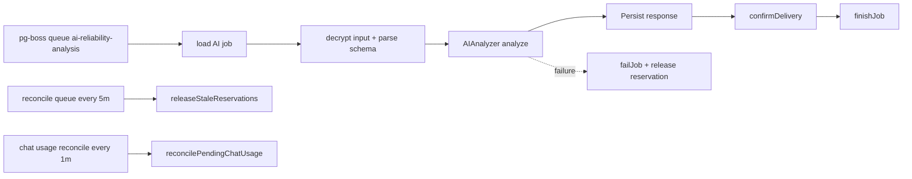
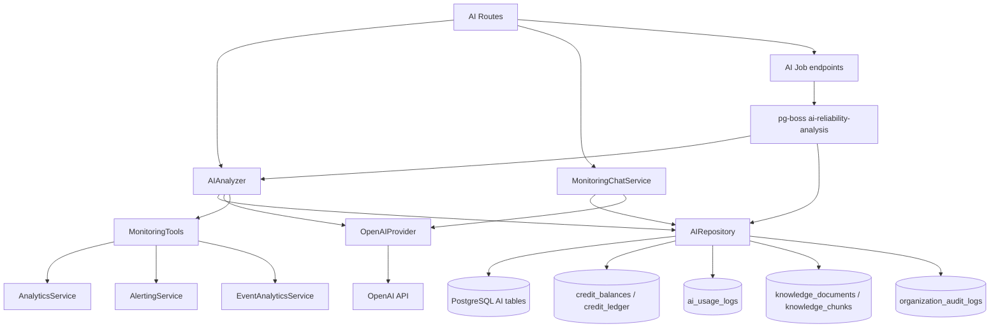

# AI Module Audit

Repository: `pulse`
Audit date: `2026-07-27`

Scope: backend AI runtime, billing integration, alerting hooks, worker queues, database schema, prompt system, and AI-related frontend surfaces.

This report is based on code inspection only. No application code was modified.

## 1. Executive Summary

The repository contains a real AI runtime, not just a stub. The core implementation is in `src/modules/ai` and is wired into the Fastify app and worker process.

What it currently does:
- Exposes 11 dedicated AI analysis endpoints plus a compatibility `/analyze` endpoint.
- Supports grounded monitoring chat with tool calls and tenant-scoped retrieval.
- Uses OpenAI for chat completions and embeddings.
- Persists AI requests, responses, chat history, tool calls, feedback, job state, cache, and usage logs.
- Enforces org membership, subscription entitlements, idempotency, request validation, rate limiting, safety redaction, and backend credit reservation/finalization.
- Runs background jobs for stale credit reservation cleanup and delayed chat usage reconciliation.

Overall maturity:
- Core analysis runtime: production-intent and fairly mature.
- Prompt governance and template management: scaffolded, not operational.
- Frontend AI UX: mostly static/dummy and not wired to the backend runtime.
- Provider architecture: single-provider OpenAI only.

Architecture quality:
- Good separation between route handling, analysis logic, retrieval/tooling, repository access, and worker execution.
- Strong safety boundaries around sanitization, validation, and credit finalization.
- Some duplication exists in billing AI consumption paths and in feature surface naming.

Production readiness:
- Core AI runtime is close to production-grade for OpenAI-backed analysis and grounded chat.
- The surrounding enterprise AI platform is incomplete because prompt lifecycle, evaluation/reporting tables, alert enrichment, and frontend integration are mostly scaffolded.

Major strengths:
- Tight tenant and org entitlement checks.
- Strong prompt-injection and secret redaction.
- Deterministic JSON schema validation on provider output.
- Credit reservation, confirmation, rollback, and stale-reservation cleanup.
- Cached response support and model-route indirection.
- Hybrid retrieval using embeddings plus lexical search.
- Observable metrics and usage ledger integration.

Major weaknesses:
- Only one provider is implemented.
- No streaming response path.
- Several schema tables exist but are unused by code.
- Frontend AI pages are present but mostly hardcoded or dummy-data driven.
- Alert AI enrichment exists only as a no-op hook.
- Prompt templates are stored in code, not in the prompt template table.

## 2. AI Architecture

### Module Structure

Primary backend module:
- `src/modules/ai/ai.module.ts`
- `src/modules/ai/routes.ts`
- `src/modules/ai/analyzer.ts`
- `src/modules/ai/chat.ts`
- `src/modules/ai/repository.ts`
- `src/modules/ai/openai-client.ts`
- `src/modules/ai/queue.ts`
- `src/modules/ai/security.ts`
- `src/modules/ai/cost-tracker.ts`
- `src/modules/ai/monitoring-tools.ts`
- `src/modules/ai/org-metrics.ts`
- `src/modules/ai/prompts/*`

Runtime wiring:
- Registered in `src/app.ts`.
- AI worker queue registered in `src/shared/workers/main.ts`.
- Billing AI credits are tracked in `src/modules/billing/*`.

### Request Flow

```mermaid
flowchart LR
  U[Authenticated user] --> R[Fastify AI routes]
  R --> A[authenticate + requireOrgAccess]
  A --> V[Zod validation + idempotency key check]
  V --> S[sanitizeUntrusted + safety checks]
  S --> X[AIRepository authorize + credit rules + cache lookup]
  X --> K[RAG retrieval via knowledge docs/chunks]
  K --> P[OpenAIProvider complete/embed]
  P --> Z[Parse JSON + schema validation]
  Z --> W[Persist response + usage log + cache]
  W --> C[onResponse confirmation]
  C --> F[Finalize or release reservation]
```

### Worker Flow

### AI Lifecycle

1. Request enters a dedicated AI endpoint.
2. Authentication and org access are enforced.
3. Idempotency key is validated.
4. User input is sanitized and bounded.
5. Entitlement and credit policy are resolved from billing tables.
6. Cached response is returned if available and allowed.
7. Otherwise the analyzer builds prompt context, retrieves RAG sources, and calls OpenAI.
8. Provider JSON output is parsed and validated against the response schema.
9. Credits are reserved, adjusted, finalized, or released depending on result and delivery.
10. Response and usage are persisted for analytics, billing, and auditability.

## 3. Feature Inventory

### Implemented AI Capabilities

| Feature Name | Purpose | How it works | Entry Point | Status |
|---|---|---|---|---|
| Error Explanation | Explain a raw error payload in plain and technical terms | Auto-routed from `/analyze` or directly via `/error-explanation`; prompt mode enforces evidence, confidence, and fix guidance | `src/modules/ai/routes.ts`, `AI_MODE_ROUTES` | Implemented |
| Root Cause Analysis | Rank likely incident root causes | Uses mode-specific prompt, confidence gating, multi-hypothesis rule, citations, and credit reservation | `/root-cause-analysis` | Implemented |
| Stack Trace Analysis | Interpret stack traces | Validates structured JSON, extracts app frame meaning, and produces fix/verification steps | `/stack-trace-analysis` | Implemented |
| Trace Analysis | Explain distributed traces and bottlenecks | Uses trace/span payloads plus RAG, then validates critical-path reasoning | `/trace-analysis` | Implemented |
| Span Analysis | Explain a single span or span cluster | Mode prompt focuses on span meaning, abnormality, parent/child context | `/span-analysis` | Implemented |
| Suggested Fixes | Provide safe remediation options | Uses reversible-fix guidance and risk/rollback structure | `/suggested-fixes` | Implemented |
| SQL Optimization | Recommend SQL performance improvements | Accepts query and optional explain/schema context; outputs index and rewrite guidance | `/sql-optimization` | Implemented |
| Log Summary | Summarize log spikes and patterns | Uses logs plus retrieval and confidence gating; clips secrets and PII | `/log-summary` | Implemented |
| Deployment Correlation | Determine whether deploys caused regressions | Compares deployments with symptom timing and produces causal assessment | `/deployment-correlation` | Implemented |
| Incident Summary | Produce stakeholder-ready incident summaries | Can run synchronously or as a queued job; persists incident-style structured output | `/incident-summary`, `/jobs` | Implemented |
| Weekly Report | Produce aggregated reliability and AI usage reports | Supports queued job execution and credit flow; intended for executive weekly reporting | `/weekly-report`, `/jobs` | Implemented |
| Monitoring Chat | Grounded chat over org telemetry and knowledge sources | Combines RAG, monitoring tools, chat history, inline citations, and usage reconciliation | `/chat` | Implemented |
| Credit Reservation and Finalization | Prevent charge leakage and charge only delivered answers | Credits are reserved before provider execution and finalized only after response delivery | repository + worker hooks | Implemented |
| Retrieval-Augmented Generation | Ground answers in tenant-scoped knowledge docs | Uses embeddings + FTS on `knowledge_documents` / `knowledge_chunks` | analyzer + chat | Implemented |
| AI Usage Analytics | Track requests, tokens, latency, cache hits, failures, feedback | Prometheus counters plus `ai_usage_logs` ledger | `cost-tracker.ts`, repository | Implemented |

### Partial or Scaffolded Features

| Feature | Purpose | Status | Notes |
|---|---|---|---|
| Alert AI enrichment hook | Enrich alert delivery with AI summary/triage | Stub | `src/modules/alerting/ai/alert-analysis.ts` is a no-op registry only |
| Prompt template management | Store versioned prompts in DB | Stub | `ai_prompt_templates` exists but is not used by runtime code |
| AI evaluation table | Store quality and safety evals | Unused | Table exists, no code writes to it |
| AI report table | Store generated reports and artifacts | Unused | Table exists, no code writes to it |
| Analysis worker placeholder | Background analysis pipeline | Stub | `src/shared/workers/analysis.processor.ts` is a placeholder |
| Frontend AI product pages | User-facing AI dashboard | UI-only | Pages are static/dummy and not wired to backend APIs |

## 4. AI Feature Matrix

| Feature | Description | Status | Routes | Services | Repository | Worker | Database | External API | Used By | Notes |
|---|---|---|---|---|---|---|---|---|---|---|
| Error Explanation | Error interpretation and remediation | Implemented | `/organizations/:orgId/ai/error-explanation` | `AIAnalyzer` | `AIRepository` | Optional async via `/jobs` | `ai_requests`, `ai_responses`, `ai_usage_logs` | OpenAI | API clients | Auto-routing also available |
| Root Cause Analysis | Incident root cause reasoning | Implemented | `/root-cause-analysis` | `AIAnalyzer` | `AIRepository` | Optional async | same as above | OpenAI | API clients | Uses multi-hypothesis gating |
| Stack Trace Analysis | Stack frame interpretation | Implemented | `/stack-trace-analysis` | `AIAnalyzer` | `AIRepository` | Optional async | same as above | OpenAI | API clients | Strong schema validation |
| Trace Analysis | Distributed trace diagnosis | Implemented | `/trace-analysis` | `AIAnalyzer`, `MonitoringTools` | `AIRepository` | Optional async | `knowledge_*`, `ai_usage_logs` | OpenAI | API clients | Uses RAG |
| Span Analysis | Single-span explanation | Implemented | `/span-analysis` | `AIAnalyzer` | `AIRepository` | Optional async | same as above | OpenAI | API clients | Low-context mode |
| Suggested Fixes | Safe remediation suggestions | Implemented | `/suggested-fixes` | `AIAnalyzer` | `AIRepository` | Optional async | same as above | OpenAI | API clients | Risk/rollback centric |
| SQL Optimization | SQL tuning guidance | Implemented | `/sql-optimization` | `AIAnalyzer` | `AIRepository` | Optional async | same as above | OpenAI | API clients | Query-plan oriented |
| Log Summary | Log clustering and summarization | Implemented | `/log-summary` | `AIAnalyzer`, `MonitoringTools` | `AIRepository` | Optional async | `ai_usage_logs`, `knowledge_*` | OpenAI | API clients | Can use retrieved log context |
| Deployment Correlation | Deploy-to-regression analysis | Implemented | `/deployment-correlation` | `AIAnalyzer` | `AIRepository` | Optional async | same as above | OpenAI | API clients | Causation vs correlation |
| Incident Summary | Executive incident report | Implemented | `/incident-summary`, `/jobs` | `AIAnalyzer` | `AIRepository` | Yes | `ai_jobs`, `ai_responses`, `ai_reports` (unused table) | OpenAI | API clients, worker | Async job only for incident summary / weekly report |
| Weekly Report | Aggregated weekly observability report | Implemented | `/weekly-report`, `/jobs` | `AIAnalyzer` | `AIRepository` | Yes | `ai_jobs`, `ai_usage_logs` | OpenAI | API clients, worker | Supports scheduled reporting |
| Monitoring Chat | Grounded org monitoring assistant | Implemented | `/chat` | `MonitoringChatService`, `MonitoringTools` | `AIRepository` | Usage reconciliation worker | `ai_chat_requests`, `ai_conversations`, `ai_conversation_messages`, `ai_tool_calls` | OpenAI | API clients | Tool-grounded and cited |
| AI Credits Billing | Consume AI credits and log usage | Implemented | `/billing/ai/consume`, `/internal/v1/usage/ai-credits` | `AiBillingService`, `InternalBillingService` | billing repositories | Billing jobs | `ai_usage_logs`, `credit_balances`, `credit_ledger` | None | Billing/admin | Two overlapping billing paths |

## 5. Prompt System

### Where prompts are stored

Current runtime prompts are stored in source code:
- `src/modules/ai/prompts/base.ts`
- `src/modules/ai/prompts/modes.ts`
- `src/modules/ai/chat.ts` for chat-specific grounding rules

The runtime does not read prompt text from `ai_prompt_templates`.

### Prompt architecture

- `BASE_SYSTEM_PROMPT` contains the shared safety, evidence, confidence, and structured JSON contract.
- `MODE_PROMPTS` contains one mode-specific prompt per `AIMode`.
- `buildSystemPrompt()` concatenates base instructions, the mode prompt, and backend-resolved credit policy.
- `CHAT_SYSTEM_PROMPT` is separate and stricter: it only allows answering from org sources.

### Prompt versioning

- `PROMPT_VERSION = 1` is source-controlled in `src/modules/ai/prompts/base.ts`.
- Responses persist `prompt_version` in `ai_responses`.
- The runtime does not yet consume a versioned prompt table.

### Hardcoded vs dynamic

- Hardcoded: all active prompts.
- Dynamic: only backend policy values injected at runtime, such as credit cost, cached cost, partial billing policy, and minimum confidence.

### System vs user prompts

- System prompt: mode-specific instructions and JSON schema contract.
- User prompt: sanitized telemetry wrapped in `<untrusted_data>` for analysis or chat.
- Both analysis and chat explicitly treat untrusted content as data, not instructions.

## 6. LLM Providers

### Implemented provider

Only one provider is implemented:
- OpenAI via `src/modules/ai/openai-client.ts`

### Configuration

- `AI_ENABLED`
- `OPENAI_API_KEY`
- `AI_PRIMARY_MODEL`
- `AI_FALLBACK_MODEL`
- `AI_EMBEDDING_MODEL`
- `AI_PROVIDER_TIMEOUT_MS`
- `AI_PROVIDER_MAX_RETRIES`
- `AI_CIRCUIT_FAILURE_THRESHOLD`
- `AI_CIRCUIT_RESET_MS`

### Behavior

- Primary request goes to `primaryModel`.
- If primary fails and `fallbackModel` differs, the same request is retried against the fallback model.
- The client has its own retry loop and exponential backoff.
- A circuit breaker opens after repeated failures and later resets.
- Embeddings are requested separately for retrieval.

### What is not implemented

- No Anthropic provider.
- No Gemini provider.
- No Ollama/local model backend.
- No OpenRouter.
- No Groq.
- No Azure OpenAI-specific provider.
- No streaming response support.

### Token and cost tracking

- Tokens are tracked through OpenAI usage fields and written to `ai_usage_logs`.
- Prometheus metrics are also emitted by `AICostTracker`.
- Cost is tracked in the DB ledger, but provider-side pricing is not used as the final source of truth.

## 7. AI APIs

### Core AI routes

All core AI routes are mounted under:
- `/organizations/:orgId/ai`

#### Dedicated analysis endpoints
- `POST /error-explanation`
- `POST /root-cause-analysis`
- `POST /stack-trace-analysis`
- `POST /trace-analysis`
- `POST /span-analysis`
- `POST /suggested-fixes`
- `POST /sql-optimization`
- `POST /log-summary`
- `POST /deployment-correlation`
- `POST /incident-summary`
- `POST /weekly-report`

#### Shared endpoints
- `POST /analyze`
- `POST /chat`
- `POST /jobs`
- `GET /jobs/:jobId`
- `POST /responses/:responseId/feedback`

### Route behavior

- Auth: `authenticate` + `requireOrgAccess`
- Validation: Zod schemas
- Idempotency: required `Idempotency-Key` or `X-Idempotency-Key`
- Rate limiting: AI-specific per-minute limits
- Error mapping:
  - `LOCKED` => 403
  - `INSUFFICIENT_CREDITS` => 402
  - `SAFETY_BLOCKED` => 422
  - invalid requests => 400
  - provider failure => 503

### Billing / usage routes

Two separate AI credit consumption surfaces exist:

1. Public/module route:
   - `POST /billing/ai/consume`
   - Uses `AiBillingService`

2. Internal service-token route:
   - `POST /internal/v1/usage/ai-credits`
   - `POST /internal/v1/usage/ai-credits/bulk`
   - Uses `InternalBillingService`

The internal usage route is more complete and is the better canonical metering surface.

## 8. AI Services

### `AIAnalyzer`

Responsibilities:
- Orchestrates end-to-end analysis.
- Resolves entitlements, model route, credit rules, cache lookup, RAG retrieval, provider invocation, validation, and persistence.
- Enforces confidence thresholds and sanitization.
- Handles delivery confirmation and reservation cancellation.

Public methods:
- `analyze()`
- `confirmDelivery()`
- `cancelDelivery()`
- `recordFeedback()`

Dependencies:
- `AIRepository`
- `AIProvider`
- `AIConfig`
- `AICostTracker`
- `security.ts`
- `prompts/*`

### `MonitoringChatService`

Responsibilities:
- Runs grounding-aware chat over org monitoring data.
- Prevents out-of-scope responses.
- Uses retrieved knowledge and live monitoring tools.
- Persists conversation state and usage logs.

Public methods:
- `chat()`
- `confirmUsage()`

Dependencies:
- `AIRepository`
- `AIProvider`
- `MonitoringTools`
- `AIConfig`

### `OpenAIProvider`

Responsibilities:
- Calls OpenAI chat completions and embeddings.
- Applies retries, fallback model selection, and circuit breaking.

Public methods:
- `complete()`
- `embed()`

### `MonitoringTools`

Responsibilities:
- Maps user intent into live analytics/alerting/event-analytics queries.
- Returns bounded source records for grounding.

### `AICostTracker`

Responsibilities:
- Emits Prometheus metrics for requests, tokens, latency, cache hits, fallbacks, safety blocks, low-confidence responses, and feedback.

### `AiBillingService`

Responsibilities:
- Converts prompt/completion token counts into estimated credits.
- Checks credit availability.
- Deduplicates by request ID.
- Consumes credits and logs usage.

## 9. AI Repositories

### `AIRepository`

This is the main persistence layer for the AI runtime.

Key query groups:
- Entitlement resolution against `organization_members`, `organization_subscriptions`, `plans`, and `v_effective_entitlements`
- Credit rule resolution from `credit_rules`
- Model route resolution from `ai_model_routes`
- Cache lookup from `ai_cache` and `ai_responses`
- Request reservation and duplicate detection in `ai_requests`
- Credit ledger reservation/finalization/release via `credit_balances` and `credit_ledger`
- Usage logging in `ai_usage_logs`
- RAG retrieval from `knowledge_documents` and `knowledge_chunks`
- Chat persistence in `ai_conversations`, `ai_chat_requests`, `ai_conversation_messages`, and `ai_tool_calls`
- Feedback in `ai_feedback`
- Async jobs in `ai_jobs`
- Governance events in `organization_audit_logs`

Performance characteristics:
- Uses advisory locks to serialize idempotency and per-tenant job admission.
- Uses partial indexes for hot paths.
- Uses vector and full-text retrieval for knowledge lookup.
- Persists usage in append-only fashion.

### `AiBillingRepository`

Used by the standalone `/billing/ai` endpoint.

Key behavior:
- Reads current usage.
- Checks and consumes credits.
- Logs AI usage rows.
- Uses request-level advisory locking for idempotency.

### `InternalBillingRepository`

This is not AI-specific, but it is the stronger billing usage path for AI credit quotas.

## 10. Database Schema

### Implemented tables

| Table | Purpose | Status |
|---|---|---|
| `ai_requests` | Request admission, idempotency, cache key, status | Used |
| `ai_responses` | Final validated AI outputs | Used |
| `ai_cache` | Cache for successful answers | Used |
| `ai_feedback` | User feedback on AI responses | Used |
| `ai_jobs` | Async job records for weekly/incident jobs | Used |
| `ai_usage_receipts` | Deduplicates usage logging per request and feature | Used |
| `ai_conversations` | Monitoring chat threads | Used |
| `ai_chat_requests` | Monitoring chat lifecycle | Used |
| `ai_conversation_messages` | Chat message history | Used |
| `ai_tool_calls` | Auditable tool invocations used in chat grounding | Used |
| `ai_usage_logs` | Billing and analytics ledger for AI usage | Used |
| `knowledge_documents` | RAG source metadata | Used |
| `knowledge_chunks` | RAG text/vector chunks | Used |
| `ai_model_routes` | Per-mode model routing rules | Used |
| `credit_balances` | Reservation and consumption of org AI credits | Used |
| `credit_ledger` | Immutable credit ledger | Used |
| `organization_usage_current_period` | Cached usage counters including AI credits | Used |
| `organization_audit_logs` | AI governance and failure audit trail | Used |

### Schema-only or unused tables

| Table | Status | Notes |
|---|---|---|
| `ai_prompt_templates` | Unused | Defined in schema, but runtime still uses source-code prompts |
| `ai_evaluations` | Unused | No code writes to it |
| `ai_reports` | Unused | No code writes to it |

### Index and constraint notes

Strong points:
- `ai_model_routes` has an active lookup index.
- `ai_conversations`, `ai_chat_requests`, `ai_conversation_messages`, and `ai_tool_calls` have practical tenant/time indexes.
- `knowledge_chunks` has both FTS and HNSW vector indexes.
- `ai_usage_logs` is partitioned and indexed for time, org, project, user, and metadata access.
- AI idempotency is enforced with unique constraints and advisory locks.

Potential gaps:
- The unused schema tables have no operational value until code is added.
- There is no current runtime path that consumes `ai_prompt_templates`, so the prompt table does not yet justify itself.

## 11. AI Background Jobs

### Implemented workers

| Worker / Queue | Purpose | Status |
|---|---|---|
| `ai-reliability-analysis` | Executes queued incident/weekly AI jobs | Implemented |
| `ai-reliability-analysis-dlq` | Dead-letter queue for failed AI jobs | Implemented |
| `ai-credit-reservation-reconcile` | Releases stale AI credit reservations every 5 minutes | Implemented |
| `ai-chat-usage-reconcile` | Backfills chat usage logs every minute | Implemented |
| `aiCreditReset` billing job | Resets AI credits on billing schedule | Implemented |

### Retry and failure semantics

- Job enqueue uses retry limit, retry delay, backoff, expiration, and dead-lettering.
- Async AI jobs are limited per tenant.
- Chat usage logging is reconciled asynchronously if the on-response confirmation is missed.
- Stale reservations are automatically released by a security-defensive SQL function.

### Non-implemented worker surface

- `src/shared/workers/analysis.processor.ts` is only a placeholder.
- There is no dedicated semantic ingestion worker for AI beyond the RAG tables already in use.

## 12. AI Analytics

### Built-in observability

Prometheus metrics emitted by `AICostTracker`:
- `ai_requests_total`
- `ai_credits_total`
- `ai_tokens_total`
- `ai_cache_hits_total`
- `ai_model_fallbacks_total`
- `ai_safety_blocks_total`
- `ai_low_confidence_total`
- `ai_provider_errors_total`
- `ai_rag_chunks_total`
- `ai_hallucination_reports_total`
- `ai_feedback_total`
- `ai_request_duration_seconds`
- `ai_rag_retrieval_duration_seconds`
- `ai_rag_relevance_score`
- `ai_feedback_score`

Database analytics:
- `ai_usage_logs` stores feature key, provider, model, credits, tokens, estimated cost, duration, status, request ID, and metadata.
- Alert rules already consume AI usage metrics such as failed requests, p95 duration, credits used, cost, and token volume.

Gaps:
- No dedicated evaluator pipeline is wired to `ai_evaluations`.
- No report-generation pipeline is wired to `ai_reports`.

## 13. Billing Integration

The AI runtime is tightly integrated with billing.

What is implemented:
- Credit entitlement checks via `v_effective_entitlements`
- Per-mode credit rules via `credit_rules`
- Reservation-before-usage model via `credit_balances` and `credit_ledger`
- Reservation adjustment for partial answers
- Finalization only after delivery confirmation
- Automatic stale-reservation release
- Refund support through the backend-only `ai_refund_credit()` function

What is also present:
- `ai_usage_logs` is used as the durable usage ledger.
- `organization_usage_current_period` is updated with AI credits used.
- `aiCreditReset` is scheduled in billing jobs.

Billing weakness:
- There are two AI credit consumption routes:
  - `/billing/ai/consume`
  - `/internal/v1/usage/ai-credits`
- They overlap conceptually and should be normalized or explicitly designated as primary/legacy.

## 14. Project Integration

### Projects

- Chat can be scoped to a specific project.
- Accessible projects are resolved from `projects`, `project_members`, and `project_environments`.
- Tool-grounded chat can fetch project dashboards.

### Organizations

- All AI routes are organization scoped.
- Entitlements are organization membership and subscription driven.
- Usage logs, conversations, and jobs are all tenant keyed.

### Users

- AI results are bound to the authenticated user and org membership.
- Conversations are user-owned.
- Feedback is attached to a specific user and response.

### API Keys and request identity

- AI rate limiting keys off auth header, API key, cookie, or IP.
- Idempotency keys are mandatory for safe retries.

### Events, Alerts, Ingestion, SDK

- `MonitoringTools` queries analytics, event analytics, and alerting data.
- Monitoring chat can use request metrics, traces, logs, incident proxies, and dashboard data.
- RAG knowledge likely comes from ingestion-fed documents/chunks.

### Frontend integration

- The frontend has AI routes and navigation entries, but most are still dummy or coming-soon surfaces.

## 15. AI Features Available To Users

### Implemented in backend APIs

- Error Explanation
- Root Cause Analysis
- Stack Trace Analysis
- Trace Analysis
- Span Analysis
- Suggested Fixes
- SQL Optimization
- Log Summary
- Deployment Correlation
- Incident Summary
- Weekly Report
- Monitoring Chat

### Implemented in backend, but not surfaced as a first-class product flow yet

- Credit reservation and usage confirmation
- AI feedback submission
- AI usage analytics and billing ledgers

### Frontend-only or planned surfaces

- AI Overview
- Anomaly Detection
- Release Impact
- Cost & Usage
- Prompt & Policy Controls

These frontend pages exist, but the code shows they are currently static or dummy-data driven rather than backed by the AI runtime.

## 16. Configuration

### AI runtime env vars

- `AI_ENABLED`
- `OPENAI_API_KEY`
- `AI_PRIMARY_MODEL`
- `AI_FALLBACK_MODEL`
- `AI_EMBEDDING_MODEL`
- `AI_PROVIDER_TIMEOUT_MS`
- `AI_PROVIDER_MAX_RETRIES`
- `AI_CIRCUIT_FAILURE_THRESHOLD`
- `AI_CIRCUIT_RESET_MS`
- `AI_MAX_INPUT_CHARS`
- `AI_MAX_OUTPUT_TOKENS`
- `AI_MAX_RETRIEVAL_CHUNKS`
- `AI_CACHE_TTL_SECONDS`
- `AI_RATE_LIMIT_PER_MINUTE`
- `AI_MAX_CONCURRENT_JOBS_PER_TENANT`
- `AI_MAX_CONCURRENT_CHAT_PER_TENANT`

### Related AI-adjacent config

- `BILLING_INTERNAL_SERVICE_TOKEN` or `INTERNAL_SERVICE_TOKEN` for internal billing usage routes.
- `AI_ALERT_ANALYSIS` feature flag exists in feature-flag definitions.
- `BILLING_AI_CREDIT_RESET_CRON` is used by billing job config.

### Defaults

- OpenAI primary model default: `gpt-4o-mini`
- Fallback model default: `gpt-4o`
- Embedding model default: `text-embedding-3-small`
- Provider timeout default: 30s
- Request rate limit default: 20/min
- Max concurrent jobs default: 5/tenant
- Max concurrent chat default: 10/tenant

## 17. Security Audit

### Strong controls

- Prompt injection detection and sanitization.
- Secret redaction for bearer tokens, API keys, AWS keys, connection strings, private keys, card-like numbers, and email addresses.
- Output validation through strict Zod schemas.
- Untrusted content is always wrapped as data, not instructions.
- Citations are allowlisted against retrieved sources.
- Organization membership and subscription gating are enforced before execution.
- Billing is reserved and finalized only after successful delivery.
- Governance events are written to audit logs.
- Internal billing route is protected by a service token.

### Gaps and risks

- Single-provider dependency on OpenAI.
- No prompt-template admin workflow, so operational prompt changes require code deployment.
- No alert-analysis provider is registered yet.
- `ai_reports` and `ai_evaluations` exist without runtime use, which increases schema drift risk.
- The frontend AI pages can imply capability that is not yet wired to live backend data.

## 18. Performance Audit

### Strengths

- Response cache for successful AI answers.
- Per-tenant idempotency avoids duplicate work.
- Advisory locks prevent queue over-admission.
- RAG retrieval is bounded and can degrade gracefully.
- Circuit breaker and retries reduce provider instability.
- Chat tool invocations are bounded to prevent runaway grounding calls.
- AI job queue and usage reconciliation are decoupled from request path.

### Weaknesses

- No streaming responses.
- Synchronous analysis routes still block on provider latency.
- OpenAI embeddings and completions are serial within a request flow.
- RAG retrieval can degrade to lexical-only lookup if embeddings fail.
- No bulk inference or batch summarization API beyond queued jobs.
- Frontend AI screens are not driven by live backend data.

## 19. Code Quality

### Dead or unused code

- `src/shared/workers/analysis.processor.ts` is a placeholder.
- `src/modules/alerting/ai/alert-analysis.ts` is a no-op hook registry.
- `ai_prompt_templates` is not consumed by runtime code.
- `ai_evaluations` and `ai_reports` are unused tables.
- Frontend AI pages are mostly hardcoded or dummy-data driven.

### Duplicate or overlapping logic

- Two AI credit consumption paths exist:
  - `src/modules/billing/ai/*`
  - `src/modules/billing/internal/*`
- Both are valid code, but they overlap enough that the platform should choose one canonical surface.

### Unused configuration

- There is no configuration for additional providers or streaming mode.
- Prompt versioning is code-based, not DB-based, despite the prompt template table.

## 20. Missing Enterprise Features

Only recommend what the code actually suggests is missing.

- Alert AI enrichment provider wired into `ai_alert_analysis`
- Operational prompt-template CRUD using `ai_prompt_templates`
- AI evaluation ingestion for `ai_evaluations`
- AI report generation pipeline for `ai_reports`
- Live frontend integration for the AI pages
- Provider abstraction beyond OpenAI
- Streaming response support
- Administrative UI for model routing and prompt policy changes
- End-to-end async job status UX for incident summary and weekly report jobs

Not missing:
- RAG / vector retrieval is already implemented.
- Root cause analysis is already implemented.
- Log summary, deployment correlation, and SQL optimization are already implemented.

## 21. Dependency Graph

## 22. Route Inventory

### Backend AI routes

| Category | Method | Path |
|---|---|---|
| Analysis | POST | `/organizations/:orgId/ai/error-explanation` |
| Analysis | POST | `/organizations/:orgId/ai/root-cause-analysis` |
| Analysis | POST | `/organizations/:orgId/ai/stack-trace-analysis` |
| Analysis | POST | `/organizations/:orgId/ai/trace-analysis` |
| Analysis | POST | `/organizations/:orgId/ai/span-analysis` |
| Analysis | POST | `/organizations/:orgId/ai/suggested-fixes` |
| Analysis | POST | `/organizations/:orgId/ai/sql-optimization` |
| Analysis | POST | `/organizations/:orgId/ai/log-summary` |
| Analysis | POST | `/organizations/:orgId/ai/deployment-correlation` |
| Analysis | POST | `/organizations/:orgId/ai/incident-summary` |
| Analysis | POST | `/organizations/:orgId/ai/weekly-report` |
| General | POST | `/organizations/:orgId/ai/analyze` |
| Chat | POST | `/organizations/:orgId/ai/chat` |
| Async jobs | POST | `/organizations/:orgId/ai/jobs` |
| Async jobs | GET | `/organizations/:orgId/ai/jobs/:jobId` |
| Feedback | POST | `/organizations/:orgId/ai/responses/:responseId/feedback` |

### Billing AI routes

| Category | Method | Path |
|---|---|---|
| Billing | POST | `/billing/ai/consume` |
| Internal billing | POST | `/internal/v1/usage/ai-credits` |
| Internal billing | POST | `/internal/v1/usage/ai-credits/bulk` |

### Frontend AI routes

| Category | Route | Status |
|---|---|---|
| AI overview | `/ai` | Coming soon / static |
| Root cause | `/ai/root-cause` | Coming soon / dummy data |
| Anomalies | `/ai/anomalies` | Coming soon / dummy data |
| Release impact | `/ai/release-impact` | Coming soon / dummy data |
| Cost usage | `/ai/costs` | Coming soon / static |
| Policies | `/ai/policies` | Coming soon / static |

## 23. File Inventory

### Backend core AI files

| File | Purpose | Status |
|---|---|---|
| `src/modules/ai/ai.module.ts` | Registers the AI runtime with Fastify | Implemented |
| `src/modules/ai/routes.ts` | HTTP endpoints and request orchestration | Implemented |
| `src/modules/ai/analyzer.ts` | Main analysis engine | Implemented |
| `src/modules/ai/chat.ts` | Grounded monitoring chat service | Implemented |
| `src/modules/ai/openai-client.ts` | OpenAI provider adapter | Implemented |
| `src/modules/ai/repository.ts` | Persistence and billing queries | Implemented |
| `src/modules/ai/queue.ts` | Job enqueue and worker registration | Implemented |
| `src/modules/ai/security.ts` | Redaction, injection detection, hashing | Implemented |
| `src/modules/ai/cost-tracker.ts` | AI metrics collection | Implemented |
| `src/modules/ai/monitoring-tools.ts` | Retrieval tools over analytics/alerts/logs | Implemented |
| `src/modules/ai/org-metrics.ts` | Natural-language time range parsing | Implemented |
| `src/modules/ai/types.ts` | Modes, schemas, credit rules, output schema | Implemented |
| `src/modules/ai/feature-routes.ts` | Dedicated route mapping per AI mode | Implemented |

### Prompt files

| File | Purpose | Status |
|---|---|---|
| `src/modules/ai/prompts/base.ts` | Shared system prompt and output contract | Implemented |
| `src/modules/ai/prompts/modes.ts` | Mode-specific prompt templates | Implemented |
| `src/modules/ai/prompts/index.ts` | Prompt assembly | Implemented |

### Billing integration files

| File | Purpose | Status |
|---|---|---|
| `src/modules/billing/ai/service.ts` | Standalone AI credit consumption service | Implemented |
| `src/modules/billing/ai/controller.ts` | Billing AI API controller | Implemented |
| `src/modules/billing/ai/repository.ts` | Billing-side AI usage repository | Implemented |
| `src/modules/billing/ai/routes.ts` | Billing AI route registration | Implemented |
| `src/modules/billing/billing.module.ts` | Registers billing AI routes | Implemented |
| `src/modules/billing/internal/routes.ts` | Canonical internal usage endpoints including AI credits | Implemented |
| `src/modules/billing/internal/service.ts` | Internal AI credit consumption logic | Implemented |
| `src/modules/billing/internal/controller.ts` | Internal usage controller | Implemented |
| `src/modules/billing/internal/repository.ts` | Internal quota/usage repository | Implemented |
| `src/modules/billing/shared/entitlement-snapshot.ts` | AI credit entitlement keys | Implemented |
| `src/modules/billing/jobs/definitions.ts` | Defines `aiCreditReset` billing job | Implemented |
| `src/modules/billing/jobs/ai-credit-reset.job.ts` | AI credit reset job alias | Implemented |
| `src/modules/billing/queue.ts` | Registers billing jobs | Implemented |

### Alerting and worker integration

| File | Purpose | Status |
|---|---|---|
| `src/modules/alerting/ai/alert-analysis.ts` | Future AI alert enrichment hook | Stub |
| `src/modules/alerting/batch-processor.ts` | Calls the hook conditionally | Partial |
| `src/shared/workers/main.ts` | Starts AI worker registration | Implemented |
| `src/shared/workers/analysis.processor.ts` | Placeholder worker file | Stub |
| `src/shared/workers/cron.ts` | Cron bootstrap, not AI-specific but relevant to billing schedules | Implemented |

### Config and app wiring

| File | Purpose | Status |
|---|---|---|
| `src/config/env.ts` | AI env vars and defaults | Implemented |
| `src/app.ts` | Registers the AI module in the API app | Implemented |

### Migrations and schema files

| File | Purpose | Status |
|---|---|---|
| `src/db/postgres/canonical_migrations_draft/18_ai/010_ai_prompt_templates.up.sql` | Prompt template table | Unused schema |
| `src/db/postgres/canonical_migrations_draft/18_ai/011_ai_model_routes.up.sql` | Model routing table and seed data | Used |
| `src/db/postgres/canonical_migrations_draft/18_ai/012_enterprise_ai_runtime.up.sql` | Core AI runtime tables and functions | Used |
| `src/db/postgres/canonical_migrations_draft/11_billing/012_ai_usage_logs.sql` | AI usage ledger | Used |
| `src/db/postgres/canonical_migrations_draft/17_enterprise_ingestion/003_feature_flags.up.sql` | `ai_alert_analysis` feature flag | Scaffolded |
| `src/db/postgres/migrations/002_create_all.sql` | Seeds `ai_alert_analysis` flag | Related |
| `src/db/postgres/migrations/002_create_all_ordered.sql` | Seeds `ai_alert_analysis` flag | Related |

### Tests and fixtures

| File | Purpose | Status |
|---|---|---|
| `test/unit/modules/ai-contract.test.ts` | Verifies route coverage, prompt versioning, and schema contract | Implemented |
| `test/unit/modules/ai-chat.test.ts` | Verifies grounded chat behavior | Implemented |
| `test/unit/modules/ai-analyzer.test.ts` | Verifies billing, caching, fallback, and delivery rules | Implemented |
| `test/unit/modules/ai-security.test.ts` | Verifies redaction and injection defenses | Implemented |
| `test/fixtures/ai-golden-cases.ts` | Golden mode coverage for contracts | Implemented |

### Frontend AI files

| File | Purpose | Status |
|---|---|---|
| `pulsiv_fe/src/app/router/protected-routes.tsx` | Registers `/ai` routes | Implemented |
| `pulsiv_fe/src/app/navigation/navigation.tsx` | Adds AI navigation entries | Coming soon |
| `pulsiv_fe/src/pages/insights/AiOverviewPage.tsx` | AI overview page | Static UI |
| `pulsiv_fe/src/pages/insights/RootCausePage.tsx` | RCA page | Dummy data |
| `pulsiv_fe/src/pages/insights/AnomaliesPage.tsx` | Anomaly page | Dummy data |
| `pulsiv_fe/src/pages/insights/ReleaseImpactPage.tsx` | Release impact page | Dummy data |
| `pulsiv_fe/src/pages/insights/CostUsagePage.tsx` | Cost page | Static UI |
| `pulsiv_fe/src/pages/insights/PoliciesPage.tsx` | Prompt/policy page | Static UI |
| `pulsiv_fe/src/hooks/useDummyData.ts` | Supplies dummy AI data | Implemented |

### Stale docs

| File | Purpose | Status |
|---|---|---|
| `reports/ai/AI_MODULE.md` | Prior AI report | Outdated / inaccurate |

## 24. Architecture Score

| Category | Score / 10 | Why |
|---|---|---|
| Architecture | 8.0 | Clean separation of route, analysis, repo, provider, and worker concerns |
| Scalability | 7.5 | Queueing, caching, and tenant-admission controls are in place |
| Maintainability | 6.5 | Good internal layering, but some duplication and dead schema increase drift |
| Security | 8.5 | Strong sanitization, validation, and access controls |
| Observability | 8.0 | Metrics, usage ledger, audit logs, and reconciliation jobs are present |
| Performance | 7.0 | Bounded retrieval and caching help, but no streaming and synchronous paths remain |
| Code Quality | 6.5 | Generally strong, but unused tables and placeholder code lower the score |
| Enterprise Readiness | 7.5 | Core runtime is enterprise-grade; surrounding product surfaces are incomplete |
| Developer Experience | 6.0 | Clear code structure, but prompt management and AI UI are not yet ergonomic |
| Production Readiness | 7.5 | Safe enough for core OpenAI-backed analysis, not yet a full AI platform |

Overall architecture score: `7.3 / 10`

## 25. Critical Findings

### High Priority

1. Single-provider dependency
   - The runtime only supports OpenAI. There is no provider abstraction beyond OpenAI fallback models.

2. UI not wired to runtime
   - The frontend AI pages are mostly dummy-data or static UI, so the product surface does not reflect the backend capability yet.

3. Prompt table is unused
   - `ai_prompt_templates` exists but the runtime reads prompts from code, so prompt governance is not operational.

### Medium Priority

1. Duplicate AI billing surfaces
   - `/billing/ai/consume` and `/internal/v1/usage/ai-credits` overlap and can drift.

2. Unused report/evaluation schema
   - `ai_evaluations` and `ai_reports` are provisioned but not used.

3. Alert AI hook is only a stub
   - The alerting integration point exists, but no provider is registered.

### Low Priority

1. Stale AI report file
   - `reports/ai/AI_MODULE.md` is materially outdated and should not be treated as current documentation.

2. No streaming support
   - Not a bug, but a gap for interactive AI UX.

## 26. Final Recommendations

### P0

- Choose one canonical AI credit consumption path and make the other explicitly legacy or remove it.

### P1

- Wire the frontend AI pages to real backend endpoints or relabel them as roadmap/dummy surfaces.
- Implement prompt template CRUD backed by `ai_prompt_templates`, or remove the table until it is actually needed.
- Add an operational path for `ai_evaluations` and `ai_reports` or drop them from the migration chain.

### P2

- Add a provider abstraction that can support another model family or provider.
- Add streaming response support for interactive chat and analysis.
- Implement the alert AI enrichment hook or remove the feature flag until it is real.

### P3

- Remove or replace the stale `reports/ai/AI_MODULE.md`.
- Add admin tooling for model routes and prompt policy management.
- Add an evaluation harness for regression testing the AI modes.

## Bottom Line

The repository already contains a credible enterprise AI runtime with grounded chat, structured analysis, RAG, billing, auditing, and worker support.

What is missing is not the core engine, but the operational product layer around it: provider diversity, prompt lifecycle management, live frontend integration, and the remaining scaffolded enterprise tables and hooks.
