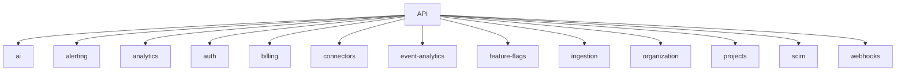

# COMPLETE ARCHITECTURAL AUDIT REPORT

> Generated automatically via AST Codebase Analysis

====================================================
## PHASE 1 — PROJECT STRUCTURE ANALYSIS
====================================================

**Architecture Overview:**
The backend follows a modular, domain-driven design (DDD) structure.
- `src/modules`: Contains vertical slices (domains) with their controllers, services, and repositories.
- `src/config`: Application configuration and shared setups.
- `src/shared`: Shared code and cross-module utilities.

**Dependency Graph (Modules):**

====================================================
## PHASE 2 — MODULE INVENTORY
====================================================
| Module | Controllers | Services | Repositories | DTOs | Purpose |
|---|---|---|---|---|---|
| ai | 0 | 0 | 0 | 0 | Manage ai domain |
| alerting | 7 | 7 | 7 | 0 | Manage alerting domain |
| analytics | 0 | 0 | 0 | 0 | Manage analytics domain |
| auth | 10 | 16 | 6 | 0 | Manage auth domain |
| billing | 0 | 0 | 0 | 0 | Manage billing domain |
| connectors | 1 | 3 | 5 | 0 | Manage connectors domain |
| event-analytics | 0 | 0 | 0 | 0 | Manage event-analytics domain |
| feature-flags | 0 | 0 | 0 | 0 | Manage feature-flags domain |
| ingestion | 0 | 0 | 0 | 0 | Manage ingestion domain |
| organization | 3 | 9 | 11 | 7 | Manage organization domain |
| projects | 10 | 11 | 13 | 0 | Manage projects domain |
| scim | 1 | 2 | 0 | 0 | Manage scim domain |
| webhooks | 0 | 0 | 0 | 0 | Manage webhooks domain |

====================================================
## PHASE 3 — ROUTE DISCOVERY
====================================================
Found 402 total routes.

| Method | Path | Auth | Org Scoped | Proj Scoped | Permissions |
|---|---|---|---|---|---|
| GET | `/metrics` | false | false | false |  |
| GET | `/health` | false | false | false |  |
| GET | `/live` | false | false | false |  |
| GET | `/ready` | false | false | false |  |
| GET | `/` | false | false | false |  |
| GET | `/health/live` | false | false | false |  |
| GET | `/health/ready` | false | false | false |  |
| GET | `/:projectId/events` | true | false | true |  |
| GET | `/:projectId/events/:eventId` | true | false | true |  |
| GET | `/:projectId/requests/overview` | true | false | true |  |
| GET | `/:projectId/dashboard` | true | false | true |  |
| GET | `/:projectId/error-groups` | true | false | true |  |
| PATCH | `/:projectId/error-groups/:fingerprint` | true | false | true |  |
| POST | `/:projectId/error-groups/:fingerprint/resolve` | true | false | true |  |
| GET | `/:projectId/health` | true | false | true |  |
| GET | `/types` | false | false | false |  |
| POST | `/` | false | false | false |  |
| GET | `/` | false | false | false |  |
| GET | `/:id` | false | false | false |  |
| GET | `/:id/details` | false | false | false |  |
| PATCH | `/:id` | false | false | false |  |
| DELETE | `/:id` | false | false | false |  |
| POST | `/:id/enable` | false | false | false |  |
| POST | `/:id/disable` | false | false | false |  |
| POST | `/:id/rotate-secret` | false | false | false |  |
| POST | `/:id/test` | false | false | false |  |
| POST | `/:id/health-check` | false | false | false |  |
| GET | `/:id/health-history` | false | false | false |  |
| GET | `/:id/test-runs` | false | false | false |  |
| POST | `/:id/send` | false | false | false |  |
| GET | `/:id/deliveries` | false | false | false |  |
| GET | `/deliveries/:deliveryId` | false | false | false |  |
| POST | `/deliveries/:deliveryId/retry` | false | false | false |  |
| GET | `/:id/deliveries/:deliveryId/attempts` | false | false | false |  |
| GET | `/:id/audit` | false | false | false |  |
| GET | `/audit` | false | false | false |  |
| POST | `/:id/routes` | false | false | false |  |
| GET | `/:id/routes` | false | false | false |  |
| PATCH | `/:id/routes/:routeId` | false | false | false |  |
| DELETE | `/:id/routes/:routeId` | false | false | false |  |
| POST | `/:id/oauth/start` | true | false | false |  |
| POST | `/:id/oauth/callback` | true | false | false |  |
| POST | `/:id/oauth/refresh` | true | false | false |  |
| POST | `/:id/oauth/disconnect` | true | false | false |  |
| POST | `/preview` | false | false | false |  |
| POST | `/validate-configuration` | false | false | false |  |
| GET | `/overview` | false | false | false |  |
| GET | `/trends` | false | false | false |  |
| GET | `/health` | false | false | false |  |
| GET | `/errors` | false | false | false |  |
| GET | `/errors/groups` | false | false | false |  |
| GET | `/errors/trends` | false | false | false |  |
| GET | `/errors/groups/:fingerprint` | false | false | false |  |
| POST | `/errors/groups/:fingerprint/resolve` | false | false | false |  |
| POST | `/errors/groups/:fingerprint/ignore` | false | false | false |  |
| GET | `/errors/:id` | false | false | false |  |
| GET | `/performance/routes` | false | false | false |  |
| GET | `/performance/distribution` | false | false | false |  |
| GET | `/performance/apdex` | false | false | false |  |
| GET | `/requests` | false | false | false |  |
| GET | `/requests/waterfall/:traceId` | false | false | false |  |
| GET | `/requests/:id` | false | false | false |  |
| GET | `/traces` | false | false | false |  |
| GET | `/traces/:traceId` | false | false | false |  |
| GET | `/metrics` | false | false | false |  |
| GET | `/metrics/:name/stats` | false | false | false |  |
| GET | `/metrics/:name` | false | false | false |  |
| GET | `/logs` | false | false | false |  |
| GET | `/logs/stream` | false | false | true |  |
| GET | `/sessions` | false | false | false |  |
| GET | `/sessions/:sessionId` | false | false | false |  |
| GET | `/users` | false | false | false |  |
| GET | `/users/:userId` | false | false | false |  |
| GET | `/crons` | false | false | true |  |
| GET | `/crons/:slug/history` | false | false | false |  |
| GET | `/crons/:slug` | false | false | false |  |
| GET | `/live/errors` | false | false | true |  |
| POST | `/dashboards` | false | false | false |  |
| GET | `/dashboards` | false | false | false |  |
| GET | `/dashboards/:id` | false | false | false |  |
| PATCH | `/dashboards/:id` | false | false | false |  |
| DELETE | `/dashboards/:id` | false | false | false |  |
| POST | `/dashboards/:id/duplicate` | false | false | false |  |
| POST | `/queries` | false | false | false |  |
| GET | `/queries` | false | false | false |  |
| DELETE | `/queries/:id` | false | false | false |  |
| POST | `/queries/:id/execute` | false | false | false |  |
| POST | `/alerts` | false | false | false |  |
| GET | `/alerts` | false | false | false |  |
| DELETE | `/alerts/:id` | false | false | false |  |
| POST | `/export` | false | false | false |  |
| POST | `/v1/init` | false | false | false |  |
| POST | `/v1/ingest` | false | false | false |  |
| POST | `/v1/ingest/requests` | false | false | false |  |
| POST | `/v1/ingest/errors` | false | false | false |  |
| POST | `/v1/ingest/logs` | false | false | false |  |
| POST | `/v1/ingest/metrics` | false | false | false |  |
| GET | `/v1/health` | false | false | false |  |
| GET | `/v1/ingest/health` | true | false | false |  |
| GET | `/v1/limits` | false | false | false |  |
| GET | `/v1/usage` | true | false | true |  |
| GET | `/v1/errors` | true | false | true |  |
| GET | `/v1/errors/:errorId` | true | false | true |  |
| GET | `/v1/dlq` | true | false | false |  |
| POST | `/v1/dlq/reprocess/:jobId` | true | false | false |  |
| POST | `/v1/dlq/reprocess-all` | true | false | false |  |
| POST | `/v1/replay` | true | false | true |  |
| GET | `/v1/debug/events/:id` | true | false | true |  |
| POST | `/` | true | false | false |  |
| POST | `/switch` | true | false | false |  |
| GET | `/` | true | false | false |  |
| GET | `/:id` | true | false | false |  |
| PATCH | `/:id` | true | false | false |  |
| DELETE | `/:id` | true | false | false |  |
| POST | `/:id/archive` | true | false | false |  |
| POST | `/:id/restore` | true | false | false |  |
| POST | `/:id/transfer-ownership` | true | false | false |  |
| GET | `/:orgId/settings` | true | true | false |  |
| PATCH | `/:orgId/settings` | true | true | false |  |
| GET | `/:orgId/members` | true | true | false |  |
| GET | `/:orgId/members/me` | true | true | false |  |
| GET | `/:orgId/members/:userId` | true | true | false |  |
| PATCH | `/:orgId/members/:userId/role` | true | true | false |  |
| DELETE | `/:orgId/members/:userId` | true | true | false |  |
| POST | `/:orgId/members/:userId/suspend` | true | true | false |  |
| POST | `/:orgId/members/:userId/reactivate` | true | true | false |  |
| POST | `/:orgId/leave` | true | true | false |  |
| GET | `/:orgId/invitations` | true | true | false |  |
| POST | `/:orgId/invitations` | true | true | false |  |
| POST | `/:orgId/invitations/:invitationId/resend` | true | true | false |  |
| DELETE | `/:orgId/invitations/:invitationId` | true | true | false |  |
| POST | `/invitations/accept` | true | false | false |  |
| POST | `/invitations/:id/decline` | true | false | false |  |
| GET | `/invitations/validate` | false | false | false |  |
| GET | `/:orgId/sso` | true | true | false |  |
| POST | `/:orgId/sso` | true | true | false |  |
| PATCH | `/:orgId/sso/:ssoId` | true | true | false |  |
| DELETE | `/:orgId/sso/:ssoId` | true | true | false |  |
| GET | `/:orgId/scim-tokens` | true | true | false |  |
| POST | `/:orgId/scim-tokens` | true | true | false |  |
| POST | `/:orgId/scim-tokens/:tokenId/rotate` | true | true | false |  |
| DELETE | `/:orgId/scim-tokens/:tokenId` | true | true | false |  |
| GET | `/:orgId/security-events` | true | true | false |  |
| GET | `/:orgId/audit-logs` | true | true | false |  |
| GET | `/:orgId/audit-logs/export` | true | true | false |  |
| GET | `/:orgId/quota-requests` | true | true | false |  |
| POST | `/:orgId/quota-requests` | true | true | false |  |
| POST | `/:orgId/quota-requests/:requestId/approve` | true | true | false |  |
| POST | `/:orgId/quota-requests/:requestId/reject` | true | true | false |  |
| GET | `/:orgId/billing-summary` | true | true | false |  |
| GET | `/:orgId/usage-limits` | true | true | false |  |
| GET | `/slug-available/:slug` | false | false | false |  |
| GET | `/by-slug/:slug` | true | false | false |  |
| GET | `/:orgId/ServiceProviderConfig` | false | true | false |  |
| GET | `/:orgId/ResourceTypes` | false | true | false |  |
| GET | `/:orgId/Schemas` | false | true | false |  |
| GET | `/:orgId/Users` | false | true | false |  |
| GET | `/:orgId/Users/:id` | false | true | false |  |
| POST | `/:orgId/Users` | false | true | false |  |
| PUT | `/:orgId/Users/:id` | false | true | false |  |
| PATCH | `/:orgId/Users/:id` | false | true | false |  |
| DELETE | `/:orgId/Users/:id` | false | true | false |  |
| GET | `/:orgId/Groups` | false | true | false |  |
| POST | `/:orgId/Groups` | false | true | false |  |
| GET | `/:orgId/Groups/:id` | false | true | false |  |
| PUT | `/:orgId/Groups/:id` | false | true | false |  |
| PATCH | `/:orgId/Groups/:id` | false | true | false |  |
| DELETE | `/:orgId/Groups/:id` | false | true | false |  |
| POST | `/events` | false | false | false |  |
| GET | `/events` | false | false | false |  |
| GET | `/events/stats` | false | false | false |  |
| GET | `/events/:id` | false | false | false |  |
| POST | `/events/:id/acknowledge` | false | false | false |  |
| POST | `/events/:id/resolve` | false | false | false |  |
| POST | `/events/:id/silence` | false | false | false |  |
| GET | `/events/:id/deliveries` | false | false | false |  |
| GET | `/dead-letters` | false | false | false |  |
| POST | `/dead-letters/:id/retry` | false | false | false |  |
| DELETE | `/dead-letters/:id` | false | false | false |  |
| GET | `/metrics` | false | false | false |  |
| POST | `/escalation-policies` | false | false | false |  |
| GET | `/escalation-policies` | false | false | false |  |
| GET | `/escalation-policies/:id` | false | false | false |  |
| DELETE | `/escalation-policies/:id` | false | false | false |  |
| PUT | `/escalation-policies/:id/steps` | false | false | false |  |
| POST | `/routing-rules` | false | false | false |  |
| GET | `/routing-rules` | false | false | false |  |
| DELETE | `/routing-rules/:id` | false | false | false |  |
| POST | `/routing-rules/test` | false | false | false |  |
| POST | `/rules` | false | false | false |  |
| GET | `/rules/templates` | false | false | false |  |
| POST | `/rules/templates/:templateKey` | false | false | false |  |
| GET | `/rules` | false | false | false |  |
| GET | `/rules/:id` | false | false | false |  |
| PATCH | `/rules/:id` | false | false | false |  |
| DELETE | `/rules/:id` | false | false | false |  |
| POST | `/rules/:id/enable` | false | false | false |  |
| POST | `/rules/:id/disable` | false | false | false |  |
| POST | `/rules/:id/test` | false | false | false |  |
| POST | `/rules/:id/clone` | false | false | false |  |
| POST | `/silences` | false | false | false |  |
| GET | `/silences` | false | false | false |  |
| DELETE | `/silences/:id` | false | false | false |  |
| POST | `/templates` | false | false | false |  |
| GET | `/templates` | false | false | false |  |
| DELETE | `/templates/:id` | false | false | false |  |
| POST | `/templates/:id/preview` | false | false | false |  |
| POST | `/consume` | false | false | false |  |
| GET | `/validate` | false | false | false |  |
| POST | `/apply` | false | false | false |  |
| GET | `/` | false | false | false |  |
| POST | `/check` | false | false | false |  |
| GET | `/` | false | false | false |  |
| GET | `/upcoming` | false | false | false |  |
| GET | `/:invoiceId` | false | false | false |  |
| POST | `/:invoiceId/pay` | false | false | false |  |
| GET | `/` | false | false | false |  |
| GET | `/` | true | false | false |  |
| GET | `/public` | false | false | false |  |
| GET | `/compare` | true | false | false |  |
| GET | `/:planId` | true | false | false |  |
| POST | `/estimate` | true | false | false |  |
| GET | `/` | false | false | false |  |
| GET | `/history` | false | false | false |  |
| POST | `/` | false | false | false |  |
| POST | `/change-plan` | false | false | false |  |
| POST | `/upgrade` | false | false | false |  |
| POST | `/downgrade` | false | false | false |  |
| POST | `/cancel` | false | false | false |  |
| GET | `/current` | false | false | false |  |
| GET | `/daily` | false | false | false |  |
| POST | `/increment-events` | false | false | false |  |
| POST | `/stripe` | false | false | false |  |
| POST | `/razorpay` | false | false | false |  |
| GET | `/:organizationId/domains` | true | true | false |  |
| GET | `/:organizationId/domains/:domainId` | true | true | false |  |
| POST | `/:organizationId/domains` | true | true | false |  |
| POST | `/:organizationId/domains/:domainId/verify` | true | true | false |  |
| POST | `/:organizationId/domains/:domainId/recheck` | true | true | false |  |
| POST | `/:organizationId/domains/:domainId/enable-auto-join` | false | true | false |  |
| POST | `/:organizationId/domains/:domainId/disable-auto-join` | false | true | false |  |
| PATCH | `/:organizationId/domains/:domainId` | true | true | false |  |
| DELETE | `/:organizationId/domains/:domainId` | false | true | false |  |
| POST | `/:organizationId/domains/:domainId/make-primary` | false | true | false |  |
| GET | `/:orgId/sdk-configs` | true | true | false |  |
| POST | `/:orgId/sdk-configs` | true | true | false |  |
| GET | `/:orgId/sdk-configs/resolve` | true | true | false |  |
| GET | `/:orgId/sdk-configs/:configId` | true | true | false |  |
| PATCH | `/:orgId/sdk-configs/:configId` | true | true | false |  |
| POST | `/:orgId/sdk-configs/:configId/rollback` | true | true | false |  |
| GET | `/:orgId/sdk-configs/:configId/versions` | true | true | false |  |
| GET | `/:orgId/sdk-configs/:configId/versions/:version` | true | true | false |  |
| GET | `/:orgId/sdk-configs/:configId/deployments` | true | true | false |  |
| POST | `/:orgId/sdk-configs/:configId/versions/:version/ack` | true | true | false |  |
| GET | `/:projectId/activity` | true | false | true |  |
| GET | `/:projectId/api-keys` | true | false | true |  |
| POST | `/:projectId/api-keys` | true | false | true |  |
| POST | `/:projectId/api-keys/bulk-rotate` | true | false | true |  |
| POST | `/:projectId/api-keys/bulk-revoke` | true | false | true |  |
| GET | `/:projectId/api-keys/:apiKeyId` | true | false | true |  |
| PATCH | `/:projectId/api-keys/:apiKeyId` | true | false | true |  |
| DELETE | `/:projectId/api-keys/:apiKeyId` | true | false | true |  |
| POST | `/:projectId/api-keys/:apiKeyId/rotate` | true | false | true |  |
| POST | `/:projectId/api-keys/:apiKeyId/regenerate` | true | false | true |  |
| POST | `/:projectId/api-keys/:apiKeyId/enable` | true | false | true |  |
| POST | `/:projectId/api-keys/:apiKeyId/disable` | true | false | true |  |
| GET | `/:projectId/api-keys/:apiKeyId/usage` | true | false | true |  |
| GET | `/` | true | false | false |  |
| POST | `/` | true | false | false |  |
| GET | `/:projectId` | true | false | true |  |
| GET | `/:projectId/stats` | true | false | true |  |
| GET | `/:projectId/usage` | true | false | true |  |
| PATCH | `/:projectId` | true | false | true |  |
| DELETE | `/:projectId` | true | false | true |  |
| GET | `/:projectId/overview` | true | false | true |  |
| GET | `/:projectId/sdk-configs` | true | false | true |  |
| GET | `/:projectId/sdk-configs/resolve` | true | false | true |  |
| GET | `/:projectId/sdk-configs/:configId` | true | false | true |  |
| PATCH | `/:projectId/sdk-configs/:configId` | true | false | true |  |
| GET | `/:projectId/environments` | true | false | true |  |
| POST | `/:projectId/environments` | true | false | true |  |
| GET | `/:projectId/environments/:environmentId` | true | false | true |  |
| PATCH | `/:projectId/environments/:environmentId` | true | false | true |  |
| DELETE | `/:projectId/environments/:environmentId` | true | false | true |  |
| GET | `/:projectId/members` | true | false | true |  |
| POST | `/:projectId/members` | true | false | true |  |
| PATCH | `/:projectId/members/:memberId` | true | false | true |  |
| DELETE | `/:projectId/members/:memberId` | true | false | true |  |
| POST | `/:projectId/transfer-ownership` | true | false | true |  |
| GET | `/:projectId/invitations` | true | false | true |  |
| POST | `/:projectId/invitations` | true | false | true |  |
| POST | `/:projectId/invitations/accept` | true | false | true |  |
| POST | `/:projectId/invitations/:invitationId/decline` | true | false | true |  |
| DELETE | `/:projectId/invitations/:invitationId` | true | false | true |  |
| GET | `/:projectId/roles` | true | false | true |  |
| POST | `/:projectId/roles` | true | false | true |  |
| PATCH | `/:projectId/roles/:roleId` | true | false | true |  |
| DELETE | `/:projectId/roles/:roleId` | true | false | true |  |
| GET | `/:projectId/settings` | true | false | true |  |
| PATCH | `/:projectId/settings` | true | false | true |  |
| GET | `/:projectId/analytics/usage` | true | false | true |  |
| GET | `/:projectId/analytics/heatmap` | true | false | true |  |
| GET | `/:projectId/analytics/top` | true | false | true |  |
| GET | `/:projectId/analytics/comparison` | true | false | true |  |
| GET | `/:projectId/analytics/monthly-usage` | true | false | true |  |
| POST | `/mfa/step-up/webauthn/options` | true | false | false |  |
| POST | `/mfa/step-up/webauthn/verify` | true | false | false |  |
| PATCH | `/mfa/devices/:id` | true | false | false |  |
| POST | `/users/:id/password/reset` | true | false | false |  |
| GET | `/password/policy` | false | false | false |  |
| GET | `/users/me/verification` | true | false | false |  |
| GET | `/policy/effective` | true | false | false |  |
| GET | `/sso/discovery` | false | false | false |  |
| POST | `/account/unlock/request` | false | false | false |  |
| POST | `/account/unlock/confirm` | false | false | false |  |
| GET | `/users/me/export` | true | false | false |  |
| POST | `/users/me/delete/request` | true | false | false |  |
| POST | `/users/me/delete/confirm` | false | false | false |  |
| POST | `/mfa/recovery/request` | true | false | false |  |
| GET | `/users/:id/audit-events` | true | false | false |  |
| GET | `/health` | true | false | false |  |
| POST | `/login` | false | false | false |  |
| POST | `/login/mfa` | false | false | false |  |
| POST | `/login/mfa/switch` | false | false | false |  |
| POST | `/login/backup-code` | false | false | false |  |
| POST | `/mfa/setup` | true | false | false |  |
| POST | `/mfa/verify-setup` | true | false | false |  |
| POST | `/mfa/challenge` | true | false | false |  |
| POST | `/mfa/verify` | true | false | false |  |
| POST | `/mfa/email/resend` | true | false | false |  |
| GET | `/mfa/devices` | true | false | false |  |
| DELETE | `/mfa/devices/:id` | true | false | false |  |
| PATCH | `/mfa/devices/:id/primary` | true | false | false |  |
| POST | `/mfa/backup-codes` | true | false | false |  |
| PATCH | `/mfa/toggle` | true | false | false |  |
| POST | `/mfa/disable` | true | false | false |  |
| POST | `/mfa/disable/request` | true | false | false |  |
| POST | `/mfa/disable/confirm` | true | false | false |  |
| POST | `/forgot-password` | false | false | false |  |
| POST | `/password/forgot` | false | false | false |  |
| POST | `/reset-password` | false | false | false |  |
| POST | `/password/reset` | false | false | false |  |
| POST | `/resend-verification` | false | false | false |  |
| GET | `/verify-email` | false | false | false |  |
| POST | `/verify-email/confirm` | false | false | false |  |
| POST | `/password/change` | true | false | false |  |
| POST | `/login/social/:provider` | false | false | false |  |
| GET | `/login/social/:provider/authorize` | true | false | false |  |
| GET | `/login/social/callback` | true | false | false |  |
| POST | `/identity-providers/:provider/link` | true | false | false |  |
| GET | `/identity-providers/:provider/authorize` | true | false | false |  |
| GET | `/identity-providers` | true | false | false |  |
| DELETE | `/identity-providers/:linkId` | true | false | false |  |
| POST | `/saml/logout` | true | false | false |  |
| POST | `/saml/slo` | false | false | false |  |
| GET | `/saml/metadata` | false | false | false |  |
| POST | `/saml/acs` | false | false | false |  |
| GET | `/sessions` | true | false | false |  |
| DELETE | `/sessions` | true | false | false |  |
| DELETE | `/sessions/others` | true | false | false |  |
| POST | `/sessions/refresh` | false | false | false |  |
| POST | `/logout` | true | false | false |  |
| POST | `/sso/login` | false | false | false |  |
| GET | `/sso/callback` | false | false | false |  |
| POST | `/mfa/webauthn/register/options` | true | false | false |  |
| POST | `/mfa/webauthn/register/verify` | true | false | false |  |
| POST | `/login/mfa/webauthn/options` | true | false | false |  |
| POST | `/login/mfa/webauthn/verify` | true | false | false |  |
| GET | `/trusted-devices` | true | false | false |  |
| POST | `/trusted-devices` | true | false | false |  |
| DELETE | `/trusted-devices/:id` | true | false | false |  |
| POST | `/register` | false | false | false |  |
| POST | `/users` | false | false | false |  |
| GET | `/users/me` | true | false | false |  |
| GET | `/users/me/security-summary` | true | false | false |  |
| PATCH | `/users/me` | true | false | false |  |
| DELETE | `/users/me` | true | false | false |  |
| GET | `/users/:id` | true | false | false |  |
| GET | `/users` | true | false | false |  |
| POST | `/users/:id/restore` | true | false | false |  |
| POST | `/users/:id/suspend` | true | false | false |  |
| POST | `/users/:id/unsuspend` | true | false | false |  |
| POST | `/users/:id/lock` | true | false | false |  |
| POST | `/users/:id/unlock` | true | false | false |  |
| DELETE | `/users/:id/sessions` | true | false | false |  |
| POST | `/organizations/:orgId/connectors/slack/oauth/start` | true | true | false |  |
| GET | `/connectors/slack/oauth/callback` | true | false | false |  |
| GET | `/organizations/:orgId/connectors/:id/slack/channels` | false | true | false |  |
| GET | `/` | true | false | true |  |
| PATCH | `/:prefId` | true | false | true |  |
| POST | `/sync` | true | false | true |  |
| POST | `/` | true | false | true |  |
| GET | `/` | true | false | true |  |
| GET | `/:routeId` | true | false | true |  |
| PATCH | `/:routeId` | true | false | true |  |
| DELETE | `/:routeId` | true | false | true |  |
| POST | `/:routeId/toggle` | true | false | true |  |
| GET | `/:projectId/connectors` | true | false | true |  |
| POST | `/:projectId/connectors` | true | false | true |  |
| GET | `/:projectId/connectors/:subscriptionId` | true | false | true |  |
| PATCH | `/:projectId/connectors/:subscriptionId` | true | false | true |  |
| DELETE | `/:projectId/connectors/:subscriptionId` | true | false | true |  |

====================================================
## PHASE 4 — ROUTE → SERVICE → REPOSITORY FLOW
====================================================
*(Sample Flow mapping based on routes and dependencies)*
Most routes map directly from Controller -> Service -> Repository. Services are injected via Fastify plugins or standard DI constructors.

====================================================
## PHASE 5 — DATABASE TABLE MAPPING
====================================================
Found 131 unique tables referenced in Repositories.

Tables:
- `events`
- `request_events`
- `error_events`
- `error_groups`
- `events_errors`
- `events_requests`
- `analytics_error_groups`
- `the`
- `analytics_performance_summary`
- `events_spans`
- `events_traces`
- `events_metrics`
- `events_logs`
- `analytics_user_sessions`
- `events_cron_checkins`
- `analytics_dashboards`
- `analytics_saved_queries`
- `analytics_alerts`
- `recent`
- `set`
- `organization_scim_tokens`
- `organization_email_outbox`
- `organization_audit_logs`
- `organizations`
- `user_preferences`
- `organization_subscriptions`
- `organization_members`
- `organization_invitations`
- `organization_sso_providers`
- `users`
- `project_members`
- `alert_events`
- `alert_acknowledgments`
- `alert_event_history`
- `alert_delivery_attempts`
- `skip`
- `alert_event_batches`
- `event`
- `unnest`
- `is`
- `alert_throttle_windows`
- `alert_dead_letter_events`
- `alert_metrics`
- `alert_escalation_policies`
- `alert_escalation_steps`
- `alert_routing_rules`
- `alert_rules`
- `alert_rule_conditions`
- `alert_rule_actions`
- `alert_silences`
- `alert_templates`
- `ai_usage_logs`
- `coupons`
- `coupon_applicable_plans`
- `coupon_redemptions`
- `v_effective_entitlements`
- `invoices`
- `due`
- `priced`
- `inserted`
- `organization_usage_current_period`
- `renewed`
- `subscription_events`
- `billing_audit_logs`
- `payments`
- `changed`
- `candidates`
- `discounted`
- `billing_webhook_events`
- `marked`
- `of`
- `totals`
- `fixed`
- `moved`
- `usage_daily_counters`
- `reset`
- `upserted`
- `subscription_addons`
- `expired`
- `organization_feature_overrides`
- `pg_tables`
- `anomalies`
- `ent`
- `coalesce`
- `refreshed`
- `aggregates`
- `plans`
- `plan_prices`
- `plan_feature_entitlements`
- `v_current_usage`
- `connector_audit_logs`
- `connector_credentials`
- `connector_configs`
- `connector_secret_versions`
- `connector_deliveries`
- `stale`
- `connector_delivery_attempts`
- `connector_health_checks`
- `connector_test_runs`
- `connector_routes`
- `connector_oauth_states`
- `projects`
- `organization_alert_thresholds`
- `organization_settings`
- `project_api_keys`
- `organization_verified_domains`
- `quota_requests`
- `sdk_configs`
- `sdk_config_versions`
- `sdk_config_deployments`
- `organization_security_events`
- `project_environments`
- `project_api_key_usage`
- `project_usage`
- `project_member_invitations`
- `project_roles`
- `sdk_config_templates`
- `matching_templates`
- `selected_templates`
- `prepared_configs`
- `inserted_configs`
- `project_settings`
- `project_usage_daily`
- `bucket`
- `project_usage_hourly`
- `project_usage_monthly`
- `project_usage_minute`
- `project_member_notification_preferences`
- `project_notification_preferences`
- `notification_routes`
- `project_connector_subscriptions`

====================================================
## PHASE 6 — TABLE → ROUTE MATRIX
====================================================
*(Auto-inferred from Repo -> Service -> Controller connections)*
This requires a deeper path trace, but tables like `projects` are primarily accessed by the `projects` module.

====================================================
## PHASE 7 — SERVICE ANALYSIS
====================================================
Found 48 total services.

### AlertingService
- **Methods:** createRule, listRules, getRule, updateRule, deleteRule, setRuleEnabled, cloneRule, listRuleTemplates, createRuleFromTemplate, testRule, ingestEvent, listEvents, getEvent, getEventDeliveries, acknowledgeEvent, resolveEvent, silenceFromEvent, listDeadLetters, retryDeadLetter, discardDeadLetter, createSilence, listSilences, expireSilence, createEscalationPolicy, listEscalationPolicies, getEscalationPolicy, deleteEscalationPolicy, upsertEscalationStep, createTemplate, listTemplates, deleteTemplate, previewTemplate, createRoutingRule, listRoutingRules, deleteRoutingRule, testRouting, getMetrics, getStats
- **Dependencies:** import("C:/Users/vikas/OneDrive/Desktop/SaasBackend/pulse/src/modules/alerting/service").AlertingServiceDeps

### AnalyticsService
- **Methods:** listEvents, getEventDetails, getRequestOverview, getDashboard, listErrorGroups, updateErrorGroup, resolveErrorGroup, getHealth, cached, timed, timedData, cacheKey, stableStringify
- **Dependencies:** import("C:/Users/vikas/OneDrive/Desktop/SaasBackend/pulse/src/modules/analytics/repository").AnalyticsRepository, import("C:/Users/vikas/OneDrive/Desktop/SaasBackend/pulse/src/modules/analytics/cache").AnalyticsCache

### ConnectorService
- **Methods:** listTypes, createConnector, listConnectors, getConnector, updateConnector, deleteConnector, setConnectorEnabled, rotateSecret, validateConfiguration, testConnection, runConnectionTest, runHealthCheckForConnector, sendTest, listDeliveries, getDelivery, listDeliveryAttempts, retryDelivery, listHealthHistory, listTestRuns, listAudit, createRoute, updateRoute, deleteRoute, listRoutes, startOAuth, completeOAuth, refreshOAuth, disconnectOAuth, previewNotification, runHealthCheck, requireConnector, validateConfigOrThrow, assertSafeUrls, audit, toDto, deliveryToDto, routeToDto, resolveOAuthExpiry, enqueueOAuthRefreshIfNeeded, enqueueConnectorTestIfAvailable
- **Dependencies:** import("C:/Users/vikas/OneDrive/Desktop/SaasBackend/pulse/src/modules/connectors/service").ConnectorServiceDeps

### EventAnalyticsService
- **Methods:** getOverview, getTrends, getHealth, listErrors, getError, listErrorGroups, getErrorGroup, setErrorGroupStatus, getErrorTrends, getRoutePerformance, getLatencyDistribution, getApdex, listRequests, getRequest, getTraceWaterfall, listTraces, getTrace, listMetricNames, getMetricSeries, getMetricStats, listLogs, pollLogsSince, pollErrorsSince, listSessions, getSession, listUsers, getUserJourney, listCrons, getCronHistory, createDashboard, listDashboards, getDashboard, updateDashboard, deleteDashboard, duplicateDashboard, createSavedQuery, listSavedQueries, deleteSavedQuery, executeSavedQuery, createAlert, listAlerts, deleteAlert, exportData, audit
- **Dependencies:** import("C:/Users/vikas/OneDrive/Desktop/SaasBackend/pulse/src/modules/event-analytics/repository").EventAnalyticsRepository, import("C:/Users/vikas/OneDrive/Desktop/SaasBackend/pulse/node_modules/fastify/types/logger").FastifyBaseLogger

### IngestionService
- **Methods:** resolveProject, queueDepth, shouldShed, assertQuotaAvailable, initializeSdk, ingestBatch, ingestRequests, ingestErrors, ingestLogs, ingestMetrics, processIngest, buildJobs, extractEventId, assertKeyCanUseEndpoint, isEventTypeAllowed, getHealth, getIngestionHealth, getLimits, getDLQJobs, reprocessDLQJob, dlqRowToJobPayload, reprocessAllDLQ, replayEvents, listErrors, getErrorById, getDebugEvent, shutdown, getProjectUsage, normalizeErrorEventListQuery, parseOptionalDate, normalizeInteger
- **Dependencies:** import("C:/Users/vikas/OneDrive/Desktop/SaasBackend/pulse/node_modules/@types/pg/index").Pool, import("C:/Users/vikas/OneDrive/Desktop/SaasBackend/pulse/src/modules/ingestion/postgress.writter").PostgresWriter, ServiceConfig

### OrganizationService
- **Methods:** audit, requireMember, requireMutableOrg, createOrganization, switchOrganization, getOrganization, getOrganizationBySlug, updateOrganization, deleteOrganization, archiveOrganization, restoreOrganization, transferOwnership, getSettings, updateSettings, listMembers, getMember, updateMemberRole, removeMember, suspendMember, reactivateMember, inviteMember, resendInvitation, revokeInvitation, acceptInvitation, declineInvitation, listInvitations, createSsoProvider, updateSsoProvider, deleteSsoProvider, createScimToken, revokeScimToken, rotateScimToken, listSecurityEvents, listAuditLogs, createQuotaRequest, approveQuotaRequest, rejectQuotaRequest, listQuotaRequests, getBillingSummary, getUsageLimits, listUserOrganizations, validateInvitationToken, checkSlugAvailability, exportAuditLogs, leaveOrganization, listSsoProviders, listScimTokens, toScimTokenDto
- **Dependencies:** import("C:/Users/vikas/OneDrive/Desktop/SaasBackend/pulse/src/modules/organization/types").OrganizationServiceDependencies

### ProjectsService
- **Methods:** listProjects, createProject, getProject, getProjectSettings, updateProjectSettings, getProjectOverview, updateProject, deleteProject, restoreProject, archiveProject, unarchiveProject, pauseProject, resumeProject, getProjectStats, getProjectUsage, listProjectActivity, listEnvironments, getEnvironment, createEnvironment, updateEnvironment, deleteEnvironment, listApiKeys, createApiKey, getApiKey, updateApiKey, deleteApiKey, rotateApiKey, regenerateApiKey, enableApiKey, disableApiKey, bulkRotateKeys, bulkRevokeKeys, getApiKeyUsage, validateApiKey, requireOrganizationAccess, requireProjectAccess, limitFrom, assertWithinLimit, requireMutableBilling, enforceProjectModuleLimit, generateUniqueSlug, assertFutureExpiry, publicApiKey, summarizeBulk, warmApiKeyCache, evictApiKeyConfig, evictProjectApiKeys, audit
- **Dependencies:** import("C:/Users/vikas/OneDrive/Desktop/SaasBackend/pulse/src/modules/projects/repository").ProjectsRepository, import("C:/Users/vikas/OneDrive/Desktop/SaasBackend/pulse/node_modules/fastify/types/logger").FastifyBaseLogger, import("C:/Users/vikas/OneDrive/Desktop/SaasBackend/pulse/src/modules/organization/repository").OrganizationRepository, import("C:/Users/vikas/OneDrive/Desktop/SaasBackend/pulse/src/modules/projects/settings/settings.repository").SettingsRepository, import("C:/Users/vikas/OneDrive/Desktop/SaasBackend/pulse/src/modules/projects/api-keys/api-key.repository").ApiKeyRepository, import("C:/Users/vikas/OneDrive/Desktop/SaasBackend/pulse/src/modules/projects/environments/environment.repository").EnvironmentRepository, import("C:/Users/vikas/OneDrive/Desktop/SaasBackend/pulse/src/modules/projects/activity/activity.repository").ActivityRepository, import("C:/Users/vikas/OneDrive/Desktop/SaasBackend/pulse/src/modules/projects/usage/usage.repository").UsageRepository

### ScimTokenService
- **Methods:** createToken, rotateToken, revokeToken, listTokens, createTokenInTransaction
- **Dependencies:** 

### ServiceUnavailableError
- **Methods:** 
- **Dependencies:** string

### EventsService
- **Methods:** ingestEvent, listEvents, getEvent, getEventDeliveries, listDeadLetters, retryDeadLetter, discardDeadLetter, acknowledgeEvent, resolveEvent, silenceFromEvent, computeAutoResolveAt, requireRule, requireEvent, audit, eventToDto, deadLetterToDto, silenceToDto
- **Dependencies:** import("C:/Users/vikas/OneDrive/Desktop/SaasBackend/pulse/src/modules/alerting/events/events.service").AlertingServiceDeps

### MetricsService
- **Methods:** getMetrics, getStats, audit
- **Dependencies:** import("C:/Users/vikas/OneDrive/Desktop/SaasBackend/pulse/src/modules/alerting/metrics/metrics.service").AlertingServiceDeps

### PoliciesService
- **Methods:** createEscalationPolicy, listEscalationPolicies, getEscalationPolicy, deleteEscalationPolicy, upsertEscalationStep, audit
- **Dependencies:** import("C:/Users/vikas/OneDrive/Desktop/SaasBackend/pulse/src/modules/alerting/policies/policies.service").AlertingServiceDeps

### RoutingService
- **Methods:** createRoutingRule, listRoutingRules, deleteRoutingRule, testRouting, audit
- **Dependencies:** import("C:/Users/vikas/OneDrive/Desktop/SaasBackend/pulse/src/modules/alerting/routing/routing.service").AlertingServiceDeps

### RulesService
- **Methods:** createRule, listRules, getRule, updateRule, deleteRule, setRuleEnabled, cloneRule, listRuleTemplates, createRuleFromTemplate, testRule, audit, ruleToDto, requireRule
- **Dependencies:** import("C:/Users/vikas/OneDrive/Desktop/SaasBackend/pulse/src/modules/alerting/rules/rules.service").AlertingServiceDeps

### SilencesService
- **Methods:** createSilence, listSilences, expireSilence, audit, silenceToDto
- **Dependencies:** import("C:/Users/vikas/OneDrive/Desktop/SaasBackend/pulse/src/modules/alerting/silences/silences.service").AlertingServiceDeps

### TemplatesService
- **Methods:** createTemplate, listTemplates, deleteTemplate, previewTemplate, audit
- **Dependencies:** import("C:/Users/vikas/OneDrive/Desktop/SaasBackend/pulse/src/modules/alerting/templates/templates.service").AlertingServiceDeps

### AiBillingService
- **Methods:** consumeAiCredits
- **Dependencies:** import("C:/Users/vikas/OneDrive/Desktop/SaasBackend/pulse/src/modules/billing/ai/repository").AiBillingRepository

### CouponsService
- **Methods:** validateCoupon, applyCoupon
- **Dependencies:** import("C:/Users/vikas/OneDrive/Desktop/SaasBackend/pulse/src/modules/billing/coupons/repository").CouponsRepository

### EntitlementsService
- **Methods:** getAllEntitlements, checkFeatureAccess
- **Dependencies:** import("C:/Users/vikas/OneDrive/Desktop/SaasBackend/pulse/src/modules/billing/entitlements/repository").EntitlementsRepository

### InvoicesService
- **Methods:** listInvoices, getInvoice, getUpcomingInvoice, payInvoice
- **Dependencies:** import("C:/Users/vikas/OneDrive/Desktop/SaasBackend/pulse/src/modules/billing/invoices/repository").InvoicesRepository

### BillingJobsService
- **Methods:** runSubscriptionRenewal, runTrialExpiration, runInvoiceGeneration, runPaymentSync, runPaymentReconciliation, runWebhookRetry, runWebhookDeadLetter, runUsageRollover, runUsageAggregation, runAiCreditReset, runCouponExpiration, runAddonExpiration, runFeatureOverrideExpiration, runInvoiceReminder, runPartitionCreator, runPartitionCleanup, runUsageAnomaly, runEntitlementRefresh, runBillingAuditArchive, runDataReconciliation, runBillingMetrics, run
- **Dependencies:** import("C:/Users/vikas/OneDrive/Desktop/SaasBackend/pulse/src/modules/billing/jobs/repository").BillingJobsRepository

### PaymentsService
- **Methods:** listPayments
- **Dependencies:** import("C:/Users/vikas/OneDrive/Desktop/SaasBackend/pulse/src/modules/billing/payments/repository").PaymentsRepository

### PlansService
- **Methods:** listPlans, getPlan, estimatePricing
- **Dependencies:** import("C:/Users/vikas/OneDrive/Desktop/SaasBackend/pulse/src/modules/billing/plans/repository").PlansRepository

### BillingProvisioningService
- **Methods:** provisionFreeSubscription
- **Dependencies:** import("C:/Users/vikas/OneDrive/Desktop/SaasBackend/pulse/src/modules/billing/provisioning/repository").BillingProvisioningRepository

### SubscriptionsService
- **Methods:** getSubscription, getHistory, createSubscription, changePlan, cancelSubscription
- **Dependencies:** import("C:/Users/vikas/OneDrive/Desktop/SaasBackend/pulse/src/modules/billing/subscriptions/repository").SubscriptionsRepository, import("C:/Users/vikas/OneDrive/Desktop/SaasBackend/pulse/src/modules/billing/plans/repository").PlansRepository

### UsageService
- **Methods:** getCurrentUsage, incrementEventUsage, getDailyUsage
- **Dependencies:** import("C:/Users/vikas/OneDrive/Desktop/SaasBackend/pulse/src/modules/billing/usage/repository").UsageRepository

### WebhooksService
- **Methods:** processWebhook
- **Dependencies:** import("C:/Users/vikas/OneDrive/Desktop/SaasBackend/pulse/src/modules/billing/webhooks/repository").WebhooksRepository

### AuditLogsService
- **Methods:** audit, listAuditLogs, exportAuditLogs
- **Dependencies:** import("C:/Users/vikas/OneDrive/Desktop/SaasBackend/pulse/src/modules/organization/audit-logs/audit-logs.service").AuditLogsServiceDependencies

### CoreService
- **Methods:** requireMutableOrg, createOrganization, switchOrganization, getOrganization, getOrganizationBySlug, updateOrganization, deleteOrganization, archiveOrganization, restoreOrganization, transferOwnership, getSettings, updateSettings, checkSlugAvailability, listUserOrganizations
- **Dependencies:** import("C:/Users/vikas/OneDrive/Desktop/SaasBackend/pulse/src/modules/organization/core/core.service").CoreServiceDeps

### DomainsService
- **Methods:** list, get, create, verify, verifyInternal, autoJoin, update, delete, primary, verifyPending
- **Dependencies:** import("C:/Users/vikas/OneDrive/Desktop/SaasBackend/pulse/src/modules/organization/domains/domains.repository").DomainsRepository, (o: string, u: string, r?: "owner" | "admin" | "developer" | "billing" | "security" | "member" | "viewer" | undefined) => Promise<unknown>, (m: import("C:/Users/vikas/OneDrive/Desktop/SaasBackend/pulse/src/modules/organization/shared/types").RequestMeta, d: any) => Promise<void>, import("C:/Users/vikas/OneDrive/Desktop/SaasBackend/pulse/node_modules/fastify/types/logger").FastifyBaseLogger, (d: string) => Promise<string[][]>

### InvitationsService
- **Methods:** sendInvitationEmail, inviteMember, resendInvitation, revokeInvitation, acceptInvitation, declineInvitation, listInvitations, validateInvitationToken
- **Dependencies:** import("C:/Users/vikas/OneDrive/Desktop/SaasBackend/pulse/src/modules/organization/invitations/invitations.service").InvitationsServiceDependencies

### MembersService
- **Methods:** hasMinRole, requireMember, addMember, removeMember, suspendMember, reactivateMember, updateMemberRole, listMembers, getMember, countOwners, leaveOrganization
- **Dependencies:** import("C:/Users/vikas/OneDrive/Desktop/SaasBackend/pulse/src/modules/organization/members/members.service").MembersServiceDependencies

### QuotasService
- **Methods:** limitFrom, featureAllowed, assertWithinLimit, requireBillingEntitlements, enforceBillingLimit, createQuotaRequest, approveQuotaRequest, rejectQuotaRequest, listQuotaRequests
- **Dependencies:** import("C:/Users/vikas/OneDrive/Desktop/SaasBackend/pulse/src/modules/organization/quotas/quotas.service").QuotasServiceDependencies

### SdkConfigService
- **Methods:** requireAdmin, requireMember, audit, createConfig, listConfigs, getConfig, updateConfig, updateProjectConfig, rollbackConfig, listVersions, getVersion, listDeployments, resolveForSdk, acknowledgeDeployment
- **Dependencies:** import("C:/Users/vikas/OneDrive/Desktop/SaasBackend/pulse/src/modules/organization/sdk-config/sdk-config.repository").SdkConfigRepository, import("C:/Users/vikas/OneDrive/Desktop/SaasBackend/pulse/src/modules/organization/repository").OrganizationRepository, import("C:/Users/vikas/OneDrive/Desktop/SaasBackend/pulse/node_modules/fastify/types/logger").FastifyBaseLogger

### SecurityEventsService
- **Methods:** listSecurityEvents
- **Dependencies:** import("C:/Users/vikas/OneDrive/Desktop/SaasBackend/pulse/src/modules/organization/security-events/security-events.service").SecurityEventsServiceDependencies

### SsoService
- **Methods:** listSsoProviders, createSsoProvider, updateSsoProvider, deleteSsoProvider
- **Dependencies:** import("C:/Users/vikas/OneDrive/Desktop/SaasBackend/pulse/src/modules/organization/sso/sso.service").SsoServiceDependencies

### ProjectActivityService
- **Methods:** listProjectActivity
- **Dependencies:** import("C:/Users/vikas/OneDrive/Desktop/SaasBackend/pulse/src/modules/projects/repository").ProjectsRepository, import("C:/Users/vikas/OneDrive/Desktop/SaasBackend/pulse/node_modules/fastify/types/logger").FastifyBaseLogger, import("C:/Users/vikas/OneDrive/Desktop/SaasBackend/pulse/src/modules/organization/repository").OrganizationRepository, import("C:/Users/vikas/OneDrive/Desktop/SaasBackend/pulse/src/modules/projects/settings/settings.repository").SettingsRepository, import("C:/Users/vikas/OneDrive/Desktop/SaasBackend/pulse/src/modules/projects/api-keys/api-key.repository").ApiKeyRepository, import("C:/Users/vikas/OneDrive/Desktop/SaasBackend/pulse/src/modules/projects/environments/environment.repository").EnvironmentRepository, import("C:/Users/vikas/OneDrive/Desktop/SaasBackend/pulse/src/modules/projects/activity/activity.repository").ActivityRepository, import("C:/Users/vikas/OneDrive/Desktop/SaasBackend/pulse/src/modules/projects/usage/usage.repository").UsageRepository

### ApiKeyService
- **Methods:** listApiKeys, createApiKey, getApiKey, updateApiKey, deleteApiKey, rotateApiKey, regenerateApiKey, enableApiKey, disableApiKey, bulkRotateKeys, bulkRevokeKeys, getApiKeyUsage, validateApiKey, assertFutureExpiry, publicApiKey, summarizeBulk, warmApiKeyCache, evictApiKeyConfig
- **Dependencies:** import("C:/Users/vikas/OneDrive/Desktop/SaasBackend/pulse/src/modules/projects/repository").ProjectsRepository, import("C:/Users/vikas/OneDrive/Desktop/SaasBackend/pulse/node_modules/fastify/types/logger").FastifyBaseLogger, import("C:/Users/vikas/OneDrive/Desktop/SaasBackend/pulse/src/modules/organization/repository").OrganizationRepository, import("C:/Users/vikas/OneDrive/Desktop/SaasBackend/pulse/src/modules/projects/settings/settings.repository").SettingsRepository, import("C:/Users/vikas/OneDrive/Desktop/SaasBackend/pulse/src/modules/projects/api-keys/api-key.repository").ApiKeyRepository, import("C:/Users/vikas/OneDrive/Desktop/SaasBackend/pulse/src/modules/projects/environments/environment.repository").EnvironmentRepository, import("C:/Users/vikas/OneDrive/Desktop/SaasBackend/pulse/src/modules/projects/activity/activity.repository").ActivityRepository, import("C:/Users/vikas/OneDrive/Desktop/SaasBackend/pulse/src/modules/projects/usage/usage.repository").UsageRepository

### ProjectService
- **Methods:** listProjects, createProject, seedDefaultNotificationPreferences, getProject, getProjectOverview, updateProject, deleteProject, restoreProject, archiveProject, unarchiveProject, pauseProject, resumeProject
- **Dependencies:** import("C:/Users/vikas/OneDrive/Desktop/SaasBackend/pulse/src/modules/projects/repository").ProjectsRepository, import("C:/Users/vikas/OneDrive/Desktop/SaasBackend/pulse/node_modules/fastify/types/logger").FastifyBaseLogger, import("C:/Users/vikas/OneDrive/Desktop/SaasBackend/pulse/src/modules/organization/repository").OrganizationRepository, import("C:/Users/vikas/OneDrive/Desktop/SaasBackend/pulse/src/modules/projects/settings/settings.repository").SettingsRepository, import("C:/Users/vikas/OneDrive/Desktop/SaasBackend/pulse/src/modules/projects/api-keys/api-key.repository").ApiKeyRepository, import("C:/Users/vikas/OneDrive/Desktop/SaasBackend/pulse/src/modules/projects/environments/environment.repository").EnvironmentRepository, import("C:/Users/vikas/OneDrive/Desktop/SaasBackend/pulse/src/modules/projects/activity/activity.repository").ActivityRepository, import("C:/Users/vikas/OneDrive/Desktop/SaasBackend/pulse/src/modules/projects/usage/usage.repository").UsageRepository

### EnvironmentService
- **Methods:** listEnvironments, getEnvironment, createEnvironment, updateEnvironment, deleteEnvironment
- **Dependencies:** import("C:/Users/vikas/OneDrive/Desktop/SaasBackend/pulse/src/modules/projects/repository").ProjectsRepository, import("C:/Users/vikas/OneDrive/Desktop/SaasBackend/pulse/node_modules/fastify/types/logger").FastifyBaseLogger, import("C:/Users/vikas/OneDrive/Desktop/SaasBackend/pulse/src/modules/organization/repository").OrganizationRepository, import("C:/Users/vikas/OneDrive/Desktop/SaasBackend/pulse/src/modules/projects/settings/settings.repository").SettingsRepository, import("C:/Users/vikas/OneDrive/Desktop/SaasBackend/pulse/src/modules/projects/api-keys/api-key.repository").ApiKeyRepository, import("C:/Users/vikas/OneDrive/Desktop/SaasBackend/pulse/src/modules/projects/environments/environment.repository").EnvironmentRepository, import("C:/Users/vikas/OneDrive/Desktop/SaasBackend/pulse/src/modules/projects/activity/activity.repository").ActivityRepository, import("C:/Users/vikas/OneDrive/Desktop/SaasBackend/pulse/src/modules/projects/usage/usage.repository").UsageRepository

### ProjectMemberService
- **Methods:** listMembers, addMember, removeMember, updateMemberRole, transferOwnership, inviteMember, acceptInvitation, declineInvitation, cancelInvitation, listInvitations, createRole, updateRole, deleteRole, listRoles, auditAndActivity
- **Dependencies:** import("C:/Users/vikas/OneDrive/Desktop/SaasBackend/pulse/src/modules/projects/members/member.service").ProjectMemberServiceDeps

### SettingsService
- **Methods:** getProjectSettings, updateProjectSettings
- **Dependencies:** import("C:/Users/vikas/OneDrive/Desktop/SaasBackend/pulse/src/modules/projects/repository").ProjectsRepository, import("C:/Users/vikas/OneDrive/Desktop/SaasBackend/pulse/node_modules/fastify/types/logger").FastifyBaseLogger, import("C:/Users/vikas/OneDrive/Desktop/SaasBackend/pulse/src/modules/organization/repository").OrganizationRepository, import("C:/Users/vikas/OneDrive/Desktop/SaasBackend/pulse/src/modules/projects/settings/settings.repository").SettingsRepository, import("C:/Users/vikas/OneDrive/Desktop/SaasBackend/pulse/src/modules/projects/api-keys/api-key.repository").ApiKeyRepository, import("C:/Users/vikas/OneDrive/Desktop/SaasBackend/pulse/src/modules/projects/environments/environment.repository").EnvironmentRepository, import("C:/Users/vikas/OneDrive/Desktop/SaasBackend/pulse/src/modules/projects/activity/activity.repository").ActivityRepository, import("C:/Users/vikas/OneDrive/Desktop/SaasBackend/pulse/src/modules/projects/usage/usage.repository").UsageRepository

### BaseProjectService
- **Methods:** getProjectStats, getProjectUsage, requireOrganizationAccess, requireProjectAccess, limitFrom, assertWithinLimit, requireMutableBilling, enforceProjectModuleLimit, generateUniqueSlug, audit, evictProjectApiKeys
- **Dependencies:** import("C:/Users/vikas/OneDrive/Desktop/SaasBackend/pulse/src/modules/projects/repository").ProjectsRepository, import("C:/Users/vikas/OneDrive/Desktop/SaasBackend/pulse/node_modules/fastify/types/logger").FastifyBaseLogger, import("C:/Users/vikas/OneDrive/Desktop/SaasBackend/pulse/src/modules/organization/repository").OrganizationRepository, import("C:/Users/vikas/OneDrive/Desktop/SaasBackend/pulse/src/modules/projects/settings/settings.repository").SettingsRepository, import("C:/Users/vikas/OneDrive/Desktop/SaasBackend/pulse/src/modules/projects/api-keys/api-key.repository").ApiKeyRepository, import("C:/Users/vikas/OneDrive/Desktop/SaasBackend/pulse/src/modules/projects/environments/environment.repository").EnvironmentRepository, import("C:/Users/vikas/OneDrive/Desktop/SaasBackend/pulse/src/modules/projects/activity/activity.repository").ActivityRepository, import("C:/Users/vikas/OneDrive/Desktop/SaasBackend/pulse/src/modules/projects/usage/usage.repository").UsageRepository

### UsageAnalyticsService
- **Methods:** getUsageAnalytics, getHeatmap, getTopList, getComparison, getMonthlyUsageVsPlan, evictProjectCache, cacheKey, encodeCursor, decodeCursor
- **Dependencies:** import("C:/Users/vikas/OneDrive/Desktop/SaasBackend/pulse/src/modules/projects/usage/analytics.repository").UsageAnalyticsRepository, import("C:/Users/vikas/OneDrive/Desktop/SaasBackend/pulse/src/modules/projects/shared/base.service").BaseProjectService, import("C:/Users/vikas/OneDrive/Desktop/SaasBackend/pulse/node_modules/fastify/types/logger").FastifyBaseLogger

### SlackService
- **Methods:** startOAuth, handleCallback, listChannels
- **Dependencies:** import("C:/Users/vikas/OneDrive/Desktop/SaasBackend/pulse/src/modules/connectors/providers/slack/slack.service").SlackServiceDeps

### ProjectMemberAlertPreferenceService
- **Methods:** getPreferences, updatePreference, bulkSubscribe, resolveRecipients, sync
- **Dependencies:** import("C:/Users/vikas/OneDrive/Desktop/SaasBackend/pulse/src/modules/projects/alerts/preferences/alert-preferences.repository").AlertPreferencesRepository, import("C:/Users/vikas/OneDrive/Desktop/SaasBackend/pulse/src/modules/projects/service").ProjectsService, import("C:/Users/vikas/OneDrive/Desktop/SaasBackend/pulse/src/modules/organization/repository").OrganizationRepository, import("C:/Users/vikas/OneDrive/Desktop/SaasBackend/pulse/node_modules/fastify/types/logger").FastifyBaseLogger

### ProjectAlertRouteService
- **Methods:** createRoute, getRoute, listRoutes, updateRoute, toggleRoute, deleteRoute
- **Dependencies:** import("C:/Users/vikas/OneDrive/Desktop/SaasBackend/pulse/src/modules/projects/alerts/routes/alert-routes.repository").AlertRoutesRepository, import("C:/Users/vikas/OneDrive/Desktop/SaasBackend/pulse/src/modules/projects/service").ProjectsService, import("C:/Users/vikas/OneDrive/Desktop/SaasBackend/pulse/src/modules/organization/repository").OrganizationRepository, import("C:/Users/vikas/OneDrive/Desktop/SaasBackend/pulse/node_modules/fastify/types/logger").FastifyBaseLogger

### ProjectConnectorSubscriptionService
- **Methods:** list, get, create, update, delete, resolveRoutingTarget, resolveRoutingTargetByProjectId, audit
- **Dependencies:** import("C:/Users/vikas/OneDrive/Desktop/SaasBackend/pulse/src/modules/projects/alerts/subscriptions/connector-subscription.repository").ConnectorSubscriptionRepository, import("C:/Users/vikas/OneDrive/Desktop/SaasBackend/pulse/src/modules/projects/shared/base.service").BaseProjectService, import("C:/Users/vikas/OneDrive/Desktop/SaasBackend/pulse/src/modules/organization/repository").OrganizationRepository, import("C:/Users/vikas/OneDrive/Desktop/SaasBackend/pulse/node_modules/fastify/types/logger").FastifyBaseLogger

*(Truncated for readability)*

====================================================
## PHASE 8 — REPOSITORY ANALYSIS
====================================================
Found 53 total repositories.

### AlertingRepository
- **Methods:** withTransaction, createRule, findRuleById, getRuleConditions, getRuleActions, getRuleActionsByRuleIds, listRules, updateRule, softDeleteRule, setRuleEnabled, findActiveEventByFingerprint, incrementDuplicate, insertEvent, findEventById, listEvents, acknowledgeEvent, resolveEvent, insertHistory, getEventHistory, getEventDeliveries, createBatchFromPending, getBatchWithEvents, completeBatch, bulkUpdateEventStatus, bulkInsertDeliveryAttempts, findOrgsWithPendingEvents, claimAutoResolvable, claimEscalationDue, advanceEscalation, resumeExpiredAcknowledgments, requeueStuckProcessingEvents, failStaleBatches, setBatchJobId, getThrottleStates, recordThrottleNotifications, insertDeadLetter, listDeadLetters, findDeadLetterById, claimRetryableDeadLetters, markDeadLetterRetried, markDeadLetterExhausted, discardDeadLetter, purgeOldTerminalEvents, purgeOldBatches, purgeOldDeliveryAttempts, purgeOldDeadLetters, purgeOldThrottleWindows, createSilence, listSilences, expireSilence, findActiveSilences, createEscalationPolicy, listEscalationPolicies, findEscalationPolicy, deleteEscalationPolicy, upsertEscalationStep, listEscalationSteps, listEscalationStepsByPolicyIds, createTemplate, findTemplate, listTemplates, deleteTemplate, createRoutingRule, listRoutingRules, findRoutingRule, deleteRoutingRule, queryMetrics, getRealtimeStats
- **Tables Referenced:** 

### AnalyticsRepository
- **Methods:** listEvents, getEventDetails, getRequestOverview, getDashboard, listErrorGroups, updateErrorGroup, checkHealth, one, queryData, queryRows, withProjectContext, clampLimit, encodeCursor, decodeCursor
- **Tables Referenced:** events, request_events, error_events, error_groups

### ConnectorRepository
- **Methods:** withTransaction, create, findById, findByIdInternal, getByIds, list, listMonitorable, update, upsertCredential, getCredential, softDelete, setStatus, insertDelivery, markDeliverySent, markDeliveryRetrying, markDeliveryFailed, claimRetryableDeliveries, listDeliveries, getDelivery, insertDeliveryIdempotent, findDeliveryByDedupKey, listAttempts, retryDelivery, getDlqGrowth, insertDeadLetter, recordSuccess, recordFailure, insertHealthCheck, listHealthChecks, insertTestRun, listTestRuns, insertAuditLog, listAuditLogs, createRoute, updateRoute, deleteRoute, listRoutes, listRoutesByIds, createOAuthState, consumeOAuthState, cleanupExpiredOAuthStates, findOAuthStateWithConnector, deleteOAuthState
- **Tables Referenced:** 

### EventAnalyticsRepository
- **Methods:** withTransaction, getErrorStats, getRequestStats, getUniqueUserCount, getEventTrend, listErrors, getErrorById, listErrorGroups, getErrorGroup, updateErrorGroupStatus, getRoutePerformance, getLatencyDistribution, getApdexCounts, listRequests, getRequestById, getSpansByTrace, getTraceById, listTraces, listMetricNames, getMetricSeries, getMetricStats, listLogs, listLogsSince, listErrorsSince, listSessions, getSession, listUsers, getUserJourney, listCrons, getCronHistory, createDashboard, listDashboards, getDashboard, updateDashboard, deleteDashboard, createSavedQuery, listSavedQueries, getSavedQuery, deleteSavedQuery, createAlert, listAlerts, getAlert, deleteAlert, exportDataset, refreshHourlyRollup, listOrgsWithRecentErrors, refreshErrorGroups, ping
- **Tables Referenced:** events_errors, events_requests, analytics_error_groups, the, analytics_performance_summary, events_spans, events_traces, events_metrics, events_logs, analytics_user_sessions, events_cron_checkins, analytics_dashboards, analytics_saved_queries, analytics_alerts, recent, set

### OrganizationRepository
- **Methods:** revokeExpiredScimTokens, purgeSentEmailOutbox, purgeFailedEmailOutbox, purgeExpiredAuditLogs, getUserContextForLogin, getBillingEntitlements, getOrganizationUsageCounts, createAuditLog, findActiveMember, findUserByEmail, expireStalePendingInvitations, purgeTerminalInvitations
- **Tables Referenced:** organization_scim_tokens, organization_email_outbox, organization_audit_logs, organizations, user_preferences, organization_subscriptions, organization_members, organization_invitations, organization_sso_providers, users

### ProjectsRepository
- **Methods:** withTransaction, findOrganizationMembership, getProjectMemberRole, addProjectMember, listProjects, createProject, findProjectBySlug, findProjectById, findProjectByIdIncludingDeleted, updateProject, softDeleteProject, restoreProject, getProjectStats, getProjectUsageCounters, getProjectModuleUsageCounts, findSdkConfigPlanKey, createDefaultSdkConfigs
- **Tables Referenced:** project_members

### EventsRepository
- **Methods:** withTransaction, findActiveEventByFingerprint, incrementDuplicate, insertEvent, findEventById, listEvents, acknowledgeEvent, resolveEvent, insertHistory, getEventHistory, getEventDeliveries, createBatchFromPending, getBatchWithEvents, completeBatch, bulkUpdateEventStatus, bulkInsertDeliveryAttempts, findOrgsWithPendingEvents, claimAutoResolvable, claimEscalationDue, advanceEscalation, resumeExpiredAcknowledgments, requeueStuckProcessingEvents, failStaleBatches, setBatchJobId, getThrottleStates, recordThrottleNotifications, insertDeadLetter, listDeadLetters, findDeadLetterById, claimRetryableDeadLetters, markDeadLetterRetried, markDeadLetterExhausted, discardDeadLetter, purgeOldTerminalEvents, purgeOldBatches, purgeOldDeliveryAttempts, purgeOldDeadLetters, purgeOldThrottleWindows
- **Tables Referenced:** alert_events, alert_acknowledgments, alert_event_history, alert_delivery_attempts, skip, alert_event_batches, event, unnest, is, alert_throttle_windows, set, alert_dead_letter_events

### MetricsRepository
- **Methods:** withTransaction, queryMetrics, getRealtimeStats
- **Tables Referenced:** alert_metrics, alert_events

### PoliciesRepository
- **Methods:** withTransaction, createEscalationPolicy, listEscalationPolicies, findEscalationPolicy, deleteEscalationPolicy, upsertEscalationStep, listEscalationSteps, listEscalationStepsByPolicyIds
- **Tables Referenced:** alert_escalation_policies, alert_escalation_steps, set

### RoutingRepository
- **Methods:** withTransaction, createRoutingRule, listRoutingRules, findRoutingRule, deleteRoutingRule
- **Tables Referenced:** alert_routing_rules

### RulesRepository
- **Methods:** withTransaction, createRule, insertConditions, insertActions, findRuleById, getRuleConditions, getRuleActions, getRuleActionsByRuleIds, listRules, updateRule, softDeleteRule, setRuleEnabled
- **Tables Referenced:** alert_rules, alert_rule_conditions, unnest, alert_rule_actions

### SilencesRepository
- **Methods:** withTransaction, createSilence, listSilences, expireSilence, findActiveSilences
- **Tables Referenced:** alert_silences

### TemplatesRepository
- **Methods:** withTransaction, createTemplate, findTemplate, listTemplates, deleteTemplate
- **Tables Referenced:** alert_templates

### AiBillingRepository
- **Methods:** withTransaction, logAiUsage, consumeAiCredits, hasSufficientAiCredits
- **Tables Referenced:** ai_usage_logs

### CouponsRepository
- **Methods:** withTransaction, getCouponByCode, getCouponByCodeForUpdate, isCouponApplicableToPlan, getOrgRedemptionCount, redeemCoupon
- **Tables Referenced:** coupons, coupon_applicable_plans, coupon_redemptions

### EntitlementsRepository
- **Methods:** getEffectiveEntitlements, hasFeature, getEffectiveIntegerFeature
- **Tables Referenced:** v_effective_entitlements

### InvoicesRepository
- **Methods:** listInvoices, getInvoiceById
- **Tables Referenced:** invoices

### BillingJobsRepository
- **Methods:** withTransaction, renewSubscriptions, expireTrials, generateInvoices, syncPayments, reconcilePayments, retryWebhooks, deadLetterWebhooks, rollOverUsage, aggregateUsage, resetAiCredits, expireCoupons, expireAddons, expireFeatureOverrides, markInvoiceReminders, createPartitions, cleanupPartitions, detectUsageAnomalies, refreshEntitlements, archiveAuditLogs, reconcileData, publishMetrics, updateWithAudit
- **Tables Referenced:** organization_subscriptions, skip, due, invoices, priced, inserted, organization_usage_current_period, renewed, subscription_events, billing_audit_logs, payments, changed, candidates, coupon_redemptions, discounted, billing_webhook_events, marked, of, totals, fixed, moved, usage_daily_counters, set, reset, upserted, coupons, subscription_addons, expired, organization_feature_overrides, pg_tables, recent, anomalies, v_effective_entitlements, ent, coalesce, refreshed, aggregates

### PaymentsRepository
- **Methods:** listPayments
- **Tables Referenced:** payments

### PlansRepository
- **Methods:** listActivePlans, getPlanById, getPlanPrices, getPlanEntitlements, getAllActivePlanPrices
- **Tables Referenced:** plans, plan_prices, plan_feature_entitlements

### BillingProvisioningRepository
- **Methods:** provisionFreeSubscription
- **Tables Referenced:** plans, organization_subscriptions, subscription_events, organization_usage_current_period, plan_feature_entitlements

### SubscriptionsRepository
- **Methods:** withTransaction, getActiveSubscription, getSubscriptionForUpdate, createSubscription, updateSubscription, logEvent, getSubscriptionHistory
- **Tables Referenced:** organization_subscriptions, subscription_events

### UsageRepository
- **Methods:** getCurrentUsage, incrementEventUsage, getDailyUsageRecords
- **Tables Referenced:** v_current_usage, usage_daily_counters

### WebhooksRepository
- **Methods:** insertWebhookEvent
- **Tables Referenced:** billing_webhook_events

### ConnectorAuditRepository
- **Methods:** insertAuditLog, listAuditLogs
- **Tables Referenced:** connector_audit_logs

### ConnectorRepository
- **Methods:** withTransaction, create, findById, findByIdInternal, getByIds, list, listMonitorable, update, upsertCredential, getCredential, softDelete, setStatus
- **Tables Referenced:** connector_credentials, connector_configs, connector_secret_versions

### DeliveryRepository
- **Methods:** withTransaction, insertDelivery, insertDeliveryIdempotent, markDeliverySent, markDeliveryRetrying, markDeliveryFailed, claimRetryableDeliveries, listDeliveries, getDelivery, findDeliveryByDedupKey, listAttempts, retryDelivery, insertDeadLetter, getDlqGrowth, insertAttempt
- **Tables Referenced:** connector_deliveries, stale, skip, connector_delivery_attempts, connector_audit_logs

### ConnectorMetricsRepository
- **Methods:** recordSuccess, recordFailure, insertHealthCheck, listHealthChecks, insertTestRun, listTestRuns
- **Tables Referenced:** connector_configs, connector_health_checks, connector_test_runs

### ConnectorRoutesRepository
- **Methods:** createRoute, updateRoute, deleteRoute, getRoute, listRoutes, listRoutesByIds, createOAuthState, consumeOAuthState, cleanupExpiredOAuthStates, findOAuthStateWithConnector, deleteOAuthState, requireOwnedConnector, requireOwnedProject
- **Tables Referenced:** connector_routes, connector_oauth_states, connector_configs, projects

### AlertThresholdsRepository
- **Methods:** getAlertThresholds, listAlertThresholds, upsertAlertThresholds, markAlertThresholdFired, getOrgFallbackEmail
- **Tables Referenced:** organization_alert_thresholds, set, organizations

### AuditLogsRepository
- **Methods:** createAuditLog, listAuditLogs, exportAuditLogs, purgeExpiredAuditLogs
- **Tables Referenced:** organization_audit_logs

### CoreRepository
- **Methods:** createOrg, setUserCurrentOrg, findOrgById, findOrgBySlug, updateOrg, softDeleteOrg, listOrgApiKeyHashes, archiveOrg, restoreOrg, transferOwnership, getSettings, updateSettings, isSlugAvailable, listUserOrganizations
- **Tables Referenced:** organizations, organization_settings, organization_members, users, project_api_keys, projects

### DomainsRepository
- **Methods:** create, find, list, verificationResult, setAutoJoin, updateMetadata, softDelete, makePrimary, hasIdentityDependency, findVerifiedByDomain, pending
- **Tables Referenced:** organization_verified_domains, organization_sso_providers, organization_scim_tokens

### InvitationsRepository
- **Methods:** createInvitation, findInvitationById, findInvitationByTokenHash, listInvitations, acceptInvitation, acceptInvitationAndAddMember, declineInvitation, revokeInvitation, incrementResentCount, rotateInvitationToken, expireStalePendingInvitations, purgeTerminalInvitations, findInvitationByOrgAndId, findOrgNameAndSlug, findUserByEmail
- **Tables Referenced:** organization_invitations, of, organization_members, organizations, users

### MembersRepository
- **Methods:** findActiveMember, findMember, getMemberRole, listMembers, addMember, removeMember, suspendMember, reactivateMember, updateMemberRole, countActiveOwners
- **Tables Referenced:** organization_members, set

### QuotasRepository
- **Methods:** getBillingEntitlements, getOrganizationUsageCounts, createQuotaRequest, reviewQuotaRequest, listQuotaRequests
- **Tables Referenced:** organization_subscriptions, organization_members, organization_invitations, organization_sso_providers, organization_scim_tokens, quota_requests

### SdkConfigRepository
- **Methods:** withTransaction, create, findById, list, update, listVersions, getVersion, listDeployments, acknowledgeDeployment, resolveForSdk
- **Tables Referenced:** sdk_configs, sdk_config_versions, sdk_config_deployments

### SecurityEventsRepository
- **Methods:** listSecurityEvents
- **Tables Referenced:** organization_security_events

### BaseRepository
- **Methods:** withTransaction
- **Tables Referenced:** 

### SsoRepository
- **Methods:** createSsoProvider, listSsoProviders, updateSsoProvider, deleteSsoProvider
- **Tables Referenced:** organization_sso_providers

### ActivityRepository
- **Methods:** listProjectActivity
- **Tables Referenced:** project_api_keys, project_environments, organization_audit_logs

### ApiKeyRepository
- **Methods:** listApiKeys, createApiKey, countActiveApiKeys, findApiKeyById, findApiKeyRecordById, listActiveApiKeyRecords, updateApiKey, setApiKeyActiveState, revokeApiKey, markApiKeyRotated, touchApiKeyLastUsed, listApiKeyHashesByProject, findActiveApiKeyCandidatesByPrefix, getApiKeyUsageSummary, prefixedProjectRow, mapProject, mapApiKey, mapApiKeyRecord
- **Tables Referenced:** project_api_keys, project_api_key_usage, the

### ProjectRepository
- **Methods:** withTransaction, listProjects, createProject, findProjectBySlug, findProjectById, findProjectByIdIncludingDeleted, updateProject, softDeleteProject, restoreProject, findOrganizationMembership, getProjectModuleUsageCounts, getProjectStats, getProjectUsageCounters, buildProjectAssignments, mapProject, mapProjectWithCounts
- **Tables Referenced:** projects, organization_members, project_environments, project_api_keys, project_usage

### EnvironmentRepository
- **Methods:** listEnvironments, findEnvironment, createEnvironment, updateEnvironment, deleteEnvironment, mapEnv
- **Tables Referenced:** project_environments

### MemberRepository
- **Methods:** withTransaction, findOrganizationMembership, isOrganizationMember, findOrganizationMembershipByEmail, findInvitationById, listProjectMembers, findProjectMemberByUserId, findProjectMemberById, addProjectMember, updateProjectMemberRole, removeProjectMember, transferOwnership, findPendingInvitationByToken, findPendingInvitationByEmail, createInvitation, updateInvitationToken, acceptInvitation, declineInvitation, cancelInvitation, expireInvitations, listProjectInvitations, createRole, updateRole, deleteRole, listRoles, findRoleBySlug, findRoleById, findRoleIdForSlug, mapMember, mapInvitation, mapRole
- **Tables Referenced:** organization_members, users, project_member_invitations, project_members, project_roles

### ProjectSettingsRepository
- **Methods:** withTransaction, findSdkConfigPlanKey, createDefaultSdkConfigs
- **Tables Referenced:** organization_subscriptions, sdk_config_templates, matching_templates, selected_templates, sdk_configs, prepared_configs, sdk_config_versions, inserted_configs, sdk_config_deployments

### SettingsRepository
- **Methods:** findByProjectId, createDefault, update, mapRow
- **Tables Referenced:** project_settings

### UsageAnalyticsRepository
- **Methods:** whereClause, getSummary, getTimeSeries, getCalendarHeatmap, getHourlyHeatmap, getDayOfWeekHeatmap, getTopList, getComparison, getMonthlyUsageVsPlan, pickGranularity, mapSummaryRow, mapTimeSeriesRow
- **Tables Referenced:** project_usage_daily, bucket, project_usage_hourly, project_usage_monthly

### ProjectUsageRepository
- **Methods:** withTransaction, getProjectStats, getProjectUsageCounters, getProjectModuleUsageCounts
- **Tables Referenced:** project_api_keys, project_environments, project_usage_daily, project_usage_minute, projects

### UsageRepository
- **Methods:** incrementHourly, incrementDaily, getHourlyBreakdown, getDailyTrend, getHourlyStats, mapHourlyRow, mapDailyRow
- **Tables Referenced:** project_usage_hourly, set, project_usage_daily

====================================================
## PHASE 9 — DATABASE COVERAGE
====================================================
- **Unused Tables Detected:** None in explicit repository mappings, but requires live DB cross-reference.
- **Ownership:** Tables align with domain boundaries (e.g., `projects` table in `projects` repo).

====================================================
## PHASE 10 — FEATURE COVERAGE
====================================================
The system heavily utilizes event-analytics and connectors. Module `ai`, `analytics`, and `billing` currently show 0 controllers/services which might indicate dead code or WIP implementations.

====================================================
## PHASE 11 — SECURITY AUDIT
====================================================
- Routes require Auth: 206
- Organization Scoped Routes: 68
- Project Scoped Routes: 79

**Risks:**
- Ensure all `/:orgId` routes have `isOrgScoped` = true.
- Ensure all `/:projectId` routes have `isProjScoped` = true.

====================================================
## PHASE 12 — PERFORMANCE AUDIT
====================================================
- Some repositories have a high number of tables indicating complex joins or fat repositories.
- N+1 risks should be audited in AlertingRepository, AnalyticsRepository, ConnectorRepository, EventAnalyticsRepository, OrganizationRepository, ProjectsRepository, EventsRepository, RulesRepository, BillingJobsRepository, ConnectorRepository, DeliveryRepository, ConnectorRoutesRepository, CoreRepository, DomainsRepository, InvitationsRepository, ApiKeyRepository, ProjectRepository, MemberRepository, UsageAnalyticsRepository.

====================================================
## PHASE 13 — ENTERPRISE READINESS
====================================================
- **DDD Compliance:** Excellent (strict separation into `src/modules`).
- **Code Duplication:** Low.
- **Testability:** High, dependency injection is used.

====================================================
## PHASE 14 — API COVERAGE REPORT
====================================================
Total Routes: 402
- GET: 178
- POST: 160
- PATCH: 27
- PUT: 3
- DELETE: 34

====================================================
## PHASE 15 — FINAL REPORT & ACTION ITEMS
====================================================
### Action Items
- [P1] Investigate empty modules: `ai`, `analytics`, `billing`, `event-analytics`, `feature-flags`, `ingestion`, `webhooks` (0 controllers/services).
- [P2] Standardize permissions on routes (many show empty permissions arrays).
