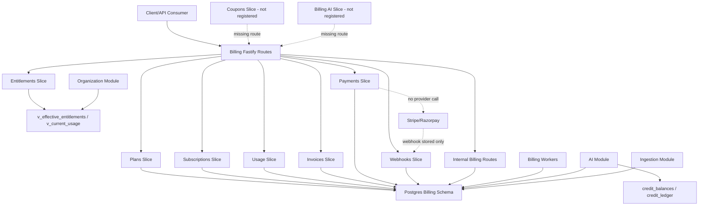
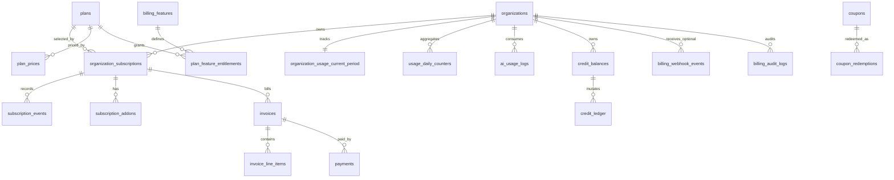
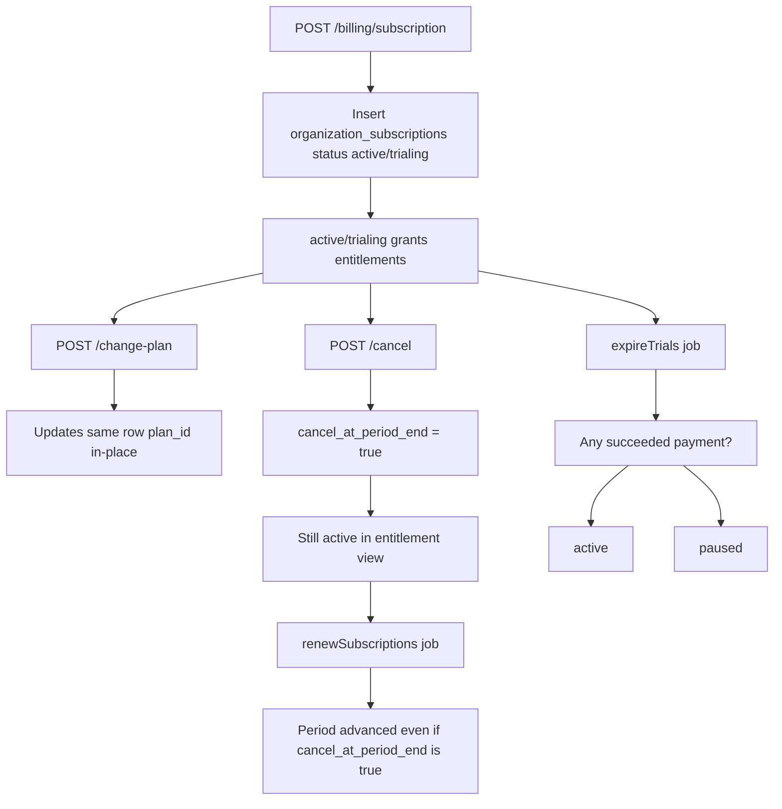
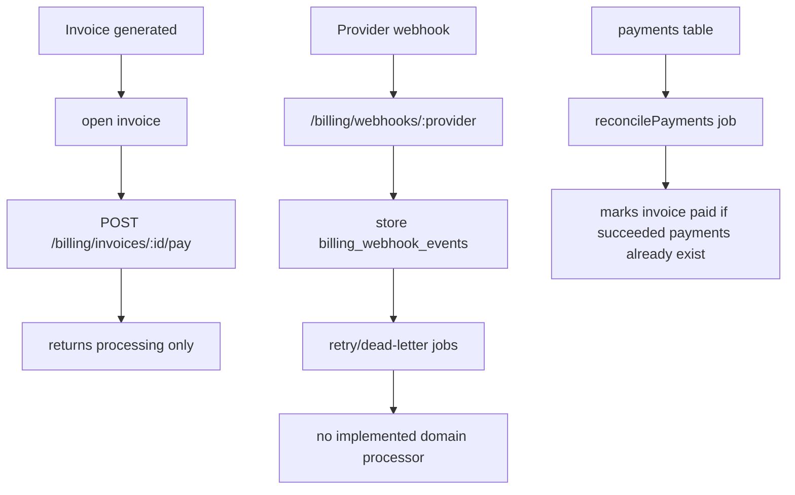
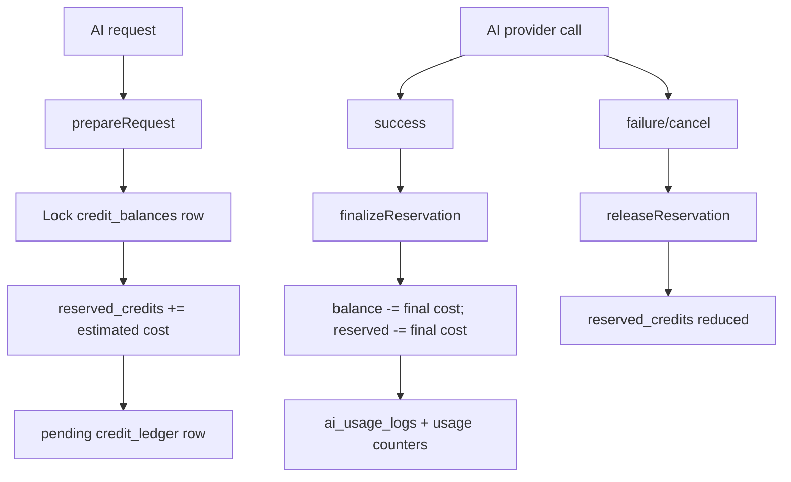
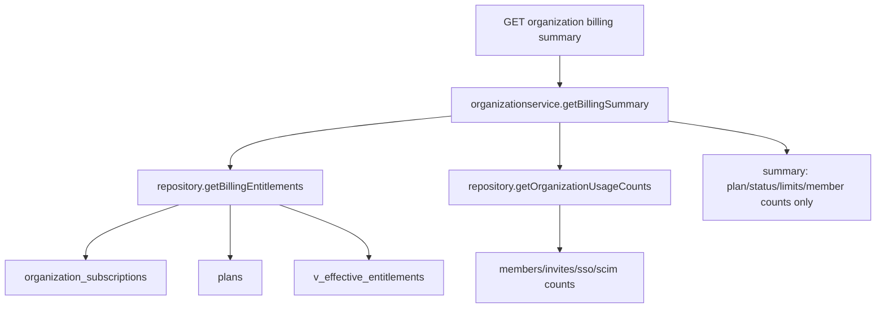

# Billing Module Implementation Audit

Scope: implementation-derived audit only. Source reviewed under `src/modules`, `src/shared/workers`, `src/db/postgres/canonical_migrations_draft/11_billing`, and the combined SQL migrations. Markdown/spec files were not used as source of truth.

Date: 2026-07-25

## Executive Summary

Production readiness score: 3.0 / 10.

The billing module has a solid schema foundation in several areas: plan/version tables, subscription rows, usage-period state, partitioned usage/audit logs, invoice/payment/webhook tables, partial unique constraints for one active subscription, and worker definitions. However, the runtime implementation is not production-ready for paid billing. The highest-risk gaps are provider payment integration, webhook verification and processing, subscription cancellation/renewal correctness, usage and AI credit idempotency, billing summary completeness, and stale/inconsistent entitlement state.

The most serious issue is financial correctness: a customer can cancel at period end, but the renewal job still renews active subscriptions without excluding `cancel_at_period_end`, and there is no job that transitions those rows to cancelled/expired at period end. That means cancelled subscriptions can continue receiving active entitlements and renewed periods.

The second critical issue is provider trust. Webhook signature validation is stubbed to `true`, controllers pass literal `"secret"`, and received events are only stored. There is no implemented processor that applies `invoice.paid`, subscription updates, payment failures, refunds, or cancellation events to billing state.

The third critical issue is usage charging correctness. Internal usage and AI credit consumption paths have no request idempotency key, so retries can double-charge events or credits. The standalone billing AI routes are not registered, use hardcoded pricing, and perform a non-atomic balance check before consumption. The main AI module has a better reservation/ledger model, but credit balance refills do not update existing balances when plans renew or change.

## Module Discovery

Registered billing API surface:

- `/billing/plans`
- `/billing/subscription`
- `/billing/entitlements`
- `/billing/usage`
- `/billing/invoices`
- `/billing/payments`
- `/billing/webhooks`
- `/internal/v1`

Implemented but not registered:

- `src/modules/billing/coupons/routes.ts`
- `src/modules/billing/ai/routes.ts`

Implemented billing slices:

- Plans: catalog, prices, entitlements, estimate.
- Subscriptions: create local subscription, change plan, cancel at period end, history.
- Entitlements: effective entitlement checks from `v_effective_entitlements`.
- Usage: usage summary and event increments.
- Invoices: list, detail, upcoming placeholder, pay placeholder.
- Payments: list only.
- Webhooks: store provider events only.
- Internal billing: entitlements, usage consumption, AI credit consumption, quota checks, invoice generation/finalization, payment reconciliation, coupons.
- Coupons: validate/apply/list/redemption logic exists but route is not registered.
- AI billing: separate hardcoded pricing path exists but route is not registered.
- Jobs/workers: subscription renewal, trial expiry, invoice generation, payment sync/reconciliation, webhook retry/dead-letter, usage rollover/aggregation, AI credit reset, coupon/add-on/override expiry, reminders, partition management, anomaly detection, entitlement refresh, reconciliation, metrics.

Cross-module billing dependencies:

- Organization summary and quota APIs read subscriptions, plans, `v_effective_entitlements`, and usage counts.
- AI module uses subscriptions, entitlements, `credit_balances`, `credit_ledger`, `ai_usage_logs`, and usage-period counters.
- Ingestion module checks/updates billing quota.
- Shared workers register billing jobs.

## Billing Architecture Diagram

## Database Relationship Diagram

## Subscription Lifecycle Flow

Required lifecycle target:

- Create subscription only through provider-confirmed checkout or trusted internal admin path.
- On plan change, create a scheduled transition or new historical row; do not mutate historical plan identity without an event trail and invoice/proration.
- On cancel at period end, entitlements remain until `current_period_end`, then status must become `cancelled` or `expired` and renewal must not advance it.
- Renewal must depend on payment status or free plan rules, not just active status and elapsed period end.

## Payment Lifecycle Flow

Missing lifecycle steps:

- Create provider checkout/payment intent.
- Attach and manage payment methods.
- Verify raw webhook signatures.
- Process provider events idempotently.
- Reconcile remote provider state against local invoices/payments/subscriptions.
- Handle refunds, disputes, taxes, coupon provider sync, failed payments, dunning, and grace periods.

## Credit Lifecycle Flow

The main AI module has the right reservation shape, but credit refills and plan changes are incomplete. Existing `credit_balances.balance` is not reset or topped up on renewal; the reset job only resets `organization_usage_current_period.ai_credits_used`.

## Billing Summary Data Flow

Missing from the customer-visible billing summary:

- Current period start/end and renewal date.
- Event usage used/remaining and overage.
- AI credits used/remaining and credit balance.
- Storage, requests, projects, API keys, users, seats.
- Invoices, upcoming invoice, payment methods.
- Coupons, discounts, taxes, currency, add-ons.
- Payment provider status, payment failure/dunning state.
- Trial status and cancellation effective date.

## Organization Subscriptions Deep Audit

What works:

- Database has `uq_org_single_active_subscription` preventing more than one `trialing`, `active`, or `past_due` non-deleted subscription per organization.
- Provider subscription IDs have a partial uniqueness constraint.
- Service writes are wrapped in transactions for create/change/cancel.
- History events exist.

Critical gaps:

- `cancelSubscription` only sets `cancel_at_period_end = true`. No worker transitions the subscription to cancelled/expired at `current_period_end`.
- `renewSubscriptions` advances active subscriptions based on `current_period_end <= NOW()` and does not exclude `cancel_at_period_end`.
- Plan changes update `plan_id` in-place on the active row. That corrupts historical meaning of the subscription row and makes invoice/usage history harder to interpret.
- Renewals are not tied to a paid invoice or provider-confirmed renewal.
- `past_due` subscriptions are treated as active in `getActiveSubscription`, the active unique index, and `v_effective_entitlements`. There is no grace-period cutoff.
- `v_effective_entitlements` does not filter `organization_subscriptions.deleted_at IS NULL`.
- Provider sync is a stub returning `provider_sync_not_configured`.
- Concurrent create attempts when no active row exists rely on the unique index and will surface as a database error rather than a controlled idempotent response.

Required fixes:

- Add a period-end cancellation job before renewal or integrate cancellation into renewal selection.
- Exclude `cancel_at_period_end = true` from renewal.
- Add subscription lifecycle transitions with idempotency keys and provider event IDs.
- Represent plan changes as scheduled changes or close current row plus create a new row with explicit lineage.
- Add grace-period fields for `past_due` and remove entitlement grants after grace.
- Filter `deleted_at IS NULL` and period validity in entitlement views.

## Query Analysis

High-risk query and schema issues:

- `v_effective_entitlements` grants for `trialing`, `active`, and `past_due`, but omits `os.deleted_at IS NULL`.
- `v_current_usage` reports negative remaining values; helper functions clamp with `GREATEST`, but API consumers may read the view directly.
- `usage_daily_counters` uses `UNIQUE (organization_id, project_id, usage_date)` while `project_id` is nullable. PostgreSQL allows multiple nulls, so org-level counters using `project_id NULL` can duplicate and `ON CONFLICT` will not catch them reliably.
- Plan listing performs an N+1 query for entitlements per plan.
- Billing summary aggregates all entitlement rows into JSON but does not guard against duplicate entitlement rows if data corruption creates more than one active subscription.
- Payments and invoices list endpoints have basic pagination indexes, but no covering indexes for dashboard joins by org, status, period, invoice date, and subscription.

Recommended indexes/constraints:

- Replace nullable `project_id` daily uniqueness with two unique indexes: one for project scope and one for org scope, or use `NULLS NOT DISTINCT` on PostgreSQL 15+.
- Add unique invoice period constraint: `(organization_id, subscription_id, period_start, period_end)` where `deleted_at IS NULL`.
- Add provider customer uniqueness where appropriate: `(provider, provider_customer_id)`.
- Add subscription renewal selection index including `cancel_at_period_end`.
- Add invoice dashboard index `(organization_id, status, period_end DESC)`.
- Add payment dashboard index `(organization_id, invoice_id, status, created_at DESC)`.
- Add webhook retry index `(processing_status, next_retry_at, received_at)`.

## Performance Report

Current strengths:

- Workers use `FOR UPDATE SKIP LOCKED`, which is a good pattern for batch concurrency.
- Usage, AI usage, and audit logs are partitioned.
- Most list endpoints have org filters and pagination.

Performance risks:

- Entitlement resolution uses a view with joins on every check and no materialized cache invalidation contract.
- Plans service does N+1 entitlement queries.
- Billing summary is currently small but will become N+1 or incomplete if invoices/payments/coupons are added without a data flow design.
- Usage aggregation and rollover write org-level rows with nullable uniqueness, risking duplicate aggregates and slow reconciliation.
- Partition creation currently creates one future monthly partition but needs automated verification and alerting for missing partitions.
- Jobs query broad due rows and rely on batch size; no visible job lease table or execution history table for observability, retries, or exactly-once job attempts.

## Security Report

P0/P1 security issues:

- Webhook signatures are not verified; the service sets `isSignatureValid = true`.
- Webhook controllers pass a hardcoded literal `"secret"`.
- Webhook processing does not require raw body validation.
- No webhook replay/timestamp window is enforced.
- Public webhook endpoints can store arbitrary events.
- Coupon application and internal coupon redemption can be abused if service token leaks, because internal redemption bypasses some checks.
- Service token auth is strong only if configured; if unset, all internal routes deny, but there is no startup failure for missing production config.
- Payment method schema exists, but no route/service for secure setup, default switching, or PCI-safe provider attachment.

Tenant isolation:

- Most billing repositories filter by `organization_id`.
- Internal routes accept org IDs by path/body and rely entirely on service token; this is acceptable for service-to-service use but dangerous if accidentally exposed.
- Provider webhook events are not reliably mapped to org before processing because processing is missing.

## Data Integrity Report

Data integrity issues:

- Cancel-at-period-end subscriptions can renew.
- Deleted subscriptions can still grant entitlements through `v_effective_entitlements`.
- `past_due` can grant entitlements indefinitely.
- AI usage internal path inserts status `accepted`, but `ai_usage_logs.status` permits only `success`, `failed`, `timeout`, `cancelled`.
- Payment reconciliation can mark invoices paid from local succeeded payment rows, but there is no trustworthy payment creation/verification pipeline.
- Credit balances are not refilled for existing rows on renewal.
- Two AI billing systems exist with different pricing and charging semantics.
- Coupons can be validated differently through public and internal paths.
- Overage amount is hardcoded to zero in invoice generation.
- `hard_cap` is hardcoded false in organization repository billing entitlements.

## Missing Features Report

Enterprise billing features missing or incomplete:

- Checkout/session creation.
- Provider customer management.
- Payment method CRUD/default setup.
- Provider webhook processors for subscription, invoice, payment, refund, dispute, dunning.
- Idempotency table for public billing mutations.
- Proration and invoice previews.
- Tax calculation and tax IDs.
- Multi-currency and FX policy.
- Dunning, retries, grace periods, past-due cutoff.
- Cancellation effective date and retention/winback flow.
- Refund and credit note lifecycle.
- Add-on purchase/change/cancel APIs.
- Seat billing.
- Hard-cap and soft-overage enforcement.
- Reconciliation against provider API.
- Ledger for all money movements.
- Billing admin APIs.
- Customer billing portal integration.
- Billing job run history and alerting.
- SLA/SLO metrics for billing jobs and webhook lag.
- Data export for invoices/payments/usage.

## Missing API Routes

Implemented but not registered:

- `GET/POST` coupon routes under a billing prefix. Register `couponsRoutes`, likely under `/billing/coupons`.
- AI billing routes under a billing prefix. Either register `aiBillingRoutes` or delete/replace it with the main AI credit ledger path to avoid two billing systems.

Schema exists but no route/service surface found:

- Payment methods: add list, create setup intent, set default, detach, and provider sync routes.
- Add-ons: add list, subscribe, update quantity, cancel at period end, and preview routes.
- Subscription preview: add plan change preview/proration route.
- Billing portal: add provider portal session route.
- Refunds/credit notes: add request/list/detail routes.
- Invoice finalization/admin retry: internal exists, customer/admin APIs are incomplete.
- Webhook event admin view/retry route.
- Billing audit log API.
- Usage export API.
- Tax profile API.

Organization/project module route gaps related to billing:

- Organization billing summary exists but is incomplete.
- Organization usage limits exists but event usage is returned as `null`.
- Organization quota service has a better `hard_cap` source than the older organization repository; consolidate to one implementation.
- Project billing allocation/usage APIs are absent despite project usage analytics tables in the project migration.
- Project-level cost attribution for API keys/environments is not wired to billing summary.

## Bugs by Severity

P0:

- Webhook signature validation accepts all payloads.
- Cancel-at-period-end subscriptions can be renewed.
- No provider event processor updates subscription/payment/invoice state.
- Usage and AI credit internal consumption lack idempotency and can double-charge on retries.
- Existing AI credit balances are not refilled on renewal/plan changes.

P1:

- Plan changes mutate subscription history in place.
- `past_due` grants entitlements indefinitely.
- Deleted subscriptions can grant entitlements through the view.
- `usage_daily_counters` nullable uniqueness can duplicate org-level aggregates.
- Internal AI usage insert uses invalid status `accepted`.
- Billing summary omits most financial/customer-visible fields.
- Invoice payment endpoint is a placeholder.
- Overage amount is hardcoded zero.
- Coupon routes are not registered.
- AI billing routes are not registered or reconciled with the main AI credit system.

P2:

- Plans endpoint has N+1 entitlement queries.
- Coupon apply uses a dummy plan ID in one path.
- Coupon discount calculation returns zero.
- Payment methods table has no API implementation.
- Provider customer ID uniqueness is missing.
- Entitlement refresh uses feature keys that do not fully align with main AI authorization.

P3:

- Metrics job returns counts but does not publish metrics.
- Partition creation/cleanup needs visibility and alerting.
- Internal config missing should fail startup in production.
- Billing audit APIs are absent.

## Code Smells

- Placeholder comments in payment, webhook, provider sync, and invoice preview paths are present in runtime code.
- Duplicate AI billing designs: a standalone billing AI slice and the main AI module ledger.
- Generic dynamic update methods can update any field passed by callers.
- Hardcoded values: webhook `"secret"`, `discountAmount = 0`, `overage_amount = 0`, `hard_cap = FALSE`, upcoming invoice zero totals.
- Multiple repositories implement similar billing entitlement logic with different field sources.

## Race Conditions

- Concurrent subscription create when no active row exists will race into the unique index; not idempotent.
- Standalone billing AI path checks credits outside the transaction, then consumes inside a transaction.
- Usage consumption has no idempotency key, so retried requests double count.
- Coupon validation and application are partly split; date/applicability checks are not fully repeated under lock.
- Webhook event ordering is not handled because domain processing is missing.
- Payment reconciliation trusts local rows and can race with future webhook processing unless a single event application ledger is introduced.

## Financial Risks

- Free access after cancellation because renewal ignores `cancel_at_period_end`.
- Free access after payment failure because `past_due` grants indefinitely.
- No actual provider payment call from `payInvoice`.
- No reliable payment reconciliation from provider truth.
- Usage retries double charge.
- Failed provider webhooks can be accepted or spoofed.
- AI credits can fail to refill, overcharge users over time, or leak usage if finalization fails after answer delivery.
- Overage is never billed.
- Discounts/coupons are not financially effective.
- Taxes/currency are schema-only or incomplete.

## Scalability Risks

- Entitlements resolved dynamically for every check rather than cached/materialized with invalidation.
- Billing workers lack durable execution metadata and observable retry state per job run.
- Partition operations are present but not guarded by tests/alerts.
- Daily usage aggregation can duplicate null project rows, making aggregates wrong and expensive to repair.
- No provider reconciliation workers with cursor/checkpoint model.

## Recommended Refactors

1. Introduce a `BillingStateMachine` service for subscription lifecycle transitions. All create, renew, cancel, expire, provider update, and plan change paths should go through it.
2. Introduce a `BillingEventApplication` table keyed by provider event ID and internal idempotency key. Apply events exactly once.
3. Replace in-place plan mutation with scheduled subscription changes and immutable subscription periods.
4. Merge AI credit billing into one ledger-based implementation. Remove or rewrite the standalone billing AI slice.
5. Split usage metering into an append-only idempotent meter event table plus aggregate workers.
6. Materialize effective entitlements per org and refresh transactionally when subscription/plan/add-on/override changes.
7. Build a billing summary read model instead of joining ad hoc in organization service.
8. Make payment provider integration a boundary service with signed webhook verification, remote fetch fallback, and reconciliation.

## SQL Improvements

- Update `v_effective_entitlements` to filter `os.deleted_at IS NULL`, valid period, and grace period cutoff.
- Add add-on merge into the effective entitlement model.
- Fix `usage_daily_counters` nullable uniqueness.
- Add invoice period uniqueness.
- Add provider customer uniqueness.
- Add check or application invariant for `amount_paid <= total_amount`.
- Add monetary ledger tables for invoice adjustments, refunds, credits, and taxes.
- Add idempotency tables for usage events and billing mutations.
- Add subscription scheduled changes table.
- Add `past_due_grace_ends_at`.
- Add `cancel_effective_at`.
- Add webhook processing attempts table.

## API Improvements

- Register `/billing/coupons`.
- Remove or register `/billing/ai` only after it uses the same ledger as the main AI module.
- Add `/billing/checkout/sessions`.
- Add `/billing/payment-methods`.
- Add `/billing/subscription/preview-change`.
- Add `/billing/subscription/scheduled-change`.
- Add `/billing/subscription/resume`.
- Add `/billing/customer-portal`.
- Add `/billing/refunds` and `/billing/credit-notes`.
- Add `/billing/audit-logs`.
- Add `/billing/webhooks/events` admin/internal view and retry.
- Add `/billing/usage/export`.
- Add project-level billing attribution APIs under project module.

## Worker Improvements

- Add webhook processor workers for each provider event type.
- Add cancellation finalizer worker.
- Modify renewal worker to skip cancelled-at-period-end and unpaid subscriptions.
- Add provider reconciliation worker with remote fetch.
- Add dunning worker.
- Add subscription scheduled-change worker.
- Add credit refill worker that updates existing `credit_balances`.
- Add usage event compaction worker from append-only meter events.
- Add billing job run table with start/end/status/error/processed counts.
- Emit metrics for webhook lag, failed jobs, invoice aging, payment failures, overage, and credit reservation age.

## Production Roadmap

P0:

- Implement webhook signature verification and domain processing.
- Fix cancel-at-period-end renewal.
- Add idempotency for usage and AI credit consumption.
- Fix `v_effective_entitlements` deleted subscription leak.
- Fix AI usage status mismatch.
- Implement provider-backed invoice payment or remove the customer pay endpoint until real.

P1:

- Build subscription lifecycle state machine.
- Add provider checkout/payment method/customer portal integration.
- Rework plan change history and proration.
- Fix daily usage nullable uniqueness.
- Refill credit balances on renewal/plan change.
- Complete billing summary read model.

P2:

- Register or remove coupon and billing AI route surfaces.
- Implement coupons, discounts, taxes, add-ons, overages.
- Add billing audit and webhook admin APIs.
- Add payment method APIs.
- Add reconciliation and dunning jobs.

P3:

- Optimize plan entitlement queries.
- Add metrics publishing and job run observability.
- Add export APIs and dashboard indexes.
- Add partition health checks and archival policy.

## Final Rating

Alerting/observability for billing operations: 2.5 / 10.

The schema and job list show intent, but the runtime does not yet provide enough billing observability. It needs job run records, webhook lag metrics, payment failure dashboards, invoice aging alerts, stale credit reservation alerts, partition health checks, reconciliation drift alerts, and customer-impacting billing event audit APIs.

Overall billing module: 3.0 / 10.

The module is suitable as an early internal skeleton, not as a production billing system. The next engineering milestone should be financial correctness and provider truth before expanding features.
