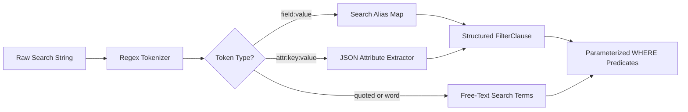

# Pulse Observability Platform: Query Engine, Parameters, Filtering & Keyset Pagination Architecture

---

## 1. Executive Summary & Architecture Overview

The Pulse Observability Query Engine is a high-throughput, deterministic, zero-SQL-injection querying subsystem designed to explore billions of partitioned telemetry events (`events_requests`, `events_errors`, `events_traces`, `events_spans`, `events_logs`, `events_metrics`, `events_profiles`, `events_cron_checkins`, `analytics_error_groups`, `analytics_user_sessions`) in sub-50ms latency.

### Core Architectural Guarantees
1. **Zero SQL Injection**: Identifiers come strictly from server-defined field registries; all user values are parameterized via `ParamBag` (`$1, $2, ...`).
2. **Index-Aware Query Planning**: Every query leads with tenant isolation (`organization_id = $1`), optional project/environment scopes, and a clamped time range matching composite indexes (`idx_<table>_tenant_env_time` / `idx_<table>_tenant_time`).
3. **Deterministic Keyset Pagination**: Eliminates PostgreSQL `OFFSET` overhead and page drift by utilizing binary tuple comparisons on `(occurred_at, id)` with opaque base64url cursor tokens.
4. **Single-Pass Aggregations**: Fetches paginated rows, facet counts, and statistical aggregates in parallel without blocking the main event stream.

---

## 2. API Endpoints & Route Taxonomy

All observability endpoints are mounted under `/organizations/:orgId/observability/:resource` (defined in [`pulse/src/modules/observability/routes.ts`](file:///c:/Users/vikas/OneDrive/Desktop/SaasBackend/pulse/src/modules/observability/routes.ts)):

| Method | Endpoint | Description |
| :--- | :--- | :--- |
| `GET` | `/:resource` | **Primary Explorer List**: Returns paginated items, bidirectional cursors, facets, summary KPIs, and applied filters. |
| `GET` | `/:resource/summary` | **Fast KPI Aggregates**: Returns summary metrics (e.g. `total`, `errorRate`, `p95`) without row fetching. |
| `GET` | `/:resource/stats` | **Statistical Distribution**: Returns `avg`, `min`, `max`, `sum`, `p50`, `p90`, `p99`. |
| `GET` | `/:resource/timeline` | **Histogram Sparkline**: Buckets event volume and error volume into `minute`, `hour`, or `day` intervals. |
| `GET` | `/:resource/:id` | **Event Detail**: Resolves event by UUID or `public_id` (`REQ-...`, `TRC-...`, `ERR-...`) with full relations. |
| `GET` | `/:resource/:id/related/:relation` | **Relational Drilldown**: Fetches child/correlated `spans`, `errors`, `logs`, `requests`, or `metrics`. |
| `POST` | `/:resource/:id/ask` | **AI Root-Cause Investigator**: Executes one of 8 specialized diagnostic intents on the target event. |
| `POST` | `/:resource/analyze` | **Bulk AI Investigation**: Analyzes a filtered or selected cohort of events. |
| `GET` | `/:resource/live` | **SSE Stream**: Real-time Server-Sent Events stream for live event tailing. |
| `GET` | `/:resource/export` | **Data Export**: Streams raw CSV or JSON exports with streaming backpressure. |

---

## 3. Query Parameters & Wire Translation

Query parameters arrive over HTTP as raw strings and are strictly validated by Zod in [`query-schema.ts`](file:///c:/Users/vikas/OneDrive/Desktop/SaasBackend/pulse/src/modules/observability/query-engine/query-schema.ts):

```typescript
export const RawExplorerQuerySchema = z.object({
  search: z.string().max(2000).optional(),
  from: z.coerce.date().optional(),
  to: z.coerce.date().optional(),
  range: z.enum(['15m', '1h', '6h', '24h', '7d', '30d', '90d']).optional(),
  environment: z.string().trim().min(1).max(64).regex(/^[A-Za-z0-9][A-Za-z0-9._-]*$/).optional(),
  projectId: z.string().uuid().optional(),
  sort: z.string().max(128).optional(),
  cursor: z.string().max(4096).optional(),
  direction: z.enum(['forward', 'backward']).default('forward'),
  limit: z.coerce.number().int().min(1).max(200).default(50),
  fields: z.string().max(2000).optional(),
  filters: z.string().max(20000).optional(),
  live: z.union([z.boolean(), z.enum(['true', 'false', '1', '0'])]).optional(),
});
```

### Parameter Breakdown

| Parameter | Type | Default | Example | Behavior |
| :--- | :--- | :--- | :--- | :--- |
| `search` | `string` | `undefined` | `service:auth status:500 "timeout"` | Free-text + key:value DSL search. Parsed into structured filter clauses + ILIKE terms. |
| `range` | `enum` | `'24h'` | `'1h'`, `'7d'` | Relative time preset. Converted to `[NOW() - ms, NOW()]`. |
| `from` / `to` | `ISO 8601` | `undefined` | `2026-08-15T00:00:00Z` | Absolute time boundary. Overrides `range`. Clamped to tenant plan retention floor. |
| `environment` | `string` | `undefined` | `'production'` | Scopes events to a specific deployment environment. |
| `projectId` | `UUID` | `undefined` | `523d55d4-...` | Scopes events to a specific project. |
| `sort` | `string` | `occurredAt:desc` | `durationMs:desc` | Field and direction (`field:asc` or `field:desc`). Must target a sortable registered field. |
| `cursor` | `string` | `undefined` | `eyJ0IjoiMjAy...` | Opaque base64url keyset cursor from a previous page. |
| `direction` | `enum` | `'forward'` | `'forward'`, `'backward'` | Paging scan direction relative to the cursor. |
| `limit` | `integer` | `50` | `25`, `100` | Page size (`1` to `200`). Engine fetches `limit + 1` to compute `hasNext`/`hasPrevious`. |
| `fields` | `string` | default projection | `id,publicId,statusCode,durationMs` | Comma-separated list of projected fields to reduce payload egress. |
| `filters` | `JSON string`| `undefined` | `[{"field":"statusCode","op":"gte","value":500}]` | Structured array of filter clauses with typed operators. |

---

## 4. Search DSL & Structured Filter Engine

Pulse supports both structured UI filter pills and a powerful human-readable search bar DSL (e.g. `service:auth status>=500 @db.system:postgresql "connection failed"`).

### 1. Search DSL Parsing Pipeline ([`search-parser.ts`](file:///c:/Users/vikas/OneDrive/Desktop/SaasBackend/pulse/src/modules/observability/query-engine/search-parser.ts))



1. **Comparison Operators**: Supports `:`, `!=`, `=`, `>`, `>=`, `<`, `<=`.
2. **Search Aliases**: Translates user-friendly shorthand to registered canonical columns (e.g. `status:500` -> `statusCode eq 500`, `method:POST` -> `httpMethod eq POST`).
3. **JSON Path Support**: Prefixes like `attr:`, `tag:`, `meta:` dynamically compile to PostgreSQL JSONB operators (e.g. `attr:db.statement:select` -> `attributes->>'db.statement' ILIKE '%select%'`).
4. **Free-Text Search**: Free words generate case-insensitive `ILIKE` predicates across the resource's indexed search columns (e.g. `name`, `endpoint`, `service`, `message`).

### 2. Supported Filter Operators ([`operators.ts`](file:///c:/Users/vikas/OneDrive/Desktop/SaasBackend/pulse/src/modules/observability/query-engine/operators.ts))

| Operator | Syntax | SQL Translation | Types Supported |
| :--- | :--- | :--- | :--- |
| `eq` | `{"op": "eq", "value": "production"}` | `column = $1` | string, number, boolean, date |
| `neq` | `{"op": "neq", "value": "test"}` | `(column != $1 OR column IS NULL)` | string, number, boolean, date |
| `gt` / `gte` | `{"op": "gte", "value": 500}` | `column >= $1` | number, date |
| `lt` / `lte` | `{"op": "lt", "value": 100}` | `column < $1` | number, date |
| `in` | `{"op": "in", "value": [200, 201]}` | `column = ANY($1)` | string[], number[] |
| `nin` | `{"op": "nin", "value": [404, 500]}` | `(column != ALL($1) OR column IS NULL)` | string[], number[] |
| `contains` | `{"op": "contains", "value": "auth"}` | `column ILIKE $1` (`%auth%`) | string |
| `ncontains` | `{"op": "ncontains", "value": "health"}` | `(column NOT ILIKE $1 OR column IS NULL)` | string |
| `startsWith`| `{"op": "startsWith", "value": "/api/v1"}` | `column ILIKE $1` (`/api/v1%`) | string |
| `endsWith` | `{"op": "endsWith", "value": ".json"}` | `column ILIKE $1` (`%.json`) | string |
| `exists` | `{"op": "exists"}` | `column IS NOT NULL` | any |
| `nexists` | `{"op": "nexists"}` | `column IS NULL` | any |
| `between` | `{"op": "between", "value": [100, 500]}` | `column BETWEEN $1 AND $2` | number, date |

---

## 5. Keyset Pagination & Cursor Deep Dive

### Why NOT `OFFSET` Pagination?
In databases with millions of partitioned rows:
```sql
-- ❌ AVOID: Scans and discards 100,000 rows, taking seconds
SELECT * FROM events_requests WHERE organization_id = $1 ORDER BY occurred_at DESC OFFSET 100000 LIMIT 50;
```
Furthermore, `OFFSET` suffers from **page drift**: if 5 new events arrive while a user is on page 1, clicking "Page 2" displays duplicate items because the entire window shifted down by 5 rows.

### The Keyset (Seek) Method
Pulse uses index-backed tuple comparison on the composite key `(occurred_at, id)`:

```sql
-- ✅ Keyset Pagination (Executes in < 2ms using index scan)
SELECT endpoint, status_code, duration_ms, id AS "__id", occurred_at AS "__t"
FROM events_requests
WHERE organization_id = $1
  AND environment = $2
  AND occurred_at >= $3 AND occurred_at < $4
  AND (occurred_at, id) < ($5, $6)  -- Keyset Seek Condition
ORDER BY occurred_at DESC, id DESC
LIMIT 51;                           -- Limit + 1 for hasNext detection
```

```
Page 1: [Row 1, Row 2, ... Row 50] ──── Last Row: (2026-08-15 10:55:40, "9947d8e5-...")
                                                   │
                                     Encodes into nextCursor
                                                   │
                                                   ▼
Page 2: WHERE (occurred_at, id) < ('2026-08-15 10:55:40', '9947d8e5-...')
```

### 1. Cursor Structure ([`cursor.ts`](file:///c:/Users/vikas/OneDrive/Desktop/SaasBackend/pulse/src/modules/observability/query-engine/cursor.ts))
The cursor is a tamper-resistant, JSON payload encoded in URL-safe base64 (`base64url`):

```typescript
export interface CursorPayload {
  /** ISO timestamp of the boundary row's time column */
  t: string;
  /** Boundary row UUID / ID (unique tie-breaker) */
  id: string;
  /** Sort direction the cursor was built under ('asc' | 'desc') */
  d: SortDirection;
}
```

Example Decoded Cursor:
```json
{
  "t": "2026-08-15T10:55:40.977Z",
  "id": "9947d8e5-61a2-41f1-b8ff-0dc954d58dff",
  "d": "desc"
}
```
Encoded Token: `eyJ0IjoiMjAyNi0wOC0xNVQxMDo1NTo0MC45NzdaIiwiaWQiOiI5OTQ3ZDhlNS02MWEyLTQxZjEtYjhmZi0wZGM5NTRkNThkZmYiLCJkIjoiZGVzYyJ9`

### 2. Bidirectional Paging (Forward & Backward)

When a user pages **backward** (e.g. `direction=backward&cursor=...`):
1. The engine inverts the scan order in SQL (`ORDER BY occurred_at ASC, id ASC`) and compares with `(occurred_at, id) > ($t, $id)`.
2. It fetches `limit + 1` rows moving backward toward the future.
3. The engine reverses the fetched array in memory before returning items to the client, preserving natural chronological display.

### 3. Response Envelope ([`types.ts`](file:///c:/Users/vikas/OneDrive/Desktop/SaasBackend/pulse/src/modules/observability/query-engine/types.ts))

```json
{
  "success": true,
  "items": [ ... ],
  "pagination": {
    "nextCursor": "eyJ0IjoiMjAyNi0wOC...",
    "previousCursor": "eyJ0IjoiMjAyNi0wOC...",
    "hasNext": true,
    "hasPrevious": false,
    "limit": 50,
    "direction": "forward"
  },
  "summary": {
    "total": 100,
    "errorCount": 4,
    "p95": 142.5
  },
  "statistics": {
    "avgValue": 12.08,
    "maxValue": 245.0,
    "minValue": 1.2
  },
  "appliedFilters": [
    { "field": "environment", "op": "eq", "value": "production" }
  ],
  "availableFilters": [ ... ],
  "states": {
    "empty": false
  }
}
```

---

## 6. Frontend Integration & React Infinite Table

In the frontend (`pulsiv_fe`), observability tables use [`useObservabilityList`](file:///c:/Users/vikas/OneDrive/Desktop/SaasBackend/pulsiv_fe/src/pages/observe/hooks/useObservabilityApi.ts) and [`InfiniteTable`](file:///c:/Users/vikas/OneDrive/Desktop/SaasBackend/pulsiv_fe/src/shared/observe/InfiniteTable.tsx):

```tsx
// Example: Querying requests with range and status filters
const { data, isLoading } = useObservabilityList('requests', {
  range: '1h',
  environment: 'production',
  search: 'status>=500 service:billing',
  limit: 50,
  cursor: currentCursor,
  direction: 'forward',
});

// Navigate forward:
const handleNextPage = () => {
  if (data?.pagination?.nextCursor) {
    setCursor(data.pagination.nextCursor);
    setDirection('forward');
  }
};
```

---

## 7. Performance & Index Optimization Checklist

To maintain sub-50ms query times on tens of millions of rows, all telemetry tables in LogDB follow these physical design rules:

1. **Partitioning Key**: All `events_*` tables are range-partitioned by `occurred_at`.
2. **Composite Tenant Index**: Every table has `(organization_id, environment, occurred_at DESC)` and `(organization_id, project_id, occurred_at DESC)`.
3. **Correlation Lookups**: Separate indexes exist for `(organization_id, project_id, trace_id)` and `(organization_id, project_id, public_id)`.
4. **No Full Table Scans**: Queries without `organization_id` are strictly rejected by the engine before reaching the database pool.
