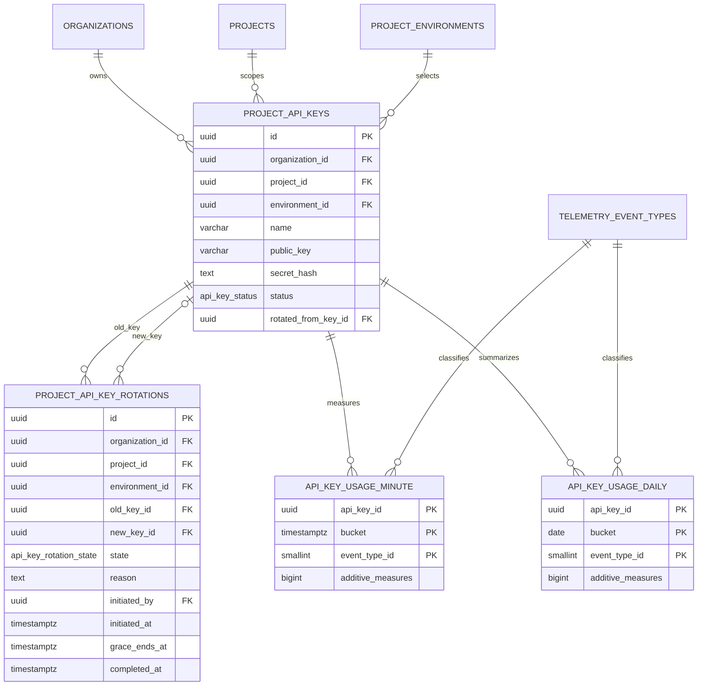
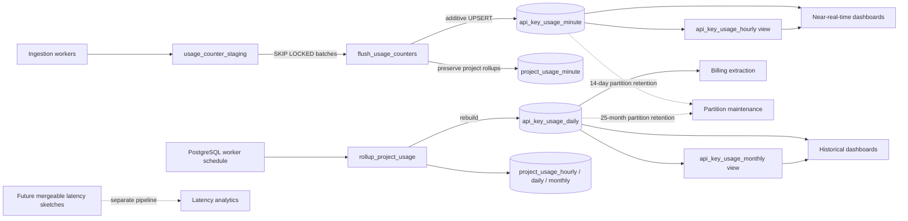

# API-key credential and usage normalization

Status: canonical database design implemented by forward migration `04_projects/018_normalize_project_api_keys_and_usage.up.sql`.
Ledgered migrations `005`–`017` are historical inputs; editing them would not upgrade an existing database.

## Decision summary

- `project_api_keys` is a minimal credential and direct-lineage record.
- Rotation workflow/history moves to `project_api_key_rotations` before credential columns are dropped.
- API-key usage has exactly two physical facts: monthly-partitioned `api_key_usage_minute` and yearly-partitioned `api_key_usage_daily`.
- `api_key_usage_hourly` and `api_key_usage_monthly` are read-only aggregate views.
- A `SMALLINT` `telemetry_event_types` key replaces repeated event-type text in physical facts.
- Tenant dimensions remain denormalized for shard and dashboard pruning. A composite foreign key and a `BEFORE` trigger both reject dimension drift.
- API-key measures are `request_count`, `accepted_event_count`, `error_event_count`, `ingestion_failure_count`, `accepted_bytes`, and `rate_limited_request_count`.
- Percentiles use **Option 1: remove now**. Percentiles are non-composable: a percentile (or the maximum of child percentiles) cannot produce the percentile of the union. A future latency system must be a separate mergeable-sketch pipeline, not columns on these additive facts.

## Credential column keep / move / remove matrix

| Legacy field or group | Action | Canonical destination / reason |
|---|---|---|
| `id`, `organization_id`, `project_id`, `environment_id` | Keep | Credential identity and tenant dimensions. |
| `name` | Keep, `NOT NULL` | Human label. |
| `public_key`, `secret_hash` | Keep | Public lookup and one-way verifier; raw secrets are never stored. |
| `status`, `expires_at`, `last_used_at` | Keep | Minimal lifecycle/authentication state. |
| `created_by`, `created_at`, `updated_at`, `deleted_at` | Keep | Ownership and lifecycle timestamps. |
| `rotated_from_key_id` | Keep | Direct old-to-new credential lineage without embedding workflow state. |
| `rotated_at`, `rotated_by`, `rotation_reason`, `rotation_state`, `grace_period_ends_at` | Move | Backfilled to `project_api_key_rotations` as initiation/completion state. |
| `rotation_version` | Remove | Workflow history rows replace mutable version counters. |
| `key_type`, `description`, `is_active` | Remove | Type/presentation/duplicate lifecycle state do not belong to the credential. `status` is authoritative. |
| `revoked_at`, `revoked_by`, `revoked_reason` | Remove | Revocation is represented by status and audit history, not parallel fields. |
| `auto_rotate_enabled`, `auto_rotate_days` | Remove | Rotation policy belongs outside credentials. |
| `usage_count`, `error_count`, `last_used_ip` | Remove | Counters and request metadata belong to telemetry facts/events. |
| `rate_limit_per_second`, `rate_limit_per_minute`, `rate_limit_per_hour` | Remove | Policy belongs to entitlement/ingestion configuration. |
| `permissions`, `allowed_endpoints`, `blocked_endpoints` | Remove | Authorization/routing policy is not secret identity. |
| `allowed_sdks`, `allowed_origins`, `allowed_ips`, `allowed_domains`, `allowed_event_types` | Remove | SDK/network/event policy belongs to environment or ingestion configuration. |
| `sampling_rules`, `feature_flags`, `sdk_config` | Remove | Already moved to versioned environment SDK configuration. |
| `metadata`, `version` | Remove | Avoid unbounded credential payload and duplicated optimistic-lock state. |

Final `project_api_keys` columns are only: `id`, `organization_id`, `project_id`, `environment_id`, `name`, `public_key`, `secret_hash`, `status`, `expires_at`, `last_used_at`, `created_by`, `rotated_from_key_id`, `created_at`, `updated_at`, `deleted_at`.
## Data model

## Rollup implementation options

| Option | Description | Assessment |
|---|---|---|
| **A — PostgreSQL worker rollups** | Scheduled workers call bounded SQL functions; minute writes are additive UPSERTs and daily rows are deterministic rebuilds. | **Recommended now.** Explicit retry/idempotency behavior, no extension dependency, operationally observable, and compatible with ordinary PostgreSQL. |
| **B — materialized views** | Refresh aggregate snapshots. | Rejected for the write path: refresh cost and locking/refresh cadence are poor fits for continuously changing near-real-time facts; materialized views also do not solve retention or incremental billing extraction. |
| **C — continuous aggregates** | Extension-managed incremental aggregates. | Deferred: useful at larger scale but introduces extension/vendor coupling and separate refresh/retention semantics. Adopt only after measured worker bottlenecks justify it. |

Option A uses normal aggregate views only for hourly/monthly reads; these are not materialized and are inherently read-only because they group rows.
## Partitioning, retention, and indexes

`api_key_usage_minute` is range-partitioned by `bucket` in UTC calendar months. Migration 018 creates partitions covering all migrated minute data plus the previous, current, and next month. A maintenance worker must create the next partition before month-end and drop a partition only when its upper bound is older than the 14-day retention cutoff. Monthly partition granularity means live retention can exceed 14 days by up to one month; row deletion may enforce an exact cutoff if required, but dropping whole partitions is the normal low-WAL path.

`api_key_usage_daily` is range-partitioned by `bucket` in UTC years. Migration 018 covers all migrated data and the current retention window. Keep 25 months so billing disputes and year-over-year dashboards span two full years plus the active month. A worker creates next year's partition and drops a year partition only after every date in it is older than 25 months; exact-cutoff row deletion is optional.

Both facts use `(api_key_id, bucket, event_type_id)` as the partition-compatible primary key. Tenant/dashboard indexes begin with `(organization_id, project_id, environment_id, bucket DESC)`; project-time indexes support project dashboards. Partition pruning uses `bucket`, while denormalized dimensions avoid credential joins. `project_api_key_rotations` indexes tenant/time, old-key history, and non-null new keys.

## Write, rollup, billing, and dashboard contracts

`flush_usage_counters()` claims at most 10,000 eligible staging rows with `FOR UPDATE SKIP LOCKED`. It resolves credential dimensions, interns event types, aggregates each minute, and performs `ON CONFLICT ... DO UPDATE` by **adding** every measure to the stored row. Addition is atomic under PostgreSQL row locking, so concurrent workers cannot overwrite each other's increments. Staging rows are deleted in the same transaction as both API-key and project minute UPSERTs.

`rollup_project_usage()` preserves project minute → hour → day → month/current rebuilds but contains no latency fields. For API keys it rebuilds only daily physical facts from minute rows using replacement UPSERTs. Hourly and monthly are queries, not write targets.

- **Billing source:** `api_key_usage_daily` (and canonical project monthly billing facts where project-level billing is required). Billing jobs checkpoint closed UTC days and must not bill from hourly/monthly views.
- **0–14 day dashboards:** minute for detailed charts; hourly view for downsampled charts.
- **15 days–25 months dashboards:** daily; monthly view for long-range visualization.
- **Key comparisons:** filter daily/minute by tenant dimensions and key IDs; join `telemetry_event_types` only when labels are needed.
- **Operational totals:** project dashboards continue to use `project_usage_*`; API-key facts are attribution detail, not a second project billing ledger.

## Integrity and event taxonomy

The composite foreign key `(api_key_id, project_id, organization_id, environment_id)` references the same unique tuple on `project_api_keys`. A `BEFORE INSERT OR UPDATE` trigger performs the same check early and emits a clear tenant-dimension error. The FK remains the authoritative race-safe constraint. `telemetry_event_types.id` is a compact `SMALLINT`; workers insert unseen names idempotently before fact UPSERTs. Renaming/deleting an event type is a controlled taxonomy migration, never an ad-hoc fact rewrite.

## Migration phases and data precedence

1. Create `project_api_key_rotations`; backfill linked rotations from `rotated_from_key_id`, then backfill legacy state-only rotations that have no successor row.
2. Add tenant indexes/FKs, then drop obsolete credential columns. Preserve `rotated_from_key_id`.
3. Rename the four legacy usage tables and copy all rows to a transaction-local staging shape with normalized measures.
4. Seed event types, create partitioned minute/daily parents and all partitions needed by migrated data, indexes, composite FKs, and tenant triggers.
5. Copy minute rows exactly. Build daily rows with precedence `legacy daily > hourly > minute` per key/day/type to avoid double-counting replicated rollup grains. Preserve monthly-only history on the first day of its month only when no finer row exists in that month.
6. Drop legacy physical tables; create read-only hourly/monthly views.
7. Drop API-key and project usage percentile columns; replace flush and rollup functions.
8. Commit atomically. The manual teardown is updated for dependency order but is never part of migration discovery and must not be run during deployment.

## Bottlenecks and operating signals

- **Minute-row contention:** one very hot key/type/minute serializes on one UPSERT row. Monitor lock wait time; shard the staging batch by key only if measured contention is material.
- **View scan cost:** hourly reads over many keys can scan many minute partitions. Tenant/time predicates are mandatory. If this becomes dominant, evaluate Option C or a separate cache—not another writable hourly table by default.
- **Daily rebuild window:** rebuilding all retained minute rows is bounded by 14 days but can still create write amplification. Workers should process closed/recent UTC days and expose lag/watermark metrics.
- **Taxonomy cardinality:** unbounded user-provided event names can exhaust `SMALLINT` or fragment facts. Validate names and alert on lookup growth.
- **Late events:** additive minute UPSERTs accept late data while retained. Re-run the affected daily rebuild before billing closes the day.
- **Partition readiness:** alert if no next monthly/yearly partition exists. Never rely on application errors to discover a missing partition.
- **Retention lag:** record oldest minute/daily partition bounds and alert when they exceed policy.
- **Percentiles:** do not reconstruct by averaging or taking maxima. A future pipeline stores mergeable sketches with its own schema, retention, rollups, and query API.
