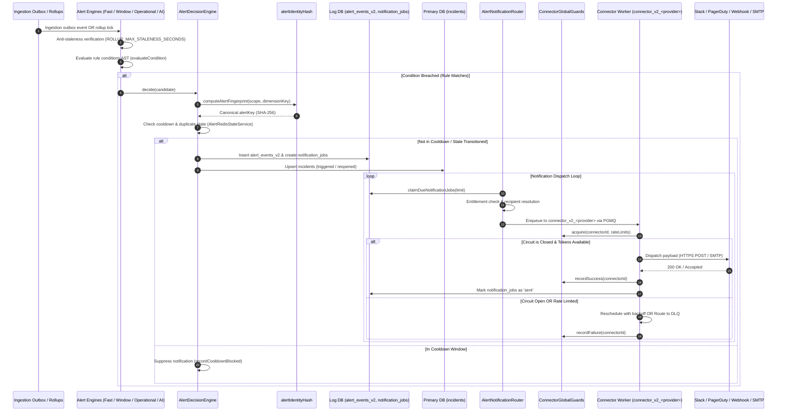

# Alerting Engine Architecture

## 1. System Role & Responsibilities

The Alerting Engine evaluates incoming telemetry events, periodic metric rollups, and operational health signals against user-defined alert rules, manages incident lifecycles, and orchestrates multichannel notification delivery.

### What the Subsystem Does
- **Multi-Tier Rule Evaluation**: Evaluates conditions across four distinct operational cadences:
  1. *Fast Tier*: Event-driven evaluation directly off the ingestion outbox stream for critical real-time triggers (error regressions, security events, crashes).
  2. *Window Tier*: Periodic 5-second evaluation querying 1-minute rollup metric tables (`*_metrics_1m`).
  3. *Operational Tier*: Periodic 30-second evaluation checking host/service system metrics.
  4. *AI Tier*: Periodic 300-second evaluation evaluating AI token usage and latency trends over 1-hour rollups (`ai_metrics_1h`).
- **Anti-Staleness Protection**: Protects against false alarms caused by lagging analytics workers via `ROLLUP_MAX_STALENESS_SECONDS`, skipping evaluation and recording `alert_evaluation_stale_total` if source rollup data exceeds freshness limits.
- **Canonical Fingerprint Deduplication**: Hashes organizational scope, project, environment, rule ID, policy ID, and normalized dimension keys into a byte-identical identity hash (`alertIdentityHash`), preventing duplicate alerts across concurrent workers.
- **Incident Lifecycle Management**: Transitions incidents through state machine phases (`triggered`, `acknowledged`, `resolved`, `reopened`) in [`src/modules/alerting/incidents/incidents.repository.ts`](file:///c:/Users/vikas/OneDrive/Desktop/SaasBackend/pulse/src/modules/alerting/incidents/incidents.repository.ts).
- **Entitlement & Notification Routing**: Resolves notification channels based on plan tier entitlements (`NotificationEntitlementService`), enforces owner fallback rules (`EmailOnlyRestrictedRouting`), and formats rich HTML/Markdown payloads.
- **Resilient Transport Dispatch**: Enqueues notification jobs into PGMQ transport queues (`connector_v2_<provider>`), protected by per-connector rate limits and automated circuit breakers (`ConnectorGlobalGuards`).
- **Escalation & Auto-Resolution**: Schedules delayed escalation snapshots (`alert_escalate`, `alert_escalation_sweep`) and auto-closes inactive alerts past their `auto_resolve_at` deadline (`alert_auto_resolve_sweep`).

### What the Subsystem Does NOT Do
- **Direct Synchronous Delivery**: Does not invoke third-party webhook endpoints or email SMTP relays inside API or evaluation loops.
- **Ad-Hoc SQL Execution by Users**: Does not execute unbounded arbitrary raw SQL queries for alert evaluation; all conditions execute through parameterized AST evaluator logic (`evaluateCondition`).
- **Per-Event Incident Storage on Ingestion Path**: Incident state is maintained in the control-plane database and updated solely inside asynchronous alert worker loops.

---

## 2. Code Traceability Map

| Component / Layer | Source File Path | Key Classes / Functions | Primary Responsibility |
| :--- | :--- | :--- | :--- |
| **Alerting Queue Supervisor** | [`src/modules/alerting/queue.ts`](file:///c:/Users/vikas/OneDrive/Desktop/SaasBackend/pulse/src/modules/alerting/queue.ts) | `registerAlertingWorkers` | Provisions PGMQ alerting queues, binds workers, schedules periodic cron sweeps, and manages worker lifecycles. |
| **Queue Name Enums** | [`src/modules/alerting/queue-names.ts`](file:///c:/Users/vikas/OneDrive/Desktop/SaasBackend/pulse/src/modules/alerting/queue-names.ts) | `ALERT_JOBS`, `ALERT_DELIVERY_WORKER_JOBS` | Canonical string definitions for all 12 alert-related queue topics. |
| **Alert Runtime Engines** | [`src/modules/alerting/runtime/engines.ts`](file:///c:/Users/vikas/OneDrive/Desktop/SaasBackend/pulse/src/modules/alerting/runtime/engines.ts) | `AlertRuntimeEngines` | Orchestrates `evaluateFast` (telemetry outbox) and `evaluateTier` (window, operational, AI rollups) with anti-staleness bounds. |
| **Decision & Deduplication Engine** | [`src/modules/alerting/decision/decision.engine.ts`](file:///c:/Users/vikas/OneDrive/Desktop/SaasBackend/pulse/src/modules/alerting/decision/decision.engine.ts) | `AlertDecisionEngine`, `alertFingerprint` | Evaluates firing vs recovery transitions, computes canonical fingerprint keys, enforces cooldown periods, and writes incident updates. |
| **Alert Identity Fingerprinting** | [`src/modules/alerting/runtime/alert-fingerprint.ts`](file:///c:/Users/vikas/OneDrive/Desktop/SaasBackend/pulse/src/modules/alerting/runtime/alert-fingerprint.ts) | `alertIdentityHash`, `computeAlertFingerprint` | Generates deterministic SHA-256 identity hashes over tenant scope and dimension attributes (`service`, `route`, `dimension`). |
| **Condition Evaluator** | [`src/modules/alerting/evaluator.ts`](file:///c:/Users/vikas/OneDrive/Desktop/SaasBackend/pulse/src/modules/alerting/evaluator.ts) | `evaluateRule`, `evaluateCondition` | In-memory evaluation of AST comparison expressions (`gt`, `gte`, `lt`, `lte`, `eq`, `neq`, `contains`) against payload values. |
| **Notification Routing Service** | [`src/modules/alerting/runtime/notification-routing.service.ts`](file:///c:/Users/vikas/OneDrive/Desktop/SaasBackend/pulse/src/modules/alerting/runtime/notification-routing.service.ts) | `NotificationRoutingService` | Matches alert severity, policy bindings, recipient overrides, and channel configurations to produce concrete dispatch targets. |
| **Notification Router Worker** | [`src/modules/alerting/runtime/notification-router.ts`](file:///c:/Users/vikas/OneDrive/Desktop/SaasBackend/pulse/src/modules/alerting/runtime/notification-router.ts) | `AlertNotificationRouter` | Claims pending notification jobs from `notification_jobs` and enqueues them to `connector_v2_<provider>` or managed email queues. |
| **Entitlement Enforcement** | [`src/modules/alerting/runtime/notification-entitlement.service.ts`](file:///c:/Users/vikas/OneDrive/Desktop/SaasBackend/pulse/src/modules/alerting/runtime/notification-entitlement.service.ts) | `NotificationEntitlementService` | Restricts delivery channels (e.g., Slack, PagerDuty, Webhooks) based on tenant plan tiers (`free`, `starter`, `pro`, `enterprise`). |
| **Restricted Routing & Fallback** | [`src/modules/alerting/runtime/email-only-restricted-routing.ts`](file:///c:/Users/vikas/OneDrive/Desktop/SaasBackend/pulse/src/modules/alerting/runtime/email-only-restricted-routing.ts) | `EmailOnlyRestrictedRouting`, `ProjectOwnerRepository` | Enforces verified project-owner delivery when third-party channels are disabled or unconfigured. |
| **Notification Formatter** | [`src/modules/alerting/runtime/alert-notification-formatter.ts`](file:///c:/Users/vikas/OneDrive/Desktop/SaasBackend/pulse/src/modules/alerting/runtime/alert-notification-formatter.ts) | `buildAlertNotificationPayload`, `renderEnterpriseAlertEmail` | Assembles title, description, rich metrics tables, evidence snippets, and deep links for email and external connectors. |
| **Escalation Worker & Sweeps** | [`src/modules/alerting/escalation/escalation.worker.ts`](file:///c:/Users/vikas/OneDrive/Desktop/SaasBackend/pulse/src/modules/alerting/escalation/escalation.worker.ts), [`escalation.ts`](file:///c:/Users/vikas/OneDrive/Desktop/SaasBackend/pulse/src/modules/alerting/escalation.ts) | `SnapshotEscalationWorker`, `AlertEscalationSweep` | Advances multi-step escalation policies when firing incidents remain unacknowledged. |
| **Auto-Resolve Sweep** | [`src/modules/alerting/runtime/auto-resolve-sweep.ts`](file:///c:/Users/vikas/OneDrive/Desktop/SaasBackend/pulse/src/modules/alerting/runtime/auto-resolve-sweep.ts) | `AlertAutoResolveSweep` | Scans active alerts with configured auto-resolve timeouts and transitions them to `resolved` when signals cease. |
| **Connector Circuit Breakers** | [`src/modules/connectors/runtime-global-guards.ts`](file:///c:/Users/vikas/OneDrive/Desktop/SaasBackend/pulse/src/modules/connectors/runtime-global-guards.ts) | `ConnectorGlobalGuards` | Atomic token-bucket rate limiting and `closed` $\to$ `open` $\to$ `half_open` state machine for third-party connector destinations. |

---

## 3. Data Flow & Sequence Diagram

The following sequence traces the entire alerting lifecycle from ingestion signal emission to external connector delivery:



---

## 4. Payloads & Data Contracts

### 4.1 Fast Evaluation Input Contract
Passed to `evaluateFast` from the telemetry outbox relay in [`src/modules/alerting/runtime/engines.ts`](file:///c:/Users/vikas/OneDrive/Desktop/SaasBackend/pulse/src/modules/alerting/runtime/engines.ts#L33-L51):

```typescript
export interface FastEvaluationInput {
  organizationId: string;
  projectId?: string | null;
  environment?: string | null;
  events?: ScopedEvent[];                // Normalized telemetry events
  signals?: FastSignalInput[];           // High-priority signal triggers
}

export interface FastSignalInput {
  projectId?: string | null;
  environment?: string | null;
  service?: string | null;
  endpoint?: string | null;
  source: 'deployment' | 'heartbeat' | 'connector' | 'security' | 'custom';
  kind: string;                          // E.g., 'error_group_regressed', 'service_unhealthy'
  occurredAt?: string | Date;
  labels?: Record<string, unknown>;
  evidence?: Record<string, unknown>;
}
```

### 4.2 Canonical Alert Identity Contract
Derived via [`src/modules/alerting/runtime/alert-fingerprint.ts`](file:///c:/Users/vikas/OneDrive/Desktop/SaasBackend/pulse/src/modules/alerting/runtime/alert-fingerprint.ts) to guarantee consistent grouping:

```typescript
export interface AlertIdentityComponents {
  organizationId: string;
  projectId: string;                     // Default: 'organization'
  environment: string;                   // Default: 'all'
  ruleId: string;
  policyId: string;
  dimensionKey: string;                  // Sorted 'dim=...|route=...|service=...'
}

// Fingerprint formula:
// sha256("org:proj:env:ruleId:policyId:dimensionKey").slice(0, 32)
```

### 4.3 Notification Transport Job Payload
Enqueued to PGMQ transport queues (`connector_v2_<provider>`) in [`src/modules/connectors/delivery/transport.types.js`](file:///c:/Users/vikas/OneDrive/Desktop/SaasBackend/pulse/src/modules/connectors/delivery/transport.types.ts):

```typescript
export interface ConnectorTransportJob {
  organizationId: string;
  notificationJobId: string;
  connectorId: string;
  projectId?: string | null;
  alertEventId: string;
  alertKey: string;
  ruleId: string;
  channelKind: string;                   // 'webhook' | 'slack' | 'pagerduty' | 'discord' | 'teams'
  provider: string;                      // E.g., 'SLACK_WEBHOOK', 'GENERIC_WEBHOOK'
  severity: 'critical' | 'error' | 'warning' | 'info';
  payload: {
    title: string;
    description: string;
    summary: string;
    severity: string;
    status: 'firing' | 'resolved';
    firedAt: string;
    resolvedAt?: string;
    metricValue?: number;
    threshold?: number;
    linkUrl?: string;
    metadata?: Record<string, unknown>;
  };
  idempotencyKey: string;
  routingDecisionHash: string;
}
```

---

## 5. Edge Cases & Failure Recovery

### 5.1 Analytics Rollup Worker Lag & Anti-Staleness Protection
- **Problem**: If background analytics workers stall, TimescaleDB rollup tables (`*_metrics_1m`, `ai_metrics_1h`) stop advancing. Evaluating stale data causes false alerts on already-resolved issues or masks ongoing outages.
- **Protection**: [`src/modules/alerting/runtime/engines.ts`](file:///c:/Users/vikas/OneDrive/Desktop/SaasBackend/pulse/src/modules/alerting/runtime/engines.ts#L91-L95) enforces strict staleness thresholds:
  - `window` tier: 180 seconds ($3 \times 60\text{s}$ bucket size).
  - `operational` tier: 300 seconds ($5 \times 60\text{s}$ bucket size).
  - `ai` tier: 7,200 seconds ($2 \times 3,600\text{s}$ bucket size).
  If the newest rollup bucket is older than the allowed threshold, evaluation is skipped, incrementing `alert_evaluation_stale_total`.

### 5.2 Split-Brain Deduplication Across Clustered Alert Workers
- **Problem**: Multiple worker processes evaluating the same scope at the same second could generate duplicate alerts and spam recipients.
- **Protection**:
  1. `AlertRedisStateService` evaluates atomic cooldown keys before creating decision candidates.
  2. `AlertDecisionEngine` relies on database-level unique constraints on `alert_events_v2` and `incidents` (`organization_id`, `project_id`, `alert_key`, `opened_at`), ensuring duplicate inserts result in an idempotent reuse of existing incident records.

### 5.3 External Webhook Latency Spikes & Circuit Breakers
- **Problem**: A customer's webhook endpoint goes down or responds with 30-second timeouts, saturating worker connections.
- **Protection**: [`src/modules/connectors/runtime-global-guards.ts`](file:///c:/Users/vikas/OneDrive/Desktop/SaasBackend/pulse/src/modules/connectors/runtime-global-guards.ts) wraps every connector:
  - Atomic token bucket per connector (`limit` within `windowSeconds`).
  - Consecutive failure tracking: If failures reach `failureThreshold` (default: 5), the circuit trips to `open` for `resetSeconds` (default: 60s).
  - While `open`, outbound deliveries fail fast without making network requests, safeguarding worker connection pools.

### 5.4 Missing Entitlements & Owner Fallback
- **Problem**: An organization downgrades from an Enterprise plan to Free, but rules still point to Slack or PagerDuty connectors.
- **Protection**: [`src/modules/alerting/runtime/notification-entitlement.service.ts`](file:///c:/Users/vikas/OneDrive/Desktop/SaasBackend/pulse/src/modules/alerting/runtime/notification-entitlement.service.ts) dynamically suppresses unauthorized channels and routes critical notifications via `EmailOnlyRestrictedRouting` directly to verified project owner email addresses.

---

## 6. Configuration Parameters

The following parameters in [`src/config/env.ts`](file:///c:/Users/vikas/OneDrive/Desktop/SaasBackend/pulse/src/config/env.ts) govern the alerting engine:

| Parameter | Type | Default | Operational Impact & Production Guidance |
| :--- | :--- | :--- | :--- |
| `ALERT_WINDOW_EVAL_INTERVAL_SECONDS` | `number` | `5` | Cadence (seconds) for windowed metric evaluations against 1-minute rollups. |
| `ALERT_OPERATIONAL_EVAL_INTERVAL_SECONDS` | `number` | `30` | Cadence (seconds) for operational system metric evaluations. |
| `ALERT_AI_EVAL_INTERVAL_SECONDS` | `number` | `300` | Cadence (seconds) for AI token/cost trend evaluations against 1-hour rollups. |
| `ALERT_COOLDOWN_SECONDS` | `number` | `300` | Default suppression window (5 minutes) following a fired alert to prevent notification spamming. |
| `ALERT_AUTO_RESOLVE_TIMEOUT_SECONDS` | `number` | `1800` | Inactivity duration (30 minutes) before an unfired alert is marked as resolved. |
| `ALERT_ROUTER_BATCH_SIZE` | `number` | `100` | Maximum notification jobs claimed per run by `AlertNotificationRouter`. |
| `CONNECTOR_CONCURRENCY` | `number` | `5` | Concurrency limit for connector transport workers. |
| `CONNECTOR_SEND_EXPIRE_SECONDS` | `number` | `60` | Visibility expiration for outbound webhook/email delivery jobs in PGMQ. |
| `CONNECTOR_RATE_LIMIT_PER_MINUTE` | `number` | `120` | Default per-connector outbound HTTP request rate limit. |
| `CONNECTOR_CIRCUIT_FAILURE_THRESHOLD` | `number` | `5` | Number of consecutive delivery failures before tripping the connector circuit breaker to `open`. |
| `CONNECTOR_CIRCUIT_RESET_SECONDS` | `number` | `60` | Duration the circuit remains `open` before entering `half_open` probe state. |
