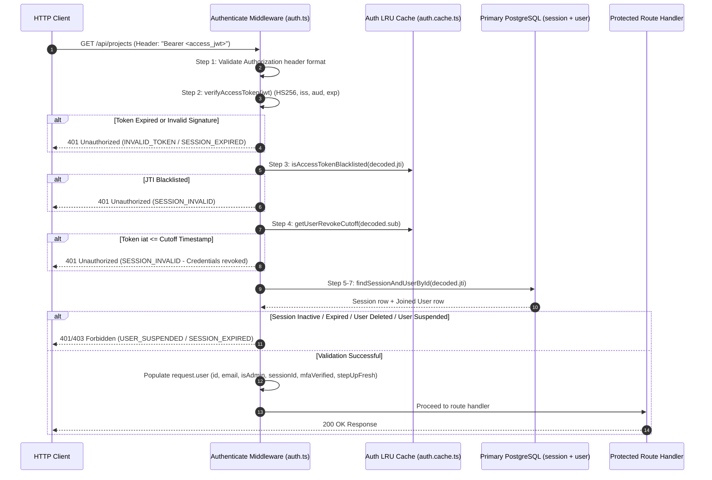

# Authentication & RBAC Architecture

## 1. System Role & Responsibilities

The Authentication and Role-Based Access Control (RBAC) subsystem governs identity verification, token lifecycle management, multi-factor challenges, API credential minting, and fine-grained authorization across organizations and projects.

### What the Subsystem Does
- **Dual-Token Session Lifecycle**: Issues short-lived access JWTs (15-minute TTL) alongside long-lived, HTTP-only refresh tokens (7-day standard, 30-day "Remember Me" TTL) backed by a 30-second graceful rotation window.
- **Fail-Closed Fast Gatekeeper**: Authenticates every API request via a strict, non-short-circuiting 7-step sequence in [`src/shared/middleware/auth.ts`](file:///c:/Users/vikas/OneDrive/Desktop/SaasBackend/pulse/src/shared/middleware/auth.ts) that validates headers, JWT crypto signatures, token-level LRU blacklists, user-level revocation cutoffs, database session status, and account suspension flags.
- **Tiered Multi-Factor & Step-Up Security**: Supports TOTP, WebAuthn/Passkeys, and emergency backup codes. Differentiates session-level verification (`requireMFA`) from ephemeral 5-minute privilege escalation (`requireStepUp`) for destructive mutations.
- **Timing-Safe Crypto Defenses**: Employs bcrypt (cost 12) with a dummy hash comparator (`FAKE_BCRYPT_HASH`) to neutralize user enumeration timing attacks, HMAC-SHA256 for email tokens, and `timingSafeEqual` hex comparisons for API keys.
- **Dual-Tier Hierarchical RBAC**: Enforces independent role inheritance hierarchies at both the Organization level (`owner` > `admin` > `developer` > `security`/`billing` > `member` > `viewer`) and the Project level (`owner` > `admin` > `developer`/`qa` > `viewer`).
- **Telemetry Ingestion API Keys**: Mints prefixed credentials (`pv_live_...` and `pv_test_...`) containing high-entropy public and secret components, persisting only SHA-256 hashes with support for dual-key grace-period rotation.

### What the Subsystem Does NOT Do
- **Stateless Distributed Session Invalidation via Redis**: Session revocation deliberately does not depend on Redis; it uses an in-memory per-process LRU cache coupled with direct PostgreSQL primary-key lookups as the canonical cross-process source of truth.
- **Client-Side Authorization Enforcement**: Never trusts claims directly from client storage; all tenant memberships and privileges are checked against backend transactional tables.

---

## 2. Code Traceability Map

| Component / Layer | Source File Path | Key Classes / Functions | Primary Responsibility |
| :--- | :--- | :--- | :--- |
| **Authentication Middleware** | [`src/shared/middleware/auth.ts`](file:///c:/Users/vikas/OneDrive/Desktop/SaasBackend/pulse/src/shared/middleware/auth.ts) | `authenticate`, `requireAdmin`, `requireMFA`, `requireStepUp` | 7-step fail-closed authentication gate, admin verification, and step-up freshness validation. |
| **JWT Token Management** | [`src/modules/auth/infrastructure/crypto/jwt.ts`](file:///c:/Users/vikas/OneDrive/Desktop/SaasBackend/pulse/src/modules/auth/infrastructure/crypto/jwt.ts) | `generateAccessToken`, `generateRefreshToken`, `verifyAccessToken`, `verifyRefreshToken` | HS256 JWT minting and cryptographic verification for access and refresh tokens. |
| **Hashing & Timing Defense** | [`src/modules/auth/infrastructure/crypto/hash.ts`](file:///c:/Users/vikas/OneDrive/Desktop/SaasBackend/pulse/src/modules/auth/infrastructure/crypto/hash.ts) | `hashToken`, `timingSafeFakePasswordCompare`, `buildDeviceFingerprint` | HMAC-SHA256 token hashing, bcrypt verification, and constant-time execution paths. |
| **Auth Constants & Policies** | [`src/modules/auth/domain/constants.ts`](file:///c:/Users/vikas/OneDrive/Desktop/SaasBackend/pulse/src/modules/auth/domain/constants.ts) | `ACCESS_TOKEN_TTL_SECONDS`, `lockoutDurationSeconds` | Canonical token lifetimes, backup code regex, progressive lockout durations, and password history depth. |
| **Session Repository** | [`src/modules/auth/infrastructure/repositories/session.repository.ts`](file:///c:/Users/vikas/OneDrive/Desktop/SaasBackend/pulse/src/modules/auth/infrastructure/repositories/session.repository.ts) | `findSessionAndUserById`, `createSession`, `revokeSession` | Single-query joined lookup of session and user rows, active session revocation. |
| **In-Memory Revocation Cache** | [`src/modules/auth/infrastructure/cache/auth.cache.ts`](file:///c:/Users/vikas/OneDrive/Desktop/SaasBackend/pulse/src/modules/auth/infrastructure/cache/auth.cache.ts) | `isAccessTokenBlacklisted`, `getUserRevokeCutoff`, `hasFreshStepUp` | High-speed LRU caches for JTI blacklisting, user-wide revocation timestamps, and step-up TTLs. |
| **Organization RBAC Types** | [`src/modules/organization/shared/types.ts`](file:///c:/Users/vikas/OneDrive/Desktop/SaasBackend/pulse/src/modules/organization/shared/types.ts) | `ROLE_HIERARCHY`, `hasMinRole`, `canManageRole` | Org role score map (100 down to 20), permission gate comparisons, mutable status checks. |
| **Project RBAC & Core Types** | [`src/modules/projects/core/project.types.ts`](file:///c:/Users/vikas/OneDrive/Desktop/SaasBackend/pulse/src/modules/projects/core/project.types.ts) | `ProjectMemberRole`, `ROLE_HIERARCHY`, `hasProjectRole` | Project role hierarchy (`owner`: 4 down to `viewer`: 1), project schemas, and parameter validation. |
| **API Key Service** | [`src/modules/projects/api-keys/api-key.service.ts`](file:///c:/Users/vikas/OneDrive/Desktop/SaasBackend/pulse/src/modules/projects/api-keys/api-key.service.ts) | `ApiKeyService`, `createApiKey` | API key lifecycle, rotation grace period enforcement, and audit logging. |
| **API Key Crypto Utilities** | [`src/modules/projects/shared/utils.ts`](file:///c:/Users/vikas/OneDrive/Desktop/SaasBackend/pulse/src/modules/projects/shared/utils.ts) | `createApiKey`, `hashApiKey`, `constantTimeEqualHex` | Generation of `pv_live_` / `pv_test_` keys, SHA-256 secret hashing, and constant-time hex equality checks. |
| **Ingestion API Key Extractor** | [`src/modules/ingestion/utils/api-key.ts`](file:///c:/Users/vikas/OneDrive/Desktop/SaasBackend/pulse/src/modules/ingestion/utils/api-key.ts) | `extractApiKeyFromRequest`, `resolveApiKey` | Resolves keys from `X-API-Key`, `Authorization: Bearer <key>`, or JSON payload bodies. |

---

## 2.1 Role-Based Access Control (RBAC) Matrix

### Organization Role Hierarchy
Organization permissions follow a strict numerical ranking (`ROLE_HIERARCHY`):

| Organization Role | Hierarchy Weight | Description & Typical Permissions |
| :--- | :---: | :--- |
| **`owner`** | **100** | Full tenant sovereignty: Transfer organization ownership, delete organization, update billing/invoicing plans, manage all members. |
| **`admin`** | **80** | Administrative control: Invite/suspend members up to `developer`, provision projects, rotate production API keys, configure SSO/SAML integrations. |
| **`developer`** | **60** | Technical delivery: Create and modify projects, generate development/test API keys, manage alert configurations and connector routing. |
| **`security`** | **50** | Security compliance: Inspect audit logs, manage MFA/SSO configurations, review API key rotations, inspect incident histories. |
| **`billing`** | **50** | Financial management: Manage subscription tiers, view usage rollups, update payment cards, view invoices. Cannot view application source data. |
| **`member`** | **40** | General member: Read-only visibility into organization projects, view dashboards, acknowledge alerts. |
| **`viewer`** | **20** | Restricted observer: Read-only access to specific dashboards and shared reports. |

### Project Role Hierarchy
Project membership operates independently within the bounds of a project:

| Project Role | Rank | Allowed Operations |
| :--- | :---: | :--- |
| **`owner`** | **4** | Archive project, transfer project ownership, delete environments. |
| **`admin`** | **3** | Manage project members, mint and revoke project API keys, configure environment settings. |
| **`developer`** | **2** | Create telemetry alert rules, update SDK configuration, view live spans and logs. |
| **`qa`** | **2** | Inspect telemetry test environments, acknowledge non-critical alerts. |
| **`viewer`** | **1** | Read-only inspection of project metrics and incident lists. |

---

## 3. Data Flow & Sequence Diagram

The following sequence details an authenticated request passing through the fail-closed authentication gate, highlighting token inspection, in-process LRU checks, and database validation:



---

## 4. Payloads & Data Contracts

### 4.1 Access and Refresh JWT Claims
Defined in [`src/modules/auth/infrastructure/crypto/jwt.ts`](file:///c:/Users/vikas/OneDrive/Desktop/SaasBackend/pulse/src/modules/auth/infrastructure/crypto/jwt.ts#L8-L26):

```typescript
export interface AccessTokenClaims {
  sub: string;            // User UUID
  jti: string;            // Session UUID (matches sessions.id in PostgreSQL)
  mfa_verified: boolean;  // True if user completed MFA at login
  type: 'access';         // Explicit token type guard
  iss: string;            // 'pulsiv'
  aud: string;            // 'pulsiv'
  iat: number;            // Issued-at Unix timestamp (seconds)
  exp: number;            // Expiration timestamp (iat + 900s)
}

export interface RefreshTokenClaims {
  sub: string;            // User UUID
  jti: string;            // Session UUID
  type: 'refresh';        // Explicit token type guard
  iss: string;            // 'pulsiv'
  aud: string;            // 'pulsiv'
  iat: number;            // Issued-at Unix timestamp (seconds)
  exp: number;            // Expiration timestamp (iat + 604800s)
}
```

### 4.2 Ingest API Key Contract
API keys generated via [`src/modules/projects/shared/utils.ts`](file:///c:/Users/vikas/OneDrive/Desktop/SaasBackend/pulse/src/modules/projects/shared/utils.ts#L182-L204):

```typescript
export interface CreatedApiKey {
  fullKey: string;        // E.g., 'pv_live_a1b2c3d4e5f6.1029384756...' (returned ONCE)
  publicKey: string;      // E.g., 'pv_live_a1b2c3d4e5f6' (used for candidate lookup)
  secretHash: string;     // SHA-256 hex digest of fullKey (stored in database)
}
```

Format specification:
- Production environment: `pv_live_{24_hex_chars}.{64_hex_chars}`
- Non-production environments: `pv_test_{24_hex_chars}.{64_hex_chars}`
- Entropy: 12 bytes (24 hex) in public component + 32 bytes (64 hex) in secret component = **44 bytes total cryptographic entropy**.

---

## 5. Edge Cases & Failure Recovery

### 5.1 Constant-Time Password Enumeration Mitigation
- **Attack Vector**: Attackers measuring HTTP response latency during `/auth/login` can determine whether an email exists based on whether the slow bcrypt calculation was invoked.
- **Defense**: [`src/modules/auth/infrastructure/crypto/hash.ts`](file:///c:/Users/vikas/OneDrive/Desktop/SaasBackend/pulse/src/modules/auth/infrastructure/crypto/hash.ts#L29-L32) defines `FAKE_BCRYPT_HASH`. If a user is not found, the service still executes `bcrypt.compare(candidate, FAKE_BCRYPT_HASH)`, matching the CPU latency of a genuine hash evaluation and preventing timing-based enumeration.

### 5.2 Progressive Account Lockout Policy
- **Attack Vector**: High-speed brute-force attacks against user credentials.
- **Protection**: [`src/modules/auth/domain/constants.ts`](file:///c:/Users/vikas/OneDrive/Desktop/SaasBackend/pulse/src/modules/auth/domain/constants.ts#L43-L49) computes exponential lockout delays based on consecutive failed attempts:
  - 1–4 failures: 0s delay.
  - 5–6 failures: 60s lockout.
  - 7–8 failures: 5-minute lockout (300s).
  - 9–10 failures: 15-minute lockout (900s).
  - 11+ failures: 1-hour lockout (3,600s).

### 5.3 Zero-Downtime API Key Rotation Grace Periods
- **Requirement**: Production services sending continuous telemetry cannot rotate API keys instantaneously across all deployed containers without experiencing dropped events.
- **Workflow**: [`src/modules/projects/api-keys/api-key.service.ts`](file:///c:/Users/vikas/OneDrive/Desktop/SaasBackend/pulse/src/modules/projects/api-keys/api-key.service.ts#L69) implements `DEFAULT_GRACE_PERIOD_HOURS` (24h). During rotation:
  1. A new primary key is minted.
  2. The old key enters `status = 'rotated'` and `rotation_state = 'grace_period'`.
  3. Ingestion admission resolves both the new and old keys simultaneously until the grace period lapses, after which background workers revoke the old key.

### 5.4 Refresh Token Concurrency Race Condition (Grace Window)
- **Problem**: When multiple browser tabs wake up simultaneously, they may all invoke `/auth/refresh` with the same refresh token. The first request rotates the token, rendering it invalid and causing the other tabs to log the user out.
- **Solution**: [`src/modules/auth/domain/constants.ts`](file:///c:/Users/vikas/OneDrive/Desktop/SaasBackend/pulse/src/modules/auth/domain/constants.ts#L24) maintains `REFRESH_GRACE_WINDOW_MS = 30000` (30 seconds). During this window, an already-rotated token returns the current active access token instead of triggering a revocation alert.

---

## 6. Configuration Parameters

The following parameters in [`src/config/env.ts`](file:///c:/Users/vikas/OneDrive/Desktop/SaasBackend/pulse/src/config/env.ts) control authentication and RBAC behavior:

| Parameter | Type | Default | Operational Impact & Production Guidance |
| :--- | :--- | :--- | :--- |
| `JWT_SECRET` | `string` | *(Required)* | Secret key used to sign and verify short-lived access JWTs. Minimum 32 bytes required. |
| `JWT_REFRESH_SECRET` | `string` | *(Required)* | Isolated secret key used to sign long-lived refresh tokens. Must differ from `JWT_SECRET`. |
| `AUTH_TOKEN_SECRET` | `string` | *(Required)* | HMAC secret for sensitive bearer tokens (email verification, password reset, unlock codes). |
| `COOKIE_SECRET` | `string` | *(Required)* | Used by Fastify cookie middleware to sign and seal HTTP-only refresh cookies. |
| `PASSWORD_BCRYPT_ROUNDS` | `number` | `12` | Cost factor for password hashing. Cost 12 requires ~250ms CPU time per check on modern hardware. |
| `MFA_ISSUER_NAME` | `string` | `'Pulse'` | Name presented to users inside TOTP authenticator apps (Google Authenticator, 1Password). |
| `WEBAUTHN_RP_ID` | `string` | *(Domain)* | Relying Party ID for WebAuthn passkey registration (must match production domain). |
| `WEBAUTHN_RP_NAME` | `string` | `'Pulse Security'` | Display name presented during WebAuthn hardware biometric challenges. |
