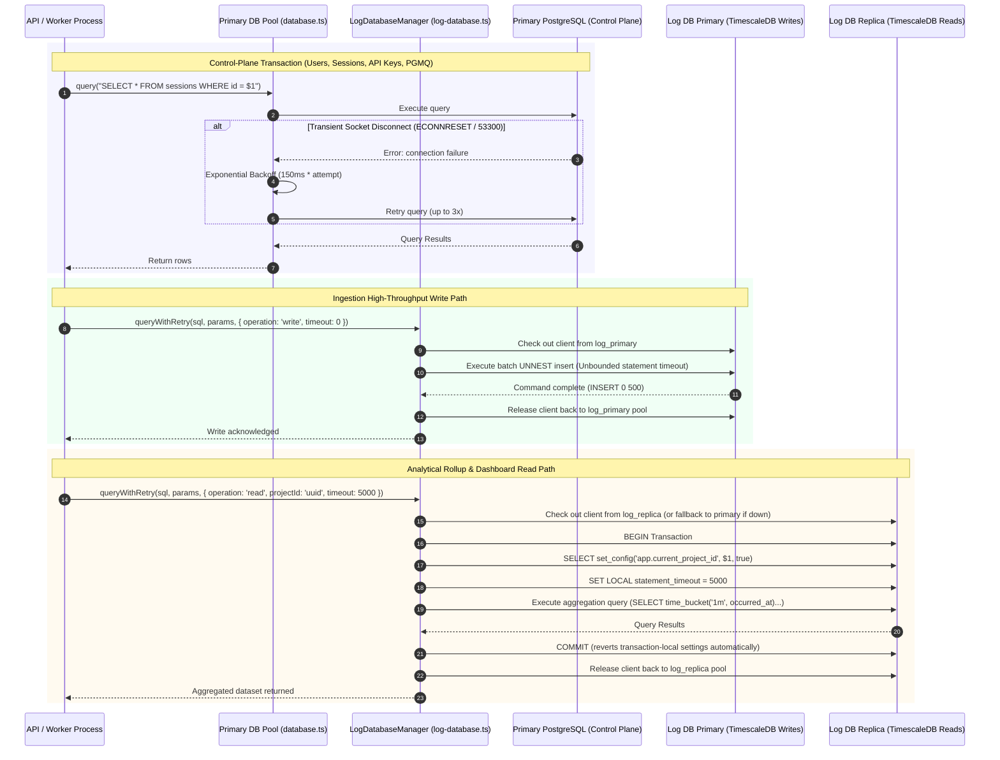

# Data Layer & Storage Architecture

## 1. System Role & Responsibilities

The Data Layer provides persistent relational storage, time-series telemetry archiving, and connection management across Pulse's backend services. It implements a strict **split-plane dual-datastore architecture**, completely isolating control-plane transactional mutations from high-volume time-series telemetry ingestion and analytical queries.

### What the Subsystem Does
- **Dual-Datastore Isolation**:
  - **Primary DB (PostgreSQL Control Plane)**: Manages users, sessions, organizations, projects, API keys, billing subscriptions, alert rules, incidents, and PGMQ message queue state.
  - **Log DB (TimescaleDB Telemetry Plane)**: Stores raw telemetry events (`events_*`, `traces`, `spans`, `logs`, `metrics`), analytical rollups (`*_metrics_1m`, `ai_metrics_1h`), watermarks, and retention policies.
- **Dedicated Subsystem Connection Pools**: Partitions PostgreSQL client sockets into independent pools (`pool`, `notificationPool`, PGMQ `readerPool`, PGMQ `commandPool`, `log_primary`, and `log_replica`), preventing connection exhaustion (`53300: too_many_connections`) and deadlocks between unrelated workloads.
- **Asymmetric Statement Timeouts**: Enforces strict statement timeouts on analytical reads (`DB_STATEMENT_TIMEOUT_MS`) to kill runaway queries, while leaving write paths unbounded (`timeout = 0`) to guarantee high-throughput batch `UNNEST` inserts never abort mid-flight.
- **Leak-Proof Transaction-Scoped Multi-Tenancy**: Scopes Row-Level Security (RLS) tenant isolation via `SELECT set_config('app.current_project_id', $1, true)` exclusively inside transactions (`is_local = true`), guaranteeing pooled connections returned to the pool never leak tenant context.
- **Resilient Connection Recovery**: Automatically catches transient disconnects (serverless pooler drops, `ECONNRESET`, Neon socket timeouts) and retries queries with exponential backoff and jitter, while immediately fast-failing non-retryable SQL errors (syntax, constraint, or permission violations).
- **Modular Topological Schema Management**: Executes individual table, function, and index migration files in strict dependency order via [`scripts/run-modular-schema.ts`](file:///c:/Users/vikas/OneDrive/Desktop/SaasBackend/pulse/scripts/run-modular-schema.ts).

### What the Subsystem Does NOT Do
- **Cross-Datastore Foreign Keys**: Does not enforce relational foreign-key constraints between Primary DB entities (e.g., `projects`) and Log DB tables (e.g., `events_traces`); relationship consistency is maintained via UUIDs and application validation.
- **Direct Synchronous Write Fanout to Replicas**: Write queries never touch read replicas; all mutations hit the primary node and replicate asynchronously.
- **Global Pool-Level State Mutations**: Never applies `SET` session commands at connection checkout time that could corrupt pooled socket states.

---

## 2. Code Traceability Map

| Component / Layer | Source File Path | Key Classes / Functions | Primary Responsibility |
| :--- | :--- | :--- | :--- |
| **Primary Database Pool** | [`src/config/database.ts`](file:///c:/Users/vikas/OneDrive/Desktop/SaasBackend/pulse/src/config/database.ts) | `pool`, `notificationPool` | Primary PostgreSQL pool instances, transient serverless error retry wrapper, notification pool isolation. |
| **Log Database Manager** | [`src/config/log-database.ts`](file:///c:/Users/vikas/OneDrive/Desktop/SaasBackend/pulse/src/config/log-database.ts) | `LogDatabaseManager`, `logDB` | Dual-pool manager (`log_primary`, `log_replica`), TimescaleDB extension setup, transaction-scoped tenant RLS, write unnesting. |
| **PostgreSQL SSL Resolver** | [`src/config/postgres-ssl.ts`](file:///c:/Users/vikas/OneDrive/Desktop/SaasBackend/pulse/src/config/postgres-ssl.ts) | `resolvePostgresSslConfig`, `isTransientPostgresError` | Resolves CA certs, enforces SSL reject-unauthorized options, classifies transient vs fatal error codes. |
| **PostgreSQL Network Helpers** | [`src/config/postgres-network.ts`](file:///c:/Users/vikas/OneDrive/Desktop/SaasBackend/pulse/src/config/postgres-network.ts) | `withPostgresAddressFamily`, `checkPostgresHealth` | Enforces IPv4 / IPv6 address family policies, performs active health probes. |
| **Connection Budget Logger** | [`src/config/connection-budget.ts`](file:///c:/Users/vikas/OneDrive/Desktop/SaasBackend/pulse/src/config/connection-budget.ts) | `logProcessConnectionBudget` | Calculates total socket demand per process against PostgreSQL `max_connections` limits. |
| **Modular Schema Runner** | [`scripts/run-modular-schema.ts`](file:///c:/Users/vikas/OneDrive/Desktop/SaasBackend/pulse/scripts/run-modular-schema.ts) | `runModularSchemaRunner` | Discovers and executes modular SQL migration files from `database/primarydbv2/schema` and `database/logdbv2/schema`. |
| **In-Memory LRU Cache** | [`src/config/lrucashe.ts`](file:///c:/Users/vikas/OneDrive/Desktop/SaasBackend/pulse/src/config/lrucashe.ts) | `apiKeyCache`, `orgCache`, `projectCache` | Ultra-low latency memory cache preventing database roundtrips on hot ingestion paths. |
| **Distributed Lookup Cache** | [`src/db/redis/lookup-cache.ts`](file:///c:/Users/vikas/OneDrive/Desktop/SaasBackend/pulse/src/db/redis/lookup-cache.ts) | `redisLookupCache` | Cluster-wide cache fallback for API key candidates and project metadata. |

---

## 3. Data Flow & Sequence Diagram

The following diagram details connection routing and query execution across the split-plane data architecture:



---

## 4. Payloads & Data Contracts

### 4.1 Log Database Query Options
Used across repositories querying telemetry and rollups in [`src/config/log-database.ts`](file:///c:/Users/vikas/OneDrive/Desktop/SaasBackend/pulse/src/config/log-database.ts#L49-L67):

```typescript
export type DbOperation = 'read' | 'write';

export interface QueryOptions {
  /** Maximum retry attempts for transient errors (default: env.LOG_RETRIES = 3) */
  maxRetries?: number;
  
  /** 'read' routes to replica when available; 'write' always hits primary */
  operation?: DbOperation;
  
  /**
   * RLS tenant scope. Sets `app.current_project_id` via `set_config(..., true)`
   * inside the transaction, automatically reverting upon COMMIT/ROLLBACK.
   */
  projectId?: string;
  
  /**
   * Per-statement timeout (ms) applied via `SET LOCAL` inside transaction.
   * `0` disables timeout (used for heavy write batches).
   */
  timeout?: number;
}
```

### 4.2 Pool Health & Connection Metadata
Returned by `checkPostgresHealth` and logged at startup in [`src/config/postgres-network.ts`](file:///c:/Users/vikas/OneDrive/Desktop/SaasBackend/pulse/src/config/postgres-network.ts):

```typescript
export interface PostgresHealthResult {
  healthy: boolean;
  latencyMs: number;
  failure?: {
    code: string;
    message: string;
    addressFamily?: 'ipv4' | 'ipv6';
    host?: string;
    port?: number;
  };
}
```

---

## 5. Edge Cases & Failure Recovery

### 5.1 Connection Starvation via Isolated Notification Pools
- **Failure Scenario**: High-severity incident bursts cause hundreds of notification jobs to spawn concurrently. If notification workers query templates using the main API pool, API request threads become starved of database sockets, causing 504 Gateway Timeouts.
- **Recovery Architecture**: [`src/config/database.ts`](file:///c:/Users/vikas/OneDrive/Desktop/SaasBackend/pulse/src/config/database.ts#L91-L125) allocates `notificationPool` (max connections: `NOTIFICATION_POOL_MAX` = 5). Notification workers never check out connections from `pool`, ensuring total resource isolation.

### 5.2 Serverless Socket Drop Resilience (Neon / PgBouncer)
- **Failure Scenario**: Managed serverless PostgreSQL providers terminate idle sockets after 60–120 seconds. Standard Node.js `pg.Pool` clients attempting to run queries on terminated sockets raise `Error: Connection terminated unexpectedly` or `ECONNRESET`.
- **Recovery Logic**: Both `pool.query` and `LogDatabaseManager.queryWithRetry` intercept `isTransientPostgresError(err)`:
  - Retryable error codes: `57P01` (admin_shutdown), `57P03` (cannot_connect_now), `08006` (connection_failure), `53300` (too_many_connections), `40001` (serialization_failure), `40P01` (deadlock).
  - Retries up to 3 times with exponential backoff ($150\text{ms} \times \text{attempt}$).
  - Non-retryable codes (`23505` unique violation, `42601` syntax error) fail immediately without useless retries.

### 5.3 Cross-Tenant RLS Scope Leak Prevention
- **Failure Scenario**: Applying `SET app.current_project_id = 'org_123'` directly on a checked-out connection modifies session state. When returned to the pool, the next borrower inherits `org_123`, exposing sensitive tenant data if RLS policies read this setting.
- **Recovery Logic**: [`src/config/log-database.ts`](file:///c:/Users/vikas/OneDrive/Desktop/SaasBackend/pulse/src/config/log-database.ts#L381-L383) uses `SELECT set_config('app.current_project_id', $1, true)` strictly inside transactions. The third argument (`is_local = true`) guarantees PostgreSQL automatically reverts the setting upon transaction end, making cross-tenant leaks impossible by design.

### 5.4 Read Replica Automatic Failover & Health Checks
- **Failure Scenario**: The Log DB read replica becomes unavailable during a database failover or maintenance window.
- **Recovery Logic**: [`src/config/log-database.ts`](file:///c:/Users/vikas/OneDrive/Desktop/SaasBackend/pulse/src/config/log-database.ts#L324-L332) monitors replica health. When `replicaPool` is down or unconfigured, read queries automatically fall back to `primaryPool`, preventing dashboard downtime.

---

## 6. Configuration Parameters

The following parameters in [`src/config/env.ts`](file:///c:/Users/vikas/OneDrive/Desktop/SaasBackend/pulse/src/config/env.ts) govern the data layer and connection pools:

| Parameter | Type | Default | Operational Impact & Production Guidance |
| :--- | :--- | :--- | :--- |
| `DATABASE_URL` | `string` | *(Required)* | Primary PostgreSQL connection string (Control plane, users, auth, PGMQ). |
| `LOG_DB_PRIMARY` | `string` | `DATABASE_URL` | Primary Log DB connection string (TimescaleDB telemetry writes and rollups). |
| `LOG_DB_REPLICA` | `string` | `undefined` | Optional read replica connection string for offloading analytical dashboard queries. |
| `DB_POOL_MAX` | `number` | `20` | Maximum connections allocated for primary API and control-plane pool. |
| `DB_POOL_MIN` | `number` | `0` | Minimum warm connections. Set to 0 for serverless pooler compatibility. |
| `NOTIFICATION_POOL_MAX` | `number` | `5` | Isolated pool size dedicated to notification workers. |
| `LOG_POOL_MAX` | `number` | `25` | Maximum connections for Log DB primary pool (sized for concurrent ingestion workers). |
| `LOG_POOL_MIN` | `number` | `0` | Minimum warm connections for Log DB pool. |
| `DB_STATEMENT_TIMEOUT_MS` | `number` | `30000` | Statement timeout (30s) applied to primary DB queries to kill runaway queries. |
| `DB_CONNECTION_TIMEOUT_MS` | `number` | `10000` | Socket connection establishment timeout (10s) before raising a connection error. |
| `DB_IDLE_TIMEOUT_MS` | `number` | `10000` | Duration (10s) an idle connection is retained in the pool before being released. |
| `DB_KEEPALIVE_INITIAL_DELAY_MS` | `number` | `10000` | TCP keepalive probe delay to prevent middlebox and firewall socket teardowns. |
| `DB_FAMILY` | `number` | `0` | IP address family: `0` (dual-stack auto), `4` (IPv4 only), `6` (IPv6 only). |
| `DB_SSL_ENABLED` | `boolean` | `true` | Enforces TLS encrypted sockets for PostgreSQL connections. |
| `DB_SSL_REJECT_UNAUTHORIZED` | `boolean` | `true` | Validates TLS certificates against trusted authorities. Set false only for local self-signed dev. |
| `LOG_DB_ENABLE_TIMESCALE` | `boolean` | `true` | When true, attempts to load TimescaleDB extension and promote event tables to hypertables. |
| `LOG_RETRIES` | `number` | `3` | Maximum retry attempts for transient query failures in `LogDatabaseManager`. |
