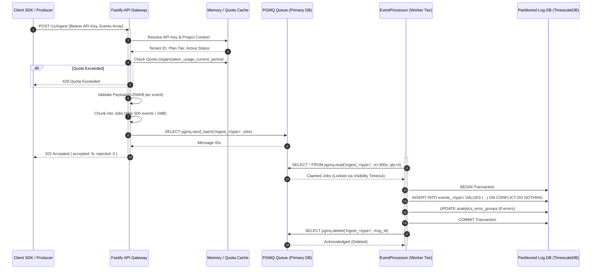

# Ingestion Pipeline Architecture

## 1. System Role & Responsibilities

The Ingestion Pipeline is the highest-volume entry point of the Pulsiv platform. It is responsible for accepting, authenticating, validating, rate-limiting, and buffering telemetry signals sent from client SDKs and backend services before durable persistence.

### Core Responsibilities
- **Acceptance & Normalization:** Ingests mixed or family-specific telemetry batches (`request`, `error`, `log`, `metric`, `trace`, `span`, `profile`, `replay`, `message`, `cron_checkin`).
- **Cryptographic Authentication:** Resolves project and tenant identities strictly through Argon2id/SHA-256 API Key hashes; rejects unauthenticated traffic before body processing.
- **Quota & Admission Enforcement:** Blocks organizations exceeding plan event quotas (`hard_limit` or `throttle`) and sheds load during high event-loop lag.
- **Fair Queue Buffering:** Chunks raw batches into atomic units ($\le 500$ events or $\le 1\text{ MB}$) and enqueues them into PostgreSQL PGMQ queues.
- **What It Does NOT Do:** The HTTP ingestion gateway **never writes directly to partitioned event tables**. All disk persistence and rollup calculations are asynchronous, executed exclusively by the downstream worker tier.

---

## 2. Code Traceability Map

| Component / Function | Source File Path | Line Range | Architectural Purpose |
| :--- | :--- | :--- | :--- |
| **Ingestion Route Definitions** | [`src/modules/ingestion/routes.ts`](file:///c:/Users/vikas/OneDrive/Desktop/SaasBackend/pulse/src/modules/ingestion/routes.ts) | Lines 1–120 | Fastify route hooks for `POST /v1/ingest` and typed routes (`POST /v1/ingest/:type`). |
| **Ingestion Pipeline Controller** | [`src/modules/ingestion/service.ts`](file:///c:/Users/vikas/OneDrive/Desktop/SaasBackend/pulse/src/modules/ingestion/service.ts) | Lines 560–680 | Core `processIngest()` method executing authentication, quota checks, event sizing, and PGMQ dispatch. |
| **API Key & Project Resolution** | [`src/modules/ingestion/service.ts`](file:///c:/Users/vikas/OneDrive/Desktop/SaasBackend/pulse/src/modules/ingestion/service.ts) | Lines 410–470 | In-memory cached lookup of project active status, environment slugs, and plan entitlement tiers. |
| **Event Normalization Engine** | [`src/modules/ingestion/pipeline/event-normalizer.ts`](file:///c:/Users/vikas/OneDrive/Desktop/SaasBackend/pulse/src/modules/ingestion/pipeline/event-normalizer.ts) | Lines 1–350 | Clamps strings, sanitizes timestamps, coerces enums, and enforces payload structural integrity. |
| **Job Chunking & Dispatch** | [`src/modules/ingestion/service.ts`](file:///c:/Users/vikas/OneDrive/Desktop/SaasBackend/pulse/src/modules/ingestion/service.ts) | Lines 850–920 | `buildJobs()` splits events into bounded chunks ($\le 500$ events / $1\text{ MB}$) by event type. |
| **Telemetry Write Persistence** | [`src/modules/ingestion/pipeline/telemetry-writer.ts`](file:///c:/Users/vikas/OneDrive/Desktop/SaasBackend/pulse/src/modules/ingestion/pipeline/telemetry-writer.ts) | Lines 550–700 | Executes set-based multi-row parameterized `INSERT` statements with `ON CONFLICT DO NOTHING`. |
| **Worker Queue Processing** | [`src/modules/ingestion/workers/event-processor.ts`](file:///c:/Users/vikas/OneDrive/Desktop/SaasBackend/pulse/src/modules/ingestion/workers/event-processor.ts) | Lines 430–560 | Dequeues job chunks, manages database write permits, and coordinates error grouping. |

---

## 3. Data Flow & Sequence Diagram



---

## 4. Payloads & Data Contracts

### A. HTTP Request Envelope (`POST /v1/ingest`)
```typescript
export interface IngestRequest {
  events: RawIngestEvent[];
  metadata?: {
    environment?: string; // e.g. "production", "staging"
    sdkName?: string;     // e.g. "@pulsiv/node"
    sdkVersion?: string;  // e.g. "2.1.0"
  };
}

export type RawIngestEvent =
  | RequestEventPayload
  | ErrorEventPayload
  | LogEventPayload
  | SpanEventPayload
  | MetricEventPayload;
```

### B. HTTP Response Envelope
```typescript
export interface IngestResponse {
  accepted: number;
  rejected: number;
  errors?: Array<{
    eventId?: string;
    reason: string;
  }>;
  timings?: {
    envelopeMs?: number;
    projectLookupMs?: number;
    validationMs?: number;
    jobBuildMs?: number;
    queueMs?: number;
  };
}
```

### C. Queue Job Payload (`IngestJobPayload`)
```typescript
export interface IngestJobPayload {
  eventType: SdkEventType;
  batchId: string;
  organizationId: string;
  projectId: string;
  projectSlug?: string;
  projectName?: string;
  orgSlug?: string;
  orgName?: string;
  apiKeyId?: string;
  apiKeyName?: string;
  planTier: string;
  environment: string;
  receivedAt: string;
  events: NormalizedEvent[];
  metadata: {
    batchBytes: number;
    chunkIndex: number;
    totalChunks: number;
  };
}
```

---

## 5. Edge Cases & Failure Recovery

1. **Burst Overload & Admission Control:**
   * When event loop delay exceeds `PRESSURE_MAX_EVENT_LOOP_DELAY_MS` (1,500ms) or utilization exceeds `0.95`, [`EnterpriseAdmissionController`](file:///c:/Users/vikas/OneDrive/Desktop/SaasBackend/pulse/src/lib/admission-control.ts) categorizes `/v1/ingest` as `SHEDDABLE` traffic.
   * Incoming requests are rejected with `503 Service Unavailable` and a `Retry-After: 10` header. Client SDKs back off exponentially, preserving server availability for Auth and Health probes.
2. **Payload Size Violations:**
   * Batches exceeding `INGESTION_MAX_BATCH_SIZE` (default 1,000) are rejected with `400 BATCH_TOO_LARGE`.
   * Individual events exceeding `MAX_EVENT_BYTES` (256 KB) are dropped individually with `{ eventId, reason: 'event_too_large' }` without failing the entire batch.
3. **Zip-Bomb Decompression Protection:**
   * Gzip decompression is clamped at `INGESTION_GZIP_MAX_BYTES` (20 MB). Payloads expanding beyond this ceiling abort immediately, protecting against memory exhaustion attacks.
4. **Idempotent Retry Handling:**
   * If an ingestion worker crashes before deleting a PGMQ job, the job is re-delivered after the visibility timeout expires. Because [`TelemetryWriter`](file:///c:/Users/vikas/OneDrive/Desktop/SaasBackend/pulse/src/modules/ingestion/pipeline/telemetry-writer.ts) writes with `ON CONFLICT DO NOTHING` on the unique `(project_id, event_id)` index, duplicate processing is completely idempotent and zero duplicate rows are created.

---

## 6. Configuration Parameters

| Environment Variable | Type | Default | Operational Impact |
| :--- | :--- | :--- | :--- |
| `INGESTION_MAX_BATCH_SIZE` | Integer | `1000` | Maximum number of events accepted in a single HTTP request batch. |
| `INGESTION_JOB_CHUNK_SIZE` | Integer | `500` | Target maximum events packed into a single PGMQ job chunk. |
| `INGESTION_JOB_MAX_BYTES` | Integer | `1048576` (1MB) | Maximum payload byte size permitted in a single PGMQ job chunk. |
| `INGESTION_GZIP_MAX_BYTES` | Integer | `20971520` (20MB)| Maximum decompressed payload size for gzip request bodies. |
| `INGESTION_ORG_RATE_LIMIT_PER_SECOND` | Integer | `5000` | Rate limit ceiling per organization at the API gateway layer. |
| `INGESTION_QUOTA_CACHE_TTL_MS` | Integer | `60000` (1m) | Time-to-live for cached organization quota entitlements. |
| `INGESTION_GENERAL_WORKERS` | Integer | `4` | Number of forked worker operating system processes. |
| `INGESTION_TYPE_WORKER_CONCURRENCY`| Integer | `2` | Number of concurrent execution slots per event queue per worker. |
| `INGESTION_WRITE_POOL_SIZE` | Integer | `24` | Dedicated PostgreSQL write pool size for telemetry insertion. |
| `INGESTION_WRITE_CONCURRENCY` | Integer | `16` | Maximum concurrent active insert transactions permitted across the write pool. |
