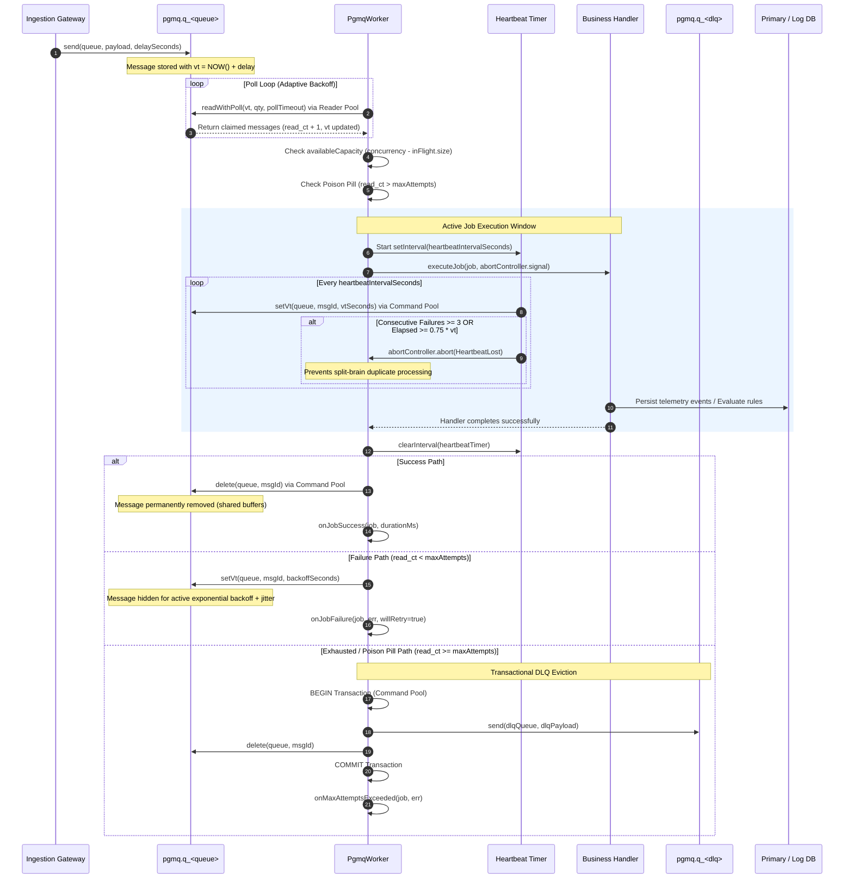

# Queue and Worker Subsystem Architecture

## 1. System Role & Responsibilities

The Queue and Worker subsystem provides asynchronous, durable, distributed message processing across Pulse's backend services. Built atop the PostgreSQL `pgmq` extension, the queue architecture replaces standalone message brokers (such as RabbitMQ or Kafka) with relational ACID guarantees, minimizing external infrastructure dependencies while ensuring at-least-once message delivery semantics.

### What the Subsystem Does
- **Durable Asynchronous Buffering**: Decouples high-throughput ingest gateways and event emitters from heavy downstream persistence engines, third-party webhook dispatchers, and analytical rollups.
- **Isolated Reader/Command Connection Pooling**: Splits PostgreSQL client connections into dedicated long-polling readers and low-latency command executors, preventing heartbeat and deletion starvation during long-polling pauses.
- **Dynamic Visibility Timeout & Automatic Heartbeats**: Claims messages via PostgreSQL visibility timeouts (`vt`) and continuously extends visibility in the background for active in-flight jobs.
- **Poison-Pill Mitigation & Split-Brain Prevention**: Automatically terminates execution via `AbortController` if consecutive heartbeats fail, actively reschedules transient failures with exponential backoff and jitter, and transactionally routes exhausted messages to dead-letter queues.
- **Fair Tenant Capacity Scheduling**: Implements a memory-efficient tenant fairness admission gate per worker process, deferring over-budget tenants via delayed PGMQ re-enqueuing to prevent noisy-neighbor starvation.
- **Graceful Process Draining**: Captures OS termination signals (`SIGTERM`, `SIGINT`), halts message polling immediately, and allows in-flight jobs up to `drainTimeoutMs` to finish or abort safely.

### What the Subsystem Does NOT Do
- **Ephemeral In-Memory Queuing**: Does not use memory-only brokers (e.g., Redis pub/sub); all messages are backed by durable WAL storage in PostgreSQL unless explicitly configured as unlogged queues.
- **Arbitrary Job Orchestration / Cron DAGs**: Does not execute complex cross-worker dependency trees; each queue operates as a decoupled, isolated message stream.
- **Direct Synchronous API Delivery**: Does not dispatch external notifications or database analytical aggregations inside the HTTP request loop.

---

## 2. Code Traceability Map

| Component / Layer | Source File Path | Key Classes / Functions | Primary Responsibility |
| :--- | :--- | :--- | :--- |
| **PGMQ Core Client** | [`src/lib/pgmq.ts`](file:///c:/Users/vikas/OneDrive/Desktop/SaasBackend/pulse/src/lib/pgmq.ts) | `PgmqClient` | Dual connection pool management (`pool` and `commandPool`), queue provisioning, `send`, `sendBatch`, `read`, `readWithPoll`, `setVt`, `delete`, `archive`, `metrics`. |
| **PGMQ Consumer Engine** | [`src/lib/pgmq-worker.ts`](file:///c:/Users/vikas/OneDrive/Desktop/SaasBackend/pulse/src/lib/pgmq-worker.ts) | `PgmqWorker` | Worker poll loop, concurrency slot allocation, background heartbeat loop, heartbeat loss abort guard, exponential retry backoff, transactional DLQ routing, graceful draining. |
| **Ingestion Worker Registry** | [`src/modules/ingestion/workers/worker-registry.ts`](file:///c:/Users/vikas/OneDrive/Desktop/SaasBackend/pulse/src/modules/ingestion/workers/worker-registry.ts) | `WorkerRegistry` | Spawns 15 dedicated event-type workers, DLQ intake worker, per-tenant fairness limiter (`TENANT_INFLIGHT_LIMIT`), deferred re-enqueueing, telemetry metrics server. |
| **Ingestion Queue Names & Enums** | [`src/modules/ingestion/queue/ingest-queues.ts`](file:///c:/Users/vikas/OneDrive/Desktop/SaasBackend/pulse/src/modules/ingestion/queue/ingest-queues.ts) | `INGEST_QUEUES`, `provisionIngestQueues` | Queue name mapping (`ingest_<eventType>`), priority calculators, queue provisioning helpers. |
| **Ingestion Worker Process Entry** | [`src/shared/workers/ingestion-worker-main.ts`](file:///c:/Users/vikas/OneDrive/Desktop/SaasBackend/pulse/src/shared/workers/ingestion-worker-main.ts) | `main()` | Standalone PM2 / container process bootstrap for telemetry event processing, connection pool budgeting, and signal handling. |
| **Alerting Queue Registration** | [`src/modules/alerting/queue.ts`](file:///c:/Users/vikas/OneDrive/Desktop/SaasBackend/pulse/src/modules/alerting/queue.ts) | `registerAlertingWorkers` | Provisions and starts fast rule evaluation, periodic window evaluation, escalation sweeps, and auto-resolve workers. |
| **Alerting Queue Definitions** | [`src/modules/alerting/queue-names.ts`](file:///c:/Users/vikas/OneDrive/Desktop/SaasBackend/pulse/src/modules/alerting/queue-names.ts) | `ALERT_JOBS`, `ALERT_DELIVERY_WORKER_JOBS` | Canonical queue identifiers (`alert_evaluate_fast`, `alert_notification_router`, `alert_escalate`, etc.). |
| **Connector Worker Registration** | [`src/modules/connectors/queue.ts`](file:///c:/Users/vikas/OneDrive/Desktop/SaasBackend/pulse/src/modules/connectors/queue.ts) | `registerConnectorWorkers` | Spawns transport consumers (`connector_v2_<provider>`) with global rate limiting and circuit-breaker wrappers. |
| **Analytics Engine Worker Registry** | [`src/modules/analytics-engine/queue.ts`](file:///c:/Users/vikas/OneDrive/Desktop/SaasBackend/pulse/src/modules/analytics-engine/queue.ts) | `registerAnalyticsEngineWorkers` | Provisions 17 domain rollup workers and platform maintenance workers (`analytics_compaction_*`, `analytics_partitions`). |
| **Analytics Worker Process Entry** | [`src/shared/workers/analytics-worker-main.ts`](file:///c:/Users/vikas/OneDrive/Desktop/SaasBackend/pulse/src/shared/workers/analytics-worker-main.ts) | `main()` | Standalone process executing continuous metric aggregation, compaction, and partition maintenance against TimescaleDB. |

---

## 3. Data Flow & Sequence Diagram

The following diagram illustrates the lifecycle of a message handled by `PgmqWorker`, including concurrency slot reservation, background heartbeat visibility extension, failure retry backoff, and transactional DLQ eviction:



---

## 4. Payloads & Data Contracts

### 4.1 PGMQ Message Container
Every message returned by `PgmqClient` is structured according to the `PgmqMessage<T>` interface defined in [`src/lib/pgmq.ts`](file:///c:/Users/vikas/OneDrive/Desktop/SaasBackend/pulse/src/lib/pgmq.ts#L18-L25):

```typescript
export interface PgmqMessage<T = unknown> {
  msgId: string;                          // Unique 64-bit bigint identifier from PostgreSQL sequence
  readCt: number;                         // Number of times the message has been read/claimed
  enqueuedAt: Date;                       // Timestamp when the message entered the queue
  vt: Date;                               // Current visibility timeout expiration timestamp
  message: T;                             // Typed application payload (deserialized JSONB)
  headers: Record<string, unknown> | null;// Optional message metadata / tracing context
}
```

### 4.2 Ingestion Job Payload
Ingestion events chunked by the API gateway and passed to event-specific workers conform to `IngestJobPayload` in [`src/modules/ingestion/queue/ingest-queues.ts`](file:///c:/Users/vikas/OneDrive/Desktop/SaasBackend/pulse/src/modules/ingestion/queue/ingest-queues.ts):

```typescript
export interface IngestJobPayload {
  organizationId: string;
  projectId: string;
  environmentId?: string;
  events: Array<Record<string, unknown>>;  // Array of validated SDK events (max 500 events)
  metadata: {
    batchId: string;                      // Idempotency batch UUID
    planTier: string;                     // 'free' | 'starter' | 'pro' | 'enterprise'
    clientIp?: string;
    userAgent?: string;
    deferCount?: number;                  // Incremented each time tenant fairness defers job
    receivedAt: number;                   // Ingestion timestamp (ms)
  };
}
```

### 4.3 Dead-Letter Queue Payload
When a job exceeds `maxAttempts` or suffers an unrecoverable failure, `handleDeadLetter` in [`src/lib/pgmq-worker.ts`](file:///c:/Users/vikas/OneDrive/Desktop/SaasBackend/pulse/src/lib/pgmq-worker.ts#L330-L340) generates the following standardized payload:

```typescript
export interface DeadLetterPayload<T = unknown> {
  sourceQueue: string;                    // Queue where the failure originated
  originalMsgId: string;                  // Original message ID in source queue
  payload: T;                             // Full original job message
  error: string;                          // Error message or string representation
  failedAt: string;                       // ISO-8601 failure timestamp
  attempts: number;                       // Total read count recorded at time of dead-lettering
}
```

---

## 5. Edge Cases & Failure Recovery

### 5.1 Dual-Pool Connection Starvation Prevention
- **Mechanism**: Long-polling (`readWithPoll`) holds a PostgreSQL connection open for up to `QUEUE_POLL_SECONDS` (default: 2s). If worker threads share a single pool, all available connections can become occupied by long-polls, causing worker heartbeats (`setVt`) and completion acknowledgments (`delete`) to block and time out.
- **Implementation**: [`src/lib/pgmq.ts`](file:///c:/Users/vikas/OneDrive/Desktop/SaasBackend/pulse/src/lib/pgmq.ts#L68-L133) maintains two separate `pg.Pool` instances:
  1. `pool` (Reader Pool, max connections: `QUEUE_POOL_MAX` = 10): Strictly isolated for `read` and `readWithPoll`.
  2. `commandPool` (Command Pool, max connections: `QUEUE_COMMAND_POOL_MAX` = 15): Reserved exclusively for `setVt`, `delete`, `archive`, `send`, and DLQ transactions.

### 5.2 Split-Brain Prevention on Heartbeat Loss
- **Failure Scenario**: A worker experiences an event-loop stall, network partition, or database connection saturation. If its visibility timeout expires while the worker is still mutating state, another worker will claim the message and execute duplicate side effects.
- **Recovery Logic**: [`src/lib/pgmq-worker.ts`](file:///c:/Users/vikas/OneDrive/Desktop/SaasBackend/pulse/src/lib/pgmq-worker.ts#L226-L250) tracks heartbeat responses. If:
  - 3 consecutive `setVt` calls fail, OR
  - Elapsed time since last successful heartbeat exceeds $0.75 \times \text{visibilityTimeoutSeconds}$,
  an `AbortController` triggers `abort(new Error('Heartbeat visibility timeout lost'))`. Downstream database queries observing `signal` cancel immediately, aborting local execution before the lock expires in PostgreSQL.

### 5.3 Active Exponential Backoff on Failure
- **Behavior**: Default PGMQ behavior leaves a failed message invisible until its original visibility timeout runs out.
- **Improvement**: [`src/lib/pgmq-worker.ts`](file:///c:/Users/vikas/OneDrive/Desktop/SaasBackend/pulse/src/lib/pgmq-worker.ts#L296-L312) intercepts recoverable failures and executes an explicit `setVt(queue, msgId, backoffSeconds)` using:
  $$\text{backoffSeconds} = \min\left(60, \max\left(1, 2 \times 2^{\text{readCt}-1} + \text{jitter}\right)\right)$$
  This ensures rapid retries on transient glitches without stampeding downstream resources.

### 5.4 Transactional DLQ Eviction
- **Failure Scenario**: A worker crashes after writing to a dead-letter queue but before deleting the original message from the source queue (duplicate processing), or deletes the source message before the DLQ write completes (message loss).
- **Recovery Logic**: [`src/lib/pgmq-worker.ts`](file:///c:/Users/vikas/OneDrive/Desktop/SaasBackend/pulse/src/lib/pgmq-worker.ts#L343-L365) checks out a client from `commandPool`, issues `BEGIN`, writes the `DeadLetterPayload` to the DLQ, deletes the message from the source queue, and executes `COMMIT`. If either fails, `ROLLBACK` executes, preserving message durability.

### 5.5 Tenant Fairness Gate & Starvation Admission
- **Behavior**: High-volume tenants submitting large event bursts could saturate worker concurrency, starving lower-volume tenants.
- **Implementation**: [`src/modules/ingestion/workers/worker-registry.ts`](file:///c:/Users/vikas/OneDrive/Desktop/SaasBackend/pulse/src/modules/ingestion/workers/worker-registry.ts#L300-L365) tracks in-flight jobs per organization against `TENANT_INFLIGHT_LIMIT`:
  - If `current >= limit` and `deferCount < INGESTION_FAIRNESS_MAX_DEFERS` (default: 5): The job is re-enqueued to PGMQ with `delaySeconds: INGESTION_FAIRNESS_DEFER_DELAY_SECONDS` (default: 2s) and acknowledged.
  - If `deferCount >= INGESTION_FAIRNESS_MAX_DEFERS`: The job is admitted unconditionally to prevent indefinite starvation, recording an `admission_starvation` telemetry counter.

---

## 6. Configuration Parameters

The following parameters in [`src/config/env.ts`](file:///c:/Users/vikas/OneDrive/Desktop/SaasBackend/pulse/src/config/env.ts) control the queue and worker runtime:

| Parameter | Type | Default | Operational Impact & Production Guidance |
| :--- | :--- | :--- | :--- |
| `QUEUE_POOL_MAX` | `number` | `10` | Maximum connections allocated for PGMQ reader long-polling (`readWithPoll`). Keep scaled with number of distinct worker queues. |
| `QUEUE_COMMAND_POOL_MAX` | `number` | `15` | Maximum connections allocated for heartbeats (`setVt`), sends, deletions, and DLQ transactions. Must never be starved. |
| `QUEUE_BATCH_SIZE` | `number` | `50` | Default number of messages fetched per poll when not overridden by specific worker configurations. |
| `QUEUE_VISIBILITY_TIMEOUT_SECONDS` | `number` | `60` | Duration (seconds) a claimed message remains invisible to other workers before being eligible for redelivery. |
| `QUEUE_POLL_SECONDS` | `number` | `2` | Duration (seconds) `readWithPoll` blocks inside PostgreSQL waiting for new messages before returning an empty batch. |
| `QUEUE_MAX_IDLE_POLL_MS` | `number` | `5000` | Upper limit for adaptive exponential poll backoff during prolonged idle periods. |
| `QUEUE_MAX_ATTEMPTS` | `number` | `5` | Maximum times a message can be read (`read_ct`) before being permanently diverted to dead-letter storage. |
| `QUEUE_HEARTBEAT_INTERVAL_SECONDS` | `number` | `20` | Interval between background `setVt` calls. Defaults to $\lfloor \text{visibilityTimeout} / 3 \rfloor$. |
| `QUEUE_DRAIN_TIMEOUT_MS` | `number` | `30000` | Maximum time (ms) a worker process waits during `SIGTERM`/`SIGINT` for in-flight tasks to complete before forceful cancellation. |
| `INGESTION_TYPE_WORKER_CONCURRENCY` | `number` | `5` | Concurrency slots allocated per event type worker (15 workers $\times$ 5 concurrency = 75 in-flight jobs max per ingestion node). |
| `INGESTION_TYPE_WORKER_BATCH_SIZE` | `number` | `10` | Batch size fetched per poll for each ingestion event type worker. |
| `INGESTION_JOB_EXPIRE_SECONDS` | `number` | `300` | Visibility timeout (5 minutes) for ingestion payload jobs. |
| `INGESTION_JOB_RETRY_LIMIT` | `number` | `5` | Maximum retry attempts for ingestion jobs before routing to `ingest_dlq_intake`. |
| `INGESTION_FAIRNESS_MAX_DEFERS` | `number` | `5` | Maximum consecutive times an over-quota tenant's job can be deferred before forced admission. |
| `INGESTION_FAIRNESS_DEFER_DELAY_SECONDS` | `number` | `2` | PGMQ delay offset applied when re-enqueuing deferred jobs. |
