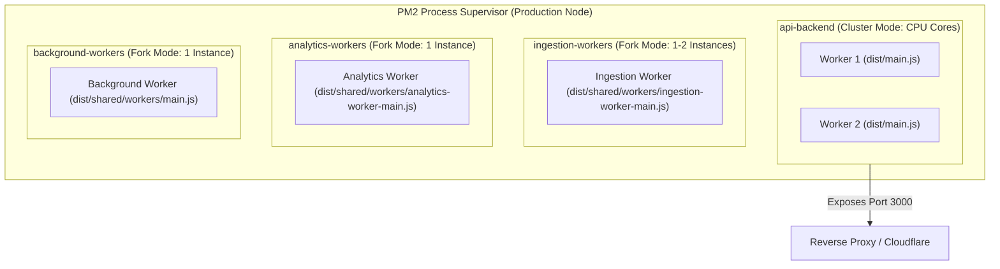

# Production Deployment & PM2 Orchestration Guide

This document provides complete instructions for orchestrating, clustering, and deploying the **Pulsiv SaaS Backend** in production environments.

---

## 1. PM2 Multi-Tier Process Orchestration

Pulsiv is structured into 4 distinct PM2 process types defined in [`pulse/ecosystem.config.cjs`](file:///c:/Users/vikas/OneDrive/Desktop/SaasBackend/pulse/ecosystem.config.cjs):



---

## 2. Zero-Downtime Deployment Runbook

Follow this step-by-step procedure during production updates:

```bash
# Step 1: Pull latest code & build TypeScript artifacts
git pull origin main
npm ci --ignore-scripts
npm run build

# Step 2: Run canonical database migrations safely
npm run db:migrate:canonical
npm run db:migrate:logdb

# Step 3: Zero-downtime rolling reload of API processes
npx pm2 reload ecosystem.config.cjs --env production

# Step 4: Restart background worker tiers
npx pm2 restart background-workers
npx pm2 restart ingestion-workers
npx pm2 restart analytics-workers

# Step 5: Verify cluster status and error logs
npx pm2 list
npx pm2 logs --lines 50
```

---

## 3. Process Readiness & Health Gates

- **`wait_ready: true`**: PM2 holds traffic from new cluster instances until `process.send('ready')` is emitted.
- **`kill_timeout: 30000`**: Allows 30 seconds for in-flight requests and job queues to drain gracefully during rolling updates.
- **`max_memory_restart: 800M`**: Prevents runaway memory leaks by automatically cycling degraded worker processes.
