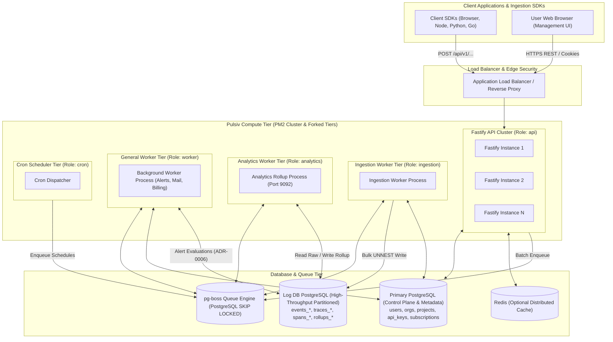

# Enterprise System Architecture & Dual-Database Topology

This document provides a comprehensive technical overview of the **Pulsiv SaaS Backend** enterprise system architecture, multi-tier process model, dual-database topology, and asynchronous message bus.

---

## 1. Architectural Principles & Isolation

### 1.1 Dual-Database Strategy
Pulsiv physically isolates transactional control-plane operations from high-volume analytical telemetry writes:
1. **Primary PostgreSQL Database (`DATABASE_URL`)**:
   - Stores users, sessions, organizations, projects, API keys, billing subscriptions, alert rules, and audit logs.
   - Optimized for ACID consistency, low concurrency mutations, and foreign key relational integrity.
2. **Log Database (`LOG_DB_PRIMARY` / `LOG_DB_REPLICAS`)**:
   - Dedicated database cluster for storing incoming telemetry (`events_errors`, `events_requests`, `spans_*`, `traces_*`) and precomputed rollups (`analytics_rollups_*`).
   - Uses daily time-partitioned tables with zero foreign keys to the control plane, enabling massive bulk insert throughput and instant partition drops for data retention.

---

## 2. Multi-Tier Process Model

To prevent CPU and memory contention, Pulsiv runs five distinct process roles:

| Process Role | Entry Point | Supervisor Mode | Scalability Target |
| :--- | :--- | :--- | :--- |
| **`api`** | `dist/main.js` | PM2 Cluster (CPU Cores) | Scaled horizontally based on HTTP request volume. |
| **`ingestion`** | `dist/shared/workers/ingestion-worker-main.js` | Dedicated Fork | Scaled based on telemetry queue depth. |
| **`analytics`** | `dist/shared/workers/analytics-worker-main.js` | Dedicated Fork | Scaled based on rollup watermark lag. |
| **`worker`** | `dist/shared/workers/main.js` | Dedicated Fork | Scaled based on background job volume. |
| **`cron`** | `dist/shared/workers/cron.js` | Singleton Fork | Single active schedule leader. |

---

## 3. Asynchronous Messaging & Queue Tier

- Employs **`pg-boss`** built on PostgreSQL `SELECT ... FOR UPDATE SKIP LOCKED`.
- Eliminates Redis as a single point of persistent failure for jobs.
- Delivers at-least-once message delivery with automatic retries, configurable backoff, and dead-letter queue (DLQ) containment.
