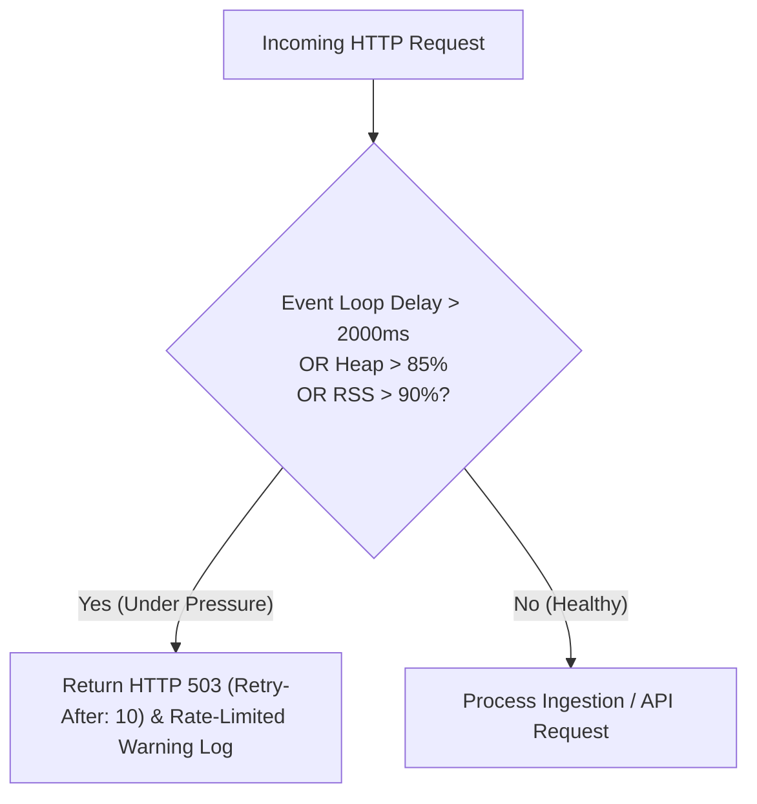

# High Availability, Fault Tolerance & Disaster Recovery Runbook

This document describes Pulsiv's high-availability (HA) architecture, admission control safeguards, backpressure mechanisms, database failover procedures, and disaster recovery (DR) runbooks.

---

## 1. SLA & SLO Target Objectives

| Service Objective | Target SLA / SLO | Measurement Window |
| :--- | :--- | :--- |
| **Ingestion Availability** | **99.99%** | Monthly Rolling |
| **Dashboard API Availability** | **99.95%** | Monthly Rolling |
| **Ingestion Latency (p95)** | **< 30 ms** | 1-Minute Slices |
| **Recovery Point Objective (RPO)** | **< 5 minutes** | Point-In-Time Database WAL Archiving |
| **Recovery Time Objective (RTO)** | **< 15 minutes** | Automated Container / Database Failover |

---

## 2. Overload Protection & Admission Control

Pulsiv implements aggressive admission control via `@fastify/under-pressure` to shed new work before memory exhaustion crashes processes:



---

## 3. Database Failover & Connection Resilience

1. **Connection Health Probes**: Fail-fast connection testing during bootstrap (`SELECT 1`) prevents traffic routing to unready replicas.
2. **Neon / Serverless Pooler Tuning**:
   - Explicit `statement_timeout` bounds runaway SQL queries.
   - Idle connections closed gracefully without throwing unhandled rejection exceptions.
3. **Automated LogDB Partition Safeguards**: Daily partition creation ensures tables exist prior to telemetry arrival.

---

## 4. Disaster Recovery & Backup Runbooks

### 4.1 Primary Database Recovery
1. Restore base snapshot from cloud storage (AWS RDS / Neon PITR).
2. Replay Write-Ahead Logs (WAL) up to target recovery timestamp.
3. Validate schema integrity:
   ```bash
   npm run db:migrate:canonical
   ```
4. Restart application cluster:
   ```bash
   npx pm2 restart ecosystem.config.cjs --env production
   ```

### 4.2 Log DB Recovery & Graceful Degradation
- If Log DB becomes unavailable, the API gateway sheds telemetry writes with `503 Service Unavailable` while control-plane API features (dashboards, auth, billing) continue operating normally on Primary PG.
