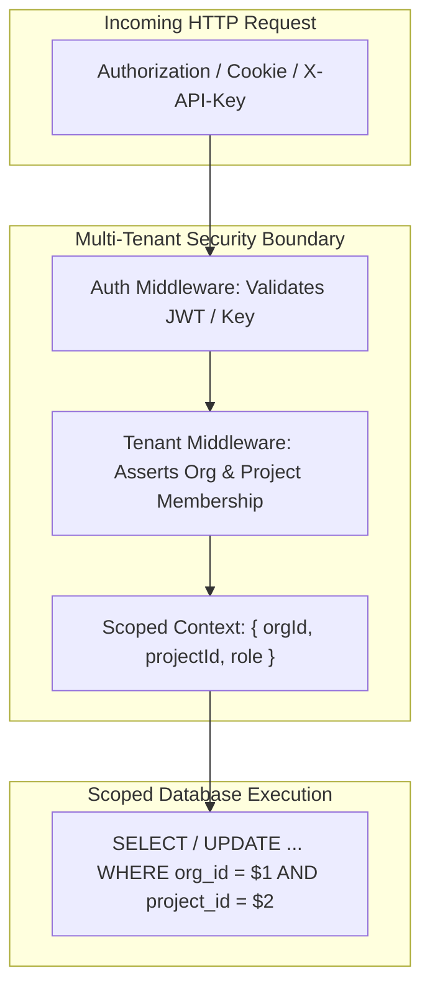

# Enterprise Security, Compliance & Multi-Tenancy Matrix

This document details Pulsiv's enterprise security architecture, zero-trust tenant isolation, authentication standards, encryption at rest and in transit, and compliance safeguards (SOC 2, GDPR, HIPAA).

---

## 1. Zero-Trust Multi-Tenancy Model

### 1.1 Tenant Isolation Guarantees
- **Logical Scoping**: All database queries strictly enforce `WHERE org_id = $1` or `WHERE project_id = $2`.
- **Database Partitioning**: Telemetry tables in the Log DB are partitioned by date and project, ensuring isolated index trees and query scans.
- **Fail-Safe Tenant Middleware**: Routes protected by `requireOrg` and `requireProjectMembership` reject requests lacking verified tenant context before service layer execution.

---

## 2. Authentication & Authorization Matrix

| Feature | Protocol / Standard | Implementation Details |
| :--- | :--- | :--- |
| **Password Security** | Bcrypt (Cost 12) | Memory-hard salt & hash; rate-limited failed attempts. |
| **Enterprise SSO** | SAML 2.0 / OIDC | Okta, Microsoft Entra ID, Google Workspace, OneLogin. |
| **Passkeys / Passwordless** | WebAuthn / FIDO2 | Asymmetric public key cryptography (ECDSA / Ed25519). |
| **Multi-Factor Auth (MFA)** | RFC 6238 TOTP | Authenticator apps (Google Auth, 1Password) with backup recovery codes. |
| **Directory Sync** | SCIM 2.0 (RFC 7644) | Automated user provisioning, role synchronization, and instant deprovisioning. |
| **Session Protection** | HttpOnly SameSite Cookies | Signed with dedicated `COOKIE_SECRET` distinct from `JWT_SECRET`. |

---

## 3. Cryptography & Encryption Standards

1. **Encryption in Transit**: TLS 1.3 enforced on all external endpoints with HSTS (`max-age=31536000`).
2. **Encryption at Rest**: AES-256-GCM authenticated encryption for sensitive third-party integration secrets (Slack webhook URLs, PagerDuty integration keys).
3. **API Key Storage**: Client API keys (`pk_live_...`) are hashed using SHA-256; only public prefixes (`pk_live_ab12cd34`) and hashes are stored in the database.
4. **Timing-Safe Equality**: Constant-time byte comparisons (`crypto.timingSafeEqual`) prevent side-channel timing attacks during authentication.

---

## 4. Compliance & Audit Logging

- **Immutable Audit Trail**: All administrative changes (`member.invite`, `role.change`, `key.rotate`, `sso.enable`) are written to `organization_audit_logs` with actor IP, user agent, and timestamp.
- **GDPR Data Portability & Erasure**: Automated asynchronous data export jobs and cascaded user redaction workflows.
- **SSRF & Network Hardening**: Outbound webhook requests validate destination IP ranges against private IP blocklists (RFC 1918, AWS metadata `169.254.169.254`).
