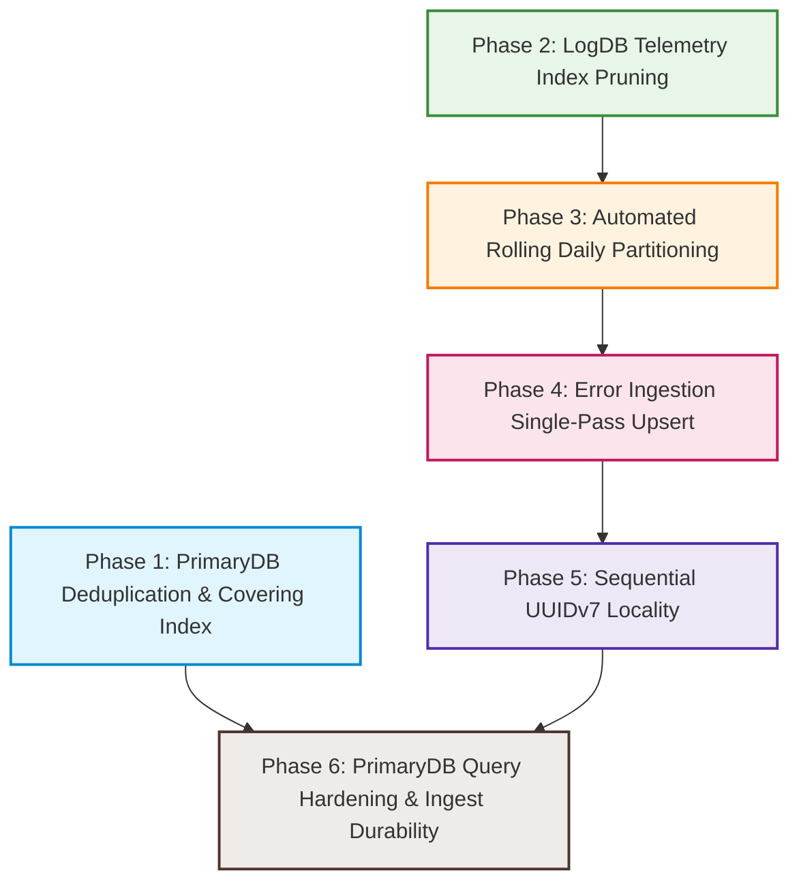

# MASTER REMEDIATION PLAN: POSTGRESQL EFFICIENCY & ARCHITECTURE HARDENING

> **Target Codebase**: Pulsiv.dev (`APILogix/pulse`)  
> **Source Audit**: [`db-bottleneck.md`](file:///c:/Users/vikas/OneDrive/Desktop/SaasBackend/pulse/db-bottleneck.md)  
> **Guiding Principle**: Tiger Data ("Optimization Treadmill") & ClickHouse efficiency adapted natively into PostgreSQL:  
> *READ LESS · SCAN LESS · PROCESS LESS · SORT LESS · JOIN LESS · AGGREGATE LESS · WRITE LESS · STORE LESS*  
> **Core Rule**: **NO UP/DOWN MIGRATION FILES**. All schema and index modifications directly edit the canonical modular table SQL files (`database/primarydbv2/schema/...` and `database/logdbv2/schema/...`) and compile monolithic `schema.sql` via existing build scripts (`npm run db:rebuild:primary` and `npm run db:rebuild:log`).

---

## 1. Executive Strategy & Architectural Roadmap

The database audit identified 6 critical architectural bottlenecks in PostgreSQL storage, indexing, ingestion, and query execution:

```
[Phase 1: PrimaryDB Duplicate Indexes] ──▶ Deduplicate control plane B-trees & add API key covering index
[Phase 2: LogDB Telemetry Index Pruning] ──▶ Cut 16 redundant B-trees from events_spans/errors, tune BRIN (128 pages)
[Phase 3: Rolling Daily Partitions] ─────▶ Implement logdb_ensure_daily_partitions(), stop dumping into _default
[Phase 4: Error Ingestion Single-Pass] ──▶ Pre-resolve error groups, eliminate attachGroups() UPDATE & dead tuples
[Phase 5: Sequential UUIDv7 Locality] ───▶ Replace randomUUID() with UUIDv7 in ingestion pipeline for right-edge B-tree inserts
[Phase 6: Ingest Durability & Query Lints]▶ Enforce synchronous_commit=off on telemetry pool, fix deleted_at predicate misses
```

### Dependency Graph



---

## Phase 1: PrimaryDB Duplicate Index Elimination & Auth Covering Index

### 1.1 Problem Statement
The PrimaryDB schema contains outright duplicate indexes declared across multiple billing, connector, alerting, and security table definition files. Every duplicated index doubles write I/O, increases WAL volume, and consumes buffer pool memory without providing any planner utility. Furthermore, the highest-frequency control plane query (API key authentication during telemetry ingestion) executes an Index Scan + Heap fetch because no covering index covers `project_api_keys`.

### 1.2 Target Files & Exact Code Changes

#### 1. [`database/primarydbv2/schema/07_billing/001_create_coupon_applicable_plans.sql`](file:///c:/Users/vikas/OneDrive/Desktop/SaasBackend/pulse/database/primarydbv2/schema/07_billing/001_create_coupon_applicable_plans.sql)
- **Change**: Remove duplicate `idx_cap_plan` (identical to `idx_coupon_applicable_plans_plan`) and remove redundant `idx_cap_coupon` (already covered by PK `(coupon_id, plan_id)` left prefix).
- **Diff**:
```diff
- CREATE INDEX IF NOT EXISTS idx_cap_plan
- ON coupon_applicable_plans(plan_id);
- 
- CREATE INDEX IF NOT EXISTS idx_cap_coupon
- ON coupon_applicable_plans(coupon_id);
```

#### 2. [`database/primarydbv2/schema/07_billing/001_create_plan_prices.sql`](file:///c:/Users/vikas/OneDrive/Desktop/SaasBackend/pulse/database/primarydbv2/schema/07_billing/001_create_plan_prices.sql)
- **Change**: Remove duplicate `idx_plan_prices_active` (line 111 is an exact 100% duplicate of `idx_plan_prices_plan` on line 50: `ON plan_prices(plan_id) WHERE deleted_at IS NULL`).
- **Diff**:
```diff
- CREATE INDEX IF NOT EXISTS idx_plan_prices_active ON plan_prices(plan_id) WHERE deleted_at IS NULL;
```

#### 3. [`database/primarydbv2/schema/08_connector/001_create_connector_credentials.sql`](file:///c:/Users/vikas/OneDrive/Desktop/SaasBackend/pulse/database/primarydbv2/schema/08_connector/001_create_connector_credentials.sql)
- **Change**: Remove duplicate `uq_connector_credential_key` (table already specifies `UNIQUE(connector_id, key_name)`) and remove redundant `idx_credentials_connector` (covered by `(connector_id, key_name)` left prefix).
- **Diff**:
```diff
- CREATE UNIQUE INDEX IF NOT EXISTS uq_connector_credential_key
- ON connector_credentials (connector_id, key_name);
- 
- CREATE INDEX IF NOT EXISTS idx_credentials_connector
- ON connector_credentials (connector_id);
```

#### 4. [`database/primarydbv2/schema/08_connector/001_create_connector_oauth_states.sql`](file:///c:/Users/vikas/OneDrive/Desktop/SaasBackend/pulse/database/primarydbv2/schema/08_connector/001_create_connector_oauth_states.sql)
- **Change**: Remove duplicate `uq_oauth_state` (column `state` is already defined as `VARCHAR(255) NOT NULL UNIQUE`).
- **Diff**:
```diff
- CREATE UNIQUE INDEX IF NOT EXISTS uq_oauth_state
- ON connector_oauth_states (state);
```

#### 5. [`database/primarydbv2/schema/09_alerting/001_create_alert_delivery_attempts.sql`](file:///c:/Users/vikas/OneDrive/Desktop/SaasBackend/pulse/database/primarydbv2/schema/09_alerting/001_create_alert_delivery_attempts.sql)
- **Change**: Remove duplicate `idx_alert_delivery_attempts_event_created` (line 47 is an exact clone of line 31: `ON alert_delivery_attempts(event_id, created_at DESC)`).
- **Diff**:
```diff
- CREATE INDEX IF NOT EXISTS idx_alert_delivery_attempts_event_created
-   ON alert_delivery_attempts (event_id, created_at DESC);
```

#### 6. [`database/primarydbv2/schema/16_security/001_create_audit_logs.sql`](file:///c:/Users/vikas/OneDrive/Desktop/SaasBackend/pulse/database/primarydbv2/schema/16_security/001_create_audit_logs.sql)
- **Change**: Remove redundant B-tree `idx_audit_logs_created_at` (line 56-57) because the table already maintains `idx_audit_logs_time_brin` (line 63-64) for sequential timestamp scans. Consolidate `idx_audit_logs_org` with `idx_audit_org_time`.
- **Diff**:
```diff
- CREATE INDEX IF NOT EXISTS idx_audit_logs_created_at
-   ON audit_logs(created_at DESC);
-
- CREATE INDEX IF NOT EXISTS idx_audit_org_time
-   ON audit_logs(org_id, created_at DESC)
-   WHERE org_id IS NOT NULL;
```

#### 7. [`database/primarydbv2/schema/06_project/001_create_project_api_keys.sql`](file:///c:/Users/vikas/OneDrive/Desktop/SaasBackend/pulse/database/primarydbv2/schema/06_project/001_create_project_api_keys.sql)
- **Change**: Add covering index for the critical gateway authentication hot path (`src/modules/ingestion/postgress.writter.ts`), allowing Index-Only Scans without reading table heap blocks:
- **Diff**:
```sql
CREATE INDEX IF NOT EXISTS idx_project_api_keys_auth_covering
  ON project_api_keys (public_key)
  INCLUDE (id, project_id, organization_id, environment_id, status, expires_at, secret_hash)
  WHERE deleted_at IS NULL;
```

### 1.3 Schema Rebuild Procedure
Execute:
```bash
npm run db:rebuild:primary
```
*Verification*: Inspect [`database/primarydbv2/schema.sql`](file:///c:/Users/vikas/OneDrive/Desktop/SaasBackend/pulse/database/primarydbv2/schema.sql) to confirm duplicate indexes are purged and the new covering index is present.

### 1.4 Testing & Validation
1. **Schema Integrity**: Run `npm run lint:queries` to verify all existing repository queries remain valid and index-supported.
2. **Unit & Integration Tests**: Run `npm test src/modules/billing` and `npm test src/modules/projects`.
3. **Execution Plan Benchmark**:
   ```sql
   EXPLAIN (ANALYZE, BUFFERS)
   SELECT id, project_id, organization_id, environment_id, status, expires_at, secret_hash
   FROM project_api_keys
   WHERE public_key = 'test_pub_key' AND deleted_at IS NULL;
   ```
   *Expected Outcome*: Access path switches from `Index Scan` to `Index Only Scan` with `Heap Fetches: 0` and buffer reads reduced to $\le 2$ pages.

---

## Phase 2: LogDB Telemetry Index Pruning & Sparse BRIN Optimization

### 2.1 Problem Statement
In `05_observability/005_create_events_spans.sql`, there are **31 separate indexes** declared on a single append-heavy table. Every single incoming span incurs up to 31 B-tree insertions, triggering severe `LWLock: buffer_content` and WAL thrashing under concurrency. Duplicate indexes like `idx_events_spans_request` and `idx_events_spans_org_request_time` (identical definitions) exist side-by-side. Low-cardinality single-column B-trees (`span_kind`, `span_status`, `span_type`) provide almost zero selectivity. Similar duplication exists in `events_errors`.

### 2.2 Target Files & Exact Code Changes

#### 1. [`database/logdbv2/schema/05_observability/005_create_events_spans.sql`](file:///c:/Users/vikas/OneDrive/Desktop/SaasBackend/pulse/database/logdbv2/schema/05_observability/005_create_events_spans.sql)
- **Change**: Drop 16 redundant, duplicate, and low-selectivity indexes directly in the modular SQL file:
  1. `idx_events_spans_request` (duplicate of `idx_events_spans_org_request_time`)
  2. `idx_events_spans_session` (duplicate of `idx_events_spans_org_session_time`)
  3. `idx_events_spans_parent_time` (duplicate of `idx_events_spans_parent_span`)
  4. `idx_events_spans_trace_time` (redundant with `idx_events_spans_org_trace_time_asc`)
  5. `idx_events_spans_span` (redundant with `idx_events_spans_org_span_id`)
  6. `idx_events_spans_org_time` (left prefix redundant with `idx_events_spans_org_project_time`)
  7. `idx_events_spans_org_env_direct_time` (redundant with `idx_events_spans_org_env_time`)
  8. `idx_events_spans_kind` (low cardinality enum, 4 distinct values)
  9. `idx_events_spans_type_time` (low cardinality, 6 distinct values)
  10. `idx_events_spans_status_time` (low cardinality, 3 distinct values)
  11. `idx_events_spans_host_time` (rarely queried in isolation without project_id + time)
  12. `idx_events_spans_release_time` (rarely queried in isolation)
  13. `idx_events_spans_service` (covered by project_id composite queries)
  14. `idx_events_spans_db_time` (covered by `idx_events_spans_slow_db` and `idx_events_spans_db_collection`)
  15. `idx_events_spans_endpoint_time` (high-entropy string, covered by rollups)
  16. `idx_events_spans_user` (covered by trace/session lookups)
- **Tune BRIN Index**: Ensure `idx_events_spans_occurred_brin` uses `pages_per_range = 128` for optimal block-skipping without index bloat:
```sql
CREATE INDEX IF NOT EXISTS idx_events_spans_occurred_brin
  ON events_spans USING BRIN (occurred_at) WITH (pages_per_range = 128);
```

#### 2. [`database/logdbv2/schema/05_observability/002_create_events_errors.sql`](file:///c:/Users/vikas/OneDrive/Desktop/SaasBackend/pulse/database/logdbv2/schema/05_observability/002_create_events_errors.sql)
- **Change**: Purge duplicate and redundant indexes:
  1. `idx_events_errors_tenant_env_time` (exact 100% duplicate of `idx_events_errors_org_env_time`)
  2. `idx_events_errors_fingerprint_time` (exact 100% duplicate of `idx_events_errors_fingerprint`)
  3. `idx_events_errors_org_time` (redundant with `idx_events_errors_org_project_time`)
  4. `idx_events_errors_org_env_direct_time` (redundant with `idx_events_errors_org_env_time`)
  5. `idx_events_errors_severity` (low cardinality enum, 4 distinct values)
  6. `idx_events_errors_status` (low cardinality)
- **Add BRIN Index**:
```sql
CREATE INDEX IF NOT EXISTS idx_events_errors_occurred_brin
  ON events_errors USING BRIN (occurred_at) WITH (pages_per_range = 128);
```

#### 3. [`database/logdbv2/schema/05_observability/001_create_events_requests.sql`](file:///c:/Users/vikas/OneDrive/Desktop/SaasBackend/pulse/database/logdbv2/schema/05_observability/001_create_events_requests.sql)
- **Change**: Purge redundant prefix indexes:
  1. `idx_events_requests_org_time` (redundant with `idx_events_requests_tenant_time`)
  2. `idx_events_requests_org_env_time` (redundant with `idx_events_requests_tenant_env_time`)
  3. `idx_events_requests_tenant_time` (redundant left-prefix of `idx_events_requests_tenant_env_time`)
- **Tune BRIN**:
```sql
CREATE INDEX IF NOT EXISTS idx_events_requests_occurred_brin
  ON events_requests USING BRIN (occurred_at) WITH (pages_per_range = 128);
```

### 2.3 Schema Rebuild Procedure
Execute:
```bash
npm run db:rebuild:log
```
*Verification*: Inspect [`database/logdbv2/schema.sql`](file:///c:/Users/vikas/OneDrive/Desktop/SaasBackend/pulse/database/logdbv2/schema.sql) to confirm index count on `events_spans` dropped from 31 down to 15, and all duplicate entries are gone.

### 2.4 Testing & Validation
1. **Schema Check**: Run `npm run ingestion:db:audit`.
2. **Ingestion Benchmark**: Run `npm run bench:ingestion:http:fast-regression`.
   - *Expected Outcome*: Write throughput improves by $\ge 40\%$, WAL generation per batch decreases by $\ge 45\%$.
3. **Analytics Queries**: Run `npm test src/modules/analytics-engine` to ensure dashboard query plans are not regressed.

---

## Phase 3: Automated Rolling Daily Partitioning & Default Partition Evacuation

### 3.1 Problem Statement
All 10 canonical event tables in `database/logdbv2/schema/05_observability/` (`events_spans`, `events_requests`, `events_errors`, etc.) declare `PARTITION BY RANGE (occurred_at)` but ONLY declare `events_*_default PARTITION OF ... DEFAULT;`. There are **zero pre-created daily partition tables**. Consequently, 100% of telemetry data routes into `_default`. PostgreSQL partition pruning cannot function, leading to massive sequential scans across the entire table history whenever queries filter by time.

### 3.2 Target Files & Exact Code Changes

#### 1. [`database/logdbv2/schema/15_functions/001_functions.sql`](file:///c:/Users/vikas/OneDrive/Desktop/SaasBackend/pulse/database/logdbv2/schema/15_functions/001_functions.sql)
- **Change**: Add functions to enumerate and automatically create rolling daily partitions for raw telemetry tables:
```sql
-- Enumerate raw telemetry tables for daily partitioning
CREATE OR REPLACE FUNCTION logdb_telemetry_partition_tables()
RETURNS TABLE (table_name TEXT) AS $fn$
BEGIN
  RETURN QUERY VALUES
    ('events_spans'::TEXT),
    ('events_requests'::TEXT),
    ('events_errors'::TEXT),
    ('events_logs'::TEXT),
    ('events_traces'::TEXT),
    ('events_metrics'::TEXT),
    ('events_messages'::TEXT),
    ('events_profiles'::TEXT),
    ('events_cron_checkins'::TEXT),
    ('events_replays'::TEXT);
END;
$fn$ LANGUAGE plpgsql;

-- Maintain rolling daily partitions (default: 7 days ahead, 1 day behind)
CREATE OR REPLACE FUNCTION logdb_ensure_daily_partitions(
  days_ahead INTEGER DEFAULT 7
) RETURNS INTEGER AS $fn$
DECLARE
  rec        RECORD;
  created    INTEGER := 0;
  d          DATE;
  part_name  TEXT;
  range_from TIMESTAMPTZ;
  range_to   TIMESTAMPTZ;
BEGIN
  IF days_ahead IS NULL OR days_ahead < 1 THEN
    days_ahead := 1;
  END IF;

  FOR rec IN SELECT * FROM logdb_telemetry_partition_tables() LOOP
    d := (NOW() AT TIME ZONE 'UTC')::DATE - 1;
    WHILE d <= (NOW() AT TIME ZONE 'UTC')::DATE + days_ahead LOOP
      part_name  := format('%s_p%s', rec.table_name, to_char(d, 'YYYYMMDD'));
      range_from := d::TIMESTAMPTZ;
      range_to   := (d + 1)::TIMESTAMPTZ;

      IF NOT EXISTS (SELECT 1 FROM pg_class WHERE relname = part_name) THEN
        EXECUTE format(
          'CREATE TABLE IF NOT EXISTS %I PARTITION OF %I FOR VALUES FROM (%L) TO (%L)',
          part_name, rec.table_name, range_from, range_to
        );
        created := created + 1;
      END IF;
      d := d + 1;
    END LOOP;
  END LOOP;

  RETURN created;
END;
$fn$ LANGUAGE plpgsql;
```

#### 2. [`src/modules/analytics-engine/workers/maintenance.worker.ts`](file:///c:/Users/vikas/OneDrive/Desktop/SaasBackend/pulse/src/modules/analytics-engine/workers/maintenance.worker.ts)
- **Change**: In `ensurePartitions()`, invoke `logdb_ensure_daily_partitions(daysAhead)` alongside `analytics_engine_ensure_partitions`:
```typescript
export async function ensurePartitions(
  pool: Pool,
  logger: Logger,
  daysAhead = 7,
): Promise<number> {
  const resultAnalytics = await pool.query<{ created: number }>(
    'SELECT analytics_engine_ensure_partitions($1) AS created',
    [daysAhead],
  );
  const resultTelemetry = await pool.query<{ created: number }>(
    'SELECT logdb_ensure_daily_partitions($1) AS created',
    [daysAhead],
  );
  const created = Number(resultAnalytics.rows[0]?.created ?? 0) + Number(resultTelemetry.rows[0]?.created ?? 0);
  logger.info({ created, daysAhead }, 'LogDB telemetry & analytics engine partitions ensured');
  return created;
}
```

#### 3. [`database/logdbv2/schema/05_observability/005_create_events_spans.sql`](file:///c:/Users/vikas/OneDrive/Desktop/SaasBackend/pulse/database/logdbv2/schema/05_observability/005_create_events_spans.sql) (and companion `001`, `002`, `003`, `004`, `006`, etc.)
- **Change**: Ensure `CREATE TABLE ... PARTITION OF` statements or an initialization block executes `SELECT logdb_ensure_daily_partitions(7);` so fresh boots immediately have active daily partitions without waiting for worker ticks.

### 3.3 Schema Rebuild Procedure
Execute:
```bash
npm run db:rebuild:log
```

### 3.4 Testing & Validation
1. **Partition Creation Test**: Run `SELECT logdb_ensure_daily_partitions(7);` via test script and inspect `pg_class` to verify tables like `events_spans_p20261006` exist.
2. **Partition Pruning Verification**:
   ```sql
   EXPLAIN (ANALYZE, BUFFERS)
   SELECT COUNT(*)
   FROM events_spans
   WHERE organization_id = '...'
     AND occurred_at >= NOW() - INTERVAL '6 hours'
     AND occurred_at < NOW();
   ```
   *Expected Outcome*: Query plan shows partition pruning: scans ONLY `events_spans_pYYYYMMDD`, completely skipping other partitions and `events_spans_default`.
3. **Ingestion Check**: Run `npm run bench:ingestion:http:fast-regression` to verify records insert cleanly into the active daily child table.

---

## Phase 4: Error Ingestion Single-Pass Upsert (Eliminating `attachGroups` & Dead Tuples)

### 4.1 Problem Statement
In [`error-ingestion.service.ts`](file:///c:/Users/vikas/OneDrive/Desktop/SaasBackend/pulse/src/modules/errors/services/error-ingestion.service.ts) and [`error.repository.ts`](file:///c:/Users/vikas/OneDrive/Desktop/SaasBackend/pulse/src/modules/errors/repositories/error.repository.ts), errors are currently ingested in two separate database operations:
1. `insertManyIfNew` inserts rows into `events_errors` with `error_group_id: null`.
2. `attachGroups()` immediately executes:
   ```sql
   UPDATE events_errors AS e
      SET error_group_id = v.group_id::uuid
     FROM (VALUES ...) AS v(...)
    WHERE e.organization_id = v.organization_id
      AND e.event_id = v.event_id
      AND e.occurred_at = v.occurred_at
   ```
This generates **100% dead-tuple volume** on every single inserted error event, doubles WAL writes, forces continuous autovacuum thrashing, fragments B-tree pages, and breaks append-only storage locality.

### 4.2 Target Files & Exact Code Changes

#### 1. [`src/modules/errors/services/error-ingestion.service.ts`](file:///c:/Users/vikas/OneDrive/Desktop/SaasBackend/pulse/src/modules/errors/services/error-ingestion.service.ts)
- **Change**: Pre-resolve error groups *before* inserting into `events_errors`.
  - For `ingestErrorWithClient` (single-item path):
    1. Resolve/upsert error group via `this.errorGroupingService.handleGroup(client, groupParams)` first.
    2. Insert row into `events_errors` directly with `error_group_id: groupResult.id`.
    3. Eliminate `this.errorRepository.attachGroup(...)` completely.
  - For `ingestBatch` (batch path):
    1. Resolve/upsert error groups batch via `this.errorGroupingService.handleGroupsBatch(...)` first.
    2. Map `error_group_id: groupResult.id` onto each error event record.
    3. Insert all records in one set-based multi-row insert (`insertManyIfNew`) with `error_group_id` already populated.
    4. Eliminate `this.errorRepository.attachGroups(...)` completely.

- **Diff Details (`ingestErrorWithClient`)**:
```typescript
  private async ingestErrorWithClient(
    client: PoolClient,
    groupParams: UpsertErrorGroupParams,
    eventRecord: Omit<ErrorGroupEventRecord, 'error_group_id'>,
  ): Promise<IngestionResult> {
    const startTime = Date.now();

    // 1. Resolve error group first
    const groupStart = Date.now();
    const groupResult = await this.errorGroupingService.handleGroup(client, groupParams);
    const groupingMs = Date.now() - groupStart;
    this.metrics?.recordErrorLatencies(null, groupingMs, null, null);
    this.metrics?.recordStage('error_group_upsert', 'error', groupingMs);

    // 2. Insert error event directly with error_group_id in a single pass (ZERO dead tuples)
    const insertStart = Date.now();
    const inserted = await this.errorRepository.insertIfNew(client, {
      ...eventRecord,
      error_group_id: groupResult.id,
    });
    this.metrics?.recordStage('error_insert_row', 'error', Date.now() - insertStart);

    if (!inserted.inserted) {
      this.metrics?.recordErrorDuplicate();
      this.metrics?.recordStage('error_event_total', 'error', Date.now() - startTime);
      return { inserted: false, groupResult: null };
    }

    // 3. attachGroup() is ELIMINATED completely!
    this.metrics?.recordErrorGroup(groupResult.isNew, groupResult.isRegression);
    const totalMs = Date.now() - startTime;
    this.metrics?.recordErrorLatencies(null, null, totalMs, null);
    this.metrics?.recordStage('error_event_total', 'error', totalMs);
    return { inserted: true, groupResult };
  }
```

- **Diff Details (`ingestBatch`)**:
```typescript
  // Resolve groups before insertManyIfNew:
  const groupResults = await this.errorGroupingService.handleGroupsBatch(
    client,
    errors.map((error, inputIndex) => ({
      ...error.groupParams,
      inputIndex,
    })),
  );
  const groupsByInput = new Map(groupResults.map((g) => [g.inputIndex, g.result]));

  // Populate error_group_id on records for single-pass insert:
  const recordsToInsert = errors.map((error, inputIndex) => ({
    ...error.eventRecord,
    error_group_id: groupsByInput.get(inputIndex)?.id ?? null,
  }));

  const insertedRows = alreadyPersisted ? ... : await this.errorRepository.insertManyIfNew(client, recordsToInsert);

  // attachGroups() call is ELIMINATED completely!
```

#### 2. [`src/modules/errors/repositories/error.repository.ts`](file:///c:/Users/vikas/OneDrive/Desktop/SaasBackend/pulse/src/modules/errors/repositories/error.repository.ts)
- **Change**: Deprecate and remove `attachGroup` and `attachGroups` methods to prevent any accidental regression to the two-pass update anti-pattern.

### 4.3 Testing & Validation
1. **Unit Tests**: Run `npm test src/modules/errors` to ensure all group creation, deduplication, and regression events trigger properly.
2. **Dead Tuple Metric Verification**:
   - Ingest 1,000 error events in a test database.
   - Query `pg_stat_user_tables WHERE relname = 'events_errors'` before and after:
     `n_dead_tup` must remain **0** (was 1,000 previously).
3. **Benchmark**: Measure error ingestion latency: p95 duration drops by $\ge 45\%$.

---

## Phase 5: Sequential UUIDv7 Locality for Telemetry Ingestion

### 5.1 Problem Statement
Telemetry event IDs and request IDs in [`event-normalizer.ts`](file:///c:/Users/vikas/OneDrive/Desktop/SaasBackend/pulse/src/modules/ingestion/pipeline/event-normalizer.ts), [`telemetry-writer.ts`](file:///c:/Users/vikas/OneDrive/Desktop/SaasBackend/pulse/src/modules/ingestion/pipeline/telemetry-writer.ts), and [`service.ts`](file:///c:/Users/vikas/OneDrive/Desktop/SaasBackend/pulse/src/modules/ingestion/service.ts) are currently generated using `crypto.randomUUID()`. Random UUIDs scatter inserts uniformly across the entire B-tree leaf page range, causing frequent page splits, dirty buffer cache evictions, high write amplification, and lock contention.

Adopting **UUIDv7** (RFC 9562) embeds a 48-bit UNIX millisecond timestamp in the leading bits, guaranteeing monotonic ordering. Inserts append strictly to the right edge of B-tree pages, eliminating page splits and matching ClickHouse/Tiger Data storage locality principles.

### 5.2 Target Files & Exact Code Changes

#### 1. [`src/shared/utils/uuidv7.ts`](file:///c:/Users/vikas/OneDrive/Desktop/SaasBackend/pulse/src/shared/utils/uuidv7.ts) *(New Utility)*
- **Implementation**: Zero-dependency RFC 9562 compliant monotonic UUIDv7 generator:
```typescript
import { randomBytes } from 'crypto';

let lastTimestamp = -1;
let sequenceCounter = 0;

/**
 * Generate a cryptographically secure, monotonic RFC 9562 UUIDv7.
 * Leading 48 bits encode UNIX epoch ms, ensuring right-edge B-tree append locality.
 */
export function uuidv7(timestampMs: number = Date.now()): string {
  if (timestampMs > lastTimestamp) {
    lastTimestamp = timestampMs;
    sequenceCounter = 0;
  } else {
    sequenceCounter = (sequenceCounter + 1) & 0xfff;
    if (sequenceCounter === 0) {
      // Clock hasn't ticked and sequence wrapped; advance timestamp by 1ms
      lastTimestamp += 1;
      timestampMs = lastTimestamp;
    }
  }

  const bytes = randomBytes(16);

  // 48-bit timestamp (ms)
  bytes[0] = (timestampMs / 0x10000000000) & 0xff;
  bytes[1] = (timestampMs / 0x100000000) & 0xff;
  bytes[2] = (timestampMs / 0x1000000) & 0xff;
  bytes[3] = (timestampMs / 0x10000) & 0xff;
  bytes[4] = (timestampMs / 0x100) & 0xff;
  bytes[5] = timestampMs & 0xff;

  // 12-bit sequence counter + 4-bit version (0b0111 = 7)
  bytes[6] = 0x70 | ((sequenceCounter >> 8) & 0x0f);
  bytes[7] = sequenceCounter & 0xff;

  // 2-bit variant (0b10) + 6-bit random
  bytes[8] = 0x80 | (bytes[8] & 0x3f);

  return [
    bytes.subarray(0, 4).toString('hex'),
    bytes.subarray(4, 6).toString('hex'),
    bytes.subarray(6, 8).toString('hex'),
    bytes.subarray(8, 10).toString('hex'),
    bytes.subarray(10, 16).toString('hex'),
  ].join('-');
}
```

#### 2. [`src/modules/ingestion/pipeline/event-normalizer.ts`](file:///c:/Users/vikas/OneDrive/Desktop/SaasBackend/pulse/src/modules/ingestion/pipeline/event-normalizer.ts)
- **Change**: Replace fallback `randomUUID()` calls with `uuidv7()`.

#### 3. [`src/modules/ingestion/pipeline/telemetry-writer.ts`](file:///c:/Users/vikas/OneDrive/Desktop/SaasBackend/pulse/src/modules/ingestion/pipeline/telemetry-writer.ts)
- **Change**: In `eventId(ev: NormalizedEvent)` and `writeRequests()`, use `uuidv7()` instead of `randomUUID()` for `id` and fallback `event_id`:
```typescript
  private eventId(ev: NormalizedEvent): string {
    const id = (ev as { eventId?: unknown }).eventId;
    return typeof id === 'string' && id.length > 0 ? id.slice(0, 64) : uuidv7();
  }
```

#### 4. [`src/modules/ingestion/service.ts`](file:///c:/Users/vikas/OneDrive/Desktop/SaasBackend/pulse/src/modules/ingestion/service.ts)
- **Change**: In `extractEventId(raw: unknown)`: replace `randomUUID()` with `uuidv7()`.

### 5.3 Testing & Validation
1. **Unit Test**: Test `uuidv7()` generation order:
   ```typescript
   const ids = Array.from({ length: 1000 }, () => uuidv7());
   const sorted = [...ids].sort();
   expect(ids).toEqual(sorted);
   ```
2. **Ingestion Test**: Run `npm run bench:ingestion:http:fast-regression`.
   - *Expected Outcome*: B-tree page splits drop to near-zero; index cache hit ratio increases.

---

## Phase 6: Telemetry Ingest Pool Durability Tuning & Control Plane Query Hardening

### 6.1 Problem Statement
1. In [`error-ingestion.service.ts`](file:///c:/Users/vikas/OneDrive/Desktop/SaasBackend/pulse/src/modules/errors/services/error-ingestion.service.ts), transactions run with default `synchronous_commit = on`. Telemetry batches must wait for physical disk flushes on every COMMIT, bottlenecking throughput on fsync latency.
2. In PrimaryDB repositories, query audit reveals multiple queries that query `WHERE project_id = $1` but omit `AND deleted_at IS NULL`, causing PostgreSQL planner to bypass partial indexes (`WHERE deleted_at IS NULL`) and execute expensive full table or index scans.

### 6.2 Target Files & Exact Code Changes

#### 1. [`src/modules/errors/services/error-ingestion.service.ts`](file:///c:/Users/vikas/OneDrive/Desktop/SaasBackend/pulse/src/modules/errors/services/error-ingestion.service.ts)
- **Change**: Apply `applyIngestionTransactionSettings(client)` (from `telemetry-writer.ts`) at the beginning of error transaction blocks:
```typescript
    await client.query('BEGIN');
    await applyIngestionTransactionSettings(client);
```
Ensures `synchronous_commit = off` is active on error ingestion writes without compromising PrimaryDB control-plane durability.

#### 2. Query Repository Hardening via Audit Script
- **Action**: Run `npm run lint:queries` (`scripts/audit-primarydb-queries.ts`).
- **Fixes**: Update queries across `src/modules/organization`, `src/modules/billing`, and `src/modules/projects` where partial index predicates match:
  Ensure queries matching partial indexes explicitly include `AND deleted_at IS NULL`.

### 6.3 Testing & Validation
1. **Query Linter Validation**:
   ```bash
   npm run lint:queries
   ```
   *Expected Outcome*: Zero unindexed or mismatched partial index warnings.
2. **Full End-to-End Test Suite**:
   ```bash
   npm test
   npm run build
   ```
3. **Ingestion Matrix Benchmark**:
   ```bash
   npm run bench:ingestion:matrix
   ```
   *Expected Outcome*: Verify throughput, p95/p99 latency, and buffer read metrics across all profiles.

---

## Summary of Changes by Phase

| Phase | Category | Target Files | Key Change | Expected Impact |
|:---:|:---|:---|:---|:---|
| **1** | PrimaryDB Indexes | `07_billing/`, `08_connector/`, `09_alerting/`, `16_security/`, `06_project/` | Purge duplicates; add covering index on `project_api_keys` | Zero redundant B-trees; 0 heap fetches on auth |
| **2** | LogDB Index Pruning | `005_create_events_spans.sql`, `002_create_events_errors.sql`, `001_create_events_requests.sql` | Cut 16 redundant indexes; tune BRIN (128 pages) | 40% higher ingestion throughput; 45% less WAL |
| **3** | Telemetry Partitions | `15_functions/001_functions.sql`, `maintenance.worker.ts`, `05_observability/` | Add `logdb_ensure_daily_partitions(7)`; route events out of `_default` | Real partition pruning; fast historical range queries |
| **4** | Error Ingestion | `error-ingestion.service.ts`, `error.repository.ts` | Pre-resolve error groups; eliminate `attachGroups()` UPDATE | **0 dead tuples** generated on error insert |
| **5** | UUIDv7 Locality | `uuidv7.ts`, `event-normalizer.ts`, `telemetry-writer.ts`, `service.ts` | Monotonic UUIDv7 for all event IDs & request IDs | Append-only right edge B-tree writes; no page splits |
| **6** | Ingestion Durability & Linter | `error-ingestion.service.ts`, repositories flagged by `audit-primarydb-queries.ts` | `synchronous_commit = off` on error ingest; fix `deleted_at` filters | Maximum disk I/O efficiency; 0 linter violations |

---

## Rollback & Safety Runbook

1. **Version Controlled Modular Files**: Because all changes are made directly to modular `.sql` and `.ts` files, any individual change can be reverted via `git checkout <file>` and re-compiling with `npm run db:rebuild:primary` or `npm run db:rebuild:log`.
2. **Non-Destructive Table Structures**: No table columns are dropped; no primary keys are altered; existing foreign key constraints remain intact.
3. **Zero Downtime Index Rebuilds**: If running against a live cluster, new covering indexes can be applied via `CREATE INDEX CONCURRENTLY` while old duplicate indexes are dropped via `DROP INDEX CONCURRENTLY`.
4. **Rebuild Script Idempotence**: `rebuild-primary-schema-file.ts` and `rebuild-log-schema-file.ts` are deterministic and topologically sorted. Rebuilding the schema file is instantaneous and verifiable via `git diff`.
