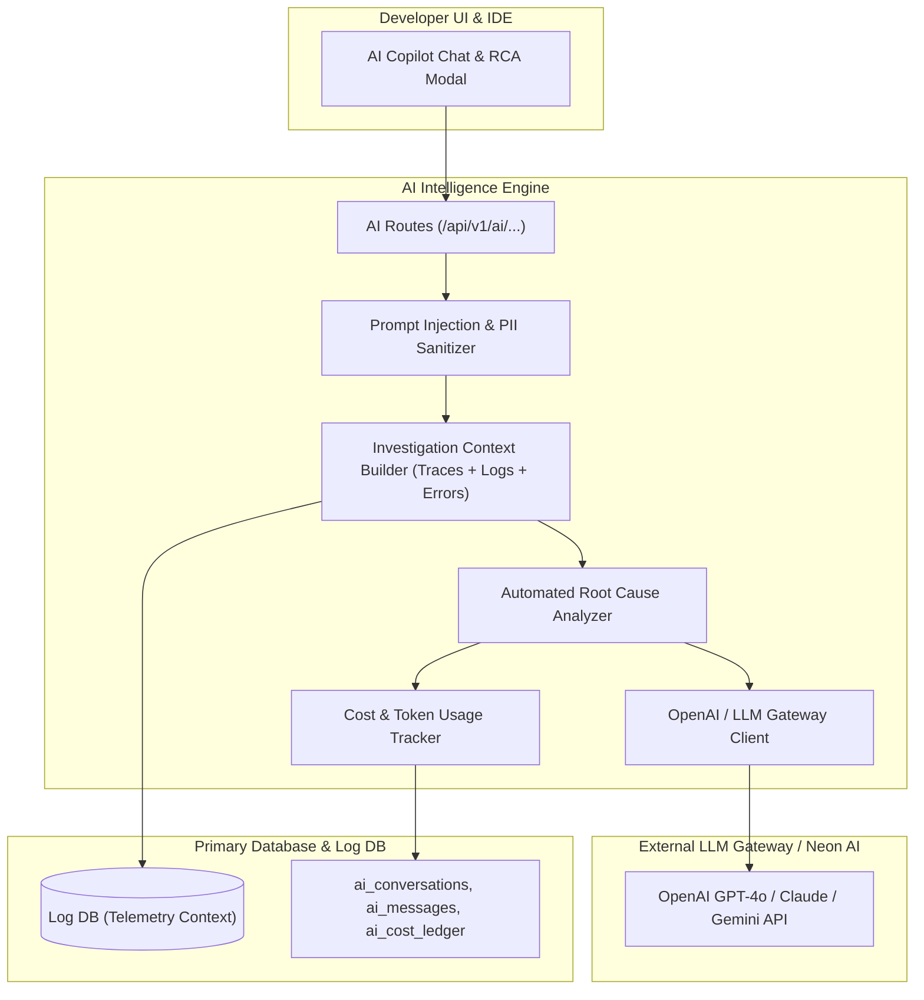

# AI Copilot & Root Cause Analysis Module Architecture

The **AI Module** powers intelligent root cause analysis, automated error triage, LLM-based code fix recommendations, interactive telemetry chat, and organizational AI usage cost tracking.

---

## 1. Core Architectural Responsibilities

1. **Automated Incident Root Cause Analysis (RCA)**: When an anomaly or critical error occurs, the analyzer pulls correlated stack traces, recent code commits, span latency waterfalls, and database query logs, constructing a rich structured context prompt.
2. **Context Assembly & PII Scrubbing**: Strips sensitive data (passwords, auth headers, credit cards, emails) via `security.ts` before dispatching prompts to LLM endpoints.
3. **Token Usage & Cost Metering**: Enforces monthly token budgets per organization and records exact token consumption in `ai_cost_ledger`.
4. **Interactive Telemetry Chat**: Allows developers to query their live monitoring data using natural language ("Why did checkout latency spike at 3 PM?").

---

## 2. Key Components & Files

| Component | Location | Description |
| :--- | :--- | :--- |
| **`analyzer.ts`** | [`pulse/src/modules/ai/analyzer.ts`](file:///c:/Users/vikas/OneDrive/Desktop/SaasBackend/pulse/src/modules/ai/analyzer.ts) | Automated incident analysis and hypothesis generation engine. |
| **`chat.ts`** | [`pulse/src/modules/ai/chat.ts`](file:///c:/Users/vikas/OneDrive/Desktop/SaasBackend/pulse/src/modules/ai/chat.ts) | Multi-turn streaming conversational assistant. |
| **`investigation-context.ts`** | [`pulse/src/modules/ai/investigation-context.ts`](file:///c:/Users/vikas/OneDrive/Desktop/SaasBackend/pulse/src/modules/ai/investigation-context.ts) | Extracts surrounding logs, traces, and metrics for prompt injection. |
| **`cost-tracker.ts`** | [`pulse/src/modules/ai/cost-tracker.ts`](file:///c:/Users/vikas/OneDrive/Desktop/SaasBackend/pulse/src/modules/ai/cost-tracker.ts) | Enforces AI token quotas and records per-model dollar costs. |
| **`security.ts`** | [`pulse/src/modules/ai/security.ts`](file:///c:/Users/vikas/OneDrive/Desktop/SaasBackend/pulse/src/modules/ai/security.ts) | Regex and entropy-based PII masking and prompt boundary isolation. |
