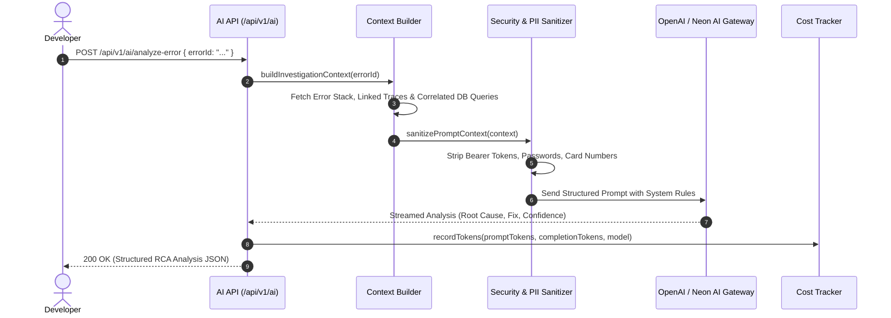

# AI Module Working & Operational Guide

This document describes the operational workflow, context compilation, prompt templates, and streaming chat APIs of the **AI Module**.

---

## 1. Automated Root Cause Analysis Workflow

---

## 2. API Endpoints

- **`POST /api/v1/ai/analyze-error`**: Generates automated root cause analysis for a specific error group.
- **`POST /api/v1/ai/chat`**: Streaming conversational assistant for interactive system debugging.
- **`GET /api/v1/ai/usage`**: Returns organization AI token consumption and remaining monthly quota.
