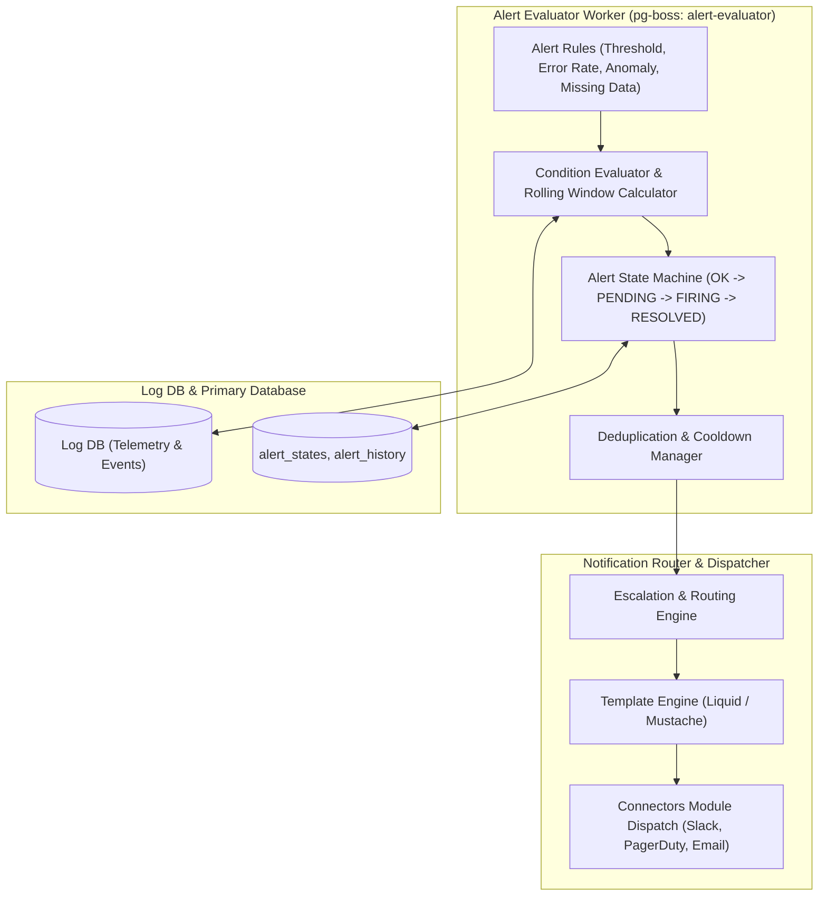

# Alerting Module Architecture

The **Alerting Module** is a mission-critical evaluation and dispatch engine that continuously evaluates alert rules, calculates metric thresholds and anomaly conditions, manages alert state lifecycles (pending, firing, resolved), enforces deduplication and cooldown windows, and routes notifications to destinations (Slack, PagerDuty, Discord, Webhooks, Email).

---

## 1. Core Architectural Responsibilities

1. **Dual-Database Assertion (ADR-0006)**: Evaluators query live telemetry exclusively through the `LogDB` connection pool (where ingestion writes events) to prevent silent evaluation failures when LogDB is hosted on a separate database cluster.
2. **Deterministic State Machine**: Employs `PENDING` confirmation periods before transitioning an alert to `FIRING`, eliminating transient noise and false positives.
3. **Escalation & Silence Policies**: Supports time-based escalation policies (e.g. notify Slack -> if unacknowledged in 15 mins, page on PagerDuty) and scheduled maintenance silence windows.
4. **Channel Routing Matrix**: Routes alerts to distinct channels based on severity (`critical`, `warning`, `info`) and project environment.

---

## 2. Key Components & Files

| Component | Location | Description |
| :--- | :--- | :--- |
| **`evaluator.ts`** | [`pulse/src/modules/alerting/evaluator.ts`](file:///c:/Users/vikas/OneDrive/Desktop/SaasBackend/pulse/src/modules/alerting/evaluator.ts) | Condition evaluation engine running SQL threshold aggregations. |
| **`queue.ts`** | [`pulse/src/modules/alerting/queue.ts`](file:///c:/Users/vikas/OneDrive/Desktop/SaasBackend/pulse/src/modules/alerting/queue.ts) | pg-boss background workers for evaluation and notification dispatch. |
| **`escalation.ts`** | [`pulse/src/modules/alerting/escalation.ts`](file:///c:/Users/vikas/OneDrive/Desktop/SaasBackend/pulse/src/modules/alerting/escalation.ts) | Escalation step evaluator and timer. |
| **`template.ts`** | [`pulse/src/modules/alerting/template.ts`](file:///c:/Users/vikas/OneDrive/Desktop/SaasBackend/pulse/src/modules/alerting/template.ts) | Rich markdown and block-kit notification formatter. |
| **`runtime/alert-runtime.repository.ts`** | [`pulse/src/modules/alerting/runtime/alert-runtime.repository.ts`](file:///c:/Users/vikas/OneDrive/Desktop/SaasBackend/pulse/src/modules/alerting/runtime/alert-runtime.repository.ts) | Manages `alert_states` with ADR-0006 pool ownership assertion. |
