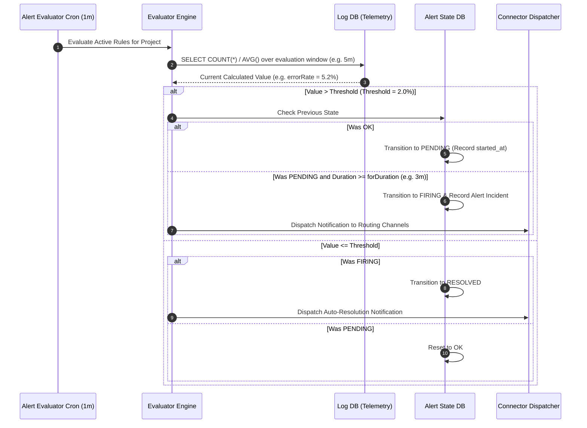

# Alerting Module Working & Operational Guide

This document describes alert condition rules, state transition mechanics, and API endpoints for the **Alerting Module**.

---

## 1. Alert Rule Evaluation Cycle

---

## 2. API Endpoints

- **`GET /api/v1/alerts/rules`**: Lists configured alert rules.
- **`POST /api/v1/alerts/rules`**: Creates a new alert rule (Metric, Error Count, Latency p95, Anomaly).
- **`GET /api/v1/alerts/history`**: Lists past alert incidents, firings, and resolution timestamps.
- **`POST /api/v1/alerts/silences`**: Configures temporary maintenance silence periods.
