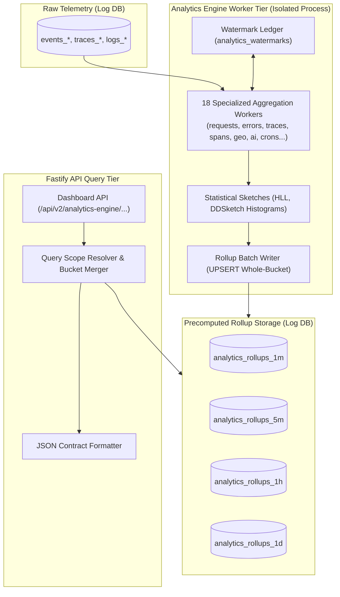

# Analytics Engine (v2) Architecture

The **Analytics Engine (v2)** is Pulsiv's next-generation, high-performance aggregation and dashboard reporting backend. It completely decouples dashboard queries from raw telemetry tables by continuously maintaining precomputed, time-bucketed rollups (1m, 5m, 1h, 1d) backed by streaming HyperLogLog (HLL) cardinality sketches and HDR/DDSketch quantile data structures.

---

## 1. Core Architectural Innovations

1. **Precomputed Rollups Only**: API endpoints **never** run raw `SELECT COUNT(*)` on raw telemetry tables; they query ultra-compact rollup tables with sub-5ms response times.
2. **Whole-Bucket Recomputation**: Idempotent recomputation ensures late-arriving events are seamlessly merged without race conditions or count drift.
3. **Statistical Data Sketches**:
   - **HyperLogLog (HLL)**: Fixed-size 12KB bitsets for unique user count and distinct IP estimation with < 1.04% standard error.
   - **DDSketch Histograms**: Bounded relative-error histograms for computing accurate p50, p75, p90, p95, p99 latencies across arbitrary query time windows.
4. **Complete Process Isolation**: Analytics engine workers run in a dedicated PM2 fork (`analytics-workers`), completely detached from the Ingestion tier.

---

## 2. Component Structure

| Component | Location | Description |
| :--- | :--- | :--- |
| **`watermark.repository.ts`** | [`pulse/src/modules/analytics-engine/watermark.repository.ts`](file:///c:/Users/vikas/OneDrive/Desktop/SaasBackend/pulse/src/modules/analytics-engine/watermark.repository.ts) | Tracks high-water mark timestamps per worker and signals lag. |
| **`workers/`** | [`pulse/src/modules/analytics-engine/workers/`](file:///c:/Users/vikas/OneDrive/Desktop/SaasBackend/pulse/src/modules/analytics-engine/workers/) | 18 signal workers (`requests.worker.ts`, `errors.worker.ts`, `traces.worker.ts`, `ai.worker.ts`, etc.). |
| **`sketches.ts`** | [`pulse/src/modules/analytics-engine/sketches.ts`](file:///c:/Users/vikas/OneDrive/Desktop/SaasBackend/pulse/src/modules/analytics-engine/sketches.ts) | Implementation of HLL union and quantile estimation algorithms. |
| **`read/dashboard.repository.ts`** | [`pulse/src/modules/analytics-engine/read/dashboard.repository.ts`](file:///c:/Users/vikas/OneDrive/Desktop/SaasBackend/pulse/src/modules/analytics-engine/read/dashboard.repository.ts) | Fast dashboard query executor reading from `analytics_rollups_*`. |
