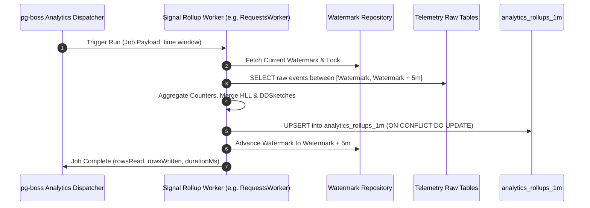

# Analytics Engine (v2) Working & Operational Guide

This document describes the operational workflow, worker execution cycles, watermark updates, and dashboard query interfaces of the **Analytics Engine (v2)**.

---

## 1. Rollup Worker Execution Cycle

---

## 2. Compaction & Hierarchy Promotion

1. **1-Minute to 5-Minute Compaction**: Runs every 5 minutes; combines 5 one-minute buckets using sketch union operations.
2. **5-Minute to 1-Hour Compaction**: Runs hourly; aggregates 12 five-minute buckets.
3. **1-Hour to 1-Day Compaction**: Runs daily; merges 24 hourly buckets into the long-term historical table.
4. **Data Retention Pruning**: Rollup partitions are dropped according to organization subscription retention tiers (30d, 90d, 365d).

---

## 3. Query API Interfaces

- **`GET /api/v2/analytics-engine/dashboard/overview`**: Returns high-level metrics (throughput, error count, p95 latency, unique users) directly from `analytics_rollups_1h`.
- **`GET /api/v2/analytics-engine/dashboard/performance`**: Returns p50, p75, p90, p95, p99 timeseries derived from merged DDSketches.
- **`GET /api/v2/analytics-engine/dashboard/errors`**: Returns top error groups, frequency trends, and affected user counts.
