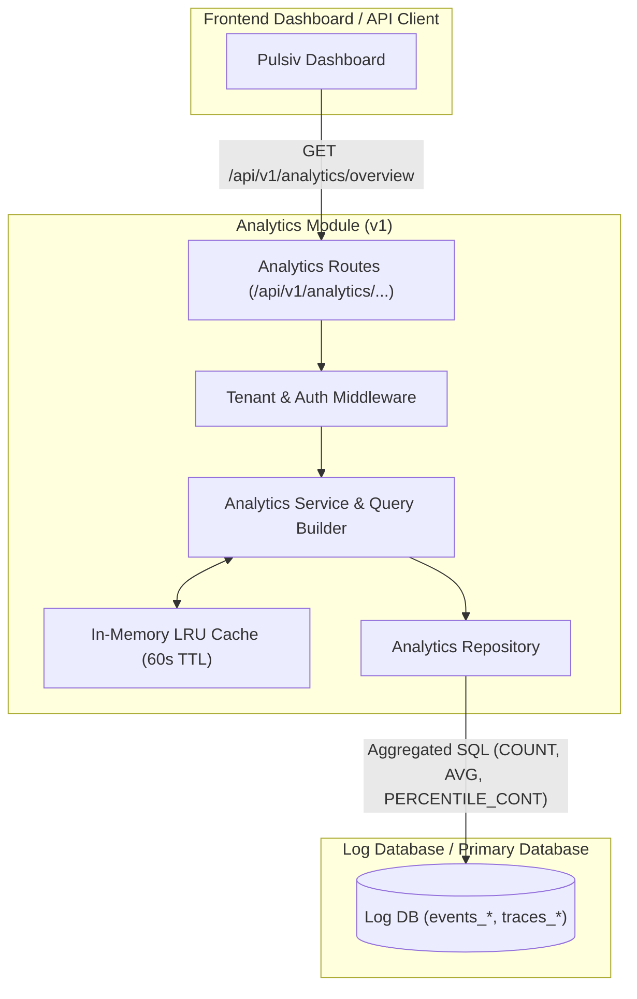

# Analytics Module (v1) Architecture

The **Analytics Module (v1)** provides real-time querying, ad-hoc aggregations, and dashboard metrics across ingestion telemetry tables in PostgreSQL.

---

## 1. Architectural Overview & Boundaries

- **Role**: Serves operational metrics (request count, p95 latency, error rates, top endpoints, status code distributions) directly from PostgreSQL telemetry tables.
- **Caching Layer**: Employs an in-memory LRU cache (`cache.ts`) with configurable TTLs (typically 60 seconds) to prevent redundant database query execution on dashboard refreshes.
- **Tenant Isolation**: Strictly enforces `projectId` and `orgId` filtering in all SQL query predicates.

---

## 2. Key Components & File Breakdown

| File | Location | Description |
| :--- | :--- | :--- |
| **`routes.ts`** | [`pulse/src/modules/analytics/routes.ts`](file:///c:/Users/vikas/OneDrive/Desktop/SaasBackend/pulse/src/modules/analytics/routes.ts) | Fastify route definitions for overview, performance, errors, and breakdown metrics. |
| **`service.ts`** | [`pulse/src/modules/analytics/service.ts`](file:///c:/Users/vikas/OneDrive/Desktop/SaasBackend/pulse/src/modules/analytics/service.ts) | Aggregates time-series buckets and computes statistical summaries. |
| **`repository.ts`** | [`pulse/src/modules/analytics/repository.ts`](file:///c:/Users/vikas/OneDrive/Desktop/SaasBackend/pulse/src/modules/analytics/repository.ts) | Raw SQL aggregation queries (`PERCENTILE_CONT(0.95)`, `DATE_TRUNC`). |
| **`cache.ts`** | [`pulse/src/modules/analytics/cache.ts`](file:///c:/Users/vikas/OneDrive/Desktop/SaasBackend/pulse/src/modules/analytics/cache.ts) | Multi-key LRU cache for query result caching. |

---

## 3. Data Flow & Security

1. Request authenticated via JWT session or API key.
2. Tenant middleware validates user membership in the requested project.
3. Service computes cache key from query parameters (`projectId`, `timeRange`, `granularity`).
4. If cached, response returned instantly; otherwise, the repository executes parameterized SQL against the Log Database.
