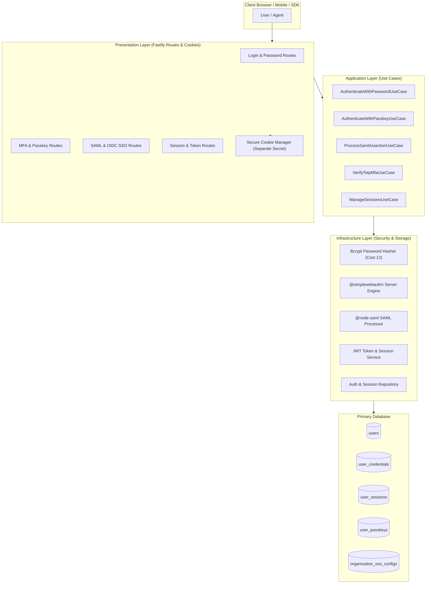

# Authentication Module Architecture

The **Authentication Module** delivers an enterprise-grade identity platform implementing Clean Architecture principles across domain, application, infrastructure, and presentation layers. It supports password-based authentication, SAML 2.0 Enterprise Single Sign-On (SSO), OIDC / Social Login (Google & GitHub), WebAuthn / Passkeys, multi-factor authentication (TOTP & SMS), Magic Links, and secure cryptographically signed session management.

---

## 1. Architectural Layers & Boundaries

1. **Domain Layer (`domain/`)**: Pure entities (`User`, `Session`, `PasskeyCredential`, `MfaPolicy`), domain events, value objects, and business rules without external dependencies.
2. **Application Layer (`application/`)**: Encapsulates use-case workflows (`AuthenticateUser`, `RegisterPasskey`, `InitiateSamlLogin`, `RevokeSession`).
3. **Infrastructure Layer (`infrastructure/`)**: Implements repositories, bcrypt hashing, JWT issuance, WebAuthn cryptographic verification, and SAML assertion parsing.
4. **Presentation Layer (`presentation/`)**: Fastify routes, strict Zod validation schemas, and secure HttpOnly cookie decorators.

---

## 2. Key Security Mechanisms

- **Cookie/JWT Secret Segregation**: `COOKIE_SECRET` and `JWT_SECRET` use independent keys so compromise of one does not forge tokens on the other.
- **CSRF Defense**: Double-submit cookie with `SameSite=Lax` (or `Strict` for mutations) and custom `X-CSRF-Token` header verification.
- **Session Revocation**: Cryptographically unique session IDs stored in `user_sessions` allowing instant single-session or all-session revocation.
- **Brute Force & Rate Limiting**: Exponential backoff on failed password attempts with IP/Account lockout protections.
