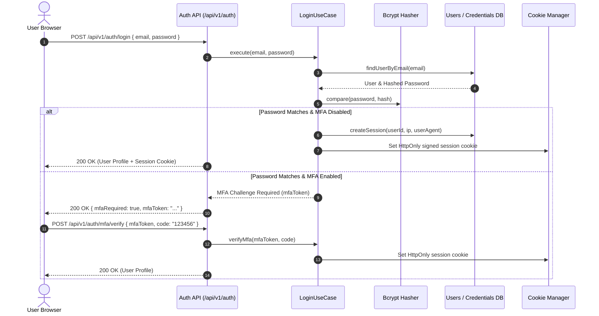

# Authentication Module Working & Operational Guide

This document provides complete API contracts, authentication flows, and security mechanics for the **Authentication Module**.

---

## 1. Authentication Flows

### 1.1 Password + MFA Login Flow

---

## 2. API Endpoints

- **`POST /api/v1/auth/register`**: User registration with email verification dispatch.
- **`POST /api/v1/auth/login`**: Credential authentication returning session cookies.
- **`POST /api/v1/auth/logout`**: Invalidates active session in database and clears cookies.
- **`POST /api/v1/auth/passkeys/generate-options`**: WebAuthn registration challenge generation.
- **`POST /api/v1/auth/passkeys/verify`**: WebAuthn credential public key registration.
- **`POST /api/v1/auth/sso/saml/login`**: Generates SAML 2.0 AuthNRequest to Enterprise IdP (Okta, Azure AD).
- **`POST /api/v1/auth/sso/saml/callback`**: Handles SAML ACS response, validates signatures, and provisions session.
