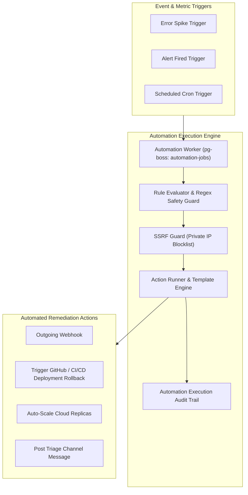

# Automation & Playbooks Module Architecture

The **Automation Module** executes automated operational playbooks, self-healing remediation workflows, threshold-triggered actions, and scheduled cron jobs. It features a sandboxed execution engine with SSRF (Server-Side Request Forgery) protection and ReDoS (Regular Expression Denial of Service) safety guards.

---

## 1. Core Architectural Responsibilities

1. **Trigger Engine**: Evaluates incoming telemetry signals against user-defined conditions (`event.type == 'error'`, `error.count > 100 in 1m`).
2. **Safe Action Execution**: Executes multi-step actions (HTTP webhooks, notification dispatches, script triggers) in an isolated async worker tier.
3. **SSRF & Network Hardening**: Blocks outbound requests to private RFC 1918 IP addresses (`10.0.0.0/8`, `172.16.0.0/12`, `192.168.0.0/16`, AWS metadata `169.254.169.254`).
4. **ReDoS Guard**: Analyzes user-supplied regex expressions against polynomial/exponential backtracking vulnerabilities before evaluation.

---

## 2. Key Components & Files

| Component | Location | Description |
| :--- | :--- | :--- |
| **`evaluator.ts`** | [`pulse/src/modules/automation/evaluator.ts`](file:///c:/Users/vikas/OneDrive/Desktop/SaasBackend/pulse/src/modules/automation/evaluator.ts) | Condition evaluation and variable substitution engine. |
| **`action-runner.ts`** | [`pulse/src/modules/automation/action-runner.ts`](file:///c:/Users/vikas/OneDrive/Desktop/SaasBackend/pulse/src/modules/automation/action-runner.ts) | Action executor with retry policies and timeouts. |
| **`ssrf.ts`** | [`pulse/src/modules/automation/ssrf.ts`](file:///c:/Users/vikas/OneDrive/Desktop/SaasBackend/pulse/src/modules/automation/ssrf.ts) | IP validation and private network blocking. |
| **`regex-safety.ts`** | [`pulse/src/modules/automation/regex-safety.ts`](file:///c:/Users/vikas/OneDrive/Desktop/SaasBackend/pulse/src/modules/automation/regex-safety.ts) | ReDoS vulnerability scanner. |
| **`workers.ts`** | [`pulse/src/modules/automation/workers.ts`](file:///c:/Users/vikas/OneDrive/Desktop/SaasBackend/pulse/src/modules/automation/workers.ts) | pg-boss background worker for asynchronous playbook execution. |
