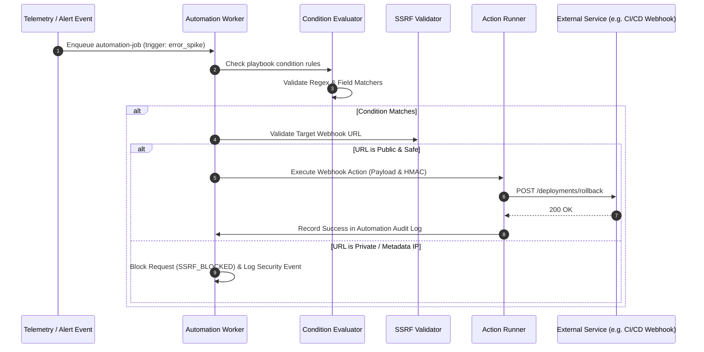

# Automation Module Working & Operational Guide

This document describes playbook configurations, action triggers, and API routes for the **Automation Module**.

---

## 1. Automation Playbook Execution Flow

---

## 2. API Endpoints

- **`GET /api/v1/automations`**: Lists configured playbooks.
- **`POST /api/v1/automations`**: Creates a new automation playbook with triggers and actions.
- **`POST /api/v1/automations/:id/test`**: Dry-run tests playbook against sample telemetry payload.
- **`GET /api/v1/automations/:id/logs`**: Retrieves execution history and status codes.
