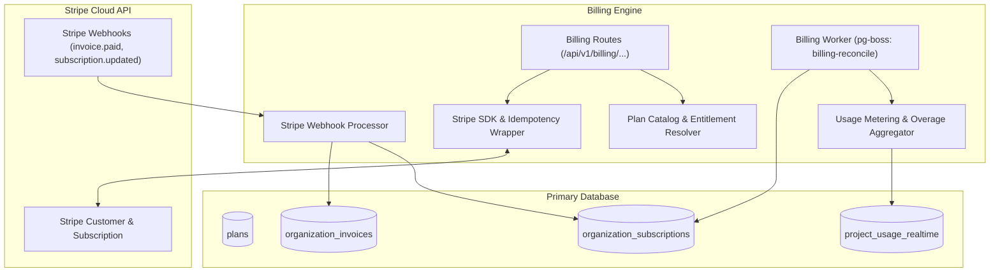

# Billing & Subscriptions Module Architecture

The **Billing Module** handles plan catalogs, Stripe customer & subscription lifecycles, real-time usage metering, plan quotas (event limits, data retention days, team member seats), invoice webhooks, coupon redemption, and overage calculations.

---

## 1. Core Architectural Responsibilities

1. **Subscription Lifecycle Synchronization**: Tracks subscription states (`trialing`, `active`, `past_due`, `canceled`, `unpaid`) and updates tenant feature gates in real-time.
2. **Entitlements & Quota Gates**: Translates subscription tier into active limits:
   - Monthly event ingestion limits (e.g. 500k, 5M, 100M events/mo).
   - Data retention windows (7d, 30d, 90d, 365d).
   - Maximum team member seats and project count.
3. **Usage Metering & Stripe Sync**: Aggregates billable ingestion counts and reports overage units to Stripe metered billing products at billing cycle cutoff.
4. **Idempotent Webhook Processing**: Cryptographically verifies `stripe-signature` and records webhook IDs in an idempotency table to prevent duplicate invoice accounting.

---

## 2. Key Components & Files

| Component | Location | Description |
| :--- | :--- | :--- |
| **`catalog/`** | [`pulse/src/modules/billing/catalog/`](file:///c:/Users/vikas/OneDrive/Desktop/SaasBackend/pulse/src/modules/billing/catalog/) | Available subscription plans and feature matrices. |
| **`subscriptions/`** | [`pulse/src/modules/billing/subscriptions/`](file:///c:/Users/vikas/OneDrive/Desktop/SaasBackend/pulse/src/modules/billing/subscriptions/) | Subscription checkout session, portal, and cancellation logic. |
| **`webhooks/`** | [`pulse/src/modules/billing/webhooks/`](file:///c:/Users/vikas/OneDrive/Desktop/SaasBackend/pulse/src/modules/billing/webhooks/) | Stripe webhook intake and dispatch handlers. |
| **`entitlements/`** | [`pulse/src/modules/billing/entitlements/`](file:///c:/Users/vikas/OneDrive/Desktop/SaasBackend/pulse/src/modules/billing/entitlements/) | Validates whether an organization has quota to perform actions. |
| **`queue.ts`** | [`pulse/src/modules/billing/queue.ts`](file:///c:/Users/vikas/OneDrive/Desktop/SaasBackend/pulse/src/modules/billing/queue.ts) | Background usage reconciliation worker. |
