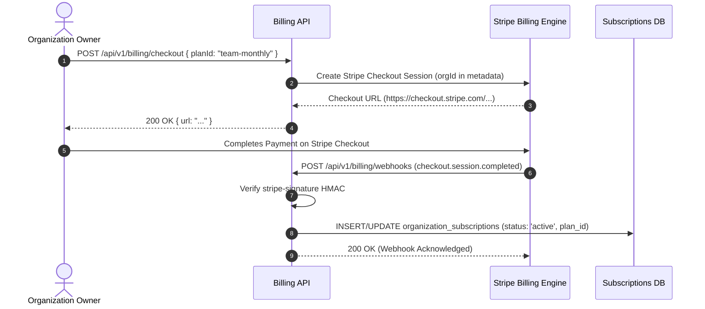

# Billing Module Working & Operational Guide

This document describes the Stripe checkout flows, webhook handling, and usage metering APIs of the **Billing Module**.

---

## 1. Stripe Checkout & Provisioning Lifecycle

---

## 2. API Endpoints

- **`GET /api/v1/billing/plans`**: Returns available plans and pricing.
- **`POST /api/v1/billing/checkout`**: Initiates Stripe Checkout session.
- **`POST /api/v1/billing/portal`**: Generates Stripe Customer Portal link for payment method updates.
- **`GET /api/v1/billing/subscription`**: Returns active subscription details, renewal date, and seat count.
- **`GET /api/v1/billing/usage`**: Current billing period event consumption and quota percentage.
- **`POST /api/v1/billing/webhooks`**: Stripe webhook receiver endpoint.
