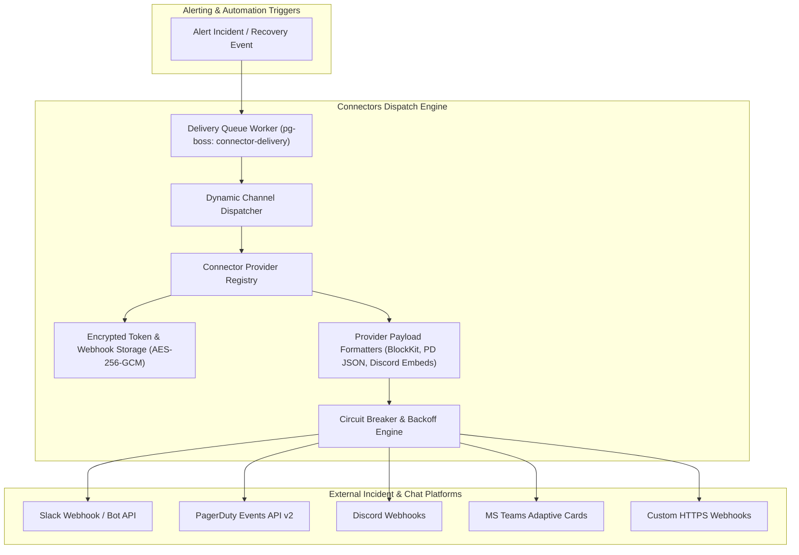

# Connectors Module Architecture

The **Connectors Module** is the outbound integration and notification hub of the Pulsiv platform. It delivers notifications and alert events to third-party communication and incident management platforms, including Slack (Block Kit), PagerDuty (Events API v2), Discord, Opsgenie, Microsoft Teams, GitHub, and generic HTTPS webhooks.

---

## 1. Core Architectural Responsibilities

1. **Provider Abstraction Registry**: Modular provider interface (`SlackProvider`, `PagerDutyProvider`, `DiscordProvider`, `TeamsProvider`, `WebhookProvider`) standardizing authentication, formatting, and delivery.
2. **Encrypted Secret Storage**: All webhook URLs, OAuth bot tokens, and routing keys are encrypted at rest using AES-256-GCM (`secrets/`).
3. **Resilient Delivery & Exponential Backoff**: Outbound requests employ circuit breakers (`opossum`) and retry queues with jittered exponential backoff to handle upstream provider downtime.
4. **Health Monitoring & Auto-Disabling**: Background monitor checks connector health and flags consistently failing integrations as degraded.

---

## 2. Key Components & Files

| Component | Location | Description |
| :--- | :--- | :--- |
| **`service.ts`** | [`pulse/src/modules/connectors/service.ts`](file:///c:/Users/vikas/OneDrive/Desktop/SaasBackend/pulse/src/modules/connectors/service.ts) | Connector CRUD, test dispatch, and verification orchestrator. |
| **`registry.ts`** | [`pulse/src/modules/connectors/registry.ts`](file:///c:/Users/vikas/OneDrive/Desktop/SaasBackend/pulse/src/modules/connectors/registry.ts) | Provider factory and formatter registration. |
| **`queue.ts`** | [`pulse/src/modules/connectors/queue.ts`](file:///c:/Users/vikas/OneDrive/Desktop/SaasBackend/pulse/src/modules/connectors/queue.ts) | Asynchronous delivery worker with retry policies. |
| **`monitor.ts`** | [`pulse/src/modules/connectors/monitor.ts`](file:///c:/Users/vikas/OneDrive/Desktop/SaasBackend/pulse/src/modules/connectors/monitor.ts) | Background health checker for registered connectors. |
