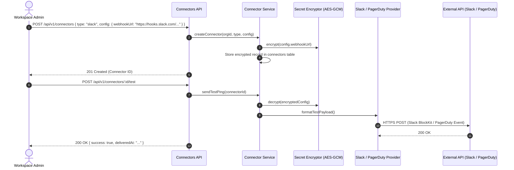

# Connectors Module Working & Operational Guide

This document describes connector creation, test ping dispatches, provider payload formatting, and API routes for the **Connectors Module**.

---

## 1. Connector Registration & Test Ping Flow

---

## 2. API Endpoints

- **`GET /api/v1/connectors`**: Lists configured connectors for the active workspace.
- **`POST /api/v1/connectors`**: Creates a new connector with encrypted credentials.
- **`POST /api/v1/connectors/:id/test`**: Dispatches a test alert notification to verify connectivity.
- **`DELETE /api/v1/connectors/:id`**: Removes connector and unlinks routing policies.
