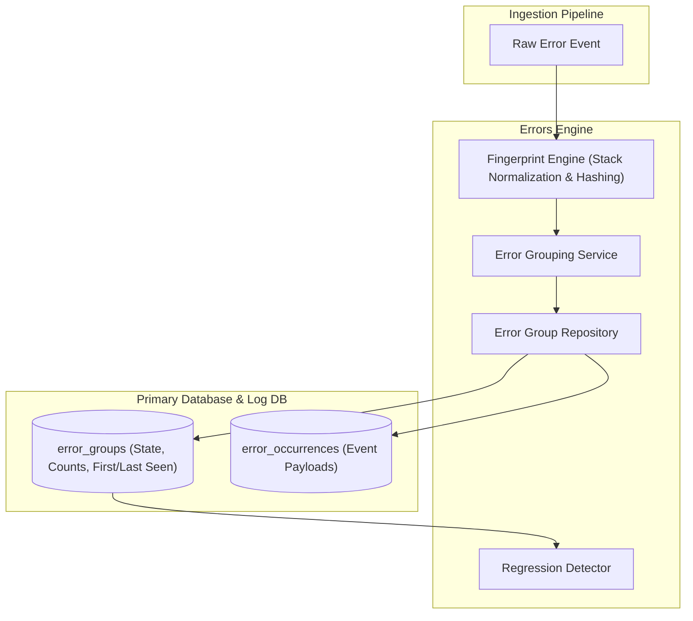

# Errors Module Architecture

The **Errors Module** is responsible for crash reporting, stack trace parsing, normalized fingerprint calculation, intelligent error grouping, issue lifecycle state management (unresolved, resolved, ignored), regression detection, and triage workflows.

---

## 1. Core Architectural Responsibilities

1. **Deterministic Fingerprinting**: Strips dynamic variables (memory addresses, timestamps, UUIDs) from stack frames and generates a robust SHA-256 fingerprint (`fingerprint.ts`).
2. **Issue Grouping & Aggregation**: Deduplicates millions of individual crash events into canonical `error_groups` with real-time occurrence counters, affected user tracking, and first/last seen timestamps.
3. **Regression Detection**: Automatically detects when a previously "resolved" error reoccurs in a newer release version and re-opens the issue.
4. **Issue Lifecycle Management**: Supports status transitions (`unresolved` -> `resolved` -> `ignored`), assignee routing, and triage notes.

---

## 2. Key Components & Files

| Component | Location | Description |
| :--- | :--- | :--- |
| **`fingerprint.ts`** | [`pulse/src/modules/errors/fingerprint.ts`](file:///c:/Users/vikas/OneDrive/Desktop/SaasBackend/pulse/src/modules/errors/fingerprint.ts) | Normalized error fingerprinting and stack frame sanitizer. |
| **`services/error-group.service.ts`** | [`pulse/src/modules/errors/services/error-group.service.ts`](file:///c:/Users/vikas/OneDrive/Desktop/SaasBackend/pulse/src/modules/errors/services/error-group.service.ts) | State machine for issue resolution, status transitions, and bulk updates. |
| **`repositories/error-group.repository.ts`** | [`pulse/src/modules/errors/repositories/error-group.repository.ts`](file:///c:/Users/vikas/OneDrive/Desktop/SaasBackend/pulse/src/modules/errors/repositories/error-group.repository.ts) | High-performance SQL queries for issue listing, searching, and metrics. |
