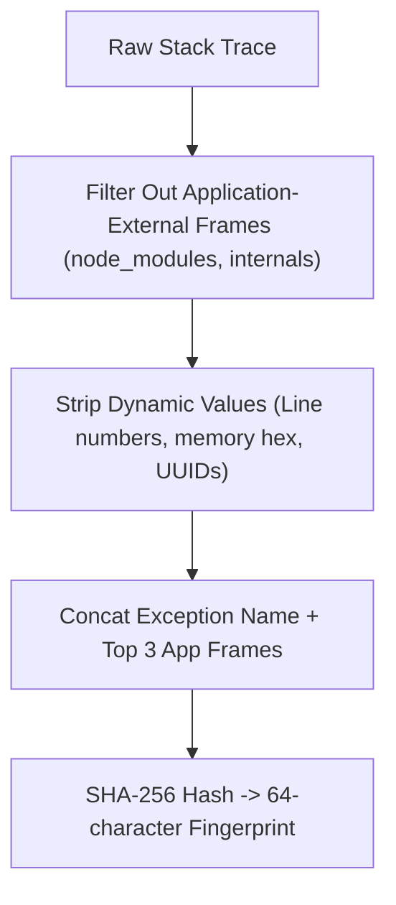

# Errors Module Working & Operational Guide

This document describes the fingerprinting algorithm, issue triage status transitions, and API endpoints of the **Errors Module**.

---

## 1. Stack Trace Fingerprinting Algorithm

---

## 2. API Endpoints

- **`GET /api/v1/errors`**: Lists paginated error groups filtered by `status`, `environment`, `query`, sorted by frequency or last seen.
- **`GET /api/v1/errors/:errorId`**: Retrieves individual error group metadata, occurrence histogram, stack trace, and context tags.
- **`PATCH /api/v1/errors/:errorId/status`**: Updates status (`unresolved`, `resolved`, `ignored`) with optional resolved version tag.
- **`GET /api/v1/errors/:errorId/occurrences`**: Paginated individual crash occurrences with raw environment tags and request context.
