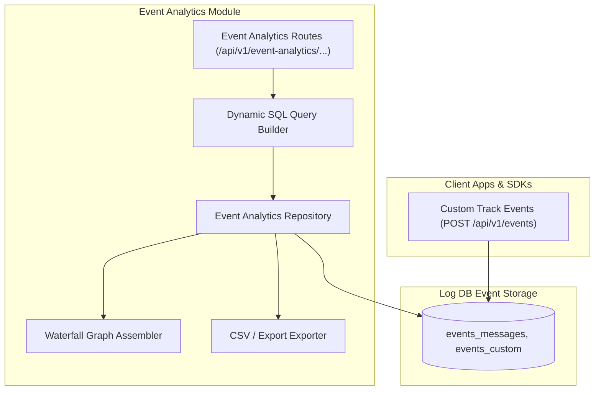

# Event Analytics Module Architecture

The **Event Analytics Module** enables custom user event tracking, behavioral telemetry querying, funnel drop-off analysis, user journey waterfall visualizers, and cohort retention calculations.

---

## 1. Core Architectural Responsibilities

1. **Custom Event Telemetry**: Manages user-defined event types, properties, traits, and metadata.
2. **Funnel Analysis Engine**: Computes conversion rates across multi-step user workflows (e.g. `Sign Up` -> `Complete Onboarding` -> `Create Project` -> `Subscribe`).
3. **Cohort & Retention Analysis**: Calculates daily, weekly, and monthly active user cohorts and retention curves.
4. **Export & CSV Streaming**: High-throughput streaming of raw and filtered event logs directly to CSV for external BI tools.

---

## 2. Key Components & Files

| Component | Location | Description |
| :--- | :--- | :--- |
| **`routes.ts`** | [`pulse/src/modules/event-analytics/routes.ts`](file:///c:/Users/vikas/OneDrive/Desktop/SaasBackend/pulse/src/modules/event-analytics/routes.ts) | Fastify routes for funnels, cohorts, event definitions, and exports. |
| **`query-builder.ts`** | [`pulse/src/modules/event-analytics/query-builder.ts`](file:///c:/Users/vikas/OneDrive/Desktop/SaasBackend/pulse/src/modules/event-analytics/query-builder.ts) | Parameterized SQL generator for dynamic JSONB property filtering. |
| **`repository.ts`** | [`pulse/src/modules/event-analytics/repository.ts`](file:///c:/Users/vikas/OneDrive/Desktop/SaasBackend/pulse/src/modules/event-analytics/repository.ts) | Executes complex analytical queries and cohort joins in PostgreSQL. |
| **`csv.ts`** | [`pulse/src/modules/event-analytics/csv.ts`](file:///c:/Users/vikas/OneDrive/Desktop/SaasBackend/pulse/src/modules/event-analytics/csv.ts) | Streamed CSV generation utility. |
