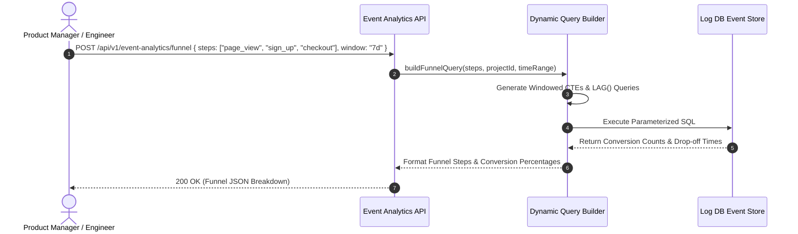

# Event Analytics Module Working & Operational Guide

This document details the query interfaces, funnel calculations, and data contracts for the **Event Analytics Module**.

---

## 1. Funnel Query Mechanics

---

## 2. API Endpoints

- **`POST /api/v1/event-analytics/funnel`**: Executes multi-step conversion funnel analysis.
- **`GET /api/v1/event-analytics/retention`**: Computes cohort retention matrix.
- **`GET /api/v1/event-analytics/events`**: Searches custom events with arbitrary JSONB property filters.
- **`GET /api/v1/event-analytics/export`**: Streams CSV export of events.
