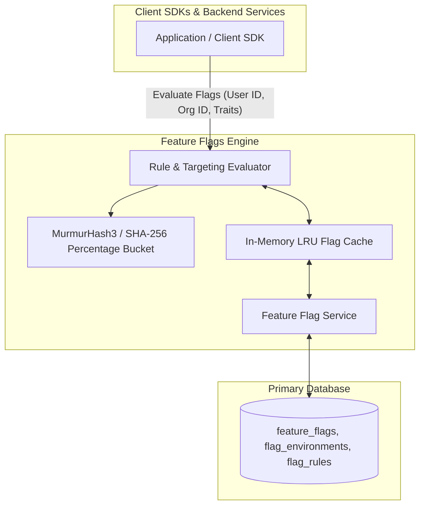

# Feature Flags Module Architecture

The **Feature Flags Module** enables progressive feature rollouts, canary deployments, targeted user segment evaluation, multivariate experimentation, and instant kill switches without redeploying application code.

---

## 1. Core Architectural Responsibilities

1. **Deterministic Percentage Rollouts**: Consistent user hashing via MurmurHash3 ensures that a user assigned to the 20% rollout variant remains consistently assigned on subsequent evaluations.
2. **Targeted Rule Engine**: Evaluates complex targeting criteria (e.g. `user.email endsWith '@acme.com'`, `user.plan == 'enterprise'`, `environment == 'production'`).
3. **Sub-Millisecond In-Memory Evaluation**: Flag definitions are cached in memory so evaluation introduces zero database latency into application critical paths.
4. **Remote SDK Config Synchronization**: Flag state updates trigger SDK config version bumps, allowing client applications to fetch updated rules seamlessly.

---

## 2. Key Components & Files

| Component | Location | Description |
| :--- | :--- | :--- |
| **`service.ts`** | [`pulse/src/modules/feature-flags/service.ts`](file:///c:/Users/vikas/OneDrive/Desktop/SaasBackend/pulse/src/modules/feature-flags/service.ts) | Flag CRUD, evaluation logic, and targeting rule matcher. |
| **`types.ts`** | [`pulse/src/modules/feature-flags/types.ts`](file:///c:/Users/vikas/OneDrive/Desktop/SaasBackend/pulse/src/modules/feature-flags/types.ts) | Flag schemas, targeting rules, variants, and evaluation context. |
