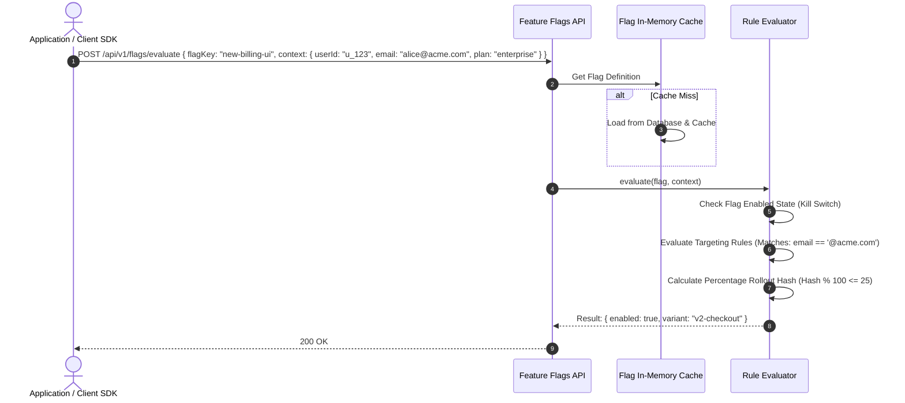

# Feature Flags Module Working & Operational Guide

This document describes targeting rule structures, evaluation algorithms, and API endpoints for the **Feature Flags Module**.

---

## 1. Flag Evaluation Workflow

---

## 2. API Endpoints

- **`GET /api/v1/flags`**: Lists feature flags for the current project.
- **`POST /api/v1/flags`**: Creates a new boolean or multivariate flag.
- **`PATCH /api/v1/flags/:id`**: Toggles flag enabled state or updates targeting rules.
- **`POST /api/v1/flags/evaluate`**: Evaluates all flags for a given user context.
