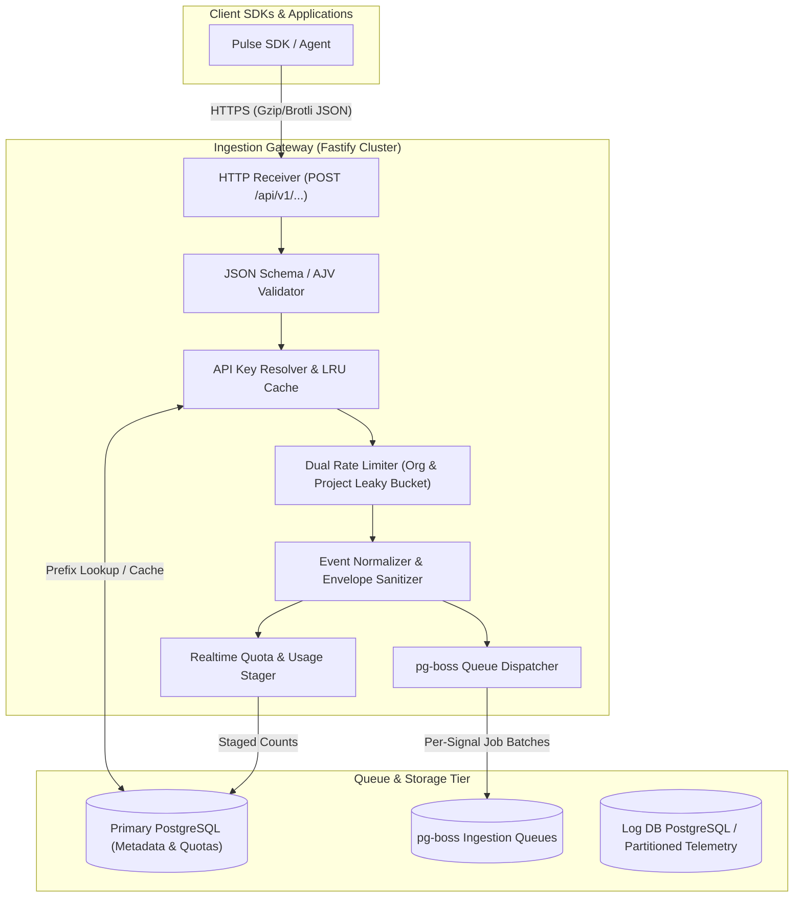

# Ingestion Module Architecture

The **Ingestion Module** is the high-throughput gateway of the Pulsiv platform. It accepts, validates, rate-limits, normalizes, and queues all incoming telemetry signals—including errors, requests, distributed traces, spans, performance metrics, application logs, profiles, messages, replays, and cron check-ins—from multi-language client SDKs and backend agents.

---

## 1. Core Architectural Responsibilities

1. **High-Throughput Ingest API**: Fastify HTTP server equipped with `@fastify/under-pressure` admission control to prevent event loop starvation and heap exhaustion.
2. **Deterministic Route Mapping**: Exposes strictly typed POST endpoints per signal (`/v1/errors`, `/v1/requests`, `/v1/traces`, `/v1/spans`, `/v1/metrics`, `/v1/logs`, `/v1/profiles`, `/v1/events`, `/v1/checkins`, `/v1/replays`) synchronized with the remote SDK configuration compiler.
3. **API Key Security & Constant-Time Verification**: High-speed prefix lookup (`pk_live_...`) with SHA-256 constant-time secret comparison and in-memory LRU caching.
4. **Hierarchical Dual-Tier Rate Limiting**: Token/Leaky bucket rate limiters evaluated at both Organization and Project levels to protect against "noisy neighbor" scenarios.
5. **Decoupled Asynchronous Persistence**: Ingestion gateway nodes never write heavy telemetry payloads synchronously to tables; they enqueue jobs into dedicated `pg-boss` queues (`ingest-error`, `ingest-request`, `ingest-trace`, etc.) for worker processing.

---

## 2. Key Components & File Structure

| Component File | Location | Primary Responsibility |
| :--- | :--- | :--- |
| **`routes.ts`** | [`pulse/src/modules/ingestion/routes.ts`](file:///c:/Users/vikas/OneDrive/Desktop/SaasBackend/pulse/src/modules/ingestion/routes.ts) | HTTP route definitions, AJV compilation, Fastify lifecycle hooks, DLQ replay endpoints. |
| **`route-table.ts`** | [`pulse/src/modules/ingestion/route-table.ts`](file:///c:/Users/vikas/OneDrive/Desktop/SaasBackend/pulse/src/modules/ingestion/route-table.ts) | Single source of truth mapping `SdkEventType` to HTTP path and transport keys. |
| **`controller.ts`** | [`pulse/src/modules/ingestion/controller.ts`](file:///c:/Users/vikas/OneDrive/Desktop/SaasBackend/pulse/src/modules/ingestion/controller.ts) | Fastify request handlers, payload unpacking, header validation, and response formatting. |
| **`service.ts`** | [`pulse/src/modules/ingestion/service.ts`](file:///c:/Users/vikas/OneDrive/Desktop/SaasBackend/pulse/src/modules/ingestion/service.ts) | Core business orchestrator coordinating auth, rate-limiting, normalization, and queueing. |
| **`rate-limiter.ts`** | [`pulse/src/modules/ingestion/rate-limiter.ts`](file:///c:/Users/vikas/OneDrive/Desktop/SaasBackend/pulse/src/modules/ingestion/rate-limiter.ts) | In-memory token bucket rate limiter tracking 1-second and 1-minute sliding windows. |
| **`postgress.writter.ts`** | [`pulse/src/modules/ingestion/postgress.writter.ts`](file:///c:/Users/vikas/OneDrive/Desktop/SaasBackend/pulse/src/modules/ingestion/postgress.writter.ts) | Primary database connection provider for API key lookups and telemetry query delegation. |
| **`event-normalizer.ts`** | [`pulse/src/modules/ingestion/pipeline/event-normalizer.ts`](file:///c:/Users/vikas/OneDrive/Desktop/SaasBackend/pulse/src/modules/ingestion/pipeline/event-normalizer.ts) | Envelope sanitizer enforcing ISO-8601 timestamps, UUID validation, and payload schema adherence. |

---

## 3. Data Flow & Security Boundaries

### 3.1 Authentication & Multi-Tenancy Resolution
1. Client sends telemetry payload with API key in header `Authorization: Bearer <key>` or `X-API-Key: <key>`.
2. Gateway extracts the 8-character public prefix (`pk_live_...`) to perform a targeted index lookup in `project_api_keys`.
3. The cryptographic SHA-256 hash is validated using `crypto.timingSafeEqual` to thwart timing attacks.
4. Active subscription status (`plans.tier`) and environment metadata (`project_environments`) are attached to the request context.

### 3.2 Admission Control & Backpressure
- `@fastify/under-pressure` monitors event loop lag (>2000ms), heap allocation (>85%), and RSS memory (>90%).
- If thresholds are exceeded, the gateway immediately returns `HTTP 503 Service Unavailable` with `Retry-After: 10` before memory exhaustion crashes the Node.js process.

---

## 4. Database Schema & State Ownership

The Ingestion gateway interfaces with the following primary database structures:

- **`project_api_keys`**: Contains `public_key`, `secret_hash`, `project_id`, `environment_id`, `status`, `expires_at`.
- **`projects` & `organizations`**: Resolves ownership, soft-delete states (`deleted_at`), and status.
- **`organization_subscriptions` & `plans`**: Resolves billing plan tier quotas and concurrency limits.
- **`project_usage_realtime`**: High-speed staging table for near-real-time quota accumulation.
