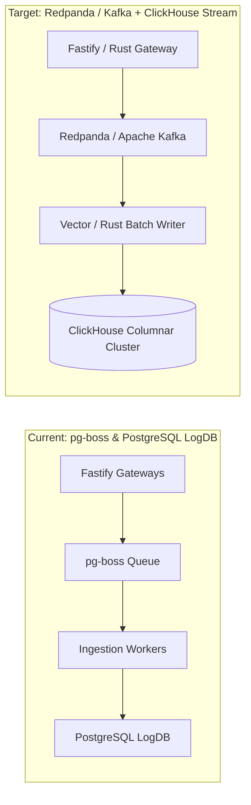

# Ingestion Module Future Updates & Roadmap

This document outlines the planned architectural upgrades, scalability roadmap, and technical debt mitigations for the **Ingestion Module** as traffic scales from $10^7$ to $10^9$ events per day.

---

## 1. Scaling Bottlenecks & Architectural Evolutions

### 1.1 PostgreSQL Queue vs. Distributed Event Streams
- **Current Limitation**: `pg-boss` relies on PostgreSQL `SKIP LOCKED`. At > 50,000 events/second, WAL generation and table bloat on the queue tables require aggressive autovacuum tuning.
- **Future Upgrade (Phase 4)**: Transition high-volume queues (traces, logs, metrics) to a distributed log stream (Redpanda or Apache Kafka) with partition-keyed tenant dispatching, while keeping pg-boss for low-frequency transactional jobs (billing, alerts).

### 1.2 ClickHouse Native Telemetry Persistence
- **Current Architecture**: Ingestion workers write to partitioned PostgreSQL tables (`events_*`, `traces_*`).
- **Future Roadmap**: Connect the ingestion stream directly to a native **ClickHouse** cluster for 10x-50x compression, sub-second analytical queries across billions of rows, and automated TTL partition dropping.

---

## 2. Feature & Protocol Roadmap

| Milestone | Target Feature | Description |
| :--- | :--- | :--- |
| **v3.2** | **OTLP/gRPC Receiver** | Native OpenTelemetry Protocol (`OTLP/HTTP` and `OTLP/gRPC`) endpoints on port `4317` / `4318` to ingest directly from standard OpenTelemetry Collectors. |
| **v3.3** | **Streaming Edge Validation** | WebAssembly (Wasm) or Rust-based edge validation proxy (Cloudflare Workers / Fastly Compute) for instant authentication and edge rate limiting. |
| **v3.4** | **Adaptive Sampling Control** | Real-time dynamic sampling adjustment sent to SDKs via WebSocket or HTTP Server-Sent Events (SSE) based on live ingestion budget saturation. |
| **v3.5** | **Zero-Copy Serialization** | Switch internal queue payloads from JSON stringification to Protocol Buffers (Protobuf) or FlatBuffers to eliminate JSON serialization CPU costs. |

---

## 3. Technical Debt & Cleanup Items

1. **Deprecate Legacy `/v1/ingest`**: Phase out the mixed multi-signal endpoint in favor of strictly typed endpoints (`/v1/errors`, `/v1/traces`).
2. **Move Rate Limiter to Redis Cluster (for Multi-Node Coordination)**: Optional distributed token bucket syncing for multi-region gateway deployments.
3. **Consolidate Header Handling**: Ensure uniform casing and normalization for reverse proxy headers (`X-Forwarded-For`, `CF-Connecting-IP`).
