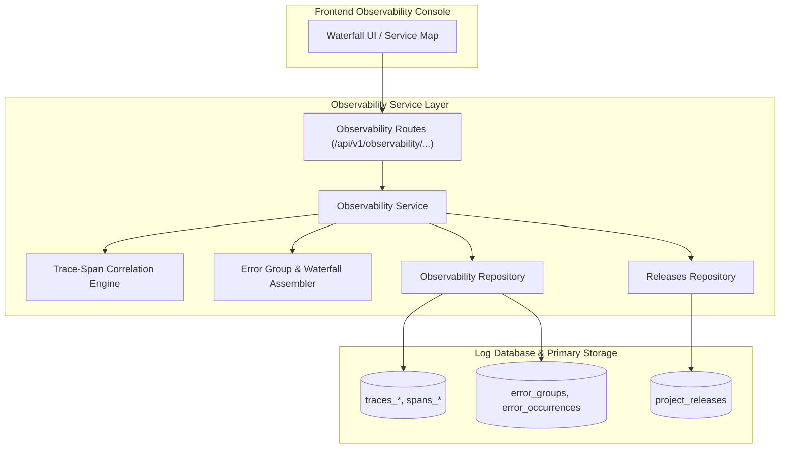

# Observability Module Architecture

The **Observability Module** provides APM (Application Performance Monitoring), distributed tracing visualization, trace waterfall assembly, span correlation, request detail inspection, service topology mapping, and deployment release tracking.

---

## 1. Core Architectural Responsibilities

1. **Distributed Trace Waterfall Construction**: Merges parent/child spans, computes relative start offsets, and detects asynchronous operations and database query bottlenecks.
2. **Unified Resource Lookups (BY-ID)**: Fast public ID resolver locating errors, requests, traces, spans, and cron checkins across partitioned tables.
3. **Service Map & Dependency Graph**: Dynamically derives service-to-service communication trees and external API latency maps from span headers.
4. **Release & Deployment Tracking**: Links telemetry anomalies, error spikes, and performance regressions to specific Git commits, semantic versions, and deployment environments.

---

## 2. Key Components & Files

| File | Location | Description |
| :--- | :--- | :--- |
| **`routes.ts`** | [`pulse/src/modules/observability/routes.ts`](file:///c:/Users/vikas/OneDrive/Desktop/SaasBackend/pulse/src/modules/observability/routes.ts) | Fastify route registrations for traces, waterfalls, releases, and resource details. |
| **`service.ts`** | [`pulse/src/modules/observability/service.ts`](file:///c:/Users/vikas/OneDrive/Desktop/SaasBackend/pulse/src/modules/observability/service.ts) | Business logic for assembling trace trees, service maps, and error context. |
| **`repository.ts`** | [`pulse/src/modules/observability/repository.ts`](file:///c:/Users/vikas/OneDrive/Desktop/SaasBackend/pulse/src/modules/observability/repository.ts) | Data access layer querying partitioned span and trace tables. |
| **`request-detail.ts`** | [`pulse/src/modules/observability/request-detail.ts`](file:///c:/Users/vikas/OneDrive/Desktop/SaasBackend/pulse/src/modules/observability/request-detail.ts) | Detailed HTTP request inspector extracting headers, params, and associated logs. |
| **`releases.repository.ts`** | [`pulse/src/modules/observability/releases.repository.ts`](file:///c:/Users/vikas/OneDrive/Desktop/SaasBackend/pulse/src/modules/observability/releases.repository.ts) | Tracks release version lifecycle, crash-free session rates, and deployment adoption. |
