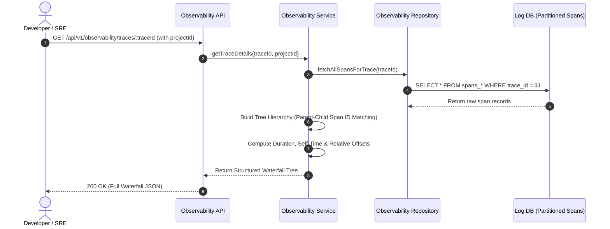

# Observability Module Working & Operational Guide

This document describes the APIs, waterfall assembly mechanics, and release tracking workflows of the **Observability Module**.

---

## 1. Trace & Waterfall Assembly Workflow

---

## 2. API Endpoints

- **`GET /api/v1/observability/traces/:traceId`**: Fetches root span, child span tree, total duration, database query breakdowns, and correlated log events.
- **`GET /api/v1/observability/service-map`**: Computes interactive service dependency graph with edge request rates, p95 latency, and error counts.
- **`GET /api/v1/observability/releases`**: Returns project releases, adoption percentages, and regression alerts.
- **`GET /api/v1/observability/resources/:id`**: Universal polymorphic resource finder resolving any public ID into its concrete entity.
