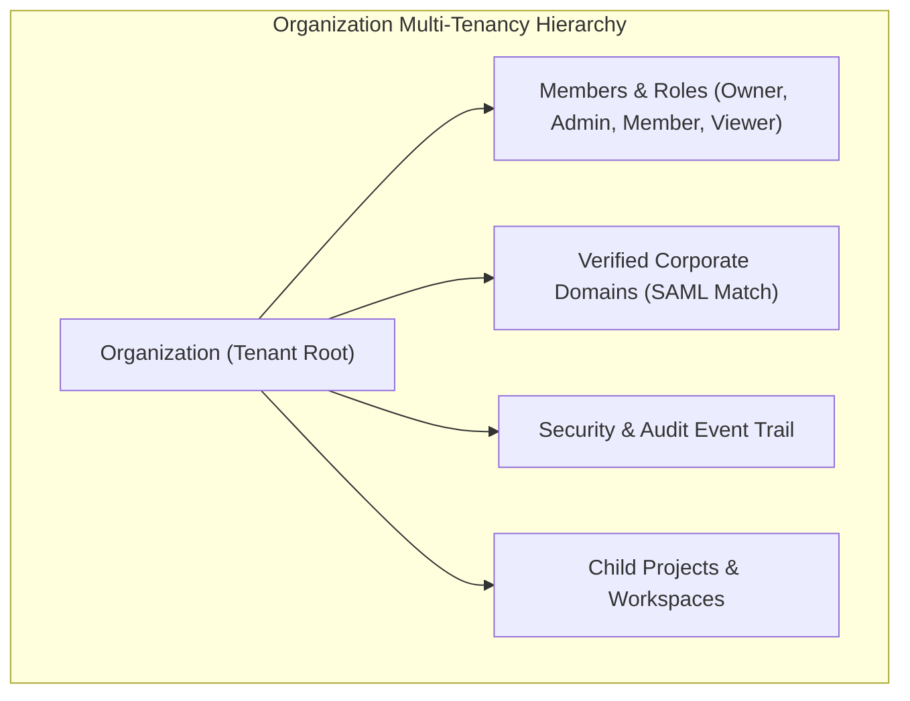

# Organization Module Architecture

The **Organization Module** serves as the multi-tenancy foundation of the Pulsiv platform. It governs organization hierarchy, workspace provisioning, role-based access control (RBAC), domain verification, member invitation lifecycles, and immutable security audit logs.

---

## 1. Core Architectural Responsibilities

1. **Multi-Tenant Root Boundary**: Every entity (projects, alerts, billing, telemetry) belongs directly or indirectly to an `organization_id`.
2. **Role-Based Access Control (RBAC)**: Enforces fine-grained permission matrices across `Owner`, `Admin`, `Member`, and `Viewer` roles.
3. **Invitation & Domain Lifecycle**: Supports email-based invitations with cryptographically signed tokens and auto-joining via verified corporate email domains (`@company.com`).
4. **Comprehensive Audit Logging**: Immutable ledger capturing all destructive and administrative actions (`member.invited`, `role.updated`, `api_key.rotated`, `sso.configured`).

---

## 2. Key Components & Files

| Component | Location | Description |
| :--- | :--- | :--- |
| **`routes.ts`** | [`pulse/src/modules/organization/routes.ts`](file:///c:/Users/vikas/OneDrive/Desktop/SaasBackend/pulse/src/modules/organization/routes.ts) | Fastify routes for org management, membership, invites, and domains. |
| **`organizationservice.ts`** | [`pulse/src/modules/organization/organizationservice.ts`](file:///c:/Users/vikas/OneDrive/Desktop/SaasBackend/pulse/src/modules/organization/organizationservice.ts) | Core tenant management orchestrator. |
| **`members/`** | [`pulse/src/modules/organization/members/`](file:///c:/Users/vikas/OneDrive/Desktop/SaasBackend/pulse/src/modules/organization/members/) | Member listing, role assignment, and removal handlers. |
| **`invitations/`** | [`pulse/src/modules/organization/invitations/`](file:///c:/Users/vikas/OneDrive/Desktop/SaasBackend/pulse/src/modules/organization/invitations/) | Token-based invitation generation and acceptance workflow. |
| **`audit-logs/`** | [`pulse/src/modules/organization/audit-logs/`](file:///c:/Users/vikas/OneDrive/Desktop/SaasBackend/pulse/src/modules/organization/audit-logs/) | Structured audit trail generator and viewer. |
