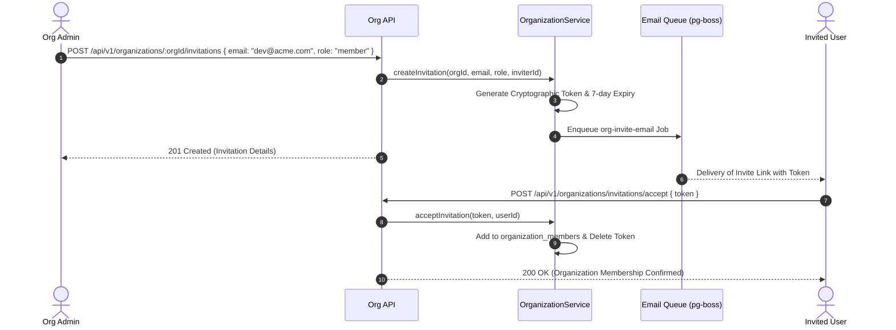

# Organization Module Working & Operational Guide

This document describes the operational workflows, invitation acceptance lifecycles, and API specifications for the **Organization Module**.

---

## 1. Member Invitation Workflow

---

## 2. API Endpoints

- **`GET /api/v1/organizations`**: Lists organizations current user belongs to.
- **`POST /api/v1/organizations`**: Creates a new organization workspace.
- **`GET /api/v1/organizations/:orgId/members`**: Lists members and roles.
- **`POST /api/v1/organizations/:orgId/invitations`**: Invites a new team member.
- **`GET /api/v1/organizations/:orgId/audit-logs`**: Retrieves audit trail filtered by actor, action, and date range.
