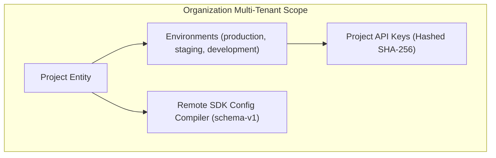

# Projects Module Architecture

The **Projects Module** manages project containers, development/staging/production environments, API keys, and Remote SDK Configuration Compilation & Delivery.

---

## 1. Core Architectural Responsibilities

1. **Project & Environment Lifecycle**: Projects contain isolated environments with dedicated API keys and telemetry settings.
2. **API Key Generation & Rotation**: Keys follow the format `pk_<env>_<public_prefix>_<secret>`. The secret is hashed with SHA-256 before storage; the raw key is displayed to the user only once.
3. **Graceful Key Rotation**: Supports dual-active key grace periods (`project_api_key_rotations`) preventing service outages during automated credential rotation.
4. **Remote SDK Config Compiler**: Compiles sampling rules, telemetry toggles, and route URLs into versioned JSON configs advertised to client SDKs.

---

## 2. Key Components & Files

| Component | Location | Description |
| :--- | :--- | :--- |
| **`projects.module.ts`** | [`pulse/src/modules/projects/projects.module.ts`](file:///c:/Users/vikas/OneDrive/Desktop/SaasBackend/pulse/src/modules/projects/projects.module.ts) | Fastify plugin registration for project endpoints. |
| **`sdk-config/`** | [`pulse/src/modules/projects/sdk-config/`](file:///c:/Users/vikas/OneDrive/Desktop/SaasBackend/pulse/src/modules/projects/sdk-config/) | Remote SDK configuration schema-v1 compiler and delivery engine. |
| **`api-keys/`** | [`pulse/src/modules/projects/api-keys/`](file:///c:/Users/vikas/OneDrive/Desktop/SaasBackend/pulse/src/modules/projects/api-keys/) | API key issuance, prefixing, hashing, and rotation management. |
