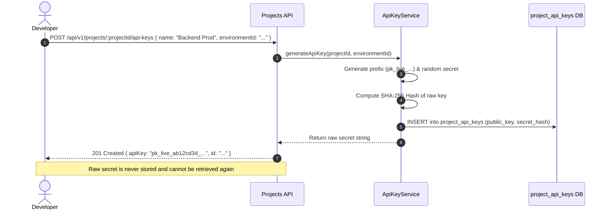

# Projects Module Working & Operational Guide

This document describes the API key generation lifecycle, SDK configuration compilation, and API routes of the **Projects Module**.

---

## 1. API Key Generation & Rotation Flow

---

## 2. API Endpoints

- **`GET /api/v1/projects`**: Lists all projects in active organization.
- **`POST /api/v1/projects`**: Creates a new project with default environments (`production`, `staging`, `development`).
- **`POST /api/v1/projects/:projectId/api-keys`**: Issues a new API key.
- **`POST /api/v1/projects/:projectId/api-keys/:keyId/rotate`**: Starts graceful key rotation with configurable grace period.
- **`GET /api/v1/projects/:projectId/sdk-config`**: Retrieves compiled SDK configuration payload.
