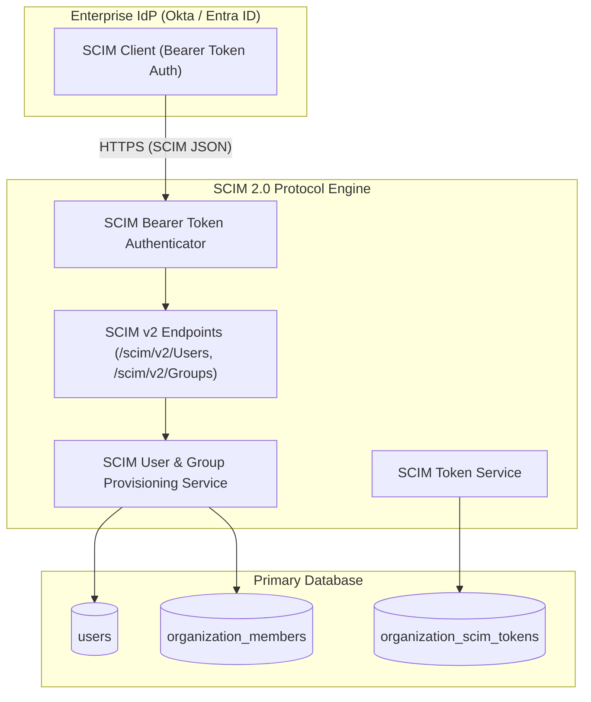

# SCIM 2.0 Module Architecture

The **SCIM 2.0 Module** implements the RFC 7643 and RFC 7644 System for Cross-domain Identity Management protocol. It allows enterprise identity providers (Okta, Microsoft Entra ID / Azure AD, OneLogin, PingIdentity) to automatically provision, update, and deprovision users and team memberships.

---

## 1. Core Architectural Responsibilities

1. **RFC 7644 SCIM REST Endpoints**: Implements `/scim/v2/Users` and `/scim/v2/Groups` for CRUD operations and PATCH updates.
2. **Automated Lifecycle Synchronization**:
   - Creating a user in IdP automatically provisions the user in Pulsiv and adds them to the designated organization.
   - Deactivating a user in IdP immediately revokes all active sessions and sets `active: false`.
3. **Group-to-Role Mapping**: Synchronizes IdP group memberships to organization RBAC roles (`admin`, `member`, `viewer`).

---

## 2. Key Components & Files

| Component | Location | Description |
| :--- | :--- | :--- |
| **`scim.routes.ts`** | [`pulse/src/modules/scim/scim.routes.ts`](file:///c:/Users/vikas/OneDrive/Desktop/SaasBackend/pulse/src/modules/scim/scim.routes.ts) | SCIM 2.0 Fastify route handlers. |
| **`scim.service.ts`** | [`pulse/src/modules/scim/scim.service.ts`](file:///c:/Users/vikas/OneDrive/Desktop/SaasBackend/pulse/src/modules/scim/scim.service.ts) | SCIM user provisioning and group mapping engine. |
| **`scim.middleware.ts`** | [`pulse/src/modules/scim/scim.middleware.ts`](file:///c:/Users/vikas/OneDrive/Desktop/SaasBackend/pulse/src/modules/scim/scim.middleware.ts) | Validates tenant-scoped SCIM bearer tokens. |
| **`scim-token.service.ts`** | [`pulse/src/modules/scim/scim-token.service.ts`](file:///c:/Users/vikas/OneDrive/Desktop/SaasBackend/pulse/src/modules/scim/scim-token.service.ts) | Issues, hashes, and validates SCIM enterprise tokens. |
