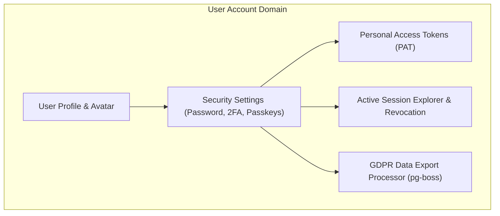

# User Account Module Architecture

The **User Account Module** governs user profile information, personal access tokens (PAT), security preferences, session management, and GDPR-compliant user data exports.

---

## 1. Core Architectural Responsibilities

1. **Profile & Identity Management**: Updates user display name, avatar, bio, and communication preferences.
2. **Personal Access Tokens (PAT)**: Issues developer CLI/API tokens with custom expiration and granular scopes.
3. **Session Governance**: Displays active sessions with parsed browser, operating system, IP address geolocation, and last active timestamp.
4. **Asynchronous GDPR Data Export**: Enqueues user data compilation into background workers (`user-data-export` queue) generating encrypted zip archives.

---

## 2. Key Components & Files

| Component | Location | Description |
| :--- | :--- | :--- |
| **`routes.ts`** | [`pulse/src/modules/user-account/routes.ts`](file:///c:/Users/vikas/OneDrive/Desktop/SaasBackend/pulse/src/modules/user-account/routes.ts) | Fastify routes for profile updates, sessions, tokens, and exports. |
| **`service.ts`** | [`pulse/src/modules/user-account/service.ts`](file:///c:/Users/vikas/OneDrive/Desktop/SaasBackend/pulse/src/modules/user-account/service.ts) | User account domain logic. |
| **`queue.ts`** | [`pulse/src/modules/user-account/queue.ts`](file:///c:/Users/vikas/OneDrive/Desktop/SaasBackend/pulse/src/modules/user-account/queue.ts) | pg-boss background worker for asynchronous user data export. |
