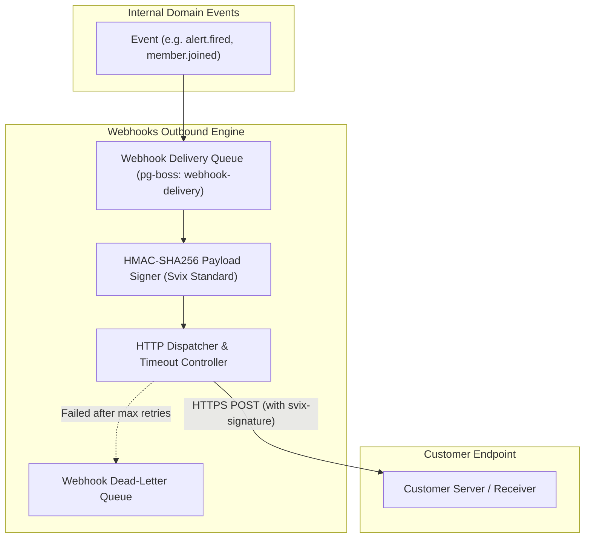

# Webhooks Module Architecture

The **Webhooks Module** manages outbound webhook dispatch, cryptographic HMAC signature generation, Svix integration, delivery tracking, and dead-letter queues.

---

## 1. Core Architectural Responsibilities

1. **Cryptographic HMAC Signatures**: Generates `svix-id`, `svix-timestamp`, and `svix-signature` (HMAC-SHA256) headers on all outgoing payloads to allow recipients to verify payload integrity and thwart replay attacks.
2. **Exponential Backoff & Retries**: Automatically retries failed dispatches (5xx, timeouts) up to 5 times over an exponential backoff schedule.
3. **Dead-Letter Queue & UI Inspection**: Captures delivery attempts, response status codes, latency, and response bodies in `webhook_deliveries` for developer debugging.

---

## 2. Key Components & Files

| Component | Location | Description |
| :--- | :--- | :--- |
| **`signer.ts`** | [`pulse/src/modules/webhooks/signer.ts`](file:///c:/Users/vikas/OneDrive/Desktop/SaasBackend/pulse/src/modules/webhooks/signer.ts) | HMAC-SHA256 signature generator. |
| **`sender.ts`** | [`pulse/src/modules/webhooks/sender.ts`](file:///c:/Users/vikas/OneDrive/Desktop/SaasBackend/pulse/src/modules/webhooks/sender.ts) | HTTP dispatch client with timeout and SSRF controls. |
| **`repository.ts`** | [`pulse/src/modules/webhooks/repository.ts`](file:///c:/Users/vikas/OneDrive/Desktop/SaasBackend/pulse/src/modules/webhooks/repository.ts) | Endpoint registration and delivery log storage. |
