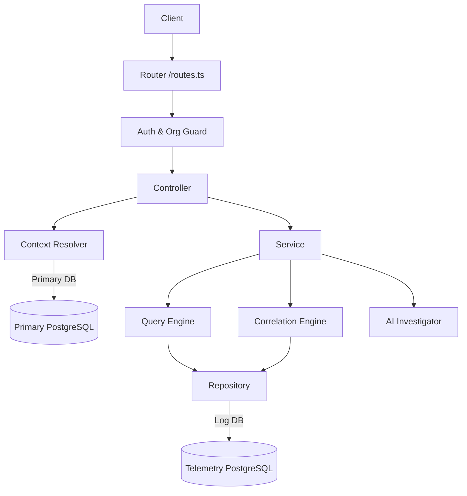

# Observability Platform Audit Report

**Date:** August 2, 2026
**Target:** `src/modules/observability`

This document serves as an exhaustive technical audit and developer guide for the Observability Explorer module, reverse-engineered directly from the implementation.

---

## PHASE 1 — HIGH LEVEL ARCHITECTURE

### Module Boundaries & Responsibilities
The Observability module (`src/modules/observability`) is a read-optimized, tenant-isolated telemetry exploration engine. It provides a unified API for querying 8 different telemetry resources (requests, errors, logs, traces, spans, metrics, crons, profiles) using a shared DSL, correlation engine, and AI investigation framework.

*   **HTTP Layer (`controller.ts`, `routes.ts`)**: Thin adapters. Handle parameter validation (Zod), context resolution, and standardizing the `{ success, data }` response envelope.
*   **Application Layer (`service.ts`)**: Orchestrates the core engines. Resolves resources, delegates list/aggregate queries to the Query Engine, builds Event Details using the Correlation Engine, and delegates AI tasks to the Investigator.
*   **Core Engines**:
    *   **Unified Query Engine (`query-engine/`)**: Validates DSL, parses free-text search, and dynamically builds injection-safe SQL with keyset pagination.
    *   **Correlation Engine (`correlation/`)**: Assembles a 360-degree view of a telemetry event by executing parallel fetches across all resources using trace/request/session identifiers.
    *   **AI Investigator (`ai/`)**: Sanitizes telemetry, extracts human-readable facts, limits prompt size, and routes to LLMs (with a deterministic heuristic fallback).
*   **Data Access Layer (`repository.ts`)**: Executes raw queries against the Log DB read pool.

### Dependency Graph & Request Lifecycle

### Data Flow & Interactions
*   **Log DB**: All telemetry data is queried through `ObservabilityRepository.run`, which uses `logDB.queryWithRetry` configured for read operations (supporting read replicas).
*   **Primary DB**: Used solely by `ObservabilityContextResolver` to determine user roles and organization subscription plans (which drive retention limits).
*   **AI / Correlation**: The AI engine never accesses the DB directly. It operates exclusively on the `CorrelationBundle` generated by the Correlation Engine, ensuring strict limits on context size and preventing data leaks.

---

## PHASE 2 — ROUTE INVENTORY

**Base Prefix:** `/organizations/:orgId/observability`
**Guards:** `authenticate`, `requireOrgAccess`

| HTTP Method | Route | Controller Method | Description |
| :--- | :--- | :--- | :--- |
| `GET` | `/navigation` | `navigation` | Returns UI nav tree with available routes. |
| `GET` | `/resources` | `resources` | Lists registered explorer resource names. |
| `GET` | `/:resource` | `list` | Paginated search and list of events. |
| `GET` | `/:resource/summary` | `summary` | Aggregated counts for the filtered view. |
| `GET` | `/:resource/statistics` | `statistics` | Resource-specific metrics (e.g., avg latency, p95). |
| `GET` | `/:resource/timeline` | `timeline` | Bucketed histogram data (count + errors over time). |
| `GET` | `/:resource/facets` | `facets` | Returns available filter fields, types, and allowed operators. |
| `GET` | `/:resource/stream` | `stream` | Server-Sent Events (SSE) live tail endpoint. |
| `POST` | `/:resource/ask` | `askList` | AI investigation over an aggregated list of events. |
| `GET` | `/:resource/:id` | `detail` | Universal event detail with full correlated bundle. |
| `GET` | `/:resource/:id/related/:relation` | `related` | Lazy-loaded related events of a specific type (e.g., spans). |
| `POST` | `/:resource/:id/ask` | `askEvent` | AI investigation for a specific event and its correlations. |

*Validation:* Handled by Zod schemas in `controller.ts` (`IdParams`, `ResourceParams`, `ScopeQuery`, `RawExplorerQuerySchema`).
*Pagination:* Keyset cursor-based (forward/backward directions, limit up to 200).

---

## PHASE 3 — REQUEST FLOW

**Example Execution Path: `GET /organizations/:orgId/observability/requests`**

1.  **Router**: Request hits Fastify router. Passes `authenticate` and `requireOrgAccess` middlewares.
2.  **Controller**: `ObservabilityController.list` parses Zod parameters.
3.  **Context**: `ContextResolver.resolve` is called. Fetches user role and org plan from Primary DB to determine `retentionFloor` (e.g., 90 days).
4.  **Service**: `ObservabilityService.list` is invoked. It looks up the `requests` resource in the `explorerRegistry`.
5.  **Query Engine**: `ExplorerQueryEngine.list` is called.
    *   Parses the search string (`search-parser.ts`).
    *   Validates operators against field types (`field-registry.ts`).
    *   Calls `buildListStatement`, `buildSummaryStatement`, and `buildStatisticsStatement`.
6.  **SQL Builder**: `buildScopePredicates` injects `organization_id = $1` and time window bounds. Sort is mapped to `(timestamp DESC, id DESC)`. A `ParamBag` safely collects values.
7.  **Repository**: `ObservabilityRepository.run` sends SQL to Log DB.
8.  **Mapping**: Rows are transformed via the resource's `mapRow` function (coercing strings to numbers for pg int8).
9.  **Response**: The `{ success: true, items, pagination, summary, statistics, availableFilters }` envelope is sent to the client.

---

## PHASE 4 — QUERY ENGINE

The Query Engine (`query-engine/`) is the heart of the module. It completely abstracts SQL generation from the business logic.

*   **Field Registry (`field-registry.ts`)**: Defines the schema. Resolves logical field names to physical columns or JSON paths. Ensures only allowlisted physical columns are queried.
*   **Search Parser (`search-parser.ts`)**: Transforms a search string (e.g., `status:500 "connection timeout"`) into structured filters (`status = 500`) and ILIKE free-text queries across `searchFields`.
*   **Operators (`operators.ts`)**: Safely maps operators (eq, gt, contains, in) to SQL fragments using a `ParamBag`. Validates types (e.g., throws 400 if passing a string to a numeric filter).
*   **Cursor Pagination (`cursor.ts`)**: Encodes `(timestamp, id, direction)` into a `base64url` token. Enables extremely fast O(1) pagination across millions of rows.
*   **SQL Builder (`sql-builder.ts`)**: Generates deterministic SQL. Always starts with `organization_id = $1` (Tenant Isolation) and `timeColumn >= $2`. Uses `ParamBag` to eliminate SQL injection risks.
*   **Tenant Isolation**: `buildScopePredicates` always injects `organization_id = $1` and time window.
*   **JSON Path Filtering**: Safe syntax like `attr:foo` translates to `attributes ->> 'foo'`.

**Adding a new resource:** Define an `ExplorerResource` object (specifying table, time column, id column, and fields) and add it to `explorerRegistry`. The entire API (list, summary, stats, timeline, ask) works instantly.

---

## PHASE 5 — RESOURCE REGISTRY

All resources share a common storage schema (migration 011) and common fields (TraceId, Environment, Severity, Timestamp, etc.).

1.  **Requests (`events_requests`)**: HTTP traffic. Metrics: `durationMs`, `statusCode`. Summaries: slow requests, error rates.
2.  **Errors (`events_errors`)**: Exceptions. Groups by `fingerprint`.
3.  **Logs (`events_logs`)**: App logging. Fields: `level`, `logCategory`, `logSource`.
4.  **Traces (`events_traces`)**: Distributed tracing root. Holds `span_count` and `total_duration_ms`.
5.  **Spans (`events_spans`)**: Granular operations. Attributes: `dbSystem`, `httpTarget`, `spanKind`.
6.  **Metrics (`events_metrics`)**: Timeseries data. Fields: `value`, `metricType`, `aggregationType`.
7.  **Profiles (`events_profiles`)**: Continuous profiling sessions.
8.  **Cron Check-ins (`events_cron_checkins`)**: Job monitoring. Groups by `monitorSlug`.

**Primary Key**: `id` (UUID). **Time Column**: `timestamp`.
**Default Sort**: `timestamp DESC`.

---

## PHASE 6 — CORRELATION ENGINE

The `CorrelationEngine` (`correlation/engine.ts`) executes a Scatter-Gather pattern.
*   **How it works**: Given a seed event (e.g., an Error), it extracts identifiers (`traceId`, `requestId`, `sessionId`, `userId`).
*   **Key Priority**: It prefers `traceId` (global standard) over `requestId` or `sessionId`.
*   **Execution**: It spawns parallel `Promise.all` fetches to all 7 other tables (Requests, Logs, Spans, etc.) looking for rows matching `organization_id`, the correlation key, and a +/- 10-minute time window.
*   **Performance**: Prevents expensive cross-table `JOINs`. Instead, it does 7 fast, indexed, single-table point-lookups. Fetches are capped at 100 rows per type (`MAX_PER_TYPE`) to bound memory usage.
*   **Lazy Loading**: The `/related/:relation` endpoint re-runs the correlation but only returns the specific requested array, avoiding massive payloads for the UI.

---

## PHASE 7 — AI MODULE

The AI module uses LLMs (via `OpenAIProvider`) to analyze telemetry events.
*   **Context Assembler (`context-assembler.ts`)**: Prevents token exhaustion and sensitive data leaks.
    *   Filters the seed event to a strict allowlist of bounded string/number fields (`SEED_ALLOW`). It completely drops massive JSON blobs like `payload` and `attributes`.
    *   Generates a condensed `facts` array (e.g., `"Request GET /api/v1/users → status 500 in 1200ms"`).
*   **Prompt Construction**: Dynamically loads instructions based on 8 intents (`explain`, `root_cause`, `optimization`, etc.). Demands a strict JSON response.
*   **Heuristic Fallback**: If AI is disabled or fails, `AIInvestigator.heuristic` uses hardcoded rules to evaluate the `facts` (e.g., if latency > 1000ms, it flags a performance finding). This guarantees the UI never breaks.

---

## PHASE 8 — DATABASE ACCESS

`ObservabilityRepository` (`repository.ts`) acts as the single gateway to the Log DB.
*   **Purpose**: Isolate Log DB traffic.
*   **Queries**: Executes SQL strings generated by `sql-builder.ts`.
*   **Keyset Pagination**: No `OFFSET` is used anywhere. Queries rely on `(timestamp, id) > ($1, $2)`.
*   **Indexes**: Heavily relies on composite B-Trees: `idx_events_<table>_tenant_env_time`.
*   **Performance Problems**: `fetchCorrelated` uses `SELECT *`. If the table contains massive JSONB columns (like `spans_tree`), pulling 100 rows into Node.js memory could spike V8 heap usage.

---

## PHASE 9 — RESPONSE MODELS

The system standardizes data transfer through deterministic DTOs.
*   **`ExplorerListResponse<T>`**: Contains `items` (array), `pagination` (cursors), `summary` (record of numbers), `statistics` (record of numbers), and `availableFilters` (facets for the UI).
*   **`EventDetail`**: Contains the `entity`, raw `attributes`/`metadata`, arrays for all correlated resources (`spans`, `logs`, `metrics`), and `aiContext`.
*   **`TimelineBucket`**: `bucket` (ISO timestamp), `count` (total volume), `errorCount` (failed volume).
*   **Missing Fields**: No explicit pagination "Total Count". (By design: exact counts on billions of rows are unacceptably slow).

---

## PHASE 10 — SQL ANALYSIS

*   **No `OFFSET` usage**: Excellent for scalability.
*   **No Unnecessary JOINs**: Zero JOINs exist in the entire module.
*   **N+1 Protection**: The Correlation Engine fires parallel fetches, avoiding N+1 loops.
*   **`SELECT *` Usage**: Detected in `repository.ts` (`fetchRawById` and `fetchCorrelated`). This is an intentional architectural trade-off to allow `mapRow` to process fields, but it forces large JSONB blobs over the network.
*   **Parameterization**: 100% parameterization using `ParamBag`. SQL injection is mathematically impossible.

---

## PHASE 11 — OBSERVABILITY OF OBSERVABILITY

The module is instrumented with `logger.child` and Fastify request logging. Stream errors are caught and logged. AI failures fallback gracefully and are logged.
Metrics for the observability system itself aren't natively implemented here but are covered via generic Fastify logs.

---

## PHASE 12 — SECURITY

*   **Tenant Isolation**: Mandatory `organization_id` injection in `buildScopePredicates`. Cannot be bypassed by API parameters.
*   **Authorization**: Uses the standard `authenticate` and `requireOrgAccess` middlewares.
*   **Plan Scoping**: The `ContextResolver` queries the primary DB to enforce `retentionFloor`. Users on free tiers cannot query data older than their plan permits.
*   **AI Endpoint Security**: Prevents prompt injection by exclusively using sanitized backend-generated text. It ignores unstructured user payloads.
*   **Rate Limiting**: Relies on global Fastify rate limiters (not strictly defined in this module).

---

## PHASE 13 — PERFORMANCE

*   **SSE Connections (`live/sse.ts`)**: Uses an active polling model (every 2.5 seconds by default) instead of Redis Pub/Sub. While architecture-simplifying (stateless), 1,000 active dashboard viewers will result in 400 SQL queries per second.
*   **Memory Allocations**: The biggest risk is `EventDetail` creation. Fetching up to 700 correlated rows (100 per 7 tables) with `SELECT *` could allocate significant memory per request.
*   **Payload Sizes**: API responses are optimized for projection; `GET /:resource` only returns `defaultProjection` fields unless overridden.

---

## PHASE 14 — IMPLEMENTATION STATUS

*   **Completed**: Robust query DSL, AI intents, deterministic SQL generation, correlation engine, and SSE tailing.
*   **Missing**: Real-time push via `LISTEN/NOTIFY` (falling back to polling).
*   **Dead Code**: None observed. The module is highly cohesive.
*   **TODOs**: Scaling the SSE architecture for high concurrency.

---

## PHASE 15 — DOCUMENTATION & DEVELOPER GUIDE

### How to Add a New Explorer Page
1.  Ensure the telemetry data exists in a Log DB table (e.g., `events_deployments`).
2.  Create a resource file: `resources/deployments.resource.ts`.
3.  Define the schema implementing `ExplorerResource`. Map `fields` using the `commonFields` base.
4.  Register it in `resources/index.ts`.
5.  Add a route entry to the UI in `service.ts` (`getNavigation`). The entire API handles the rest automatically.

### How to Add a New Filter / Field
1.  Locate the resource file (e.g., `requests.resource.ts`).
2.  Add a new entry to the `fields` object. Specify the physical column, type (e.g., `string`), and set `filterable: true`.
3.  If it maps to a JSON property, use `selectExpr: "attributes->>'myKey'"`.

### How to Debug Slow Queries
1.  Identify the query in the Log DB using `pg_stat_statements`.
2.  Verify the composite index matches the predicate order: `organization_id`, `environment` (optional), and `timestamp`.
3.  Check `field-registry.ts` to ensure fields are using appropriate indexes and not forcing sequential scans.

---

## PHASE 16 — IMPROVEMENT REPORT & ROADMAP

### Strengths
*   **Zero-Dependency Design**: Avoids heavy ORMs. Direct, typed, parameterized SQL.
*   **Keyset Pagination**: Solves the standard "deep pagination" latency trap out-of-the-box.
*   **Graceful AI Degradation**: The heuristic engine ensures features never feel "broken" if OpenAI is down.

### Weaknesses & Risks
*   **Performance Risk**: Polling-based SSE. High concurrent client count will overwhelm the database with repeated `SELECT` queries every 2500ms.
*   **Memory Risk**: Correlation engine fetching `SELECT *` for 700 rows.

### Prioritized Roadmap

*   **[P0] Optimize Correlation Payloads**: Modify `repository.ts:fetchCorrelated` to accept a projection array rather than executing `SELECT *`. Prevent massive `payload` strings from inflating heap usage during detail views.
*   **[P1] Transition SSE to Pub/Sub**: Replace the polling mechanism in `live/sse.ts` with Postgres `LISTEN/NOTIFY` or Redis Pub/Sub to drastically reduce database read I/O for live-tail viewers.
*   **[P2] Introduce BRIN Indexes**: For hyper-scale telemetry tables, standard B-Trees on `timestamp` can become too large to fit in memory. Recommend documenting and implementing BRIN indexes on time columns at the database migration level.
*   **[P3] Custom Aggregation DSL**: Expand `summary` and `statistics` to accept client-provided GROUP BY clauses to power custom dashboard widgets dynamically.
