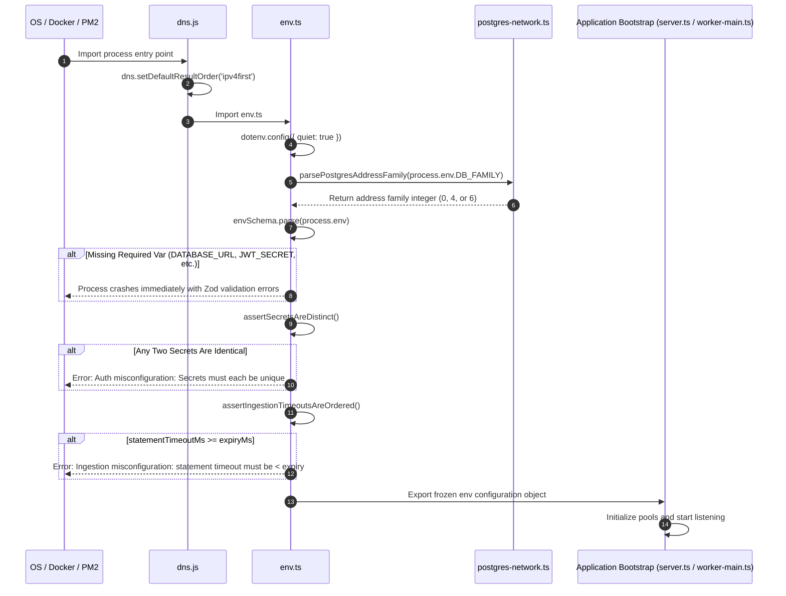

# Configuration & Environment Reference

## 1. System Role & Responsibilities

The Configuration and Environment subsystem provides centralized, runtime-validated configuration parsing, environment normalization, secret isolation verification, and boot-time invariant enforcement across all Pulse API and worker processes.

### What the Subsystem Does
- **Strict Zod Schema Validation**: Loads environment variables from `.env` and host environment via [`src/config/env.ts`](file:///c:/Users/vikas/OneDrive/Desktop/SaasBackend/pulse/src/config/env.ts), coercing types, enforcing defaults, and terminating process startup immediately (`fail-fast`) if required variables are absent or invalid.
- **Cryptographic Secret Distinctness Assertion**: Validates that all five primary application secrets (`JWT_SECRET`, `JWT_REFRESH_SECRET`, `COOKIE_SECRET`, `AUTH_TOKEN_SECRET`, `ENCRYPTION_KEY`) are mutually distinct, preventing cross-protocol cryptographic token confusion.
- **Ingestion Timeout Ordering Invariant**: Enforces at startup that `INGESTION_LOG_DB_STATEMENT_TIMEOUT_MS` is strictly less than `INGESTION_JOB_EXPIRE_SECONDS`, preventing transaction overlap and duplicate worker execution during long database queries.
- **DNS Family Normalization**: Preloads [`src/config/dns.js`](file:///c:/Users/vikas/OneDrive/Desktop/SaasBackend/pulse/src/config/dns.js) across all entry points, configuring Node.js address selection (`ipv4first`) to protect against IPv6 blackholes when connecting to cloud database providers.
- **Connection Pool Capacity Budgeting**: Enforces per-subsystem pool ceilings (`DB_POOL_MAX`, `NOTIFICATION_POOL_MAX`, `LOG_POOL_MAX`, `QUEUE_POOL_MAX`, `QUEUE_COMMAND_POOL_MAX`) so multiple local or clustered processes do not exceed database `max_connections`.

### What the Subsystem Does NOT Do
- **Dynamic Hot Reloading**: Configuration is parsed and frozen at process startup; altering environment variables requires a rolling restart of the application container or PM2 process.
- **Plaintext Secret Printing**: Never outputs raw cryptographic tokens, database credentials, or API keys in application logs; connection strings are sanitized via `sanitizePostgresConnectionString`.

---

## 2. Code Traceability Map

| Component / Layer | Source File Path | Key Classes / Functions | Primary Responsibility |
| :--- | :--- | :--- | :--- |
| **Environment Schema & Validator** | [`src/config/env.ts`](file:///c:/Users/vikas/OneDrive/Desktop/SaasBackend/pulse/src/config/env.ts) | `envSchema`, `env`, `assertSecretsAreDistinct`, `assertIngestionTimeoutsAreOrdered` | Zod schema parsing, type coercion, boot-time security invariants, and exported `env` singleton. |
| **DNS Resolution Normalizer** | [`src/config/dns.js`](file:///c:/Users/vikas/OneDrive/Desktop/SaasBackend/pulse/src/config/dns.js) | `setDefaultResultOrder` | Forces `ipv4first` DNS resolution to resolve dual-stack cloud network latency issues. |
| **PostgreSQL SSL Resolver** | [`src/config/postgres-ssl.ts`](file:///c:/Users/vikas/OneDrive/Desktop/SaasBackend/pulse/src/config/postgres-ssl.ts) | `resolvePostgresSslConfig`, `sanitizePostgresConnectionString` | Strips passwords from logged URLs and maps SSL parameters to Node `pg.PoolConfig`. |
| **PostgreSQL Network Policy** | [`src/config/postgres-network.ts`](file:///c:/Users/vikas/OneDrive/Desktop/SaasBackend/pulse/src/config/postgres-network.ts) | `parsePostgresAddressFamily`, `withPostgresAddressFamily` | Injects IPv4 (`family: 4`) or IPv6 (`family: 6`) socket options into `pg` connection pools. |
| **Connection Budget Calculator** | [`src/config/connection-budget.ts`](file:///c:/Users/vikas/OneDrive/Desktop/SaasBackend/pulse/src/config/connection-budget.ts) | `logProcessConnectionBudget` | Computes aggregate connection footprints across all pools in the running process. |
| **Process Clustering Spec** | [`ecosystem.config.cjs`](file:///c:/Users/vikas/OneDrive/Desktop/SaasBackend/pulse/ecosystem.config.cjs) | PM2 cluster configuration | Defines standalone process topology (`api-server`, `ingestion-workers`, `analytics-workers`, `alert-workers`). |

---

## 3. Data Flow & Sequence Diagram

The following diagram illustrates how configuration is evaluated and validated during process boot:



---

## 4. Payloads & Data Contracts

### 4.1 Invariant Assertions
At boot time, `src/config/env.ts` enforces two runtime invariant assertions:

```typescript
// Invariant 1: Cryptographic secret segregation
function assertSecretsAreDistinct(): void {
  const distinct = new Set([
    env.JWT_SECRET,
    env.JWT_REFRESH_SECRET,
    env.COOKIE_SECRET,
    env.AUTH_TOKEN_SECRET,
    env.ENCRYPTION_KEY,
  ]);
  if (distinct.size < 5) {
    throw new Error(
      'Auth misconfiguration: JWT_SECRET, JWT_REFRESH_SECRET, COOKIE_SECRET, AUTH_TOKEN_SECRET, and ENCRYPTION_KEY must each be unique.',
    );
  }
}

// Invariant 2: Database transaction timeout ordering
function assertIngestionTimeoutsAreOrdered(): void {
  const statementTimeoutMs = env.INGESTION_LOG_DB_STATEMENT_TIMEOUT_MS;
  const expiryMs = env.INGESTION_JOB_EXPIRE_SECONDS * 1000;
  if (statementTimeoutMs > 0 && statementTimeoutMs >= expiryMs) {
    throw new Error(
      'Ingestion misconfiguration: INGESTION_LOG_DB_STATEMENT_TIMEOUT_MS ' +
        `(${statementTimeoutMs}ms) must be strictly less than INGESTION_JOB_EXPIRE_SECONDS ` +
        `(${env.INGESTION_JOB_EXPIRE_SECONDS}s = ${expiryMs}ms).`,
    );
  }
}
```

---

## 5. Edge Cases & Failure Recovery

### 5.1 Duplicate Secrets Across Environments
- **Failure**: A developer copies `.env.example` and pastes the same test key into `JWT_SECRET`, `JWT_REFRESH_SECRET`, and `AUTH_TOKEN_SECRET`.
- **Mitigation**: The `assertSecretsAreDistinct` validator calculates set cardinalities and immediately raises a fatal configuration exception, preventing cross-context token reuse attacks.

### 5.2 Transaction Leakage and Redelivery Deadlocks
- **Failure**: A database batch insert hangs due to a row lock. If `INGESTION_JOB_EXPIRE_SECONDS` is 300s and `INGESTION_LOG_DB_STATEMENT_TIMEOUT_MS` is unset (unbounded), PGMQ considers the job expired and redelivers it to another worker, while the original worker continues holding connection sockets and row locks.
- **Mitigation**: `assertIngestionTimeoutsAreOrdered` mandates that statement timeouts are bounded strictly below message visibility timeouts, terminating stuck queries in PostgreSQL before PGMQ redelivers the message.

### 5.3 Managed Serverless IPv6 Connectivity Drops
- **Failure**: Cloud PostgreSQL hosts (such as Supabase or Neon) advertise IPv6 addresses that intermittently hang when running on Docker or cloud VM environments without IPv6 routes.
- **Mitigation**: Setting `DB_FAMILY=4` forces all `pg.Pool` sockets to connect over IPv4. [`src/config/dns.js`](file:///c:/Users/vikas/OneDrive/Desktop/SaasBackend/pulse/src/config/dns.js) also sets `setDefaultResultOrder('ipv4first')` globally at startup.

---

## 6. Exhaustive Configuration Parameters

### 6.1 Server & Core Runtime

| Variable | Type | Default | Description |
| :--- | :--- | :--- | :--- |
| `NODE_ENV` | `enum` | `'development'` | Operating environment (`development`, `staging`, `production`, `test`). |
| `PORT` | `number` | `3000` | HTTP server port for API and ingestion gateway. |
| `HOST` | `string` | `'0.0.0.0'` | Bind address for Fastify server. |
| `UV_THREADPOOL_SIZE` | `number` | `8` | Libuv threadpool size for crypto and DNS offloading. |
| `PRESSURE_MAX_EVENT_LOOP_DELAY_MS` | `number` | `1500` | Event loop delay threshold triggering soft admission shedding. |
| `PRESSURE_CRITICAL_EVENT_LOOP_DELAY_MS` | `number` | `3500` | Event loop delay threshold triggering hard 503 load shedding. |
| `PRESSURE_MAX_EVENT_LOOP_UTILIZATION` | `number` | `0.95` | Event loop utilization ratio (0.5–1.0) triggering backpressure. |
| `PRESSURE_MAX_HEAP_MB` | `number` | `420` | V8 heap memory threshold (MB) triggering protective shedding. |
| `PRESSURE_MAX_RSS_MB` | `number` | `768` | Resident Set Size threshold (MB) triggering protective shedding. |
| `SHUTDOWN_TIMEOUT_MS` | `number` | `20000` | Maximum duration (ms) for graceful process shutdown before `SIGKILL`. |

### 6.2 Primary Database & Pools

| Variable | Type | Default | Description |
| :--- | :--- | :--- | :--- |
| `DATABASE_URL` | `string` | *(Required)* | PostgreSQL connection URL for control plane and PGMQ queues. |
| `DB_POOL_MAX` | `number` | `20` | Maximum connections for the main API database pool. |
| `DB_POOL_MIN` | `number` | `0` | Minimum idle connections (0 recommended for serverless). |
| `NOTIFICATION_POOL_MAX` | `number` | `10` | Dedicated pool size for notification delivery workers. |
| `DB_IDLE_TIMEOUT_MS` | `number` | `30000` | Idle connection eviction timeout in milliseconds. |
| `DB_CONNECTION_TIMEOUT_MS` | `number` | `30000` | TCP connection establishment timeout in milliseconds. |
| `DB_STATEMENT_TIMEOUT_MS` | `number` | `30000` | Server-side statement timeout applied to primary DB queries. |
| `DB_FAMILY` | `number` | `0` | Address family: `0` (auto), `4` (IPv4 only), `6` (IPv6 only). |
| `DB_SSL_ENABLED` | `boolean` | `true` | Enables TLS for PostgreSQL connections. |
| `DB_SSL_REJECT_UNAUTHORIZED` | `boolean` | `true` | Enforces certificate chain verification. |

### 6.3 Log Database (TimescaleDB)

| Variable | Type | Default | Description |
| :--- | :--- | :--- | :--- |
| `LOG_DB_PRIMARY` | `string` | `DATABASE_URL` | Connection URL for TimescaleDB telemetry primary instance. |
| `LOG_DB_REPLICA` | `string` | `undefined` | Optional read-replica URL for offloading dashboard queries. |
| `LOG_POOL_MAX` | `number` | `20` | Maximum connections for shared Log DB read operations. |
| `LOG_DB_WRITE_TIMEOUT` | `number` | `0` | Statement timeout for write transactions (`0` = unbounded). |
| `LOG_QUERY_TIMEOUT` | `number` | `30000` | Statement timeout for analytical read queries (ms). |
| `LOG_DB_ENABLE_TIMESCALE` | `boolean` | `true` | Promotes event tables to hypertables upon startup. |
| `LOG_DB_CHUNK_INTERVAL` | `string` | `'1 day'` | Hypertable partition chunk time window. |
| `LOG_DB_COMPRESS_AFTER` | `string` | `'7 days'` | Age threshold before chunks undergo TimescaleDB compression. |
| `LOG_DB_RETENTION` | `string` | `'90 days'` | Automated drop-chunk retention window. |
| `LOG_RETRIES` | `number` | `3` | Maximum retry attempts on transient Log DB socket errors. |

### 6.4 Security & Secrets

| Variable | Type | Default | Description |
| :--- | :--- | :--- | :--- |
| `JWT_SECRET` | `string` | *(Required)* | Secret key for signing 15-minute access JWTs (min 32 chars). |
| `JWT_REFRESH_SECRET` | `string` | *(Required)* | Isolated secret key for signing refresh tokens (min 32 chars). |
| `COOKIE_SECRET` | `string` | *(Required)* | Secret key for signing HTTP-only session cookies (min 32 chars). |
| `AUTH_TOKEN_SECRET` | `string` | *(Required)* | HMAC-SHA256 secret for sensitive bearer tokens (min 32 chars). |
| `ENCRYPTION_KEY` | `string` | *(Required)* | Exactly 32-byte key for AES-256 encryption of TOTP secrets at rest. |

### 6.5 Queue & Worker Subsystem

| Variable | Type | Default | Description |
| :--- | :--- | :--- | :--- |
| `QUEUE_POOL_MAX` | `number` | `20` | Connections reserved for PGMQ long-poll readers (`readWithPoll`). |
| `QUEUE_COMMAND_POOL_MAX` | `number` | `15` | Connections reserved for heartbeats, sends, deletions, and DLQ. |
| `QUEUE_BATCH_SIZE` | `number` | `50` | Default messages fetched per poll cycle. |
| `QUEUE_VISIBILITY_TIMEOUT_SECONDS` | `number` | `60` | Duration claimed messages remain hidden from other workers. |
| `QUEUE_POLL_SECONDS` | `number` | `0` | Long-poll duration in PostgreSQL before returning empty batch. |
| `QUEUE_MAX_ATTEMPTS` | `number` | `5` | Maximum delivery attempts before dead-letter routing. |
| `QUEUE_HEARTBEAT_INTERVAL_SECONDS` | `number` | `15` | Background `setVt` visibility extension cadence. |
| `QUEUE_DRAIN_TIMEOUT_MS` | `number` | `30000` | Graceful worker drain window during process termination. |

### 6.6 Ingestion Gateway & Fairness

| Variable | Type | Default | Description |
| :--- | :--- | :--- | :--- |
| `INGESTION_MAX_BATCH_SIZE` | `number` | `1000` | Maximum events accepted in a single HTTP POST request. |
| `INGESTION_JOB_CHUNK_SIZE` | `number` | `500` | Maximum events grouped into a single PGMQ worker job. |
| `INGESTION_JOB_MAX_BYTES` | `number` | `1048576` | Serialized byte limit (1MB) per PGMQ worker job. |
| `INGESTION_JOB_EXPIRE_SECONDS` | `number` | `300` | Visibility timeout (5m) for ingestion worker jobs. |
| `INGESTION_LOG_DB_STATEMENT_TIMEOUT_MS`| `number`| `60000` | Max duration (60s) for an ingest write transaction in Postgres. |
| `INGESTION_WRITE_POOL_SIZE` | `number` | `24` | Dedicated database connections for telemetry batch inserts. |
| `INGESTION_WRITE_CONCURRENCY` | `number` | `16` | Maximum concurrent batch write permits in ingestion worker. |
| `INGESTION_TYPE_WORKER_CONCURRENCY`| `number` | `2` | Worker concurrency slots per event type queue. |
| `INGESTION_FAIRNESS_MAX_DEFERS` | `number` | `5` | Max consecutive defers for over-quota tenants before admission. |
| `INGESTION_FAIRNESS_DEFER_DELAY_SECONDS`| `number`| `2` | PGMQ delay offset applied when deferring over-quota tenant jobs. |
| `INGESTION_WORKER_METRICS_PORT`| `number` | `9465` | Prometheus scrape port exposed by ingestion worker process. |

### 6.7 Alerting & Connector Pipelines

| Variable | Type | Default | Description |
| :--- | :--- | :--- | :--- |
| `CONNECTOR_GLOBAL_LIMIT` | `number` | `60` | Outbound request rate limit per connector per window. |
| `CONNECTOR_GLOBAL_WINDOW_SECONDS` | `number` | `60` | Rate limit window duration (seconds). |
| `CONNECTOR_CIRCUIT_FAILURE_THRESHOLD`| `number` | `5` | Consecutive failures before tripping connector circuit breaker. |
| `CONNECTOR_CIRCUIT_RESET_SECONDS` | `number` | `60` | Circuit breaker `open` duration before `half_open` probe. |
| `CONNECTOR_SEND_EXPIRE_SECONDS` | `number` | `45` | PGMQ visibility timeout for outbound notification delivery. |
| `ALERT_WINDOW_EVAL_INTERVAL_SECONDS` | `number` | `5` | Cadence for windowed rule evaluations on 1-minute rollups. |
| `ALERT_OPERATIONAL_EVAL_INTERVAL_SECONDS`| `number`| `30` | Cadence for system metric rule evaluations. |
| `ALERT_AI_EVAL_INTERVAL_SECONDS` | `number` | `300` | Cadence for AI token usage trend evaluations on 1-hour rollups. |
